# R&D Expenses · 研发支出实务标准工作流

> 本技能只讲**怎么做**——为处理研发费用 / 研发支出 / 研发投入 / 高企认定研发费用的各类问题，提供统一的方法论与工作流程。
> **适用**：研发活动定性、费用归集与加计、研发人员认定、研发产出处理、研发支出资本化、高企认定、IPO 研发投入、委外与合作研发、口径差异、行业专属口径、研发税务风险与合规。
> **不适用**：与研发无关的普通会计、税务、法务问题。
> **时效**：政策具时效性，涉及最新规定的，以官方发布为准并建议核验。
> 知识底座：`policy/`（法规原文、官方解读、监管规则、协会答疑、行业指引、整本书）与 `cases/`（真实案例），二者各自以 `README.md` 为索引入口。具体条款与案例不在本文件展开，检索时按索引定位。

---

## 一、总则（贯穿全流程的七条原则）

| 原则 | 要求 |
|:---|:---|
| **实质合规 · 制度先行** | 财税合规的前提是**真实的研发活动**与**完善的研发管理**：规范研发流程，明确研发阶段划分与资本化时点，健全研发内控。制度与流程建设优先于事后补救，解读与建议均不以形式包装替代实质。 |
| **口径一致** | 先定口径——会计 / 加计扣除 / 高企认定 / IPO 研发投入 / 统计；全流程围绕同一口径推进。涉及多个口径时分别给结论、并列呈现，绝不混用（**跨口径不得外推**：窄口径不满足不代表宽口径不满足，宽口径已计入也不代表窄口径可归集）。 |
| **整体优先** | 对问题所属板块先通读、再整体解读；反对对单一条款或单一案例的孤立、割裂式解读。 |
| **财税协调** | 同一事项的会计处理与税务处理尽量对齐，主动识别、解释二者差异，减少口径矛盾。 |
| **原文可溯源** | 结论必须附库内原文出处（policy 条款 或 case 编号），不以转述代替原文。 |
| **依据分级** | 结论须标注依据强度——明文条款 / 仅类比案例 / 库内无据——并把类比当类比，不把类比当定论；引用案例时**须同时标明其证据性质**（见下表），不得把不同性质的案例混称"正面 / 反面"。 |
| **尽责与免责** | 库内无据则如实说明，不臆测、不编造；输出为分析草稿，不构成税务、审计或法律意见。 |

### 案例性质与证据力（引用案例前必读）

`cases/` 内案例按**来源性质**分五类。性质不同，能支撑的结论不同——**稽查通报是已定性的违法，IPO 问询只是审核问过、发行人答过，二者证据力完全不同**。

| 性质 | 编号 | 是什么 | 能支撑 | 不能当作 |
|:---|:---|:---|:---|:---|
| **稽查处罚 / 曝光通报** | 01–21（08–21 见案例集 1–5）、28、33–40、53–56 | 税务机关已作出处理处罚，或官方公开曝光的事实 | "这样做被认定违规、后果是什么"——违规认定的强证据 | 不代表同类情形必然被同样定性 |
| **项目鉴定** | 22–27、29–32 | 科技部门专家对项目是否属研发活动的鉴定意见 | "这类项目属／不属研发活动"的判定思路与指标 | 只对被鉴定项目有效，不能类推全部同类 |
| **IPO 问询** | 41–44、46–51、57–61、63–67、74–87 | 交易所问询与发行人答复 | "监管关注什么、发行人如何论证"——审核口径与论证范式 | **不是违规定性**；问过 ≠ 有错，答过 ≠ 被认可 |
| **正面合规典型** | 68–72 | 税务与科技部门官方发布的合规做法 | "这样做被官方认可"——做法可复制 | 不代表未列入的做法就不合规 |
| **司法裁判** | 62、73 | 法院生效判决 | 程序与实体争议的最终结论 | 个案裁判，不当然适用于其他主体 |

编号区间与逐案来源见 `cases/README.md` 第一章；45、52 永久空置。

---

## 二、六步工作流

```mermaid
flowchart TD
  S1["1 需求分析<br/>定口径 · 定板块 · 找缺口"] --> S2["2 任务规划<br/>定路径 · 拆子问题"]
  S2 --> S3["3 资料收集<br/>取企业事实 · 必要时调研"]
  S3 --> S4["4 知识查找<br/>经 README 索引定位 policy / cases"]
  S4 --> S5["5 结合实际解读<br/>整体解读 · 财税协调 · 调用子技能"]
  S5 --> S6["6 建议与方案<br/>建议 · 口径 · 风险"]
```

### 1. 需求分析

- **目的**：把口语化的问题定性。
- **做法**：判定适用口径；判定**任务类型**（对照下方「任务分派」表）；定位问题所属知识板块（研发活动定性 / 费用归集与加计 / 研发人员认定 / 研发产出 / 研发支出资本化 / 高企认定 / IPO 研发投入 / 委外与合作研发 / 行业专属 / 税务风险 / 合规做法）；识别信息缺口。
- **产出**：问题定性 + 待补事实清单。

**需求明细**（把用户诉求归入下表，据此确定口径、任务与板块）：

| 需求类别 | 典型问法 | 归属 |
|:---|:---|:---|
| 活动定性 | 这笔 / 这个项目算不算研发？常规升级算吗？ | 板块·研发活动定性（各任务共同前置） |
| 费用归集与加计 | 能不能加计？归哪一类？限额怎么算？ | 优惠享受 / 财税处理 |
| 人员与工时 | 谁算研发人员？兼职和工时怎么分？ | 优惠享受 / 财税处理 |
| 研发产出 | 样机 / 样品 / 副产品 / 废料怎么处理？ | 财税处理 |
| 资本化与阶段划分 | 资本化时点？研究开发阶段怎么分？ | 财税处理 |
| 账务与辅助账 | 怎么入账？辅助账怎么设？ | 财税处理 |
| 资质与项目申报 | 高企 / 科小 / 专精特新怎么报？材料怎么审？ | 项目申报 |
| 税收优惠享受 | 能不能享受、享受多少、何时享受、备查？ | 优惠享受 |
| 委外与合作研发 | 委托 / 合作 / 外购研发怎么处理？ | 优惠享受 / 财税处理 |
| IPO 研发投入 | IPO 研发投入怎么核？问询怎么答？ | 财税处理（发行口径） |
| 行业专属口径 | 我们行业有什么特殊规定？ | 各任务按需（分行业指引） |
| 制度建设与内控 | 研发管理与内控怎么建？ | 内控建设与流程优化 |
| 风险自查 | 我们这样有没有风险？ | 风险评估诊断 |
| 稽查应对 | 被查了、有异议怎么办？ | 稽查审查应对 |

### 2. 任务规划

- **目的**：为本题规划解决路径。
- **做法**：确定需要哪些资料、检索哪些文件、是否需要调用子技能、输出的形态与深度；复杂问题拆解为子问题。
- **产出**：可执行的检索与作答计划。

### 3. 资料收集

- **目的**：补齐「企业实际」这一半。
- **做法**：向用户索取关键事实（所属行业、适用口径、所属期间、具体支出或事项、现有处理方式等）；信息不足时主动提问；必要时对企业实际情况开展调研核实，并就政策时效与最新口径联网核验。
- **产出**：企业事实要素 + 必要的调研结论。

**资料收集明细**（按下表向用户收集，可分批，见「交互规则」）：

| 类别 | 需收集 |
|:---|:---|
| 企业基本信息 | 名称、所属行业、成立时间、征收方式（查账 / 核定）、是否负面清单行业 |
| 资质与清单 | 是否高企 / 科小 / 专精特新；是否集成电路 / 工业母机清单内企业 |
| 研发活动 | 研发项目清单与目标、研发形式（自主 / 委托 / 合作 / 集中）、立项与结题文件 |
| 人员 | 研发人员名单、工时记录、兼职与共用人员情况 |
| 费用 | 人员人工、直接投入、折旧与摊销、设计试验、其他相关费用明细 |
| 资产 | 研发用仪器设备、无形资产、共用资产及工时分摊依据 |
| 账务 | 会计科目设置、费用化 / 资本化处理、现有辅助账 / 台账 |
| 研发产出 | 样机 / 样品 / 副产品 / 废料及试生产产品的处理与销售情况 |
| 委外合作 | 委托 / 合作研发合同及登记、外购技术合同、支付凭证 |
| 申报与备查 | 已申报数据、留存备查资料现状 |
| 风险与程序 | 是否被稽查 / 核查、是否有异议事项 |

**调研明细**（在资料基础上，对企业实际情况开展调查核实）：

| 调研项 | 目的 | 方式 |
|:---|:---|:---|
| 业务与行业实质 | 判定行业归属与负面清单 | 访谈 + 查工商 / 年报 / 资质 |
| 研发活动真实性 | 确认研发活动真实存在 | 查立项 / 过程 / 结题记录，访谈研发人员 |
| 研发组织与管理 | 了解研发管理与内控现状 | 查阅制度，访谈研发 / 财务 |
| 技术领域与创新性 | 对标技术领域、判定研发属性 | 访谈技术人员，查技术资料 |
| 财务核算与归集 | 确认能否准确归集 | 查阅账套、辅助账、凭证 |
| 历史申报与涉税 | 了解既往归集申报与风险 | 查阅申报表、备查资料、税务记录 |

### 4. 知识查找

- **目的**：在库内定位与问题板块对应的政策与案例。
- **做法**：先读 `policy/README.md`、`cases/README.md` 两张索引，再定位到具体文件；法条与实务兼顾；对问题所属板块**成组取用**，而非只抓零散碎片；引用条款前核对其**现行效力**（是否已被后续文件修改、废止或替代）。
- **产出**：政策条款原文 + 正反案例清单。

### 5. 结合实际的详细解读

- **目的**：把知识落到企业的具体事实上。
- **做法**：以板块整体视角解读；协调会计与税务两种处理、标注并解释差异；回归合规前提（真实的研发活动 + 完善的研发管理），不以形式包装替代实质；命中特定板块时，改由对应**子技能**执行（见下方「任务分派」）。
- **产出**：分口径的分析结论 + 差异说明。

### 6. 提出建议与方案

- **目的**：给出可执行的方案。
- **做法**：提出处理建议 / 合规方案 / 风险提示；标明适用口径；建议优先落在制度建设与流程规范（研发流程、阶段划分与资本化时点、研发内控），而非仅作事后补救；必要时给出备选方案与取舍。
- **产出**：建议方案 + 风险提示。

### 交付物链

六步按序产出、逐环递进，最终汇入答复：

1. **问题定性 + 信息缺口清单**（第 1 步）
2. **执行计划**（第 2 步）
3. **企业事实要素 + 调研结论**（第 3 步）
4. **政策条款原文 + 正反案例清单**（第 4 步）
5. **分口径分析结论 + 差异说明**（第 5 步）
6. **建议方案**（第 6 步）
→ 汇总为**最终答复**（须满足下方「交付要求」）

### 任务分派

第 1 步判定任务类型，命中即打开对应子技能执行；**本文件只保留各任务共用的通用 SOP，子技能只写本任务增量，不重复本文件内容**。

| 任务类型 | 打开 |
|:---|:---|
| 项目申报（高企认定 / 科技型中小企业 / 专精特新 / 科技计划与研发项目申报；材料编制 · 整理 · 审核） | [`subskills/R&D-Expenses/subskills/rd-proj-application/SKILL.md`](subskills/R&D-Expenses/subskills/rd-proj-application/SKILL.md) |
| 优惠享受（加计扣除、高企税率、集成电路 / 工业母机 120%、委托境外） | [`subskills/R&D-Expenses/subskills/rd-tax-benefit/SKILL.md`](subskills/R&D-Expenses/subskills/rd-tax-benefit/SKILL.md) |
| 财税处理（会计与税务处理、辅助账编制、三口径差异） | [`subskills/R&D-Expenses/subskills/rd-accounting-tax/SKILL.md`](subskills/R&D-Expenses/subskills/rd-accounting-tax/SKILL.md) |
| 内控建设与流程优化（制度 · 流程 · 内控 · 文档体系） | [`subskills/R&D-Expenses/subskills/rd-internal-control/SKILL.md`](subskills/R&D-Expenses/subskills/rd-internal-control/SKILL.md) |
| 风险评估诊断（主动自查体检） | [`subskills/R&D-Expenses/subskills/rd-risk-diagnosis/SKILL.md`](subskills/R&D-Expenses/subskills/rd-risk-diagnosis/SKILL.md) |
| 稽查审查应对（已被查 / 有异议，含异议鉴定） | [`subskills/R&D-Expenses/subskills/rd-audit-response/SKILL.md`](subskills/R&D-Expenses/subskills/rd-audit-response/SKILL.md) |

- **研发活动定性**是各任务的共同前置，作为通用判据保留在本文件（第 1 步板块枚举），不单列子技能。
- 跨任务的问题按「主要诉求」归主任务，其余部分跨引用。
- **划界**：认定 / 资格归「项目申报」，认定后的优惠如何享受归「优惠享受」；主动体检归「风险评估诊断」，被动处置归「稽查审查应对」。

### 交付要求（强制）

每份答复固定包含以下要素，缺一不可：

- **口径声明**：本题适用口径；涉多口径时必须并列结论（口径差异提醒）。
- **来源**：policy 条款（文件名 → 条款）或 case 编号（编号 + 主体）。
- **正反佐证**：尽可能同时给出法规依据、反面案例（稽查 / 否定鉴定）与正面案例（合规典型 / 肯定鉴定）。
- **依据强度**：标注结论的依据等级（明文条款 / 类比案例 / 库内无据）；仅类比或库内无据的，须显式提示不确定性与风险。
- **建议方案**：可执行的处理建议。
- **免责声明**：本答复基于本库原文整理，为分析草稿，不构成税务、审计或法律意见。

### 交付前自检

答复前逐项核对，任一项不通过则先补齐再交付：

- [ ] 口径是否已声明？多口径是否并列、未混用？
- [ ] 财务处理与税务处理是否自洽？差异是否已标注并解释？
- [ ] 是否回归「真实的研发活动 + 完善的研发管理」这一合规前提？
- [ ] 每条结论是否都能溯源到 policy 条款 或 case 编号？
- [ ] 引用条款是否已核实现行有效（未被后续文件修改、废止或替代）？
- [ ] 结论依据强度是否已标注（明文条款 / 类比案例 / 库内无据）？
- [ ] 是否存在库内无据的臆测或编造？
- [ ] 是否只做孤立解读、而遗漏板块整体视角？
- [ ] 是否已附免责声明？

### 交互规则

1. **渐进式收集信息**：不一次性抛出所有问题，随对话自然、分批收集（清单见第 3 步）。
2. **前置门禁**：第 1 步判定后，若问题不属本技能适用范围，直接说明并终止，不强行作答。
3. **灵活跳转**：用户只需某一环节时，可直接进入对应步骤或子技能，不必从第 1 步走完。
