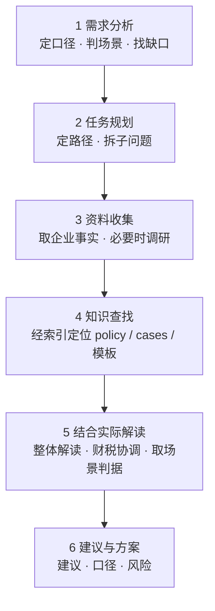

# R&D Expenses · 研发支出实务标准工作流

> 本技能只讲**怎么做**——为研发费用 / 研发支出 / 研发投入 / 高企认定研发费用的各类问题，提供**一套统一的标准工作流（SOP）**：**不设子技能，所有场景按同一套六步流程执行**，差别只体现在「二」的第 5 步按场景取用「三、场景要点」里的专属判据。
> **适用**：研发活动定性、费用归集与加计、研发人员认定、研发产出处理、研发支出资本化、高企认定、IPO 研发投入、委外与合作研发、口径差异、行业专属口径、研发税务风险与合规、制度建设与内控。
> **不适用**：与研发无关的普通会计、税务、法务问题。
> **时效**：政策具时效性，涉及最新规定的，以官方发布为准并建议核验。
>
> **资产地图**
> - 本文件 `SKILL.md`——总则（含案例性质）+ 六步标准工作流 + 场景要点，是全技能的**唯一执行入口**。
> - `references/`——方法与规则：`rd-mgmt-methodology.md`（研发费用管理方法论）、`subject-caliber-baseline.md`（**科目级口径基准，唯一基准**）、`hitech-scoring.md`（高企认定评分自检）、`regulatory-basis.md`（政策口径索引）、`workflow-governance.md` / `workflow-evidence.md`（制度侧 / 证据侧工作流）。
> - `templates/`——可交付模板 **34 份**：`01-regulations/`（制度 16）、`02-processes/`（流程 7）、`03-forms/`（表单与报表 6）、`04-practical-tools/`（辅助账 5）；用法见 `templates/README.md`。
> - `policy/`（法规原文、指引、协会答疑、行业指引）与 `cases/`（真实案例），各自以 `README.md` 为索引入口。具体条款与案例不在本文件展开，检索时按索引定位。
> - **目录结构**：`SKILL.md`（唯一执行入口）· `cases/` `policy/` `references/` `templates/`（四类资产，各含 `README.md` 索引）。

---

## 一、总则（贯穿全流程的七条原则）

| 原则 | 要求 |
|:---|:---|
| **实质合规 · 制度先行** | 财税合规的前提是**真实的研发活动**与**完善的研发管理**：规范研发流程，明确研发阶段划分与资本化时点，健全研发内控。制度与流程建设优先于事后补救，解读与建议均不以形式包装替代实质。 |
| **口径一致** | 先定口径——会计 / 加计扣除 / 高企认定 / IPO 研发投入 / 统计；全流程围绕同一口径推进。涉及多个口径时分别给结论、并列呈现，绝不混用（**跨口径不得外推**：窄口径不满足不代表宽口径不满足，宽口径已计入也不代表窄口径可归集）。 |
| **整体优先** | 对问题所属板块先通读、再整体解读；反对对单一条款或单一案例的孤立、割裂式解读。 |
| **财税协调** | 同一事项的会计处理与税务处理尽量对齐，主动识别、解释二者差异，减少口径矛盾。 |
| **原文可溯源** | 结论必须附库内原文出处（policy 条款 或 case 编号），不以转述代替原文。 |
| **依据分级** | 结论须标注依据强度——明文条款 / 仅类比案例 / 库内无据——并把类比当类比，不把类比当定论；引用案例时**须同时标明其证据性质**（见下表），不得把不同性质的案例混称"正面 / 反面"。 |
| **尽责与免责** | 库内无据则如实说明，不臆测、不编造；输出为分析草稿，不构成税务、审计或法律意见。 |

### 案例性质与证据力（引用案例前必读）

`cases/` 内案例按**来源性质**分五类。性质不同，能支撑的结论不同——**稽查通报是已定性的违法，IPO 问询只是审核问过、发行人答过，二者证据力完全不同**。

| 性质 | 编号 | 是什么 | 能支撑 | 不能当作 |
|:---|:---|:---|:---|:---|
| **稽查处罚 / 曝光通报** | 01–21（08–21 见案例集 1–5）、28、33–40、53–56 | 税务机关已作出处理处罚，或官方公开曝光的事实 | "这样做被认定违规、后果是什么"——违规认定的强证据 | 不代表同类情形必然被同样定性 |
| **项目鉴定** | 22–27、29–32 | 科技部门专家对项目是否属研发活动的鉴定意见 | "这类项目属／不属研发活动"的判定思路与指标 | 只对被鉴定项目有效，不能类推全部同类 |
| **IPO 问询** | 41–44、46–51、57–61、63–67、74–87 | 交易所问询与发行人答复 | "监管关注什么、发行人如何论证"——审核口径与论证范式 | **不是违规定性**；问过 ≠ 有错，答过 ≠ 被认可 |
| **正面合规典型** | 68–72 | 税务与科技部门官方发布的合规做法 | "这样做被官方认可"——做法可复制 | 不代表未列入的做法就不合规 |
| **司法裁判** | 62、73 | 法院生效判决 | 程序与实体争议的最终结论 | 个案裁判，不当然适用于其他主体 |

编号区间与逐案来源见 `cases/README.md` 第一章；45、52 永久空置。

---

## 二、六步标准工作流

**所有场景都走这六步**；第 1 步判出场景后，第 5 步到「三、场景要点」取该场景的专属判据。区别只在第 5 步的判据与第 6 步的建议形态，步骤本身不变。

### 1. 需求分析

- **目的**：把口语化的问题定性。
- **做法**：判定适用口径；判定**场景**（对照下方「需求明细」表，六选一为主场景）；定位问题所属知识板块（研发活动定性 / 费用归集与加计 / 研发人员认定 / 研发产出 / 研发支出资本化 / 高企认定 / IPO 研发投入 / 委外与合作研发 / 行业专属 / 税务风险 / 合规做法）；识别信息缺口。
- **产出**：问题定性（口径 + 场景 + 板块）+ 待补事实清单。

**需求明细**（把用户诉求归入下表，据此确定口径与场景；跨场景的按「主要诉求」定主场景，其余跨引用）：

| 需求类别 | 典型问法 | 主场景（见「三」） |
|:---|:---|:---|
| 活动定性 | 这笔 / 这个项目算不算研发？常规升级算吗？ | 3.1 研发活动定性（共用前置） |
| 资质与项目申报 | 高企 / 科小 / 专精特新怎么报？能得多少分？材料怎么审？ | 3.2 项目申报 |
| 税收优惠享受 | 能不能享受、享受多少、何时享受、备查？ | 3.3 优惠享受 |
| 费用归集与加计 | 能不能加计？归哪一类？限额怎么算？ | 3.3 优惠享受 / 3.4 财税处理 |
| 人员与工时 | 谁算研发人员？兼职和工时怎么分？ | 3.3 / 3.4 |
| 研发产出 | 样机 / 样品 / 副产品 / 废料怎么处理？ | 3.4 财税处理 |
| 资本化与阶段划分 | 资本化时点？研究开发阶段怎么分？ | 3.4 财税处理 |
| 账务与辅助账 | 怎么入账？辅助账怎么设？ | 3.4 财税处理 |
| 委外与合作研发 | 委托 / 合作 / 外购研发怎么处理？ | 3.3 / 3.4 |
| IPO 研发投入 | IPO 研发投入怎么核？问询怎么答？ | 3.4 财税处理（发行口径） |
| 行业专属口径 | 我们行业有什么特殊规定？ | 各场景按需（分行业指引） |
| 制度建设与内控 | 研发管理与内控怎么建？ | 3.5 内控建设与流程优化 |
| 风险自查 | 我们这样有没有风险？ | 3.6 风险评估诊断 |
| 稽查应对 | 被查了、有异议怎么办？ | 3.7 稽查审查应对 |

### 2. 任务规划

- **目的**：为本题规划解决路径。
- **做法**：确定需要哪些资料、检索哪些文件、要不要调用模板、输出的形态与深度；复杂问题拆解为子问题。
- **产出**：可执行的检索与作答计划。

### 3. 资料收集

- **目的**：补齐「企业实际」这一半。
- **做法**：向用户索取关键事实（所属行业、适用口径、所属期间、具体支出或事项、现有处理方式等）；信息不足时主动提问；必要时对企业实际情况开展调研核实，并就政策时效与最新口径联网核验。
- **产出**：企业事实要素 + 必要的调研结论。

**资料收集明细**（按下表向用户收集，可分批，见「交互规则」）：

| 类别 | 需收集 |
|:---|:---|
| 企业基本信息 | 名称、所属行业、成立时间、征收方式（查账 / 核定）、是否负面清单行业 |
| 资质与清单 | 是否高企 / 科小 / 专精特新；是否集成电路 / 工业母机清单内企业 |
| 研发活动 | 研发项目清单与目标、研发形式（自主 / 委托 / 合作 / 集中）、立项与结题文件 |
| 人员 | 研发人员名单、工时记录、兼职与共用人员情况 |
| 费用 | 人员人工、直接投入、折旧与摊销、设计试验、其他相关费用明细 |
| 资产 | 研发用仪器设备、无形资产、共用资产及工时分摊依据 |
| 账务 | 会计科目设置、费用化 / 资本化处理、现有辅助账 / 台账 |
| 研发产出 | 样机 / 样品 / 副产品 / 废料及试生产产品的处理与销售情况 |
| 委外合作 | 委托 / 合作研发合同及登记、外购技术合同、支付凭证 |
| 申报与备查 | 已申报数据、留存备查资料现状 |
| 风险与程序 | 是否被稽查 / 核查、是否有异议事项 |

**调研明细**（在资料基础上，对企业实际情况开展调查核实）：

| 调研项 | 目的 | 方式 |
|:---|:---|:---|
| 业务与行业实质 | 判定行业归属与负面清单 | 访谈 + 查工商 / 年报 / 资质 |
| 研发活动真实性 | 确认研发活动真实存在 | 查立项 / 过程 / 结题记录，访谈研发人员 |
| 研发组织与管理 | 了解研发管理与内控现状 | 查阅制度，访谈研发 / 财务 |
| 技术领域与创新性 | 对标技术领域、判定研发属性 | 访谈技术人员，查技术资料 |
| 财务核算与归集 | 确认能否准确归集 | 查阅账套、辅助账、凭证 |
| 历史申报与涉税 | 了解既往归集申报与风险 | 查阅申报表、备查资料、税务记录 |

### 4. 知识查找

- **目的**：在库内定位与问题板块 / 场景对应的政策、案例与模板。
- **做法**：先读 `policy/README.md`、`cases/README.md` 两张索引，再定位到具体文件；法条与实务兼顾；需要规则口径与模板时取 `references/`、`templates/`；对问题所属板块**成组取用**，而非只抓零散碎片；引用条款前核对其**现行效力**（是否已被后续文件修改、废止或替代）。可交付物优先套用 `templates/` 里的模板，不另起炉灶。
- **产出**：政策条款原文 + 正反案例清单 + （如需）规则口径与模板。

### 5. 结合实际解读

- **目的**：把知识落到企业的具体事实上。
- **做法**：以板块整体视角解读；协调会计与税务两种处理、标注并解释差异；回归合规前提（真实的研发活动 + 完善的研发管理），不以形式包装替代实质；**到「三、场景要点」取本场景的专属判据**（活动定性 → 3.1；申报 → 3.2；优惠 → 3.3；财税 → 3.4；内控 → 3.5；风险 → 3.6；稽查 → 3.7）。
- **产出**：分口径的分析结论 + 差异说明。

### 6. 提出建议与方案

- **目的**：给出可执行的方案。
- **做法**：提出处理建议 / 合规方案 / 风险提示；标明适用口径；建议优先落在制度建设与流程规范（研发流程、阶段划分与资本化时点、研发内控），而非仅作事后补救；需要成稿时直接产出 `templates/` 对应模板；必要时给出备选方案与取舍。
- **产出**：建议方案（+ 可交付模板）+ 风险提示。

### 交付物链

六步按序产出、逐环递进，最终汇入答复：

1. **问题定性（口径 + 场景）+ 信息缺口清单**（第 1 步）
2. **执行计划**（第 2 步）
3. **企业事实要素 + 调研结论**（第 3 步）
4. **政策条款原文 + 正反案例清单 + 规则/模板**（第 4 步）
5. **分口径分析结论 + 差异说明**（第 5 步）
6. **建议方案（+ 模板成稿）**（第 6 步）
→ 汇总为**最终答复**（须满足下方「交付要求」）

### 交付要求（强制）

每份答复固定包含以下要素，缺一不可：

- **口径声明**：本题适用口径；涉多口径时必须并列结论（口径差异提醒）。
- **来源**：policy 条款（文件名 → 条款）或 case 编号（编号 + 主体 + 证据性质）。
- **正反佐证**：尽可能同时给出法规依据、反面案例（稽查 / 否定鉴定）与正面案例（合规典型 / 肯定鉴定）。
- **依据强度**：标注结论的依据等级（明文条款 / 类比案例 / 库内无据）；仅类比或库内无据的，须显式提示不确定性与风险。
- **建议方案**：可执行的处理建议（需要成稿时附 `templates/` 对应模板）。
- **免责声明**：本答复基于本库原文整理，为分析草稿，不构成税务、审计或法律意见。

### 交付前自检

答复前逐项核对，任一项不通过则先补齐再交付：

- [ ] 口径是否已声明？多口径是否并列、未混用？
- [ ] 财务处理与税务处理是否自洽？差异是否已标注并解释？
- [ ] 是否回归「真实的研发活动 + 完善的研发管理」这一合规前提？
- [ ] 每条结论是否都能溯源到 policy 条款 或 case 编号？
- [ ] 引用条款是否已核实现行有效（未被后续文件修改、废止或替代）？
- [ ] 结论依据强度是否已标注（明文条款 / 类比案例 / 库内无据）？
- [ ] 引用案例是否已标明证据性质？是否把 IPO 问询 / 鉴定意见错当成了违规定性？
- [ ] 是否存在库内无据的臆测或编造？
- [ ] 是否只做孤立解读、而遗漏板块整体视角？
- [ ] 是否已附免责声明？

### 交互规则

1. **渐进式收集信息**：不一次性抛出所有问题，随对话自然、分批收集（清单见第 3 步）。
2. **前置门禁**：第 1 步判定后，若问题不属本技能适用范围，直接说明并终止，不强行作答。
3. **灵活跳转**：用户只需某一环节时，可直接进入对应步骤，不必从第 1 步走完。
4. **场景不换流程**：所有场景共用这套六步，只换「三」里的判据；不因场景不同另起一套流程。

---

## 三、场景要点（在第 5 步按场景取用）

每节只写该场景在第 5 步的**专属判据**、需再收集的信息、交付物与必读资产；通用步骤一律以「二」为准。

### 3.1 研发活动定性（共用前置）

- **典型问法**：这笔 / 这个项目算不算研发？常规升级、工艺改进算吗？
- **判据**：按创新性三要素（新颖性 / 技术不确定性 / 系统性组织）判断，对照 119 号「七项不适用活动」逐条排除，再与项目鉴定案例（22–27、29–32）类比。这是所有场景的前置：定性不成立，后续归集、加计、高企都无从谈起。
- **交付物**：定性结论（属 / 不属 / 存疑）+ 依据条款 + 类比案例。
- **必读资产**：`policy/财税2015-119号…`（一、研发活动定义；一（二）不适用活动）；`cases/` 22–27、29–32、75（不认定）、17。

### 3.2 项目申报

- **典型问法**：高企 / 科小 / 专精特新怎么报？材料怎么审？我们够不够格？能得多少分、先补哪项？
- **判据**：逐条核对申报条件（如高企八项）；**高企评分自检**按 `references/hitech-scoring.md`——先判八条一票否决（排在评分前），再按四项指标打分（100 分、71 达标），主观项（技术先进程度、核心支持作用）以**保守—乐观区间**呈现，输出按性价比排序的补齐路径。
- **需再收集**：申报类型与年度、知识产权、科技人员占比、近三年研发费用、高新收入、已有材料与专项审计情况。
- **交付物**：申报材料包 + 审核意见 +（高企）评分自检报告。
- **必读资产**：`policy/高新技术企业认定管理办法-国科发火2016-32号.md`（第十一条）、`高新技术企业认定管理工作指引-国科发火2016-195号.md`、`国科发政2017-115号…`、`科创属性评价指引…`；`references/hitech-scoring.md`；`templates/03-forms/evidence-checklist.md`（高企 6 项）、`reports.md`（高企占比表）；`cases/` 33 / 39 / 73、68–72。

### 3.3 优惠享受

- **典型问法**：能不能加计？比例多少？高企税率能否叠加？何时享受？留哪些备查？委托境内外怎么算？
- **判据**：判优惠种类与适用条件 → 定口径与比例（费用化 100%、资本化 200%；集成电路 / 工业母机 120% / 220%；委托境内 80%、境外 80% 且 ≤ 境内符合条件研发费 2/3）→ 定时点（7 月 / 10 月预缴、汇算；自行判别、申报享受、留存备查）→ 填报申报表（A107012）→ 列留存备查清单。**增值税加计抵减**与研发加计是两回事，须区分。
- **速算表**（研发费用 X 万元、企业有所得时）：

  | 企业类型 | 加计比例 | 加计扣除额 | 适用税率 | 节税额 |
  |:---|:---|:---|:---|:---|
  | 一般企业 | 100% | X | 25% | 0.25X |
  | 高新技术企业 | 100% | X | 15% | 0.15X |
  | 集成电路 / 工业母机（清单内） | 120% | 1.2X | 25% | 0.30X |
  | 小型微利企业 | 100% | X | 5%（实际税负） | 0.05X |
  | 负面清单行业 | — | 0 | — | 0 |

  口径提示：节税额 = 加计扣除额 × 适用税率；**无所得（亏损）**时加计先扩大亏损、经以后年度弥补体现；资本化按 200%（IC/母机 220%）摊销；数字随政策变化，以官方为准。
- **交付物**：优惠享受方案 + 申报与备查资料清单 + 口径说明。
- **必读资产**：`policy/` 财税2015-119号、税务总局公告2015-97号 / 2017-40号 / 2018-23号 / 2021-28号、财政部税务总局公告2023-7号、财政部等四部门公告2023-44号、税务总局财政部公告2023-11号、国家税务总局公告2025年第1号、财税2018-64号、研发费用加计扣除政策执行指引2.0；`templates/03-forms/`（证据清单加计 8 项、报表 2 加计测算）；`cases/` 案例集3、01 / 06 / 15、68–72。

### 3.4 财税处理

- **典型问法**：怎么入账？费用化还是资本化？样机 / 样品 / 副产品 / 废料怎么处理？辅助账怎么设？四套口径差在哪？IPO 研发投入怎么核？
- **判据**：（1）会计定性（费用化 / 资本化、产出物去向：存货 / 固定资产 / 费用化 / 废料）；（2）账务处理（1704 开发支出、5301 研发支出、6605 研发费用）；（3）辅助账 / 台账编制（2021 版 / 2015 版样式，可自设）；（4）税务归集（40 号公告，研发与生产经营分别核算，特殊收入与材料费冲减）；（5）**四口径差异协调**——会计 / 加计扣除 / 高企认定 / R&D 统计逐项比对，**科目级取值以 `references/subject-caliber-baseline.md` 为唯一基准**。IPO 场景按发行类第 9 号与 IPO 规范指引。
- **交付物**：账务处理方案 + 辅助账 / 台账模板 + 四口径差异说明。
- **必读资产**：`references/subject-caliber-baseline.md`（唯一基准）、`references/rd-mgmt-methodology.md`；`policy/企业会计准则第6号-无形资产.md`、`企业会计准则解释第15号…`、`财企[2007]194号…`、`监管规则适用指引-发行类第9号…`、`企业IPO研发费用规范指引.md`；`templates/04-practical-tools/`（AL-01~17）、`templates/03-forms/reports.md`；`cases/` 专题_研发产出确认时点、专题_研发阶段划分与资本化时点、58 / 49、63 / 74、59。

### 3.5 内控建设与流程优化

- **典型问法**：研发管理制度怎么写？立项要留哪些痕？工时 / 领料怎么管？内控体系怎么搭？
- **判据**：现状诊断 → 制度框架设计（立项〔技术 + 财务 + 税务三审〕→ 实施 → 结题 → 工时 → 领料与产出 → 文档 / 辅助账）→ 跨部门职责 → 落地模板。这是总则「制度先行」的落地主战场。
- **交付物**：研发管理制度文件 + 流程图与职责 + 表单 / 台账模板（**直接取 `templates/01-regulations` / `02-processes` / `03-forms`**，填入企业信息即成稿）。
- **必读资产**：`templates/README.md`、`references/rd-mgmt-methodology.md`、`references/workflow-governance.md`、`references/workflow-evidence.md`；`policy/研发费用加计扣除政策执行指引2.0.md`（三、研发项目管理）、`税务总局公告2015-97号…`（六（三）留存备查）、`税务总局公告2018-23号…`；`cases/` 68–72（制度范式）、01–21（反面对照）。

### 3.6 风险评估诊断

- **典型问法**：我们研发费用归集有没有风险？帮我体检一次。稽查重点有哪些？账能对上吗？
- **判据**：对照稽查手法清单逐项自查（虚列 / 虚增、虚构项目、人员不实、活动不属研发、跨期加计、逻辑矛盾、产出处理不当、领料混同、股份支付、委外不合规等）→ 数据勾稽核对（申报研发费 vs 期间费用 vs 辅助账 vs 专项审计报告 vs 纳税申报表）→ 风险点分级（高 / 中 / 低）→ **后果量化**（剔除金额 → 减少的加计 → 按适用税率估算税款影响 + 滞纳金）→ 整改建议（标注依据强度）。**不以"零风险"作结**：即便资料完整也说"目前看风险较低"。
- **交付物**：风险体检报告（风险点 + 依据 + 分级 + 后果量化）+ 整改清单。
- **必读资产**：`cases/README.md`（四、违规手法速查；五、处罚依据速查）；`cases/` 01–21、28、38、17、75；`templates/03-forms/evidence-checklist.md`。

### 3.7 稽查审查应对

- **典型问法**：税务局来查加计扣除怎么办？项目被质疑不属研发怎么办？异议鉴定怎么申请？会不会被定性偷税？高企资格被撤还能救吗？复议 / 诉讼怎么走？
- **判据**：判程序与性质（稽查 / 核查 / 专项审计；是否进入**异议鉴定**）→ 事实梳理与举证 → 对照定性依据（是否属研发活动〔119 号〕、归集是否准确；定性走向 **偷税**〔征管法 63 条〕还是**编造虚假计税依据**〔64 条〕）→ 应对策略（补正 / 申辩 / 异议鉴定 / 复议诉讼；关注追征期〔追溯 3 年〕与滞纳金）→ 复盘整改（回连 3.5 修补制度）。
- **交付物**：应对方案（含程序判断与策略）+ 举证清单 + 后果与风险评估。
- **必读资产**：`policy/税总发2017-106号…`（异议鉴定）、`税务总局公告2018-23号…`（后续管理、不能证实即追缴）、`财税2015-119号…`（五、管理事项）、`高新技术企业认定管理办法-国科发火2016-32号.md`（监督管理）；`cases/README.md`（五、处罚依据速查）；`cases/` 01–21、22–32（鉴定）、34、62、73、33 / 39 / 40 / 53–56。
