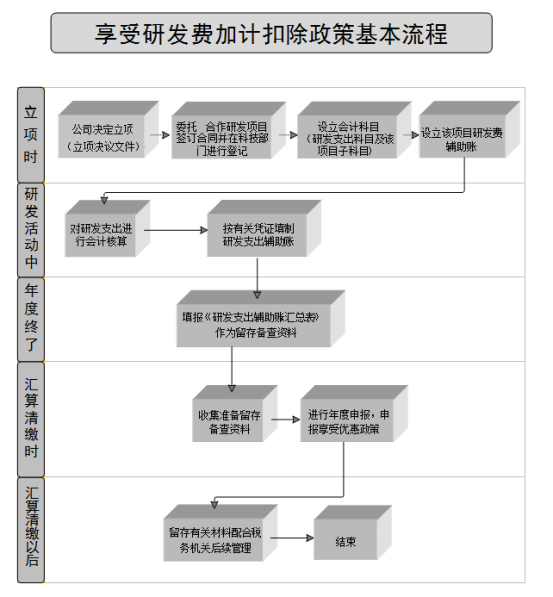

> **标题**：生物医药领域企业研发费税收政策指引(1.0版)
> **发布机关**：国家税务总局广东省税务局
> **发布日期**：2020年5月18日
> **版本**：1.0版
> **文号**：无（政策指引，不带文号）
> **效力状态**：部分失效，已被后续政策更新的内容见下方"失效内容清单"，使用时以现行政策为准
> **官方原文**：https://guangdong.chinatax.gov.cn/gdsw/qysd_zcfg/2020-05/18/content_c83fd30c86b44a8c9083a2188cdf62de.shtml
> **全文载体**：上述页面正文只有 4 个 PDF 下载链接，57 页全文在附件 https://guangdong.chinatax.gov.cn/gdsw/qysd_zcfg/2020-05/18/c83fd30c86b44a8c9083a2188cdf62de/files/bd314515eeaa479293507469baebb0ae.pdf
> **核验**：2026-10-22 从该 PDF 逐页抽取文字转录。比对方法：删净两侧空白后按 PDF 行内空格切块，官方件 1 798 块，本件命中 1 796 块；未命中的 2 块是同一处嵌套书名号在 PDF 里跨行断开所致，本件按原句写全，逐字仍在。本件另外做了三处处理：段与段之间补空行；官方 PDF 用符号字体排印、文字层落成 U+2022/U+2023/U+201E/U+201F/U+2020/U+2021 的字符，按逐条上下文核对后还原为《》〔〕〈〉（共 36 对、34 对、3 对），一处以尖括号排印的嵌套书名号同样还原为〈〉；书名标题原被 PDF 断成两行，本件接回一行。

> **失效内容清单**：
> 1. **加计扣除比例**：文中引用财税〔2018〕99号（75%费用化加计/175%资本化摊销），已被财政部 税务总局公告2023年第7号替代，现行比例为**100%费用化加计/200%资本化摊销**（全行业制度性安排）
> 2. **预缴申报方式**：文中称"汇缴享受"、"季度预缴时不能申报享受"，已被税务总局 财政部公告2023年第11号替代，现行为**7月/10月/汇算清缴三次预缴享受**
> 3. **备案手续**：文中提到"备案手续"，已被税务总局公告2018年第23号替代，现行为**自行判别、申报享受、相关资料留存备查**（无需备案）
> 4. **辅助账样式**：文中引用2015年第97号公告所附样式，已被税务总局公告2021年第28号更新为**2021版辅助账样式**
> 5. **财税〔2018〕99号**：该文已被财政部 税务总局公告2021年第13号→2023年第7号公告替代并废止
> 6. **追溯享受**：文中提到"追溯享受并履行备案手续"，现行已无需备案手续，但追溯享受3年期限规定仍然有效

> **仍有效的核心内容**：
> - 生物医药领域研发活动界定与各阶段费用归集方法（第三章）
> - 研发费用三口径差异比较（第三章·一）
> - CRO/CMO/CDMO方式的加计扣除处理（第三章·三·2）
> - 委托研发与合作研发的区分与合同登记要求（第三章·三·1）
> - 生物医药企业案例解析（第六章，计算方法可参考但比例须调整为100%）
> - 热点问题汇总中的定性分析（第七章，除涉及具体比例外）

---

# 生物医药领域企业研发费税收政策指引(1.0版)

国家税务总局广东省税务局　2020年5月

### 前言

为深入贯彻中共中央、国务院关于实施国家创新驱动发展战略，认真落实广东省委、省政府关于推动科技创新强省建设和培育产业集群的重要部署，切实发挥税收服务职能，解决企业享受研究开发费用加计扣除政策过程中的“痛点”“堵点”“难点”。广东税务围绕广东省重点研发领域，广泛邀请相关企业、行业协会和政府机关共同参与，以企业需求为牵引，编写重点领域企业研发费税收政策系列指引，帮助企业用足、用好研究开发费用加计扣除政策。

一、突出实用性，政策内容“一目了然”。重点领域企业研发费税收政策系列指引从实用性、可操作性出发，在研究开发费用加计扣除政策内容中充分融入企业研发活动开展情况，以“政策+案例+问题解答”多样化的展示形式进行编写。研究开发费用加计扣除政策一目了然，企业对照指引即可掌握如何正确、便捷地享受研究开发费用加计扣除政策，激发企业创新活力。

二、突出针对性，助推创新“一臂之力”。本系列指引基于我省重点领域研发计划，针对不同领域企业研发活动特点，充分与企业互动，为不同领域企业量身定制。首批由广东省税务局统筹聚合广州市税务局、珠海市税务局、佛山市税务局和东莞市税务局共同完成新一代信息技术、高端装备制造、生物医药、数字经济领域的研究开发费用加计扣除政策指引；第二批计划在2020年12月底发布绿色低碳、新材料、海洋经济、现代种业和精准农业、现代工程技术五大重点领域的研究开发费用加计扣除政策指引。

三、突出规范性，应知尽知“一应俱全”。重点领域企业研发费税收政策系列指引编写以规范性为统领，让每一个案例解读和分析都有据可依、有章可循。为不同领域企业享受研究开发费用加计扣除政策提供了一份口径统一、规范明确的办税指引。

本指引仅旨在方便读者查找和充分享受研究开发费用加计扣除政策，不是税收执法或申请享受政策的直接依据。具体执行中遇到的问题请依照国家最新发布的法律、法规、规章及规范性文件的规定执行。由于编写的时间和水平有限，书中难免有疏漏之处，敬请批评指正。

国家税务总局广东省税务局目录一、生物医药领域研发概述...........................................................................................................1二、研发费加计扣除政策与企业研发活动...................................................................................2

（一）研发费加计扣除政策内容...........................................................................................2

（二）享受研发费加计扣除政策的基本流程.......................................................................3

（三）税收方面对研发活动的界定.......................................................................................4

（四）可加计扣除的研发费用...............................................................................................51．研发费加计扣除政策口径的研发费用.....................................................................52．加计扣除研发费用核算要求.....................................................................................5三、生物医药领域企业研发活动中的税务处理...........................................................................6

（一）研发费用归集的三个口径及差异比较.......................................................................6

1.人员人工费用...............................................................................................................6

2.直接投入费用...............................................................................................................7

3.折旧费用与长期待摊费用...........................................................................................8

4.无形资产摊销...............................................................................................................9

5.设计试验等费用...........................................................................................................9

6.其他相关费用...............................................................................................................9

（二）各阶段研发费用归集.................................................................................................10

1.早期研究及立项阶段.................................................................................................10

2.研发活动阶段.............................................................................................................15

（三）其他应注意事项.........................................................................................................21

1.委托研发与合作研发要合理区分.............................................................................21

2.医药研发外包（CRO）、医药合同定制生产（CMO）、医药合同定制研发生产（CDMO）方式的加计扣除政策.....................................................................................................23

3.委托研发与合作研发项目的合同区分境内境外分别到科技主管部门登记.........25

4.研发费用的费用化或资本化处理方面的规定.........................................................25四、企业申报表填报指引.............................................................................................................27

（一）企业申报享受基本流程.............................................................................................27

（二）申报享受方式.............................................................................................................27

（三）申报表填列样式.........................................................................................................27

（四）其他应注意事项.........................................................................................................32

1.研发费加计扣除为汇缴享受项目.............................................................................32

2.企业申报享受研发优惠无需报送 《归集表》 和 《汇总表》 .................................32

3.盈利企业和亏损企业都可以享受加计扣除政策.....................................................32

4.叠加享受税收优惠的处理.........................................................................................33五、企业申报后的注意事项.........................................................................................................33

（一）主要留存备查资料.....................................................................................................33

1.企业享受开发新技术、新产品、新工艺发生的研究开发费用加计扣除政策应留存备查以下资料.................................................................................................................34

2.企业享受为获得创新性、创意性、突破性的产品进行创意设计活动而发生的相关费用加计扣除政策应留存备查以下资料.....................................................................35

（二）研发项目异议鉴定.....................................................................................................35

（三）项目鉴定共性问题.....................................................................................................35

（四）追溯享受规定.............................................................................................................37六、生物医药企业享受研发费加计扣除政策案例解析.............................................................38

（一）自主研发.....................................................................................................................38

（二）委托研发.....................................................................................................................43

（三）合作研发.....................................................................................................................45

（四）集团研发.....................................................................................................................46七、享受研发费加计扣除政策热点问题汇总.............................................................................47

（一）企业研发新药品取得政府补助的，如何计算加计扣除金额？ .............................47

（二）药品研发项目最终研发失败，相关研发费用是否还可以享受企业所得税税前加计扣除？ .....................................................................................................................................47

（三）为研发新药品新建的实验室是否可以享受加计扣除？ .........................................47

（四）受托研发新药品，委托方选择不享受研发费加计扣除优惠政策，我公司作为受托方是否可以就实际发生的研发费用申报享受研发费加计扣除？ .....................................48

（五）为研发新药，支付了某种软件的使用费，但不拥有软件的所有权。请问该部分费用，可以作为长期待摊费用或其他费用享受研发费用加计扣除政策优惠吗？ .............48

（六）我司为研发新药，以经营租赁方式租入了用于研发活动的仪器、设备，并根据需要进行了改装，该部分费用可以享受研发费加计扣除优惠吗？ .....................................48

（七）为什么委托境内研发和委托境外机构研发需去经科技主管部门登记备案的主体分别为受托方和委托方？容易导致企业混淆，建议统一为委托方可以吗？ .....................49

（八）企业取得研发过程中形成的下脚料、残次品、中间试制品或企业研发活动直接形成产品或作为组成部分形成的产品对外销售的，研发费用应该怎么核算？ .................49

（九）在新药研发过程中，发生的不在财税[2015]119号文列举范围内的其他费用，能否加计扣除？.........................................................................................................................50

（十）预缴企业所得税时能否享受研发费用加计扣除优惠？ .........................................50

（十一）委托非关联方研发是否需要提供研发项目费用支出明细？ .............................51

（十二）企业集团集中开发的研发费用分摊需要注意哪些事项？ .................................51

### 一、生物医药领域研发概述

生物医药被称为“永不衰落的朝阳产业”，主要包括高通量测序、生命组学、细胞（干细胞）治疗、液体活检、特异性分子诊断、 3D 生物打印、脑科学与类脑科学、体外诊断试剂（设备）、化学药制剂、高端医疗器械、中药大健康产品、干细胞与组织工程、重组蛋白药物和抗体药物、新型疫苗、个体化药物和新型诊疗技术、生物医用材料、生物催化与转化技术等新兴领域。生物医药领域研发活动呈现技术风险高、资金投入大、研发周期长的显著特点。以小分子新药研发为例，从研发至投产需要经过临床前研究（研究开发和临床前实验）、临床试验审批（Investigational New Drug）、临床试验、以及新药上市审批（ New Drug Application）等流程，其中任何一个环节出现问题都会导致研发失败，因此新药研发的成功率很低。另外，根据研发目标和适应症领域不同，研究开发阶段一般需要2-3 年，临床前实验阶段一般需要2-4年，临床试验阶段一般则需要3-7年，整个研发周期可长达8-15年。据统计，全球十大药厂的研发费用约占营业额的 8%-15%，随着新药研制的复杂程度不断提高，研发费用也相应提升，高技术的时效性决定了大量、连续的研发投入成为必然。

按照广东省 《关于促进生物医药创新发展的若干政策措施》（粤科社字〔2020〕 86号）要求，为深入贯彻落实研发费税前加计扣除政策，进一步发挥税收职能作用，持续为生物医药领域研发活动提供有力支持，推动我省生物医药科技和产业高质量发展，国家税务总局广东省税务局组织编写了《生物医药领域企业研发费税收政策指引》。

本指引第二、四、五部分是研发企业存在的共性涉税问题，具有普遍性指导意义； 第三、六、七部分则是通过座谈、调研生物医药企业，根据该领域研发活动的流程和特点组织编写，具有个性化和领域针对性。如遇到本指引尚未涵括的有关问题，可将有关情况反馈给我们(yffjjkc_gdsw@126.com)，我局将据此进一步完善本指引。

### 二、研发费加计扣除政策与企业研发活动

#### （一）研发费加计扣除政策内容

根据 《中华人民共和国企业所得税法》 及其实施条例：企业开发新技术、新产品、新工艺发生的研究开发费用，可以在计算企业所得税应纳税所得额时加计扣除。上述所称研究开发费用的加计扣除，是指企业为开发新技术、新产品、新工艺发生的研究开发费用，未形成无形资产计入当期损益的，在按规定据实扣除的基础上，按照本年度实际发生额的50%，从本年度应纳税所得额中扣除；形成无形资产的，按照无形资产成本的 150%在税前摊销。

根据《财政部 税务总局 科技部关于提高研究开发费用税前加计扣除比例的通知》（财税〔2018〕 99号）的有关规定：在2018年1 月 1 日至2020年12月31 日期间，企业开展研发活动中实际发生的研发费用，未形成无形资产计入当期损益的，在按规定据实扣除的基础上，再按照实际发生额的 75%在税前加计扣除；形成无形资产的，在上述期间按照无形资产成本的175%在税前摊销。

企业为获得创新性、创意性、突破性的产品进行创意设计活动而发生的相关费用，可以按照规定进行税前加计扣除。

#### （二）享受研发费加计扣除政策的基本流程

享受研发费用加计扣除优惠政策基本流程见下图：

#### （三）税收方面对研发活动的界定

《财政部国家税务总局、科学技术部关于完善研究开发费用税前扣除政策的通知》 （财税〔2015〕 119 号）规定：研发活动是指企业为获得科学与技术新知识，创造性运用科学技术新知识，或实质性改进技术、产品（服务）、工艺而持续进行的具有明确目标的系统性活动。

在享受研发费加计扣除政策时应注意：

##### 1.企业发生的以下一般性知识性、技术性活动不属于税收意义上的研发活动，其支出不适用研发费用加计扣除政策：

（1 ）企业产品（服务）的常规性升级。

（2 ）对某项科研成果的直接应用，如直接采用公开的新工艺、材料、装臵、产品、服务或知识等。

（3 ）企业在商品化后为顾客提供的技术支持活动。

（4）对现存产品、服务、技术、材料或工艺流程进行的重复或简单改变。

（5 ）市场调查研究、效率调查或管理研究。

（6）作为工业（服务）流程环节或常规的质量控制、测试分析、维修维护。

（7）社会科学、艺术或人文学方面的研究。

2.企业以下列六个行业业务为主营业务，其研发费用发生当年的主营业务收入占企业按《中华人民共和国企业所得税法》 第六条规定计算的收入总额减除不征税收入和投资收益的余额50% （不含）以上的，不适用研发费用加计扣除政策：

(1)烟草制造业。

(2)住宿和餐饮业。

(3)批发和零售业。

(4)房地产业。

(5)租赁和商务服务业。

(6)娱乐业。

(7)财政部和国家税务总局规定的其他行业。

上述行业以《国民经济行业分类与代码（GB/4754-2017）》 为准，并随之更新。

#### （四）可加计扣除的研发费用

##### 1．研发费加计扣除政策口径的研发费用

包括人员人工费用、直接投入费用、折旧费用、无形资产摊销费用、新产品设计费、新工艺规程制定费、新药研制的临床试验费、勘探开发技术的现场试验费、其他相关费用以及财政部和国家税务总局规定的其他费用。

##### 2．加计扣除研发费用核算要求

（1 ）企业应按照国家财务会计制度要求，对研发支出进行会计处理；同时，对享受加计扣除的研发费用按研发项目设臵辅助账，准确归集核算当年可加计扣除的各项研发费用实际发生额。企业在一个纳税年度内进行多项研发活动的，应按照不同研发项目分别归集可加计扣除的研发费用。

（2 ）企业应对研发费用和生产经营费用分别核算，准确、合理归集各项费用支出，对划分不清的，不得实行加计扣除。

### 三、生物医药领域企业研发活动中的税务处理

#### （一）研发费用归集的三个口径及差异比较

目前研发费用归集有三个口径，一是会计核算口径，由《财政部关于企业加强研发费用财务管理的若干意见》（财企〔2007〕 194 号）规范；二是高新技术企业认定口径，由 《科技部财政部国家税务总局关于修订印发〈高新技术企业认定管理工作指引〉的通知》（国科发火〔2016〕195 号）规范；三是加计扣除税收规定口径，由财税〔2015〕 119号文件和97 号公告、 40号公告规范。三个研发费用归集口径相比较，存在一定差异。

##### 1.人员人工费用

差异：本项费用的会计核算口径大于税收核算口径。税收核算口径中可加计扣除人员人工费用归集对象是直接从事研发活动人员，分为研究人员、技术人员和辅助人员三类。研究开发人员既可以是本企业的员工，也可以是外聘研发人员。外聘研发人员是指与本企业或劳务派遣企业签订劳务用工协议（合同）和临时聘用的研究人员、技术人员、辅助人员。而高新技术企业人员人工费用归集对象是直接从事研发和相关技术创新活动，以及专门从事上述活动的管理和提供直接技术服务的科技人员，并且在企业累计实际工作时间在183天以上。

| 会计规定 | 高新技术企业认定 | 研发费用加计扣除 |
| --- | --- | --- |
| 企业在职研发人员的工资、奖金、津贴、补贴、社会保险费、住房公积金等人工费用以及外聘研发人员的劳务费用。 | 企业科技人员的工资薪金、基本养老保险费、基本医疗保险费、失业保险费、工伤保险费、生育保险费和住房公积金，以及外聘科技人员的劳务费用。 | 直接从事研发活动人员 的工资薪金、基本养老 保险费、基本医疗保险 费、失业保险费、工伤 保险费、生育保险费和 住房公积金，以及外聘 研发人员的劳务费用。 |

例如：高新技术企业如果存在累计工作时间未达到183天的直接从事研发活动的研发人员，该部分人员从事研发工作所发生的工资薪金等费用可以享受加计扣除税收优惠，企业应注意将该部分人员费用按照会计核算受益原则计入研发费用。

##### 2.直接投入费用

差异：房屋等固定资产的运行维护、维修等费用不计入高企研发口径；房屋等固定资产的租赁费、运行维护、维修等费用不计入加计扣除范围。

| 会计规定 | 高新技术企业认定 | 研发费用加计扣除 |
| --- | --- | --- |
| （1 ）研发活动直接消耗的材料、燃料和动力费用。 | （1 ）直接消耗的材料、燃料和动力费用。 | （1 ）研发活动直接消耗的材料、燃料和动力费用。 |
| （2）用于中间试验和产 | （2）用于中间试验和产 | （2）用于中间试验和产 |

| 品试制的模具、工艺装备开发及制造费，样品、样机及一般测试手段购臵费，试制产品的检验费等。 | 品试制的模具、工艺装备开发及制造费，不构成固定资产的样品、样机及一般测试手段购臵费，试制产品的检验费。 | 品试制的模具、工艺装备开发及制造费，不构成固定资产的样品、样机及一般测试手段购臵费，试制产品的检验费。 |
| --- | --- | --- |
| （3）用于研发活动的仪器、设备、房屋等固定资产的租赁费，设备调整及检验费，以及相关固定资产的运行维护、维修等费用。 | （3）用于研究开发活动的仪器、设备的运行维护、调整、检验、检测、维修等费用，以及通过经营租赁方式租入的用于研发活动的固定资产租赁费。 | （3）用于研发活动的仪器、设备的运行维护、调整、检验、维修等费用，以及通过经营租赁方式租入的用于研发活动的仪器、设备租赁费。 |

例如：企业的办公场所、实验室、试制车间等能合理分摊研发项目与非研发项目，其租金可计入高新技术企业研发费范畴，但不可享受加计扣除。

##### 3.折旧费用与长期待摊费用

差异：房屋折旧费不计入高企和加计扣除范围。此外，在用建筑物的折旧费，研发设施的改建、改装、装修和修理过程中发生的长期待摊费用等计入高企研发口径的研发费不计入加计扣除范围。

| 会计规定 | 高新技术企业认定 | 研发费用加计扣除 |
| --- | --- | --- |
| 用于研发活动的仪器、设备、房屋等固定资产的折旧费。 | 用于研究开发活动的仪器、设备和在用建筑物的折旧费。 研发设施的改建、改装、装修和修理过程中发生 | 用于研发活动的仪器、设备的折旧费。 |

|  | 的长期待摊费用。 |  |
| --- | --- | --- |

##### 4.无形资产摊销

差异：高企研发费用包含“知识产权”摊销，而加计扣除研发费用包含“专利权”摊销,二者存在一定差异。

| 会计规定 | 高新技术企业认定 | 研发费用加计扣除 |
| --- | --- | --- |
| 用于研发活动的软件、专利权、非专利技术等无形资产的摊销费用。 | 用于研究开发活动的软件、知识产权、非专利技术（专有技术、许可证、设计和计算方法等）的摊销费用。 | 用于研发活动的软件、专利权、非专利技术（包括许可证、专有技术、设计和计算方法等）的摊销费用。 |

##### 5.设计试验等费用

差异：高新研发费用包含装备调试费用和田间试验费，而加计扣除研发费用范围限于正列举范围。

| 会计规定 | 高新技术企业认定 | 研发费用加计扣除 |
| --- | --- | --- |
|  | 符合条件的设计费用、装备调试费用、试验费用（包括新药研制的临床试验费、勘探开发技术的现场试验费、田间试验费等）。 | 新产品设计费、新工艺规程制定费、新药研制的临床试验费、勘探开发技术的现场试验费。 |

##### 6.其他相关费用

差异：加计扣除政策及高新研发费用范围中对其他相关费用总额有比例限制，并且加计扣除研发费用范围限于正列举范围。

| 会计规定 | 高新技术企业认定 | 研发费用加计扣除 |
| --- | --- | --- |
| 与研发活动直接相关的其他费用，包括技术图书资料费、资料翻译费、会议费、差旅费、办公费、外事费、研发人员培训费、培养费、专家咨询费、高新科技研发保险费用等。研发成果的论证、评审、验收、评估以及知识产权的申请费、注册费、代理费等费用。 | 与研究开发活动直接相关的其他费用，包括技术图书资料费、资料翻译费、专家咨询费、高新科技研发保险费，研发成果的检索、论证、评审、鉴定、验收费用，知识产权的申请费、注册费、代理费，会议费、差旅费、通讯费等。 此项费用一般不得超过研究开发总费用的 20%，另有规定的除外。 | 与研发活动直接相关的其他费用，如技术图书资料费、资料翻译费、专家咨询费、高新科技研发保险费，研发成果的检索、分析、评议、论证、鉴定、评审、评估、验收费用，知识产权的申请费、注册费、代理费，差旅费、会议费，职工福利费、补充养老保险费、补充医疗保险费。 此项费用总额不得超过可加计扣除研发费用总额的 10%。 |

#### （二）各阶段研发费用归集

##### 1.早期研究及立项阶段

生物医药领域企业在立项之初，通常要经过药物靶点确认、化合物的筛选与合成、活性化合物的验证与优化、学习技术资料收集、项目可行性分析、立项报告审批等流程。

###### （1 ）本阶段可加计扣除的研发费用及注意事项

在早期研究及立项阶段，生物医药企业通常会发生的费用包括人员工资薪酬、技术图书资料费、资料翻译费、专家咨询费、差旅费、会议费、业务招待费、办公用品费、通讯费等。

根据国家税务总局公告2017年第40号的要求，可归入研发费加计扣除项目的研发费用大类包括人员人工费用、其他相关费用等。

###### ①人员人工费用

指直接从事研发活动人员的工资薪金、基本养老保险费、基本医疗保险费、失业保险费、工伤保险费、生育保险费和住房公积金，以及外聘研发人员的劳务费用。

A.直接从事研发活动人员包括研究人员、技术人员、辅助人员。研究人员是指主要从事研究开发项目的专业人员；技术人员是指具有工程技术、自然科学和生命科学中一个或一个以上领域的技术知识和经验，在研究人员指导下参与研发工作的人员；辅助人员是指参与研究开发活动的技工。外聘研发人员是指与本企业或劳务派遣企业签订劳务用工协议（合同）和临时聘用的研究人员、技术人员、辅助人员。

接受劳务派遣的企业按照协议（合同）约定支付给劳务派遣企业，且由劳务派遣企业实际支付给外聘研发人员的工资薪金等费用，属于外聘研发人员的劳务费用。

后勤人员、行政人员、生产工人不能计算为直接从事研发活动人员，该部分人员的相关费用不得计入研发费加计扣除的人员人工费。

B.工资薪金包括按规定可以在税前扣除的对研发人员股权激励的支出。

C.直接从事研发活动的人员、外聘研发人员同时从事非研发活动的，企业应对其人员活动情况做必要记录，并将其实际发生的相关费用按实际工时占比等合理方法在研发费用和生产经营费用间分配，未分配的不得加计扣除。

###### ②其他相关费用

指与研发活动直接相关的其他费用，如技术图书资料费、资料翻译费、专家咨询费、高新科技研发保险费，研发成果的检索、分析、评议、论证、鉴定、评审、评估、验收费用，知识产权的申请费、注册费、代理费，差旅费、会议费，职工福利费、补充养老保险费、补充医疗保险费。

研发人员的职工福利费、补充养老保险费、补充医疗保险费在其他相关费用进行核算。

此类费用总额不得超过可加计扣除研发费用总额的10%。国家税务总局2015年97号公告明确了该限额的计算：应按项目分别计算，每个项目可加计扣除的其他相关费用都不得超过该项目可加计扣除研发费用总额的10%。

加计扣除其他相关费用的简易计算方法如下：假设某一研发项目的其他相关费用的限额为X，财税〔2015〕 119号文件第一条允许加计扣除的研发费用中的第1项至第5项费用之和为Y，那么 X =（X+Y）× 10%，即 X=Y × 10%/(1-10%)。

例：某企业2019年进行了二项研发活动A和B，A项目共发生研发费用100 万元，其中与研发活动直接相关的其他费用12 万元， B 共发生研发费用100 万元，其中与研发活动直接相关的其他费用8万元，假设研发活动均符合加计扣除相关规定。 A项目其他相关费用限额=（ 100-12）× 10%/(1-10%)=9.78 万元，小于实际发生数 12万元，则A项目允许加计扣除的研发费用应为97.78万元

（100-12+9.78=97.78）。B项目其他相关费用限额=（ 100-8）× 10%/(1-10%)=10.22 万元，大于实际发生数8 万元，则B项目允许加计扣除的研发费用应为100 万元。

该企业2019年度可以享受的研发费用加计扣除额为98.89万元[（ 97.78+100）× 75%=148. 335]。

###### ③不得加计扣除费用

允许扣除的研发费用范围采取的是正列举方式，即政策规定中没有列举的加计扣除项目，不可以享受加计扣除优惠。 本阶段业务招待费、办公用品费、通讯费等不可以纳入加计扣除范围。

###### （2 ）备查资料留存及注意事项

①自主、委托、合作研究开发项目计划书和企业有权部门关于立项的决议文件。

自 2016年1月1 日起，企业申报享受研发费用加计扣除优惠，无需事前通过科技部门鉴定，只需企业内部有决策权的部门，如董事会等做出决议即可。

②自主、委托、合作研究开发专门机构或项目组的编制情况和研发人员名单。

名单应包括本企业研发人员和外聘研发人员。

③委托、合作研究开发项目经科技行政主管部门登记的开发项目合同。

《技术合同认定管理办法》（国科发政字〔2000〕 63 号）第六条规定：未申请认定登记和未予登记的技术合同，不得享受国家对有关促进科技成果转化规定的税收、信贷和奖励等方面的优惠政策；国家税务总局公告2015年97 号规定，委托及合作研发的，需提供经科技行政主管部门登记的委托、合作研究开发项目的合同留存备查。

④委托方委托关联方开展研发活动的，委托方需保留委托方研发过程中实际发生的研发项目费用支出明细情况。

国家税务总局公告2017年第40 号要求，委托方委托关联方开展研发活动的，受托方需向委托方提供研发过程中实际发生的研发项目费用支出明细情况。

⑤从事研发活动的人员（包括外聘人员）和用于研发活动的仪器、设备、无形资产的费用分配说明（包括工作使用情况记录及费用分配计算证据材料）。

⑥集中研发项目研发费决算表、集中研发项目费用分摊明细情况表和实际分享收益比例等资料。

⑦本阶段根据研发项目分别设臵的“研发支出”辅助账。

A.国家税务总局公告2015年第97号为指导企业设臵研发支出辅助账做了细化规定，以帮助企业防范相关风险，企业可参照97号公告所附样式，在研发项目立项时根据研发活动的形式分别设臵： 1.自主研发“研发支出”辅助账； 2.委托研发“研发支出”辅助账； 3.合作研发“研发支出”辅助账； 4.集中研发“研发支出”辅助账。年末汇总分析填报研发支出辅助账汇总表，以便正确核算企业该年度发生的可加计扣除的研发费用。

企业也可以根据自己的实际情况建立辅助账，但应涵盖97号公告所附样式内容。也就是说辅助账样式可以在总局发布的辅助账框架内增加有关项目，但不得减少和合并有关项目。

B.企业应准确归集核算当年可加计扣除的各项研发费用实际发生额，从凭证级别记录各个项目的研发支出，并将每笔研发支出按照国家税务总局公告2017年第40号列明的可加计扣除的六大类研发费用类别进行归类。

C.企业在一个纳税年度内进行多项研发活动的，应按照不同研发项目分别设臵辅助账归集可加计扣除的研发费用。

##### 2.研发活动阶段

生物医药业研发活动通常包括临床前研究、临床期研究、新药申报获批等活动。

###### （1 ）临床前研究

临床前试验的目的，一是评估药物的药理和毒理作用，药物的吸收、分布、代谢和排泄情况。这部分试验需要在动物层面展开，确定药物的有效性与安全性。二是进行生产工艺、质量控制、稳定性等研究，这部分需要在符合GMP检查要求的车间完成（GMP检查是对生产企业申报新药的生产工艺规程、软硬件、人员等条件能够稳定、有效的生产出与临床实验药品质量一致的产品进行的现场检查，是新药上市前的最后审查环节）。生物制药企业本阶段较多的采用CRO、 CMO、 CDMO等形式外包。

①可加计扣除的研发费用及注意事项在临床前研究阶段，生物医药企业通常会进行核心原材料筛选、实验方法确定、实验体系的建立、雏形试剂验证、产品生产工艺及技术要求确定、中间试验阶段生产、产品性能评价及验证等活动。

根据国家税务总局公告2017年第40号的要求，本阶段可归入研发费加计扣除项目的研发费用大类主要是人员人工费用、直接投入费用、折旧费用、无形资产摊销费用、其他相关费用等。

A.直接投入费用指研发活动直接消耗的材料、燃料和动力费用；用于中间试验和产品试制的模具、工艺装备开发及制造费，不构成固定资产的样品、样机及一般测试手段购臵费，试制产品的检验费；用于研发活动的仪器、设备的运行维护、调整、检验、维修等费用，以及通过经营租赁方式租入的用于研发活动的仪器、设备租赁费。

a.以经营租赁方式租入的用于研发活动的仪器、设备，同时用于非研发活动的，企业应对其仪器设备使用情况做必要记录，并将其实际发生的租赁费按实际工时占比等合理方法在研发费用和生产经营费用间分配，未分配的不得加计扣除。

以经营租赁方式租入的用于研发活动的仪器、设备不包括房屋建筑物。

b.企业研发活动直接形成产品或作为组成部分形成的产品对外销售的，研发费用中对应的材料费用不得加计扣除。

产品销售与对应的材料费用发生在不同纳税年度且材料费用已计入研发费用的，可在销售当年以对应的材料费用发生额直接冲减当年的研发费用，不足冲减的，结转以后年度继续冲减。

B.折旧费用指用于研发活动的仪器、设备的折旧费。

a.用于研发活动的仪器、设备，同时用于非研发活动的，企业应对其仪器设备使用情况做必要记录，并将其实际发生的折旧费按实际工时占比等合理方法在研发费用和生产经营费用间分配，未分配的不得加计扣除。

b.企业用于研发活动的仪器、设备，符合税法规定且选择加速折旧优惠政策的，在享受研发费用税前加计扣除政策时，就税前扣除的折旧部分计算加计扣除。

c.研发费加计扣除折旧费用不包括房屋建筑物的折旧费用。由于生物医药行业对实验试剂的储存和试验环境通常具有恒温恒湿等要求，空调等设备可作为研发活动的设备进行折旧费归集；但中央空调等不可随意移动的附属设备和配套设施，根据《国家税务总局关于进一步明确房屋附属设备和配套设施计征房产税有关问题的通知》(国税发〔2005〕 173号)规定，应计入房产原值，作为房屋建筑物的一部分进行折旧，不能归集入研发费加计扣除的折旧费。

C.无形资产摊销费用指用于研发活动的软件、专利权、非专利技术（包括许可证、专有技术、设计和计算方法等）的摊销费用。

a.用于研发活动的无形资产，同时用于非研发活动的，企业应对其无形资产使用情况做必要记录，并将其实际发生的摊销费按实际工时占比等合理方法在研发费用和生产经营费用间分配，未分配的不得加计扣除。

b.用于研发活动的无形资产，符合税法规定且选择缩短摊销年限的，在享受研发费用税前加计扣除政策时，就税前扣除的摊销部分计算加计扣除。

D.人员人工费用、其他相关费用详见早期研究及立项阶段的相关说明。

E.不得加计扣除费用房屋折旧费不计入加计扣除范围；经营租赁方式租入设备改装费、房屋装修费类长期待摊费用不计入加计扣除范围；软件、专利权、非专利技术等租入无形资产待摊费用不计入加计扣除范围。

②备查资料留存及注意事项

A.自主、委托、合作研究开发专门机构或项目组的编制情况和研发人员名单；

如本阶段研发人员有变动等情况，应及时更新机构或项目组的编制情况和研发人员名单。

B.委托方委托关联方开展研发活动的，委托方需保留委托方研发过程中实际发生的研发项目费用支出明细情况。研发活动阶段应注意向委托方索要相关费用支出明细材料。

C.从事研发活动的人员（包括外聘人员）和用于研发活动的仪器、设备、无形资产的费用分配说明（包括工作使用情况记录及费用分配计算证据材料）；

D.集中研发项目研发费决算表、集中研发项目费用分摊明细情况表和实际分享收益比例等资料；

E.“研发支出”辅助账及汇总表详见早期研究及立项阶段对“研发支出”辅助账及汇总表的相关说明。

###### （2）临床期研究

又称临床试验阶段，是指在人体（病人或健康志愿者）进行药物的系统性研究，以证实或揭示试验药物的作用、不良反应或试验药物的吸收、分布、代谢和排泄，目的是确定试验药物的疗效与安全性。

在临床期研究阶段，生物医药企业通常会经历Ⅰ期临床（初步的临床药理学及人体安全性评价试验）、Ⅱ期临床（治疗作用初步评价阶段）、Ⅲ期临床（治疗作用确证阶段）、Ⅳ期临床（新药上市后应用研究阶段）。

①可加计扣除的研发费用及注意事项本阶段可归入研发费加计扣除项目的研发费用大类主要是人员人工费用、直接投入费用、折旧费用、无形资产摊销费用、新药研制的临床试验费、其他相关费用。

A.新药研制的临床试验费指企业在新产品设计、新工艺规程制定、新药研制的临床试验、勘探开发技术的现场试验过程中发生的与开展该项活动有关的各类费用。

生物医药行业的新药研制临床试验费在研发费加计扣除归集和高新技术企业认定的归集口径中基本趋同。

B.人员人工费用、其他相关费用详见早期研究及立项阶段部分的相关说明。 直接投入费用、折旧费用、无形资产摊销费用、不得加计扣除费用参考临床前研究部分的相关说明。

②备查资料留存及注意事项本阶段留存备查资料与临床前研究阶段基本一致。

###### （3）药品注册检验

在生物医药行业新药研发上市的过程中，通常会经历药品临床试验申请、药品上市许可申请、关联审评审批、药品注册核查及检查、药品再注册申请等审评检查阶段。

①可加计扣除的研发费用及注意事项本阶段研发费主要是知识产权的申请费、药物上市前商业化试生产费等等，较多生物医药企业会委托外部机构开展该项活动内容。本阶段可归入研发费加计扣除项目的研发费用大类主要是人员人工费用、直接投入费用、折旧费用、无形资产摊销费用、新药研制的临床试验费、其他相关费用。

人员人工费用、其他相关费用参考早期研究及立项阶段部分的相关说明。直接投入费用、折旧费用、无形资产摊销费用、不得加计扣除费用参考临床前研究部分的相关说明。新药研制的临床试验费参考临床期研究部分的相关说明。

②备查资料留存及注意事项

A.企业如果已取得地市级（含）以上科技行政主管部门出具的鉴定意见，应作为留存备查资料。

其余留存备查资料与临床前研究、临床期研究阶段基本一致。

#### （三）其他应注意事项

##### 1.委托研发与合作研发要合理区分

不同类型的研发活动对研发费用归集的要求不尽相同，为了准确享受政策，企业在研发项目立项期应明确区分研发活动的类型。生物医药企业的研发项目常常需要与高校、医院、研究所合作，要特别注意区分委托开发和合作开发。

###### （1 ）委托研发

指被委托人基于他人委托而开发的项目。委托人以支付报酬的形式获得受托人的研发成果的所有权。委托项目的特点是研发经费受委托人支配，项目成果必须体现委托人的意志和实现委托人的使用目的。

委托研发项目，应当在研发项目批准立项后按照 《企业（委托）研究开发项目计划书》 和 《技术开发（委托）合同》 等类似文件设臵委托研发“研发支出”辅助账，以委托研发发生的“研发活动发生费用”的 80%作为基数分类计入研发费归集的六大类费用，并留存备查。

企业委托外部机构或个人开展研发活动发生的费用，可按规定税前扣除；加计扣除时按照研发活动发生费用的80%作为加计扣除基数。委托个人研发的，应凭个人出具的发票等合法有效凭证在税前加计扣除。“研发活动发生费用”是指委托方实际支付给受托方的费用。

委托境外进行研发活动所发生的费用，按照费用实际发生额的 80%计入委托方的委托境外研发费用。委托境外研发费用不超过境内符合条件的研发费用三分之二的部分，可以按规定在企业所得税前加计扣除。可加计扣除的委托境外进行研发活动不包括委托境外个人进行的研发活动。

委托方委托关联方开展研发活动的，受托方需向委托方提供研发过程中实际发生的研发项目费用支出明细情况。比如：A企业2017 年委托其B关联企业研发，假设该研发符合研发费用加计扣除的相关条件。 A企业支付给B企业100 万元。 B企业实际发生费用90万元（其中按可加计扣除口径归集的费用为85 万元），利润10万元。2019 年， A企业可加计扣除的金额为100 × 80% × 75%=60 万元， B企业应向A企业提供实际发生费用90万元的情况。

考虑到涉及商业秘密等原因，财税〔2015〕 119号规定，委托方委托非关联方开展研发活动的，加计扣除时不再需要提供研发项目的费用支出明细情况。

无论委托方是否享受研发费用税前加计扣除政策，受托方均不得加计扣除。

###### （2）合作研发

合作研发是指研发立项企业通过契约的形式与其他企业共同对项目的某一个关键领域分别投入资金、技术、人力，共同参与产生智力成果的创作活动，共同完成研发项目。合作各方应直接参与研发活动，而非仅提供咨询、物质条件或其他辅助性活动。

合作开发在合同中应注明，双方分别投入、各自承担费用、知识产权双方共有或各自拥有自己的研究成果的知识产权。除了具体技术指标、研发时间和合同的常规条款外，还应特别关注可以享受研发费用加计扣除优惠政策的合作方应该部分或全部拥有合作研发项目成果的所有权。若知识产权最后仅属于某一方，则不拥有知识产权的合作方不能享受研发费用加计扣除政策。

##### 2.医药研发外包（CRO）、医药合同定制生产（CMO）、医药合同定制研发生产（CDMO）方式的加计扣除政策

生物医药研发或生产外包服务已逐渐成为医药产业中的新兴趋势，生物医药企业的新药研发过程部分或全部涉及到医药研发外包（CRO）、医药合同定制生产（CMO）、医药合同定制研发生产（CDMO）以及以上方式的组合。

（1 ）医药研发外包（CRO），主要为制药公司及生物技术公司提供药物发现、临床前研究、临床试验等新药研发合同研究服务。该种模式下，新药的研发和检验主要由CRO来完成，委托方涉及较少，在具体判断研发费加计扣除的适用主体资格时，需要重点关注双方之间的法律关系认定、具体分工、知识产权归属等因素。在实践中，往往通过合同、协议等重要文件的相关条款来判定研发费用加计扣除的享受主体。如果CRO企业希望享受研发费加计扣除优惠的，应在合同谈签阶段，明确自身对知识产权的占有份额，同时确保合同的具体条款和表述能为享受优惠提供充分依据，以降低未来风险。

（2 ）医药合同定制生产（CMO）,主要是接受制药公司的委托，进行定制生产服务，提供产品生产时所需要的工艺开发、配方开发、临床试验用药、化学或生物合成的原料药生产、中间体制造、制剂生产（如粉剂、针剂）以及包装等服务。该种模式下，相关产品主要是为委托方度身定制，CMO仅仅作为受托生产方。该种模式下，委托方对该部分费用按照委托方实际支付给CMO 的费用的80%进行加计扣除， CMO企业作为受托方，通常不享受研发费加计扣除优惠。

（3）医药合同定制研发生产（CDMO）,主要为制药企业及生物技术公司提供医药特别是创新药的工艺研发及制备、工艺优化、放大生产、注册和验证批生产以及商业化生产等定制研发生产服务。 CDMO 将高技术附加值的工艺研发及规模生产能力相结合，较多的采用“合作研发+定制生产”模式。该种模式下，研发费用加计扣除的享受主体也是通过合同等重要文件中对于双方之间的法律关系认定、具体分工、知识产权的归属等因素来进行判定。

（4）生物医药的研发，大部分生物医药企业将在临床研究或其他阶段涉及CRO、 CMO、 CDMO等业务，为了准确进行研发费用归集，应准确区分其中的委托研发和合作研发部分，委托研发需要保存好委托方实际支付给受托方的“研发活动发生费用”相关凭证，如是关联方，还需要受托方提供研发过程中实际发生的研发项目费用支出明细情况；合作研发由合作各方按照《企业（合作）研究开发项目计划书》和经登记的 《技术开发（合作）合同》 分项目设臵 《合作研发“研发支出”辅助账》，就自身实际承担的研发费用按照会计核算要求分项目核算，并按照研发费用归集范围分别计算加计扣除。

##### 3.委托研发与合作研发项目的合同区分境内境外分别到科技主管部门登记

由于受托方一般是享受增值税等其他税种税收优惠政策的主体，科技部门为便于管理、统计，避免双重登记，因此明确发生委托境内研发活动的，由受托方到科技部门进行登记。

而委托境外进行研发活动的受托方在国外，不受我国相关法律管辖，要求受托方登记不具有操作性，因此财税〔2018〕 64号文件对此进行了调整，将登记方由受托方调整至委托方，以保证委托方能顺利享受政策。

##### 4.研发费用的费用化或资本化处理方面的规定

企业开展研发活动中实际发生的研发费用形成无形资产的，其税收上资本化的时点应与会计处理保持一致。 《企业会计准则第6号-无形资产》 第7条规定，企业内部研究开发项目的支出，应当区分研究阶段支出与开发阶段支出。

###### （1 ）研究阶段支出

研究阶段，是指为获取新的科学或技术知识并理解它们而进行的独创性的有计划调查，主要是指为获取相关知识而进行的活动。

考虑到研究阶段的探索性及其成果的不确定性，企业无法证明其能够带来未来经济利益的无形资产的存在， 因此，对于企业内部研究开发项目，研究阶段的有关支出，应当在发生时全部费用化，计入当期损益（管理费用）。

###### （2）开发阶段支出

开发阶段，是指在进行商业性生产或使用前，将研究成果或其他知识应用于某项计划或设计，以生产出新的或具有实质性改进的材料、装臵、产品等，包括生产前或使用前的原型和模型的设计、建造和测试、小试、中试和试生产设施等。

考虑到进入开发阶段的研发项目形成成果的可能性较大，因此，如果企业能够证明开发支出符合无形资产的定义及相关确认条件，则可将其确认为无形资产。具体来讲，对于企业内部研究开发项目，开发阶段的支出同时满足了下列条件的才能资本化，确认为无形资产，否则应当计入当期损益（管理费用）。

A.完成该无形资产以使其能够使用或出售在技术上具有可行性。

B.具有完成该无形资产并使用或出售的意图。

C.无形资产产生经济利益的方式，包括能够证明运用该无形资产生产的产品存在市场或无形资产自身存在市场，无形资产将在内部使用的，应当证明其有用性。

D.有足够的技术、财务资源和其他资源支持，以完成该无形资产的开发，并有能力使用或出售该无形资产。

E.归属于该无形资产开发阶段的支出能够可靠地计量。

（3）无法区分研究阶段和开发阶段的支出无法区分研究阶段和开发阶段的支出，应当在发生时费用化，计入当期损益（管理费用）。

费用化的研发支出，按照当年费用化的金额部分加计扣除，资本化的研发费用，按照形成的无形资产当年摊销额进行加计扣除。

### 四、企业申报表填报指引

#### （一）企业申报享受基本流程

1.企业应当根据经营情况以及相关税收规定自行判断是否符合研发费加计扣除优惠享受条件，符合条件的在汇算清缴期间自行计算减免税额，并通过填报企业所得税年度纳税申报表享受税收优惠。同时，按照国家税务总局公告2018年第23号的规定归集和留存相关资料备查。

2.办理渠道：电子税务局或办税服务厅。

#### （二）申报享受方式

企业按照“自行判别、申报享受、相关资料留存备查”的享受方式。

#### （三）申报表填列样式

享受研发费加计扣除优惠的企业需填报A107010 《免税、减计收入及加计扣除优惠明细表》 和A107012 《研发费用加计扣除优惠明细表》。

填报范例： 甲企业为高新技术企业，2019年度进行了三项研发活动，项目名称分别为A、B、C。其中 A、B项目为自主研发、 C项目为委托研发。

A项目共发生研发费用200 万元，全部费用化处理。其中：直接从事研发活动的人员工资80 万元，五险一金20 万元，直接消耗材料费用 30万元、燃料10万元、动力费用10万元，用于研发活动的设备折旧费10 万元，用于研发活动的专利权摊销费用5万元，新产品设计费5 万元，其他相关费用30万元（包含差旅费20 万元、会议费 10 万元）。

B项目共发生研发费用100 万元， 2019年1月起开始资本化，至 2019年7月10 日结束资本化并结转形成无形资产，会计按直线法计算摊销费用，分10年摊销。费用明细：直接从事研发活动的人员工资60 万元，五险一金10 万元，直接消耗材料费用5万元、燃料3万元、动力费用2万元，用于研发活动的设备折旧费5万元，用于研发活动的软件摊销费用5 万元，新工艺设计费5 万元，资料翻译费5万元。

C项目委托研发费用总额100 万元，其中 30万元由境外机构完成。

#### 填报分析：

A 项目：除其他相关费用之外的研发费用合计170 万元，其他相关费用扣除限额=170 × 10%／ (1－ 10%)=18.89(万元)，小于实际发生数 30 万元，允许加计扣除的研发费用=170+18.88=188.89 （万元）B项目：除其他相关费用之外的研发费用合计95万元，其他相关费用扣除限额=95 × 10%／ (1－ 10%)=10.56(万元)，大于实际发生数 5万元，资本化的研发费用为100万元。本年形成无形资产摊销额=100/10 ×（ 6/12)=5(万元)。

C项目：可加计扣除的研发费用合计80万元，其中委托境内研发费用=70 × 80%=56(万元)，委托境外研发费用=30 × 80%=24 （万元），不超过境内符合条件的研发费用三分之二。

年度研发费用小计=188.89+100+80=368.89 （万元），其中本年费用化金额268.89万元，资本化金额100万元。允许加计扣除的研发费用合计=268.89+5=273.89 （万元），本年研发费用加计扣除总额=273.89 × 75%=205.42 （万元）。

#### 表格填报：

A107012 研发费用加计扣除优惠明细表（金额单位:人民币元（列至角分）

| 行次 | 项目 | 金额（数量） |
| --- | --- | --- |
| 1 | 本年可享受研发费用加计扣除项目数量 | 3 |
| 2 | 一、自主研发、合作研发、集中研发（ 3+7+16+19+23+34） | 2,888,888.89 |
| 3 | （一）人员人工费用（ 4+5+6） | 1,700,000 |
| 4 | 1.直接从事研发活动人员工资薪金 | 1,400,000 |
| 5 | 2.直接从事研发活动人员五险一金 | 300,000 |
| 6 | 3.外聘研发人员的劳务费用 | 0 |
| 7 | （二）直接投入费用（ 8+9+10+11+12+13+14+15） | 600,000 |
| 8 | 1.研发活动直接消耗材料费用 | 350,000 |
| 9 | 2.研发活动直接消耗燃料费用 | 130,000 |
| 10 | 3.研发活动直接消耗动力费用 | 120,000 |
| 11 | 4.用于中间试验和产品试制的模具、工艺装备开发及制造费 | 0 |

| 12 | 5.用于不构成固定资产的样品、样机及一般测试手段购臵费 | 0 |
| --- | --- | --- |
| 13 | 6.用于试制产品的检验费 | 0 |
| 14 | 7.用于研发活动的仪器、设备的运行维护、调整、检验、维修等费用 | 0 |
| 15 | 8.通过经营租赁方式租入的用于研发活动的仪器、设备租赁费 | 0 |
| 16 | （三）折旧费用（ 17+18） | 150,000 |
| 17 | 1.用于研发活动的仪器的折旧费 | 0 |
| 18 | 2.用于研发活动的设备的折旧费 | 150,000 |
| 19 | （四）无形资产摊销（ 20+21+22） | 100,000 |
| 20 | 1.用于研发活动的软件的摊销费用 | 50,000 |
| 21 | 2.用于研发活动的专利权的摊销费用 | 50,000 |
| 22 | 3.用于研发活动的非专利技术（包括许可证、专有技术、设计和计算方法等）的摊销费用 | 0 |
| 23 | （五）新产品设计费等（ 24+25+26+27） | 100,000 |
| 24 | 1.新产品设计费 | 50,000 |
| 25 | 2.新工艺规程制定费 | 50,000 |
| 26 | 3.新药研制的临床试验费 | 0 |
| 27 | 4.勘探开发技术的现场试验费 | 0 |
| 28 | （六）其他相关费用(29+30+31+32+33) | 350,000 |
| 29 | 1.技术图书资料费、资料翻译费、专家咨询费、高新科技研发保险费 | 50,000 |
| 30 | 2.研发成果的检索、分析、评议、论证、鉴定、评审、评估、验收费用 | 0 |
| 31 | 3.知识产权的申请费、注册费、代理费 | 0 |
| 32 | 4.职工福利费、补充养老保险费、补充医疗保险费 | 0 |
| 33 | 5.差旅费、会议费 | 300,000 |
| 34 | （七）经限额调整后的其他相关费用 | 238,888.89 |
| 35 | 二、委托研发(36+37+39) | 1,000,000 |
| 36 | （一）委托境内机构或个人进行研发活动所发生的费用 | 700,000 |
| 37 | （二）委托境外机构进行研发活动发生的费用 | 300,000 |
| 38 | 其中：允许加计扣除的委托境外机构进行研发活动发生的费用 | 240,000 |
| 39 | （三）委托境外个人进行研发活动发生的费用 | 0 |
| 40 | 三、年度研发费用小计(2+36 × 80%+38) | 3,688,888.89 |

| 41 | （一）本年费用化金额 | 2,688,888.89 |
| --- | --- | --- |
| 42 | （二）本年资本化金额 | 1,000,000 |
| 43 | 四、本年形成无形资产摊销额 | 50,000 |
| 44 | 五、以前年度形成无形资产本年摊销额 | 0 |
| 45 | 六、允许扣除的研发费用合计（ 41+43+44） | 2,738,888.89 |
| 46 | 减：特殊收入部分 | 0 |
| 47 | 七、允许扣除的研发费用抵减特殊收入后的金额(45-46) | 2,738,888.89 |
| 48 | 减：当年销售研发活动直接形成产品（包括组成部分）对应的材料部分 | 0 |
| 49 | 减：以前年度销售研发活动直接形成产品（包括组成部分）对应材料部分结转金额 | 0 |
| 50 | 八、加计扣除比例（%） | 75% |
| 51 | 九、本年研发费用加计扣除总额（ 47-48-49）× 50 | 2,054,166.67 |
| 52 | 十、销售研发活动直接形成产品（包括组成部分）对应材料部分结转以后年度扣减金额（当 47-48-49≥ 0，本行＝ 0； 当 47-48-49＜ 0，本行＝ 47-48-49 的绝对值) | 0 |

企业填报完上表后，第 51行数据会带入表A107010。

#### A107010 免税、减计收入及加计扣除优惠明细表

| 行次 | 项目 | 金额 |
| --- | --- | --- |
| … … | …… | …… |
| 25 | 三、加计扣除（ 26+27+28+29+30） | 2,054,166.67 |
| 26 | （一）开发新技术、新产品、新工艺发生的研究开发费用加计扣除（填写A107012） | 2,054,166.67 |
| 27 | （二）科技型中小企业开发新技术、新产品、新工艺发生的研究开发费用加计扣除（填写A107012） | 0 |
| 28 | （三）企业为获得创新性、创意性、突破性的产品进行创意设计活动而发生的相关费用加计扣除 | 0 |
| … … | …… | …… |
| 31 | 合计（ 1+17+25） |  |

#### （四）其他应注意事项

##### 1.研发费加计扣除为汇缴享受项目

按照 《企业所得税优惠政策事项办理办法》（国家税务总局公告 2018年第23 号），企业开发新技术、新产品、新工艺发生的研究开发费用加计扣除的优惠享受时间为“汇缴享受”，也就是说，企业在季度预缴时不能申报享受研发费加计扣除优惠。

##### 2.企业申报享受研发优惠无需报送 《归集表》和 《汇总表》

根据《国家税务总局关于修订企业所得税年度纳税申报表有关问题的公告》（国家税务总局公告2019年第41号）第二条规定，企业申报享受研发费用加计扣除政策时，按照《国家税务总局关于发布修订后的〈企业所得税优惠政策事项办理办法〉的公告》 (国家税务总局公告2018年第23号)的规定执行，不再填报 《研发项目可加计扣除研究开发费用情况归集表》和报送 《“研发支出”辅助账汇总表》。

《“研发支出”辅助账汇总表》由企业留存备查。

##### 3.盈利企业和亏损企业都可以享受加计扣除政策

现行企业所得税法第五条明确企业每一纳税年度的收入总额，减除不征税收入、免税收入、各项扣除以及允许弥补的以前年度亏损后的余额，为应纳税所得额，因此，企业发生的研发费用，不论企业当年是盈利还是亏损，都可以加计扣除。

##### 4.叠加享受税收优惠的处理

根据 《国家税务总局关于发布修订后的〈企业所得税优惠政策事项办理办法〉的公告》（国家税务总局公告2018年第23 号）的规定，所称优惠事项是指企业所得税法规定的优惠事项，以及国务院和民族自治地方根据企业所得税法授权制定的企业所得税优惠事项。包括免税收入、减计收入、加计扣除、加速折旧、所得减免、抵扣应纳税所得额、减低税率、税额抵免等。

按照《财政部国家税务总局关于执行企业所得税优惠政策若干问题的通知》（财税〔2009〕 69 号）的规定，企业所得税法及其实施条例中规定的各项税收优惠，凡企业符合规定条件的，可以同时享受。因此，企业既符合享受研发费用加计扣除政策条件，又符合享受其他优惠政策条件的，可以同时享受有关优惠政策。

例如：依法成立且符合条件的集成电路设计企业和软件企业，在2018 年12月31前自获利年度起计算优惠期，第一年至第二年免征企业所得税，第三年至第五年按照25%的法定税率减半征收企业所得税，并享受至期满为止。该项税收优惠政策可与研发费加计扣除优惠政策叠加享受。

### 五、企业申报后的注意事项

#### （一）主要留存备查资料

企业享受研发费加计扣除政策，应当在完成年度汇算清缴后，将留存备查资料归集齐全并整理完成，以备税务机关核查。

##### 1.企业享受开发新技术、新产品、新工艺发生的研究开发费用加计扣除政策应留存备查以下资料

（1 ）自主、委托、合作研究开发项目计划书和企业有权部门关于自主、委托、合作研究开发项目立项的决议文件；

（2 ）自主、委托、合作研究开发专门机构或项目组的编制情况和研发人员名单；

（3）经科技行政主管部门登记的委托、合作研究开发项目的合同；

（4）从事研发活动的人员（包括外聘人员）和用于研发活动的仪器、设备、无形资产的费用分配说明（包括工作使用情况记录及费用分配计算证据材料）；

（5 ）集中研发项目研发费决算表、集中研发项目费用分摊明细情况表和实际分享收益比例等资料；

（6）“研发支出”辅助账及汇总表；（7）企业如果已取得地市级（含）以上科技行政主管部门出具的鉴定意见，应作为资料留存备查。

（8）委托境外进行研发活动发生的研究开发费用，需留存委托境外研发银行支付凭证和受托方开具的收款凭据和当年委托研发项目的进展情况等资料。

（9 ）科技型中小企业还应取得的入库登记编号证明资料。

##### 2.企业享受为获得创新性、创意性、突破性的产品进行创意设计活动而发生的相关费用加计扣除政策应留存备查以下资料

（1 ）创意设计活动相关合同；

（2 ）创意设计活动相关费用核算情况的说明。

企业留存备查资料应从企业享受优惠事项当年的企业所得税汇算清缴期结束次日起保留10 年。

#### （二）研发项目异议鉴定

根据 《科技部财政部国家税务总局关于进一步做好企业研发费用加计扣除政策落实工作的通知》（国科发政〔2017〕 211 号）规定，税务部门事中、事后对企业享受加计扣除优惠的研发项目有异议的，可将项目资料送科技部门进行鉴定。鉴定部门在收到税务部门的鉴定需求后，将组织3名以上相关领域的产业、技术、管理等专家进行鉴定，并在规定时间内通过原渠道将鉴定意见反馈税务部门。企业承担省部级（含）以上科研项目和以前年度已鉴定的跨年度研发项目，不再需要鉴定。

#### （三）项目鉴定共性问题

科技部门在鉴定研发项目时，主要发现以下共性问题：

1.项目计划书只有工作进度安排，无具体技术研发内容；

2.项目计划书过于简单，研究内容无法体现技术创新性；

3.提供的科技计划项目合同书不符合财税〔2015〕 119号加计扣除政策要求的研发项目，例如工程技术研发中心项目、实验室建设项目、技术改造项目等；

4.提供的科技计划项目合同书或企业自立项项目计划书执行期不在申请享受研发费税前加计扣除的年度，且没有项目实际研发时间变更的相关说明；

5．企业变更了项目研发时间，但无法提供材料证明项目变更后在申请享受加计扣除年度所开展的真实有效的技术创新研发工作；

6.政府立项项目只提供项目申报书或提供的合同书无项目签订各方的盖章签字，项目无法证明政府立项的真实性；

7.企业当年存在多个研发项目的未按照项目为单位，形成每个项目独立完整的留存备查资料；

8．企业在系统填报上传的留存备查资料，如项目立项决议和项目的一些流程审批文件涉及要签字盖章的地方未盖章签字（须保证上传资料的严谨性和完整性）；

9.企业提供的项目资料属于企业产品（服务）的常规性升级；

10.企业提供的项目资料属于对某项科研成果的直接应用，如直接采用公开的新工艺、材料、装臵、产品、服务或知识等；

11.企业提供的项目资料属于企业在商品化后为顾客提供的技术支持活动；

12.企业提供的项目资料属于对现存产品、服务、技术、材料或工艺流程进行的重复或简单改变；

13.企业提供的项目资料属于市场调查研究、效率调查或管理研究；

14.企业提供的项目资料属于作为工业（服务）流程环节或常规的质量控制、测试分析、维修维护；

15.企业提供的项目资料属于社会科学、艺术或人文学方面的研究；

16.根据企业提供的项目资料，无法判断是否研发项目；

17.企业提供的项目资料属于其它形式的非研发项目；

18.企业提供的项目资料属于受托研发项目；

19.企业未按政策要求提供经科技行政主管部门登记的委托、合作研究开发项目的合同；

20.企业提供的项目资料前后不一致、逻辑矛盾，如项目名称和项目研发内容前后不一致，项目立项决议文件审批时间在项目完成时间之后等。

#### （四）追溯享受规定

企业符合财税〔2015〕119号文件规定的研发费用加计扣除条件而在2016年1月1 日以后未及时享受该项税收优惠的，可以追溯享受并履行备案手续，追溯期限最长为3年。例如， 2016年度发生了研发支出未享受加计扣除优惠的，最迟需在2019年度汇缴期内，也就是2020年5月31 日前更正申报2016年度企业所得税汇缴申报，追溯享受研发优惠的同时做好优惠备案手续。

### 六、生物医药企业享受研发费加计扣除政策案例解析

#### （一）自主研发

甲 1公司是财务会计核算健全的生物医药企业，企业所得税实行查账征收，2017年1月立项研发新药品A，为开发该药品，各研发环节发生支出情况如下：

##### 1、早期研究及立项阶段

（1） 2017年，该公司在本阶段发生费用情况如下：

①发生市场调研问卷调查支出2万元，发生市场需求情况分析调查报告支出4万元，发生专家咨询费2 万元，差旅费5万元，会议费 5万元，评审费20 万元。

②发生直接从事研发人员工资50万元，“五险一金”5万元，职工福利费3万元；行政人员工资 30 万元。

（2 ）本环节加计扣除情况如下：

①允许加计扣除的研发费用：

人员人工费用：根据财税〔2015〕119 号、国家税务总局公告2017 年第 40 号，直接从事研发人员工资 50 万元，“五险一金”5 万元，允许在按规定据实扣除的基础上，按照本年度实际发生额的50% （根据财税〔2018〕99 号， 2018年1月1 日起，加计扣除比例提升至75%）从本年度应纳税所得额中扣除。即：

可扣除的人员人工费用=（ 50+5） × 150%=82.5 （万元）其他相关费用：根据财税〔2015〕119 号、国家税务总局公告2015年第97号、国家税务总局公告2017年第40号，该公司发生的专家咨询费2 万元、职工福利费3万元、差旅费5 万元、会议费5 万元、评审费 20 万元属于其他相关费用。此项费用总额不得超过可加计扣除研发费用总额的10%，当此项费用实际发生数小于限额时，按实际发生数计算税前加计扣除数额，当此项费用实际发生数大于限额时，按限额计算税前加计扣除数额，即：

发生的其他相关费用=2+3+5+5+20=35 （万元）由于企业所得税申报按年汇缴，因此需计算本年度本项目允许计算加计扣除的其他相关费用限额=（50+5） × 10%/（1-10%）=6.11 （万元）因此，本年度甲 1 公司可计算加计扣除的其他相关费用为 6.11 万元，超出限额外的28.89万元不适用税前加计扣除。

可扣除的其他相关费用=6.11 × 150%=9.165 （万元）

②不适用加计扣除的费用：

该公司发生的调研问卷调查支出2万元，发生市场需求情况分析调查报告支出4 万元，行政人员工资 30 万元，不属于适用加计扣除的范围。

##### 2、临床前研究阶段

（1） 2018年期间，该公司因在实验室研究开发新药，及开展临床前实验，本年度发生支出情况如下：

①发生项目差旅费20万元，会议费20万元，评审费50 万元。

②发生直接从事研发人员工资500万元，“五险一金”35 万元，职工福利费 30 万元，补充养老保险费5万元、补充医疗保险费5 万元，外聘研发人员的劳务费用100万元，行政人员工资100 万元，生产工人工资80万元。

③为研发该药品，本年度直接消耗研究材料100 万元；部分药物候选物因在研究过程中未能通过验证，测试失败淘汰，耗费相应研发费用200 万元。

④2017年12月以600万元购进药品生产设备作为项目专用固定资产， 自 2017年12月起投入使用，企业选择加速折旧，折旧年限为 6 年，预计净残值为 0；发生项目专用实验仪器维护费 50 万元；发生项目专用经营租赁方式租入实验设备改装费20 万元。

⑤以经营租赁方式租入项目专用实验室，本年度发生租金100万元；本年度对公司自有的项目专用实验室进行装修，发生房屋装修费 50 万元；购买项目专用的系统软件发生初始成本费用 120 万元，使用期限为6 年，按年进行摊销。

（2 ）本环节加计扣除情况如下：

①允许加计扣除的研发费用：

人员人工费用：根据财税〔2015〕119 号、国家税务总局公告2017 年第40 号，直接从事研发人员工资500 万元，“五险一金”35 万元，外聘研发人员的劳务费用 100 万元，根据财税〔2018〕 99 号，以上人员人工费用允许在按规定据实扣除的基础上，在 2018年1 月 1 日至 2020年12 月 31 日期间，再按照实际发生额的 75%在税前加计扣除，即：

2018年度可扣除的人员人工费用=（500+35+100）× 175%=1111.25 （万元）直接投入费用：根据财税〔2015〕119 号、国家税务总局公告2017 年第40 号，本年度研发该药品直接消耗研究材料费用 100 万元，失败淘汰药物候选物耗费的研发费用200 万元，项目专用实验仪器维护费50 万元，根据财税〔2018〕 99 号，以上直接投入费用允许在按规定据实扣除的基础上，在2018年1月1 日至2020年12月31 日期间，再按照实际发生额的 75%在税前加计扣除，即：

2018年度可扣除的直接投入费用=（ 100+200+50） × 175%=612.5 （万元）折旧费用：根据财税〔2015〕 119 号、国家税务总局公告 2017 年第40 号，作为项目专用固定资产以600万元购进的药品生产设备，符合税法规定且选择加速折旧优惠政策的，就税前扣除的折旧部分计算加计扣除。

2018年度可扣除的折旧费用=（ 600 ÷ 6） × 175%=175 （万元）无形资产摊销费用：根据财税〔2015〕 119 号、国家税务总局公告2017年第40号、财税〔2018〕 99 号，在2018年1月1 日至2020 年 12 月 31 日期间，无形资产摊销费用，按照无形资产成本的 175%在税前摊销。

2018年度可扣除的无形资产摊销费用=（120 ÷ 6） × 175%=35 （万元）其他相关费用：根据国家税务总局公告2015年第97号、国家税务总局公告2017年第40 号，补充养老保险费5 万元、补充医疗保险费 5 万元，职工福利费 30 万元，差旅费 20 万元，会议费 20 万元，评审费 50 万元属于其他相关费用。此项费用总额不得超过可加计扣除研发费用总额的10%，当此项费用实际发生数小于限额时，按实际发生数计算税前加计扣除数额，当此项费用实际发生数大于限额时，按限额计算税前加计扣除数额。

2018年度发生的其他相关费用=5+5+30+20+20+50=130 （万元）根据税务总局的政策解读，国家税务总局2015年97号公告明确了其他相关费用限额的计算：应按项目分别计算，每个项目可加计扣除的其他相关费用都不得超过该项目可加计扣除研发费用总额的 10%。因此， 2018年度本项目允许计算加入扣除的其他相关费用限额应从2017年项目初始时加总计算。

2018 年度本项目允许计算加计扣除的其他相关费用限额=（1111.25+612.5+175+35） × 10%/（ 1-10%）+6.11=220.97 （万元）2017 年其他相关费用 35 万元+2018 年其他相关费用 130 万元=165 万元，小于该项目其他相关费用加计扣除限额，减去2017年已经扣除的6.11万元，剩余部分可全额加计扣除。

因此， 2018 年度甲 1 公司可计算加计扣除的其他相关费用=165-6.11=128.89 万元。

②不适用加计扣除的费用：

根据国家税务总局公告2017年第40 号，行政人员工资100 万元，生产工人工资 80 万元，本年度以经营租赁方式租入项目专用实验室发生的租金100万元，本年度对公司自有的项目专用实验室进行装修发生房屋装修费 50 万元，经营租赁方式租入项目专用实验设备改装费20万元不属于适用加计扣除的范围。

##### 3、临床试验审批、临床试验环节

（1） 2019年期间， 甲 1公司委托乙医疗机构对新药品A进行临床试验，根据委托合同，本年度甲 1公司向乙医疗机构支付研发活动费用200 万元。

（2 ）本环节加计扣除情况如下：

①享受研发费加计扣除的主体：根据财税〔2015〕 119 号、国家税务总局公告2015年第97 号，由委托方甲1公司申报享受研发费用加计扣除，受托方不得再加计扣除。委托方甲1公司与受托方乙医疗机构签订的委托研发项目合同需经科技行政主管部门登记。

②允许加计扣除的研发费用：

根据财税〔2015〕 119号、国家税务总局公告2017年第40 号，委托研发的研发活动发生费用是指委托方实际支付给受托方的费用。企业委托外部机构或个人进行研发活动所发生的费用，按照费用实际发生额的80%计入委托方研发费用并计算加计扣除。

可计算加计扣除的委托研发费用=200× 80%=160 （万元）

#### （二）委托研发

甲 2公司 2017 年立项研发新药品 B，委托境内乙公司、境外丙公司、境内关联方丁公司、境外个人戊进行开发。根据合同约定，新药品B 的所有权归甲公司所有。

##### 1、甲 2公司每年向受托方支付研发费用情况如下：

（1 ）向境内乙公司支付研发活动发生费用共 150 万元。

（2）向境外丙公司支付研发活动发生费用共 180 万元。

（3）向境内关联方丁公司支付研发活动发生费用共 100 万元。

（4 ）向境外个人戊支付研发活动发生费用 50 万元。

2、享受研发费加计扣除的主体：根据国家税务总局公告 2017年第 40号、国家税务总局公告2015年第97号，由委托方甲公司申报享受研发费用加计扣除，受托方不得再加计扣除。委托方甲公司与各受托方签订的委托研发项目合同需经科技行政主管部门登记。

3、允许加计扣除的研发费用：

（1）委托方允许加计扣除的研发费用项目归集与自主研发一致。

（2）根据国家税务总局公告 2017年第40号，境内关联方丁公司需向委托方甲公司提供研发过程中实际发生的研发项目费用支出明细情况。

（3）根据财税〔2015〕 119 号、国家税务总局公告2017年第40 号，委托研发的研发活动发生费用是指委托方实际支付给受托方的费用。企业委托外部机构或个人进行研发活动所发生的费用，按照费用实际发生额的80%计入委托方研发费用并计算加计扣除，即：

可计算加计扣除的境内乙公司研发活动发生费用=150× 80%=120 （万元）可计算加计扣除的境内关联方丁公司活动发生费用=100 ×

80%=80 （万元）

（4）根据财税〔2018〕 64 号，委托境外进行研发活动所发生的费用，按照费用实际发生额的80%计入委托方的委托境外研发费用。委托境外研发费用不超过境内符合条件的研发费用三分之二的部分，可以按规定在企业所得税前加计扣除。即：

委托境外研发费用=180 × 80%=144 （万元）允许计算加计扣除的委托境外研发费用限额=（ 150+100） × 80%× 2/3=133.33 （万元）因此，甲 2 公司可计算税前加计扣除的委托境外研发费用为 133.33万元，超出限额外的10.67万元不适用税前加计扣除。

##### 4 、不适用加计扣除的费用：

根据财税〔2018〕 64 号，该公司委托境外个人戊研发的相关研发费用50万元不适用税前加计扣除。

#### （三）合作研发

2018 年，甲 3公司、乙公司签订关于研发新药品 C 的合作研发合同，根据合同约定，甲3 、乙公司双方分别投入、各自承担费用，并共同拥有新药品C的知识产权所有权。

##### 1 、该项目发生的支出情况如下：

（1 ）甲 3公司发生符合条件的研发费用共500 万元。

（2）乙公司发生符合条件的研发费用共 400 万元。

##### 2、享受研发费加计扣除的主体：根据财税〔2015〕 119 号、国

家税务总局公告2015年第97 号， 甲 3、乙公司双方各自就自身实际承担的研发费用分别计算加计扣除。甲 3、乙公司签订的合作研发项目合同需经科技行政主管部门登记。

3、允许加计扣除的研发费用：允许加计扣除的研发费用项目归集与自主研发一致。

2018年甲3公司加计扣除研发费用=500 × 175%=875万元 2018年乙公司加计扣除研发费用=400 × 175%=700万元

#### （四）集团研发

因集团经营需要，2018 年，甲 4 公司所属的集团公司决定立项集中研发新药品D，药品研发成功后，将由 4家集团成员企业： 甲 4、戊、己、庚公司分享受益。

1、享受研发费加计扣除的主体：根据财税〔2015〕 119 号，由受益成员企业甲4、戊、己、庚公司计算享受加计扣除。

2 、允许加计扣除的研发费用：

（1）委托方允许加计扣除的研发费用项目归集与自主研发一致。

（2 ）甲 4、戊、己、庚公司按照权利和义务相一致、费用支出和受益分享相配比的原则，合理确定研发费用分摊方法进行分摊，分别计算加计扣除。

### 七、享受研发费加计扣除政策热点问题汇总

#### （一）企业研发新药品取得政府补助的，如何计算加计扣除金额？

答：根据国家税务总局公告2017年第40 号的规定，企业取得的政府补助，会计处理时采用直接冲减研发费用方法且税务处理时未将其确认为应税收入的，应按冲减后的余额计算加计扣除金额。但如果企业在税收上将政府补助确认为应税收入，则应以税前扣除的研发费用为加计扣除的基数。例如，某企业当年发生研发支出200 万元，取得政府补助50万元，当年会计上的研发费用为150万元，未进行相应的纳税调整，则税前加计扣除金额为 150 × 75%=112.5万元。如进行纳税调整，将政府补助50万元确认为应税收入，同时将研发支出调整为200 万元，则税前加计扣除金额为200 × 75%=150 万元。

#### （二）药品研发项目最终研发失败，相关研发费用是否还可以享受企业所得税税前加计扣除？

答：根据国家税务总局公告2017年第40 号的规定，失败的研发活动所发生的研发费用可享受税前加计扣除。

#### （三）为研发新药品新建的实验室是否可以享受加计扣除？

答：根据财税〔2015〕119 号规定，允许加计扣除的研发费用——折旧费用不包括不动产的折旧费。

#### （四）受托研发新药品，委托方选择不享受研发费加计扣除优惠政策，我公司作为受托方是否可以就实际发生的研发费用申报享受研发费加计扣除？

答：根据国家税务总局公告2017年第40 号的规定，无论委托方是否享受研发费用税前加计扣除政策，受托方均不得加计扣除。

#### （五）为研发新药，支付了某种软件的使用费，但不拥有软件的所有权。请问该部分费用，可以作为长期待摊费用或其他费用享受研发费用加计扣除政策优惠吗？

答：根据《关于研发费用税前加计扣除归集范围有关问题的公告》（国家税务总局公告 2017年第40 号），研发费用的归集范围以正列举的方式限定为六大类，长期待摊费用不属于这六大类中的一种，因此无法享受研发费用加计扣除政策优惠。

#### （六）我司为研发新药，以经营租赁方式租入了用于研发活动的仪器、设备，并根据需要进行了改装，该部分费用可以享受研发费加计扣除优惠吗？

答：根据《关于研发费用税前加计扣除归集范围有关问题的公告》（国家税务总局公告 2017年第40 号），研发费用的归集范围以正列举的方式限定为六大类，长期待摊费用不属于这六大类中的一种，因此无法享受研发费用加计扣除政策优惠。

#### （七）为什么委托境内研发和委托境外机构研发需去经科技主管部门登记备案的主体分别为受托方和委托方？容易导致企业混淆，建议统一为委托方可以吗？

答：根据国家税务总局2015年97号公告留存备查资料要求，委托研发、合作研发的合同需经科技主管部门登记。未申请认定登记和未予登记的技术合同，不得享受研发费用加计扣除优惠政策。

由于受托方一般是享受增值税等其他税种税收优惠政策的主体，科技部门为便于管理、统计，避免双重登记，因此明确发生委托境内研发活动的，由受托方到科技部门进行登记。

而委托境外进行研发活动的受托方在国外，不受我国相关法律管辖，要求受托方登记不具有操作性，因此财税〔2018〕 64号文件对委托境外机构研发进行了调整，将登记方由受托方调整至委托方，以保证委托方能顺利享受政策。

#### （八）企业取得研发过程中形成的下脚料、残次品、中间试制品或企业研发活动直接形成产品或作为组成部分形成的产品对外销售的，研发费用应该怎么核算？

答：企业开展研发活动中实际发生的研发费用可按规定享受加计扣除政策，实务中常有已归集计入研发费用，但在当期取得的研发过程中形成的下脚料、残次品、中间试制品等特殊收入，此类收入均为与研发活动直接相关的收入，应冲减对应的可加计扣除的研发费用。为简便操作，企业取得研发过程中形成的下脚料、残次品、中间试制品等特殊收入，在计算确认收入当年的加计扣除研发费用时，应从已归集研发费用中扣减该特殊收入，不足扣减的，加计扣除研发费用按零计算。

研发活动直接形成产品或作为组成部分形成的产品对外销售，产品所耗用的料、工、费全部计入研发费用加计扣除不符合政策鼓励本意。考虑到材料费用占比较大且易于计量，企业研发活动直接形成产品或作为组成部分形成的产品对外销售的，研发费用中对应的材料费用不得加计扣除。产品销售与对应的材料费用发生在不同纳税年度且材料费用已计入研发费用的，可在销售当年以对应的材料费用发生额直接冲减当年的研发费用，不足冲减的，结转以后年度继续冲减。

#### （九）在新药研发过程中，发生的不在财税[ 2015 ] 119号文列举范围内的其他费用，能否加计扣除？

答：国家税务总局公告2017年第40号与财税[ 2015 ] 119 号相比，增加了职工福利费、补充养老保险费、补充医疗保险费的内容，采取正列举方式规定了其他费用具体范围，对于其于未列明的费用类型，不得作为其他费用在税前加计扣除。

#### （十）预缴企业所得税时能否享受研发费用加计扣除优惠？

答：根据 《国家税务总局关于发布〈企业所得税优惠事项办理办法〉的公告》（国家税务总局公告2018年第23号）的规定，研发费用税前加计扣除政策属于汇缴享受优惠项目，因此企业实际发生的研发费用，在年度中间预缴所得税时，允许据实计算扣除，在年度终了进行所得税年度汇算清缴纳税申报时，再依照规定享受加计扣除优惠政策。

#### （十一）委托非关联方研发是否需要提供研发项目费用支出明细？

答：委托研发费用中既包括研发支出，也包括受托方的利润，受托方的研发利润属于受托方的商业机密，受托方多不会如实告知委托方。因此政策规定委托研发只能按照80%加计扣除，企业委托非关联方研发的，不必提供研发项目费用支出明细，但委托研发费用实际发生额应符合独立交易原则；只有委托关联方研发的，才需提供研发项目费用支出明细。

#### （十二）企业集团集中开发的研发费用分摊需要注意哪些事项？

答：企业集团根据生产经营和科技开发的实际情况，对技术要求高、投资数额大，需要集中研发的项目，其实际发生的研发费用，可以按照权利和义务相一致、费用支出和收益分享相配比的原则，合理确定研发费用的分摊方法，在受益成员企业间进行分摊，由相关成员企业分别计算加计扣除。

根据《国家税务总局关于完善关联申报和同期资料管理有关事项的公告》（国家税务总局公告2016年第42号）的规定，企业集团开发、应用无形资产及确定无形资产所有权归属的整体战略，包括主要研发机构所在地和研发管理活动发生地及其主要功能、风险、资产和人员情况等应在主体文档中披露。

（十三）对于同时用于研发活动和非研发活动的仪器、设备、无形资产以及同时参与生产经营管理的研发人员可以享受研发费加计扣除政策吗？

答：企业应对共用的人员活动情况及仪器、设备、无形资产的使用情况做必要记录，并将其实际发生的相关费用按实际工时占比等合理方式在研发费用和生产经营费用间分配，可以享受研发费加计扣除政策；未分配的不得加计扣除。

