<!-- PDF 第 1 页（页眉：无；页脚：未显示；装饰：封面深色底、四角电路风格装饰线框、出版社社标图形） -->
研发费用加计扣除与高新技术企业优惠实务及案例

分析政策要点 聚焦优惠风险
解析经典案例 提升税务价值

吴健 万晓玲 王娟 吴冠桦◎著

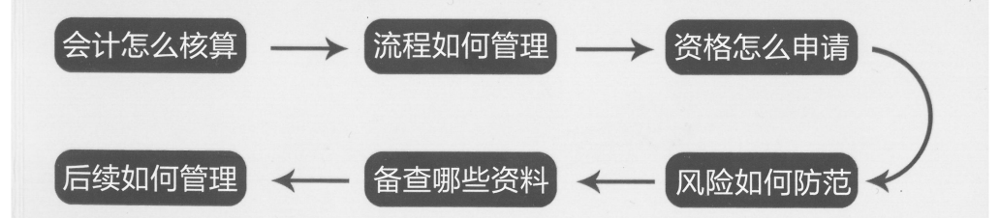

中国市场出版社
China Market Press

<!-- PDF 第 2 页（页眉：无；页脚：未显示；装饰：四角电路风格装饰线框、出版社社标图形） -->
研发费用加计扣除与高新技术企业优惠实务及案例

吴健 万晓玲 王娟 吴冠桦◎著

中国市场出版社
China Market Press
·北 京·

<!-- PDF 第 3 页（页眉：无；页脚：未显示；装饰：出版发行项社标图形、横分隔线） -->
图书在版编目（C I P）数据

研发费用加计扣除与高新技术企业优惠实务及案例 / 吴健等著 . — 北京：中国市场出版社有限公司，2024.3
ISBN 978-7-5092-2544-8

Ⅰ. ①研… Ⅱ. ①吴… Ⅲ. ①高技术企业－技术开发－科技经费－税收政策－案例－中国 ②高技术企业－税收政策－优惠政策－案例－中国 Ⅳ. ①F812.422

中国国家版本馆CIP数据核字（2024）第053912号

研发费用加计扣除与高新技术企业优惠实务及案例
YANFA FEIYONG JIAJI KOUCHU YU GAOXINJISHU QIYE YOUHUI SHIWU JI ANLI

著 者 吴 健 万晓玲 王 娟 吴冠桦
责任编辑 张 瑶（zhangyao9903@126.com ）
出版发行 中国市场出版社
社 址 北京市西城区月坛北小街2号院3号楼（100837）
电 话 （010）68020337 / 68021338
网 址 http://www.scpress.cn
印 刷 河北鑫兆源印刷有限公司
规 格 185mm×260mm 16开本　版 次 2024年3月第1版
印 张 25.25　印 次 2024年3月第1次印刷
字 数 418千字　定 价 98.00元
书 号 ISBN 978-7-5092-2544-8

版权所有 侵权必究 印装差错 负责调换

<!-- PDF 第 4 页（页眉：无；页脚：001；装饰：竖排 PREFACE） -->
# 序 言

研究开发是企业核心竞争力的本源，是促进企业自主创新的重要体现，是企业加快转变经济发展方式的强大推动力。钱学森同志曾经说过，科技创新就是自主研发拥有曾经“买不到、买不起、买回来已落后”的核心技术。创新、产权、知识、人才是核心资源，自主创新是第一要务。

税收优惠是国家根据经济持续、健康、稳定发展的需要和宏观经济调控总体目标制定的税收激励措施，通过减轻或免除特定纳税人的税收负担，达到鼓励或支持的政策目的。近年来，国家财税部门持续完善了一系列促进科技创新的减免税政策，目的就是进一步优化税收管理、减轻企业负担，通过“放水养鱼”增强经济发展的动力和后劲。研发费用加计扣除和高新技术企业优惠，是鼓励科技创新类政策的重中之重，是优惠力度和规模最大的两类企业所得税优惠事项，两类优惠政策要求高、把握难、风险大，一直是税务机关征管的重点和纳税人关注的焦点，也是巡视审计督查的关注点。

为帮助和指导征纳双方更好地了解、掌握和落实好研发费用加计扣除与高新技术企业税收优惠政策，我们撰写了《研发费用加计扣除与高新技术企业优惠实务及案例》一书。本书具体分为两部分共九章内容，第一部分为研发费用加计扣除优惠，包括研发费用加计扣除概述、研发费用加计扣除优惠、IPO研发投入监管要求与研发投入统计、研发费用财务处理与研发内部控制、研发费用加计扣除的申报与风险识别及应对五章内容。第二部分为高新技术企业优惠，包括高新技术企业优惠具体内容、高新技术企业认定条件、监督管理与税收风险管理三章内容。本书力求做到：

<!-- PDF 第 5 页（页眉：| 研发费用加计扣除与高新 | 技术企业优惠实务及案例 |；页脚：002） -->
坚持风险导向。聚焦审计巡视督查等关注重点、稽查典型案例以及反复出现的优惠风险，强化研发费用加计扣除和高新技术企业优惠重点事项管理，并单设两节内容，详细介绍研发费用加计扣除和高新技术企业优惠风险识别与应对，切实防范和化解税收优惠风险。

聚焦两类优惠。现行八大类企业所得税优惠共计约120余项优惠事项，本书聚焦其中两类最重要、优惠力度最大的促进科技创新类企业所得税优惠，系统阐述了优惠沿革、优惠政策内容、享受优惠条件、财务处理、内部控制、IPO监管要求、四类不同口径的差异比较等内容。

增强易理解性。为增强本书的可读性和税收优惠政策的易理解性，我们使用大量表格、思维导图、典型案例等，解析研发费用加计扣除和高新技术企业优惠中的热点、难点、疑点问题。希望这23张图、64张表、70个案例，能帮助广大读者准确理解、运用研发费用加计扣除和高新技术企业优惠。

本书的顺利出版离不开方方面面的支持和帮助，中国市场出版社的编辑们为本书的出版付出了辛勤劳动。国家税务总局税务干部学院陈斌才教授，厦门国家会计学院陈爱华教授，北京中翰税务师事务所集团合伙人、中国财税浪子王骏先生，分别对本书给出了热情的推荐。本书的出版也凝聚了永诚财税集团柴成山董事长、万晓玲、王娟、杨燕、王文丽和中国建设银行宿迁市分行吴冠桦的汗水和智慧，他们整理资料、校对书稿、复核数据，并负责撰写部分章节。书中的部分案例还来自永诚财税集团员工的一线实践。在此谨向您们表示衷心感谢！

虽然我们已经尽己所能，力求做到书中内容完整准确，方便读者阅读和理解，但由于优惠事项复杂，加之时间、精力和水平所限，书中难免有疏漏和不足之处，敬请读者批评指正，与我们共同探讨、改进。广大读者可通过邮箱896659584@qq.com与作者联系。

此外，我们会根据研发费用加计扣除和高新技术企业优惠政策变化，适时通过“财税健谈”微信公众号更新相关内容，读者可以关注阅读或下载。

吴健
2024年3月28日

<!-- PDF 第 6 页（页眉：无；页脚：001；装饰：竖排 C O N T E N T S） -->
# 目 录

第一章 研发费用加计扣除概述 / 001

第一节 研发费用加计扣除政策概述 / 004
一、研发费用加计扣除政策历史沿革 / 004
二、立法确认研发费用加计扣除政策 / 007
三、扩大可加计扣除研发费用归集范围 / 007
四、提高研发费用加计扣除比例 / 009

第二节 研发费用加计扣除政策的调整和完善 / 015
一、放宽研发活动适用范围限制 / 015
二、进一步扩大可加计扣除研发费用归集范围 / 016
三、明确创意设计活动相关费用可税前加计扣除 / 016
四、取消委托境外机构研发不得加计扣除限制 / 016
五、简化对研发费用的归集和核算管理 / 016
六、减少享受优惠的审核程序 / 017
七、提高研发费用加计扣除比例 / 017
八、调整其他相关费用限额计算方法 / 018
九、预缴申报可以享受研发费用加计扣除优惠 / 018

<!-- PDF 第 7 页（页眉：| 研发费用加计扣除与高新 | 技术企业优惠实务及案例 |；页脚：002） -->
第三节 研发活动的界定 / 020
一、科技活动与研发活动 / 020
（一）科技活动的概念 / 020
（二）科技活动的分类 / 020
（三）R&D活动与科技活动的关系 / 021
二、研发活动的界定与类型 / 021
（一）研发活动的税法概念与分类 / 021
（二）科技与财务关于研发活动的界定 / 022
（三）研发活动判断的基本要点 / 023
（四）不适用加计扣除政策的活动 / 024
（五）研发活动判断的边界与说明 / 028
三、研发项目管理 / 031
（一）研发项目的组织形式 / 031
（二）研发项目的流程管理 / 032
（三）研发项目异议鉴定 / 034
（四）项目鉴定存在的主要问题 / 035
（五）广东为研发项目提供事前技术鉴定服务的实践 / 036
四、研发费用加计扣除项目鉴定案例 / 037

第二章 研发费用加计扣除优惠 / 041

第一节 研发费用加计扣除优惠内容 / 044
一、一般行业企业研发费用加计扣除100% / 044
二、集成电路和工业母机企业研发费用加计扣除120% / 046
（一）优惠政策内容 / 046
（二）享受加计扣除120%优惠的集成电路企业应符合的条件 / 047

<!-- PDF 第 8 页（页眉：| 目 录 |；页脚：003） -->
（三）享受加计扣除120%优惠的工业母机企业应符合的条件 / 049
（四）享受加计扣除120%政策的工业母机企业实行清单管理 / 052
（五）享受加计扣除120%政策的工业母机企业需提交的材料 / 053
（六）优惠管理方式 / 055
三、企业投入基础研究支出加计扣除100% / 055
（一）企业投入基础研究支出加计扣除优惠内容 / 055
（二）享受优惠的非营利性科研机构、高等学校应符合的条件 / 056
（三）享受优惠的政府性自然科学基金应符合的条件 / 057
（四）享受优惠的基础研究应符合的条件 / 057
（五）优惠管理与留存备查资料 / 057
四、创意设计活动发生的相关费用加计扣除100% / 058
五、研发费用加计扣除政策的适用范围 / 059
（一）负面清单行业企业不适用研发费用加计扣除优惠 / 059
（二）核定征收企业不适用研发费用加计扣除优惠 / 062
（三）非居民与不能准确归集研发费用的企业不适用加计扣除 / 062
六、研发费用加计扣除与据实扣除 / 063
七、研发费用加计扣除需关注的疑难问题 / 064
（一）加计扣除可以形成或扩大企业亏损 / 064
（二）符合条件未享受加计扣除优惠可追溯3年享受 / 065
（三）研发费用资本化的时点税收与会计处理一致 / 066
（四）研发失败也可享受税前加计扣除优惠 / 066
（五）加计扣除与其他企业所得税优惠可叠加享受 / 067

第二节 允许加计扣除研发费用的归集范围 / 068
一、人员人工费用 / 068
（一）研发人员的分类与界定 / 069
（二）劳务派遣研发人员的劳务费 / 069

<!-- PDF 第 9 页（页眉：| 研发费用加计扣除与高新技术企业优惠实务及案例 |；页脚：004） -->
（三）对研发人员的股权激励支出 / 070
（四）研发人员同时从事非研发活动的处理 / 073
（五）支付兼职人员报酬享受加计扣除优惠问题 / 073
（六）证监会监管规则适用指引对研发人员的认定 / 074
二、直接投入费用 / 078
（一）直接投入费用的归集范围 / 078
（二）研发与生产经营混用仪器、设备租赁费的处理 / 079
（三）应扣减研发费用的不得加计扣除的材料费用 / 079
三、折旧费用 / 080
（一）允许加计扣除的折旧费用的归集范围 / 080
（二）研发与生产经营混用仪器、设备折旧费的加计扣除 / 081
（三）加速折旧费用的加计扣除 / 082
四、无形资产摊销 / 084
（一）允许加计扣除的无形资产摊销的归集范围 / 084
（二）研发与生产经营混用无形资产的摊销 / 084
（三）无形资产加速摊销费的加计扣除 / 084
五、新产品设计费等四项费用 / 085
六、其他相关费用 / 086
（一）可加计扣除的其他相关费用的归集范围 / 086
（二）其他相关费用限额计算 / 087
（三）资本化项目中其他相关费用的处理 / 090
七、不允许加计扣除的费用 / 090
（一）不允许税前扣除的费用和支出不得加计扣除 / 090
（二）无形资产中不属于加计扣除范围的项目摊销时不得加计扣除 / 091
（三）不符合规定的研发费用加计扣除被稽查案例 / 091

<!-- PDF 第 10 页（页眉：| 目 录 |；页脚：005） -->
八、应冲减研发费用的特殊情形 / 093
（一）与研发直接相关的特殊收入应扣减研发费用 / 093
（二）符合规定的研发活动直接消耗的材料应冲减研发费用 / 094
（三）政府补助用于研发应区别情形处理 / 095
九、研发费用归集范围差异比较 / 096
（一）新旧政策差异比较 / 096
（二）IPO案例：研发费归集范围差异及其分析 / 099
第三节  不同研发形式的税务处理 / 105
一、研发形式简介 / 105
二、自主研发 / 105
（一）自主研发的界定 / 105
（二）自主研发的税务处理 / 105
三、委托研发 / 106
（一）委托研发的界定 / 106
（二）委托境内研发的税务处理 / 106
（三）委托境内研发案例分析 / 108
（四）委托境外研发的税务处理 / 110
（五）资本化项目委托境外研发费可加计扣除额的计算 / 113
（六）委托关联方和非关联方研发的区别 / 113
四、合作研发 / 114
（一）合作研发的界定 / 114
（二）合作研发的税务处理 / 114
（三）委托研发与合作研发的区别 / 114
（四）合作研发项目的核算要求 / 115
（五）委托研发与合作研发项目的合同需经科技部门登记 / 115

<!-- PDF 第 11 页（页眉：| 研发费用加计扣除与高新技术企业优惠实务及案例 |；页脚：006） -->
五、集中研发 / 118
（一）集中研发的界定 / 118
（二）财务上集团集中收付研发费用 / 118
（三）集中研发的税务处理 / 118
（四）集中研发项目研发费用分摊的关联申报 / 119
（五）境外集团公司向境内企业分摊研发费用可否加计扣除 / 120
第四节  科技型中小企业研发费用加计扣除优惠与管理 / 121
一、科技型中小企业研发费用加计扣除优惠 / 122
（一）科技型中小企业的界定 / 122
（二）科技型中小企业研发费用加计扣除优惠政策 / 122
（三）科技型中小企业研发费用加计扣除口径 / 125
二、科技型中小企业应符合的条件 / 125
（一）基本条件 / 125
（二）“直通车”条件 / 126
（三）评价指标 / 127
（四）研发费用总额 / 129
三、科技型中小企业评价的组织与实施 / 132
四、科技型中小企业评价工作流程 / 133
（一）注册登记 / 133
（二）自主评价 / 133
（三）信息确认 / 134
（四）名单公示 / 134
（五）入库登记编号 / 134
五、监督管理 / 135
（一）信息更新 / 135
（二）企业诚信 / 135

<!-- PDF 第 12 页（页眉：| 目 录 |；页脚：007） -->
（三）日常监督 / 135
（四）集中抽查 / 136
（五）撤销入库登记编号 / 137
六、优惠的享受与停止 / 137
（一）开始享受优惠 / 137
（二）被撤销登记编号的企业不得享受优惠 / 138
七、主要留存备查资料 / 139
八、研发费用加计扣除综合案例 / 140
第三章  IPO研发投入监管要求与研发投入统计 / 145
第一节  IPO研发投入监管要求 / 148
一、研发投入认定 / 148
（一）研发人员职工薪酬 / 148
（二）共用资源费用 / 149
（三）国拨研发项目支出 / 149
（四）受托研发支出 / 149
（五）委外研发 / 149
（六）研发过程中产出的产品 / 150
二、核查要求 / 150
（一）保荐机构及申报会计师的核查要求 / 150
（二）发行人律师的核查要求 / 152
第二节  研发投入统计 / 153
一、基本任务与统计范围 / 153
二、R&D活动的统计界定 / 154

<!-- PDF 第 13 页（页眉：| 研发费用加计扣除与高新技术企业优惠实务及案例 |；页脚：008） -->
（一）界定、分类与条件 / 154
（二）基础研究 / 154
（三）应用研究 / 154
（四）试验发展 / 154
（五）R&D活动的组织形式 / 155
三、R&D投入统计的基本原则 / 155
（一）法人单位在地统计原则 / 155
（二）条块结合原则 / 155
（三）依托科技统计原则 / 155
（四）多种调查方式相结合原则 / 155
四、人员统计的基本指标 / 156
（一）R&D人员及其分类 / 156
（二）R&D人员统计指标 / 156
五、经费统计的基本指标 / 157
（一）R&D经费支出 / 157
（二）内部支出和外部支出 / 157
六、R&D投入统计的主要分类 / 159
（一）基于R&D活动单位的分类 / 159
（二）基于R&D活动的分类 / 160
第四章  研发费用财务处理与研发内部控制 / 163
第一节  研发费用财务处理 / 166
一、财务上研发费用的开支范围 / 166
二、研发准备金与研发费用的披露 / 167
（一）研发准备金 / 167

<!-- PDF 第 14 页（页眉：| 目 录 |；页脚：009） -->
（二）研发费用的披露与填报 / 167
三、研发支出的费用化或资本化 / 168
（一）研究阶段支出 / 168
（二）开发阶段支出 / 169
（三）无法区分研究阶段和开发阶段的支出 / 169
第二节  研发支出辅助账 / 170
一、研发费用加计扣除的会计核算要求 / 170
（一）遵照国家统一会计制度 / 170
（二）按研发项目设置研发支出辅助账 / 170
（三）研发与生产经营费用应分别核算 / 171
（四）研发费用归集核算需部门间协调配合 / 171
二、2021版研发支出辅助账与汇总表 / 171
（一）研发支出辅助账的样式 / 171
（二）2021版研发支出辅助账 / 172
（三）2021版研发支出辅助账汇总表 / 172
（四）2021版研发支出辅助账的主要变化与填报口径 / 175
（五）研发支出辅助账核算流程 / 176
（六）研发支出辅助账填报案例 / 178
第三节  研发内部控制 / 189
一、研发业务流程 / 189
二、研发活动应当关注的风险 / 190
三、研发业务的主要风险及管控措施 / 191
（一）立项阶段 / 191
（二）研发过程管理 / 192
（三）结题验收 / 193

<!-- PDF 第 15 页（页眉：| 研发费用加计扣除与高新技术企业优惠实务及案例 |；页脚：010） -->
（四）研究成果开发 / 194
（五）研究成果保护 / 195
（六）研发活动评估 / 196
第五章  研发费用加计扣除的申报与风险识别及应对 / 197
第一节  研发费用加计扣除申报与留存备查资料 / 200
一、享受研发费用加计扣除优惠的办理方式 / 200
二、享受研发费用加计扣除的基本流程 / 200
三、享受加计扣除优惠的申报 / 203
（一）预缴申报时加计扣除优惠的享受 / 203
（二）汇算清缴时享受加计扣除优惠涉及的主要表单 / 209
（三）研发费用加计扣除优惠明细表及其填报 / 212
四、主要留存备查资料 / 218
（一）预缴环节享受优惠的留存备查资料 / 218
（二）汇算清缴环节享受优惠的留存备查资料 / 219
（三）委托境外研发的留存备查资料 / 220
（四）创意设计活动相关费用加计扣除留存备查资料 / 220
五、后续管理与核查 / 221
（一）税前扣除或加计扣除额的调整 / 221
（二）后续管理与核查 / 221
（三）税务核查与享受研发费用加计扣除优惠的关系 / 221
六、研发费用加计扣除财税处理案例 / 221
第二节  研发费用加计扣除风险识别与应对 / 237
一、“加计扣除——其他”项目不实风险 / 237

<!-- PDF 第 16 页（页眉：| 目 录 |；页脚：011） -->
（一）识别指标与风险描述 / 237
（二）风险应对 / 237
二、研发费用加计扣除不实风险 / 238
（一）识别指标与风险描述 / 238
（二）风险应对 / 238
三、享受高新技术企业优惠未享受研发费加计扣除风险 / 240
（一）识别指标与风险描述 / 240
（二）风险应对 / 240
第六章  高新技术企业优惠 / 241
第一节  高新技术与高新技术企业 / 244
一、高新技术 / 244
二、高新技术企业 / 244
（一）高新技术企业的界定 / 244
（二）国家需要重点扶持的高新技术企业 / 245
（三）中小高新技术企业 / 246
三、高新技术产业 / 246
四、高新技术企业认定的发展沿革 / 247
五、高新技术企业资格有效期 / 248
第二节  高新技术企业税收优惠 / 249
一、高新技术企业减按 15% 税率征收企业所得税 / 249
（一）高新技术企业企业所得税低税率优惠 / 249
（二）经认定的高新技术企业可依规定申报享受优惠 / 249
（三）享受高新技术企业优惠的起止时间 / 249

<!-- PDF 第 17 页（页眉：| 研发费用加计扣除与高新技术企业优惠实务及案例 |；页脚：012） -->
（四）复核后不符合认定条件已享受优惠的追缴 / 251
（五）被取消高新技术企业资格后税款的追缴 / 251
（六）日常管理中发现不符合认定条件的处理 / 252
二、经济特区和浦东新区新设高新技术企业过渡性优惠 / 252
三、高新技术企业境外所得适用税率及税收抵免 / 253
四、关于选择适用税率与减半征税问题 / 253
（一）过渡期优惠税率的适用与减半征税 / 253
（二）境外所得享受15%优惠时收入总额中境外部分收入口径问题 / 254
（三）西部大开发优惠的税率适用 / 254
五、主要留存备查资料 / 254
（一）高新技术企业低税率优惠主要留存备查资料 / 254
（二）经济特区和浦东新区新设高新技术企业定期减免留存备查资料 / 255
六、高新技术企业税收优惠的申报 / 256
（一）预缴申报 / 256
（二）汇缴申报 / 256
第七章 高新技术企业认定条件 / 261
第一节 高新技术企业应符合的条件 / 264
一、申请认定时须注册成立一年以上 / 267
二、拥有核心自主知识产权的所有权 / 267
（一）知识产权的界定 / 267
（二）高新技术企业认定对知识产权的要求 / 268
（三）知识产权的取得方式 / 270

<!-- PDF 第 18 页（页眉：| 目 录 |；页脚：013） -->
（四）知识产权的评价 / 270
（五）知识产权有效性的判定 / 271
三、技术领域属于规定的范围 / 272
（一）界定依据及其主要变化 / 272
（二）技术领域属于规定范围 / 273
四、科技人员占比不低于10% / 274
（一）科技人员 / 274
（二）职工总数 / 275
（三）统计方法 / 275
五、研究开发费用占销售收入比例条件 / 276
（一）企业研究开发活动的确定 / 277
（二）委托外部研究开发费用 / 280
（三）企业在中国境内发生的研究开发费用 / 281
（四）销售收入 / 282
（五）研发费用的分摊 / 282
六、高新技术产品（服务）收入占比条件 / 284
（一）高新技术产品（服务）与主要产品（服务） / 284
（二）高新技术产品（服务）收入 / 285
（三）总收入与收入总额 / 286
（四）高新技术企业取得的政策性搬迁收入是否计入企业总收入问题 / 289
（五）研发费用资本化部分计算研发费用占比问题 / 289
七、企业创新能力评价达到相应要求 / 289
（一）知识产权 / 290
（二）科技成果转化能力 / 292
（三）研究开发组织管理水平 / 297

<!-- PDF 第 19 页（页眉：| 研发费用加计扣除与高新技术企业优惠实务及案例 |；页脚：014） -->
（四）企业成长性 / 299
八、安全生产和环境保护条件 / 301
第二节 高新技术企业认定研发费用的归集 / 302
一、企业研究开发费用归集办法 / 302
二、研究开发费用的归集范围 / 303
（一）人员人工费用 / 303
（二）直接投入费用 / 304
（三）折旧费用与长期待摊费用 / 306
（四）无形资产摊销费用 / 306
（五）设计费用 / 307
（六）装备调试费用与试验费用 / 308
（七）其他费用 / 308
三、会计、高新技术企业认定和研发费用加计扣除归集口径比较 / 310
（一）研发费用不同归集口径存在差异的原因 / 310
（二）研发费用不同归集口径差异比较 / 311
第八章 监督管理与税收风险管理 / 313
第一节 高新技术企业认定程序与组织管理 / 316
一、认定程序与组织实施 / 316
（一）企业申请 / 316
（二）专家评审 / 317
（三）审查认定 / 318
（四）认定组织与实施 / 319
二、监督管理 / 322

<!-- PDF 第 20 页（页眉：| 目 录 |；页脚：015） -->
（一）随机抽查和重点检查 / 322
（二）企业年报 / 322
（三）更名与重大变化 / 323
（四）异地迁移或搬迁 / 324
（五）复核、核实与审核 / 325
（六）高新技术企业资格的取消 / 326
（七）税务机关的日常管理 / 328
三、企业内各部门间协作配合机制 / 329
第二节 高新技术企业优惠风险及其管理 / 331
一、不符合高新技术企业资格条件风险 / 331
（一）风险特征 / 331
（二）风险识别 / 331
二、应享未享15%税率优惠的风险 / 331
（一）风险特征 / 331
（二）风险识别 / 332
三、不应享而享高新技术企业优惠风险 / 332
（一）风险特征 / 332
（二）风险识别 / 332
四、取消高新技术企业资格仍违规享受优惠风险 / 332
（一）风险特征 / 332
（二）风险识别 / 333
五、关联交易转移利润风险 / 333
（一）风险特征 / 333
（二）风险识别 / 333
六、高新技术企业优惠风险识别与应对指引 / 333

<!-- PDF 第 21 页（页眉：| 研发费用加计扣除与高新技术企业优惠实务及案例 |；页脚：016） -->
（一）识别指标与风险描述 / 333
（二）风险应对指引 / 334
七、高新技术企业优惠管理 / 335
附 录 主要政策依据 / 337
附录 1 研发费用加计扣除政策 / 339
财政部 国家税务总局 科技部关于完善研究开发费用税前加计扣除政策的通知 / 339
国家税务总局关于研发费用税前加计扣除归集范围有关问题的公告 / 343
财政部 税务总局 科技部关于企业委托境外研究开发费用税前加计扣除有关政策问题的通知 / 347
财政部 税务总局关于企业投入基础研究税收优惠政策的公告 / 348
财政部 税务总局关于进一步完善研发费用税前加计扣除政策的公告 / 350
附录 2 高新技术企业政策依据 / 352
高新技术企业认定管理办法 / 352
高新技术企业认定管理工作指引 / 357
国家税务总局关于实施高新技术企业所得税优惠政策有关问题的公告 / 381

<!-- PDF 第 22 页（页眉：无；页脚：未显示；装饰：TAXING） -->
# 第一章 研发费用加计扣除概述

纳税是为权利受保护付费。

——〔美〕詹姆士·韦恩

<!-- PDF 第 23 页（页眉：无；页脚：未显示；装饰：正文段左上、右下有直角装饰线） -->
研究开发是企业核心竞争力的本源，是企业自主创新的重要体现，是企业加快转变经济发展方式的强大推动力。钱学森同志曾经说过，科技创新就是自主研发拥有曾经“买不到、买不起、买回来已落后”的核心技术；即使买到产品，也买不到产权；即使买到产权，也买不到知识；即使买到知识，也买不到人才。由此说明，创新、产权、知识、人才是核心资源，自主创新是第一要务。研发费用加计扣除政策是鼓励科技创新类政策的重中之重。本章作为研发费用概述（如图1-1所示），主要介绍政策沿革、政策的调整和完善以及研发活动的界定。

<!-- PDF 第 24 页（页眉：| 第一章 研发费用加计扣除概述 |；页脚：003） -->
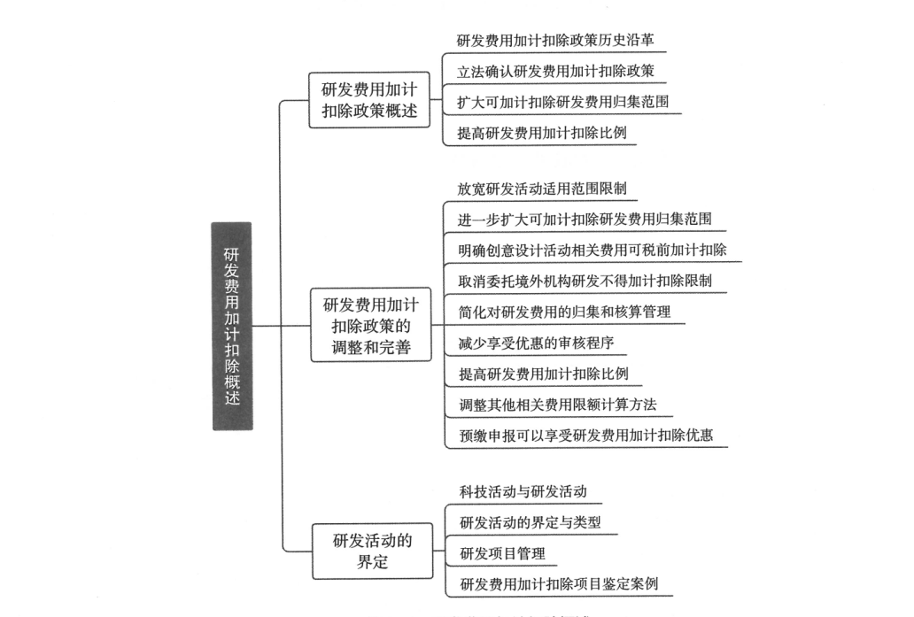
图 1-1 研发费用加计扣除概述

<!-- PDF 第 25 页（页眉：| 研发费用加计扣除与高新 技术企业优惠实务及案例 |；页脚：004） -->
## 第一节 研发费用加计扣除政策概述

### 一、研发费用加计扣除政策历史沿革

现行《企业所得税法》[1] 及其实施条例明确研发费用可享受加计扣除优惠。近年来，国家多次优化完善研发费用加计扣除政策，加大政策优惠力度，具体政策沿革见表1-1。

表 1-1 研发费用加计扣除政策沿革

| 时间 | 政策依据 | 主要内容 | 有效性 |
| --- | --- | --- | --- |
| 2008年开始实施 | 《企业所得税法》及其实施条例 | 以法律形式确认研发费用加计扣除政策 | |
| 2008年12月 | 《国家税务总局关于印发〈企业研究开发费用税前扣除管理办法（试行）〉的通知》（国税发〔2008〕116号） | 对研发费用加计扣除政策做出系统、详细规定 | 失效 |
| 2009年2月 | 《国家税务总局关于企业所得税若干税务事项衔接问题的通知》（国税函〔2009〕98号） | 企业技术开发费加计扣除部分已形成企业年度亏损，可以用以后年度所得按规定弥补 | |

[1] 为行文简洁，本书涉及法律、法规等均采用简称形式，如《企业所得税法》《企业所得税法实施条例》等。

<!-- PDF 第 26 页（页眉：| 第一章 研发费用加计扣除概述 |；页脚：005） -->
续表

| 时间 | 政策依据 | 主要内容 | 有效性 |
| --- | --- | --- | --- |
| 2013年9月 | 《财政部 国家税务总局关于研究开发费用税前加计扣除有关政策问题的通知》（财税〔2013〕70号） | 扩大可加计扣除的研发费用范围 | 失效 |
| 2015年11月 | 《财政部 国家税务总局 科技部关于完善研究开发费用税前加计扣除政策的通知》（财税〔2015〕119号） | 扩大了享受优惠的企业研发活动及研发费用的范围，大幅减少了研发费用加计扣除口径与高新技术企业认定研发费用归集口径的差异 | |
| 2015年12月 | 《国家税务总局关于企业研究开发费用税前加计扣除政策有关问题的公告》（国家税务总局公告2015年第97号） | 细化研发费用加计扣除政策口径及管理要求，提高政策可操作性 | 部分失效 |
| 2017年5月 | 《财政部 国家税务总局 科技部关于提高科技型中小企业研究开发费用税前加计扣除比例的通知》（财税〔2017〕34号） | 将科技型中小企业享受研发费用加计扣除比例由50%提高到75% | |
| | 《国家税务总局关于提高科技型中小企业研究开发费用税前加计扣除比例有关问题的公告》（国家税务总局公告2017年第18号） | 进一步明确科技型中小企业研发费用加计扣除政策执行口径，保证优惠政策的贯彻实施 | 失效 |
| 2017年11月 | 《国家税务总局关于研发费用税前加计扣除归集范围有关问题的公告》（国家税务总局公告2017年第40号） | 进一步完善和明确了部分研发费用范围和归集口径 | |
| 2018年6月 | 《财政部 税务总局 科技部关于企业委托境外研究开发费用税前加计扣除有关政策问题的通知》（财税〔2018〕64号） | 允许委托境外机构研发费用加计扣除 | |
| 2018年9月 | 《财政部 税务总局 科技部关于提高研究开发费用税前加计扣除比例的通知》（财税〔2018〕99号） | 将研发费用加计扣除比例由50%提高到75% | |
| 2021年3月 | 《财政部 税务总局关于延长部分税收优惠政策执行期限的公告》（财政部 税务总局公告2021年第6号） | 将研发费用加计扣除75%政策延期到2023年底 | |
| 2021年3月 | 《财政部 税务总局关于进一步完善研发费用税前加计扣除政策的公告》（财政部 税务总局公告2021年第13号） | 将制造业企业的研发费用加计扣除比例由75%提高到100% | 失效 |

<!-- PDF 第 27 页（页眉：| 研发费用加计扣除与高新 技术企业优惠实务及案例 |；页脚：006） -->
续表

| 时间 | 政策依据 | 主要内容 | 有效性 |
| --- | --- | --- | --- |
| 2021年9月 | 《国家税务总局关于进一步落实研发费用加计扣除政策有关问题的公告》（国家税务总局公告2021年第28号） | 在2021年10月份预缴申报时，允许企业自主选择享受前三季度研发费用加计扣除，优化研发费用辅助账样式，调整“其他相关费用”限额的计算方法 | 部分失效 |
| 2022年3月 | 《财政部 税务总局 科技部关于进一步提高科技型中小企业研发费用税前加计扣除比例的公告》（财政部 税务总局 科技部公告2022年第16号） | 将科技型中小企业的研发费用加计扣除比例由75%提高到100% | 失效 |
| 2022年5月 | 《国家税务总局关于企业预缴申报享受研发费用加计扣除优惠政策有关事项的公告》（国家税务总局公告2022年第10号） | 将企业10月份预缴申报享受研发费用加计扣除政策的举措予以长期化、制度化 | 失效 |
| 2022年9月 | 《财政部 税务总局 科技部关于加大支持科技创新税前扣除力度的公告》（财政部 税务总局 科技部公告2022年第28号） | 现行适用研发费用税前加计扣除比例75%的企业，在2022年10月1日至2022年12月31日期间，研发费用税前加计扣除比例提高到100% | 失效 |
| 2022年9月 | 《财政部 税务总局关于企业投入基础研究税收优惠政策的公告》（财政部 税务总局公告2022年第32号） | 明确企业投入基础研究支出可加计扣除100% | |
| 2023年3月 | 《财政部 税务总局关于进一步完善研发费用税前加计扣除政策的公告》（财政部 税务总局公告2023年第7号） | 将符合条件行业企业研发费用税前加计扣除比例提高到100%的政策，作为制度性安排长期实施 | |
| 2023年6月 | 《国家税务总局 财政部关于优化预缴申报享受研发费用加计扣除政策有关事项的公告》（国家税务总局 财政部公告2023年第11号） | 再新增一个享受时点，7月份预缴申报时企业可就当年上半年发生的研发费用享受加计扣除政策 | |
| 2023年9月 | 《财政部 税务总局 国家发展改革委 工业和信息化部关于提高集成电路和工业母机企业研发费用加计扣除比例的公告》（财政部 税务总局 国家发展改革委 工业和信息化部公告2023年第44号） | 集成电路企业和工业母机企业开展研发活动中实际发生的研发费用可加计120% | |

<!-- PDF 第 28 页（页眉：| 第一章 研发费用加计扣除概述 |；页脚：007） -->
续表

| 时间 | 政策依据 | 主要内容 | 有效性 |
| --- | --- | --- | --- |
| 2023年7月 | 《研发费用加计扣除政策执行指引（2.0版）》 | | |
| | 《研发费用加计扣除项目鉴定案例》 | | |
| 2023年11月 | 《监管规则适用指引——发行类第9号：研发人员及研发投入》 | | |

### 二、立法确认研发费用加计扣除政策

2008年1月1日实施的《企业所得税法》及其实施条例，将研发费用加计扣除优惠政策以法律形式予以确认。

根据《企业所得税法》第三十条的规定，企业开发新技术、新产品、新工艺发生的研究开发费用，可以在计算应纳税所得额时加计扣除。

根据《企业所得税法实施条例》第九十五条的规定，企业为开发新技术、新产品、新工艺发生的研究开发费用，未形成无形资产计入当期损益的，在按照规定据实扣除的基础上，按照研究开发费用的50%加计扣除；形成无形资产的，按照无形资产成本的150%摊销。

为便于纳税人享受优惠政策，同年国家税务总局发布《企业研究开发费用税前扣除管理办法（试行）》（国税发〔2008〕116号，自2016年1月1日起被财税〔2015〕119号文件废止），对研发费用加计扣除政策做出了系统而详细的规定。《国家税务总局关于企业所得税若干税务事项衔接问题的通知》（国税函〔2009〕98号）明确新旧税法衔接问题：“企业技术开发费加计扣除部分已形成企业年度亏损，可以用以后年度所得弥补，但结转年限最长不得超过5年”。

### 三、扩大可加计扣除研发费用归集范围

2013年初，国家决定在中关村、东湖、张江三个国家自主创新示范区和合芜蚌自主创新综合试验区开展扩大研究开发费用加计扣除范围政策试点。当年9月，在

<!-- PDF 第 29 页（页眉：| 研发费用加计扣除与高新 技术企业优惠实务及案例 |；页脚：008） -->
总结试点经验的基础上，《财政部 国家税务总局关于研究开发费用税前加计扣除有关政策问题的通知》（财税〔2013〕70号）发布，将试点政策推广到全国。

根据《财政部 海关总署 国家税务总局关于继续实施支持文化企业发展若干税收政策的通知》（财税〔2014〕85号）第四条的规定，对从事文化产业支撑技术等领域的文化企业，按规定认定为高新技术企业的，减按15%的税率征收企业所得税；开发新技术、新产品、新工艺发生的研究开发费用，允许按照税收法律法规的规定，在计算应纳税所得额时加计扣除。文化产业支撑技术等领域的具体范围和认定工作由科技部、财政部、税务总局商中央宣传部等部门另行明确。

为鼓励企业加大研发投入，有效促进企业研发创新活动，2015年11月，经国务院批准，三部委联合下发《财政部 国家税务总局 科技部关于完善研究开发费用税前加计扣除政策的通知》（财税〔2015〕119号），扩大了享受优惠的企业研发活动及可加计扣除的研发费用的归集范围，大幅减少了研发费用加计扣除口径与高新技术企业认定研发费用归集口径的差异，并首次明确了负面清单制度。《国家税务总局关于企业研究开发费用税前加计扣除政策有关问题的公告》（国家税务总局公告2015年第97号），简化了研发费用在税务处理中的归集、核算及备案管理，进一步降低了企业享受加计扣除优惠的门槛。

2017年11月，为进一步做好研发费用加计扣除优惠政策的贯彻落实工作，切实解决政策落实过程中存在的问题，国家税务总局下发了《国家税务总局关于研发费用税前加计扣除归集范围有关问题的公告》（国家税务总局公告2017年第40号），聚焦研发费用归集范围，完善和明确了部分研发费用执行口径。

根据国务院常务会议有关取消企业委托境外研发费用不得加计扣除限制和提高加计扣除比例的精神，《财政部 税务总局 科技部关于企业委托境外研究开发费用税前加计扣除有关政策问题的通知》（财税〔2018〕64号）规定，自2018年1月1日起，委托境外（作者注：指境外机构）进行研发活动所发生的费用，按照费用实际发生额的80%计入委托方的委托境外研发费用。委托境外研发费用不超过境内符合条件的研发费用三分之二的部分，可以按规定在企业所得税前加计扣除。

<!-- PDF 第 30 页（页眉：| 第一章 研发费用加计扣除概述 |；页脚：009） -->
### 四、提高研发费用加计扣除比例

##### 1.将研发费用加计扣除比例提高到75%

2017年5月，为进一步鼓励科技型中小企业加大研发费用投入，根据国务院常务会议决定，三部委联合印发了《财政部 国家税务总局 科技部关于提高科技型中小企业研究开发费用税前加计扣除比例的通知》（财税〔2017〕34号），将科技型中小企业享受研发费用加计扣除比例由50%提高到75%。国家税务总局同时下发了《国家税务总局关于提高科技型中小企业研究开发费用税前加计扣除比例有关问题的公告》（国家税务总局公告2017年第18号），进一步明确政策执行口径，保证优惠政策的贯彻实施。三部委还印发了《科技部 财政部 国家税务总局关于印发〈科技型中小企业评价办法〉的通知》（国科发政〔2017〕115号），明确了科技型中小企业评价标准和程序。

《财政部 税务总局 科技部关于提高研究开发费用税前加计扣除比例的通知》（财税〔2018〕99号）规定，企业开展研发活动中实际发生的研发费用，未形成无形资产计入当期损益的，在按规定据实扣除的基础上，在2018年1月1日至2020年12月31日期间，再按照实际发生额的75%在税前加计扣除；形成无形资产的，在上述期间按照无形资产成本的175%在税前摊销。为贯彻落实2021年全国“两会”精神，《财政部 税务总局关于延长部分税收优惠政策执行期限的公告》（财政部 税务总局公告2021年第6号）将财税〔2018〕99号文件规定的研发费用加计扣除75%优惠政策执行期限延长至2023年12月31日。

##### 2.将研发费用加计扣除比例提高到100%

（1）将制造业企业研发费用加计扣除比例提高到100%。

根据《财政部 税务总局关于进一步完善研发费用税前加计扣除政策的公告》〔财政部 税务总局公告2021年第13号，自2023年1月1日起被《财政部 税务总局关于进一步完善研发费用税前加计扣除政策的公告》（财政部 税务总局公告2023年第7号）废止〕第一条的规定，制造业企业开展研发活动中实际发生的研发费用，未形成无形资产计入当期损益的，在按规定据实扣除的基础上，自2021年1月1日起，再按照实际发生额的100%在税前加计扣除；形成无形资产的，自2021年1月1

<!-- PDF 第 31 页（页眉：| 研发费用加计扣除与高新 技术企业优惠实务及案例 |；页脚：010） -->
日起，按照无形资产成本的200%在税前摊销。

制造业企业，是指以制造业业务为主营业务，享受优惠当年主营业务收入占收入总额的比例达到50%以上的企业。制造业的范围按照《国民经济行业分类》（GB/T 4574—2017）确定（如表1-2所示）。收入总额按照《企业所得税法》第六条规定执行。

表 1-2 国民经济行业分类代码表

| 代 码 | | | | 类别名称 |
| --- | --- | --- | --- | --- |
| 门类 | 大类 | 中类 | 小类 | |
| C | | | | 制造业 |
| | 13 | | | 农副食品加工业 |
| | 14 | | | 食品制造业 |
| | 15 | | | 酒、饮料和精制茶制造业 |
| | 16 | | | 烟草制品业 |
| | 17 | | | 纺织业 |
| | 18 | | | 纺织服装、服饰业 |
| | 19 | | | 皮革、毛皮、羽毛及其制品和制鞋业 |
| | 20 | | | 木材加工和木、竹、藤、棕、草制品业 |
| | 21 | | | 家具制造业 |
| | 22 | | | 造纸和纸制品业 |
| | 23 | | | 印刷和记录媒介复制业 |
| | 24 | | | 文教、工美、体育和娱乐用品制造业 |
| | 25 | | | 石油、煤炭及其他燃料加工业 |
| | 26 | | | 化学原料和化学制品制造业 |
| | 27 | | | 医药制造业 |
| | 28 | | | 化学纤维制造业 |
| | 29 | | | 橡胶和塑料制品业 |
| | 30 | | | 非金属矿物制品业 |
| | 31 | | | 黑色金属冶炼和压延加工业 |
| | 32 | | | 有色金属冶炼和压延加工业 |

<!-- PDF 第 32 页（页眉：| 第一章 研发费用加计扣除概述 |；页脚：011） -->
续表

| 代 码 | | | | 类别名称 |
| --- | --- | --- | --- | --- |
| 门类 | 大类 | 中类 | 小类 | |
| | 33 | | | 金属制品业 |
| | 34 | | | 通用设备制造业 |
| | 35 | | | 专用设备制造业 |
| | 36 | | | 汽车制造业 |
| | 37 | | | 铁路、船舶、航空航天和其他运输设备制造业 |
| | 38 | | | 电气机械和器材制造业 |
| | 39 | | | 计算机、通信和其他电子设备制造业 |
| | 40 | | | 仪器仪表制造业 |
| | 41 | | | 其他制造业 |
| | 42 | | | 废弃资源综合利用业 |
| | 43 | | | 金属制品、机械和设备修理业 |

企业享受研发费用加计扣除政策的其他政策口径和管理要求，按照《财政部 国家税务总局 科技部关于完善研究开发费用税前加计扣除政策的通知》（财税〔2015〕119号）、《财政部 税务总局 科技部关于企业委托境外研究开发费用税前加计扣除有关政策问题的通知》（财税〔2018〕64号）等文件相关规定执行。

优化完善研发费用加计扣除政策依然是鼓励科技创新类政策的重中之重。2021年，相关部门对研发费用加计扣除政策从政策、管理等多个维度进行了完善。《财政部 税务总局关于进一步完善研发费用税前加计扣除政策的公告》（财政部 税务总局公告2021年第13号）将制造业研发费用加计扣除比例由75%提高到100%。对于此项政策，重点需要关注制造业的判断问题。对于制造业的判断，与固定资产加速折旧政策一致，采取“主营业务收入占比+国民经济行业分类”的办法，具体为：

①主营业务收入占收入总额的比例要达到50%以上。考虑到企业存在多业经营的实际情况，政策明确企业主要从事制造业业务，即主营业务收入占比达到50%以上即可享受。收入总额按照《企业所得税法》第六条规定执行。按照规定，企业取

<!-- PDF 第 33 页（页眉：| 研发费用加计扣除与高新技术企业优惠实务及案例 |；页脚：012） -->
得免税收入、不征税收入也属于收入总额的计算范围，应作为计算主营业务收入占比的基数。

②按照国民经济行业分类确定制造业。这也是税收政策在判断行业时普遍采用的方法。现行的国民经济行业分类于2017年发布，如果以后有新的版本发布，则按新版本执行。此外，由于资本化研发费用涉及多个时点，具体以哪个时点所属年度判断企业行业，也是在政策执行中面临的问题。为保持政策的一致性，判断制造业的时点也应以摊销点为准，即2021年企业摊销的比例取决于企业在2021年是否符合制造业的条件，如符合则按200%摊销，不符合则按175%摊销，与发生年度和形成资产年度是否属于制造业无关。同时，2021年企业行业性质只能决定企业2021年摊销比例，以后年度摊销比例仍取决于摊销当年是否属于制造业。

【例1-1】乙公司是一家制造业企业，2020年经研发形成了一项计税基础为100万元的无形资产，分10年按直线法摊销。

要求：分析说明2021年可否适用制造业企业研发费用加计扣除政策。

【解析】制造业企业按100%加计扣除政策，对无形资产的形成时间没有具体要求。对于制造业企业2021年以前形成的无形资产，自2021年1月1日起，可以按照无形资产成本的200%在税前摊销。具体到乙公司，假设该无形资产的计税基础均属于可加计扣除的研发费用范围，分10年摊销，则在2020年按照普惠性研发费用加计扣除政策，可在税前摊销扣除17.5万元，2021年起按照制造业企业研发费用加计扣除政策，可在税前摊销扣除20万元，如果按25%税率，换算成税款，每年多减税0.625万元。

（2）将2022年第四季度加计扣除比例提高到100%。

根据《财政部 税务总局 科技部关于加大支持科技创新税前扣除力度的公告》〔财政部 税务总局 科技部公告2022年第28号，自2023年1月1日起被《财政部 税务总局关于进一步完善研发费用税前加计扣除政策的公告》（财政部 税务总局公告2023年第7号）废止〕第二条的规定，适用研发费用税前加计扣除比例75%的企业，在2022年10月1日至2022年12月31日期间，税前加计扣除比例提高到100%。企

<!-- PDF 第 34 页（页眉：| 第一章 研发费用加计扣除概述 |；页脚：013） -->
业在2022年度企业所得税汇算清缴计算享受研发费用加计扣除优惠时，第四季度研发费用可由企业自行选择按实际发生数计算，或者按全年实际发生的研发费用乘以2022年10月1日后的经营月份数占其2022年度实际经营月份数的比例计算。

（3）将科技型中小企业研发费用加计扣除比例提高到100%。

根据《财政部 税务总局 科技部关于进一步提高科技型中小企业研发费用税前加计扣除比例的公告》〔财政部 税务总局 科技部公告2022年第16号，自2023年1月1日起被《财政部 税务总局关于进一步完善研发费用税前加计扣除政策的公告》（财政部 税务总局公告2023年第7号）废止〕的规定，科技型中小企业开展研发活动中实际发生的研发费用，未形成无形资产计入当期损益的，在按规定据实扣除的基础上，自2022年1月1日起，再按照实际发生额的100%在税前加计扣除；形成无形资产的，自2022年1月1日起，按照无形资产成本的200%在税前摊销。

（4）将研发费用加计扣除比例统一提高到100%。

自2023年1月1日起，《财政部 税务总局关于进一步完善研发费用税前加计扣除政策的公告》（财政部 税务总局公告2023年第7号）第一条规定，企业开展研发活动中实际发生的研发费用，未形成无形资产计入当期损益的，在按规定据实扣除的基础上，自2023年1月1日起，再按照实际发生额的100%在税前加计扣除；形成无形资产的，自2023年1月1日起，按照无形资产成本的200%在税前摊销。

##### 3.将集成电路和工业母机企业加计扣除比例提高到120%

《财政部 税务总局 国家发展改革委 工业和信息化部关于提高集成电路和工业母机企业研发费用加计扣除比例的公告》（财政部 税务总局 国家发展改革委 工业和信息化部公告2023年第44号）第一条规定，集成电路企业和工业母机企业开展研发活动中实际发生的研发费用，未形成无形资产计入当期损益的，在按规定据实扣除的基础上，在2023年1月1日至2027年12月31日期间，再按照实际发生额的120%在税前扣除；形成无形资产的，在上述期间按照无形资产成本的220%在税前摊销。

研发费用加计扣除比例调整情况如图1-2所示。

<!-- PDF 第 35 页（页眉：| 研发费用加计扣除与高新技术企业优惠实务及案例 |；页脚：014） -->
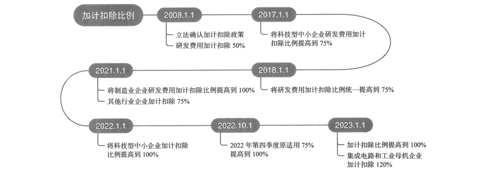
图 1-2 研发费用加计扣除比例

<!-- PDF 第 36 页（页眉：| 第一章 研发费用加计扣除概述 |；页脚：017） -->
业可能没有单独设立专账核算，申报的时候往往不符合条件。调整后的政策，只是要求企业在现有会计科目基础上，按照研发项目设置辅助账。辅助账比专账简化得多，企业的核算管理更为简便。

### 六、减少享受优惠的审核程序

原来企业享受加计扣除优惠，必须在企业所得税年度纳税申报时向税务机关提供全部有效证明，税务机关对企业申报的研发项目有异议时，由企业提供科技部门的鉴定意见，增加了企业的工作量，导致企业享受优惠的门槛较高。调整后的程序将企业享受加计扣除优惠政策简化为自行申报享受，有关资料由企业留存备查即可。另外，对争议解决机制也进行了调整，如果税务机关对研发项目有异议，不再由企业找科技部门进行鉴定，而是由税务机关转请科技部门提供鉴定意见。因此企业享受优惠政策更便捷、更直接、更高效。

### 七、提高研发费用加计扣除比例

自2023年1月1日起，《财政部 税务总局关于进一步完善研发费用税前加计扣除政策的公告》（财政部 税务总局公告2023年第7号）第一条规定，企业开展研发活动中实际发生的研发费用，未形成无形资产计入当期损益的，在按规定据实扣除的基础上，自2023年1月1日起，再按照实际发生额的100%在税前加计扣除；形成无形资产的，自2023年1月1日起，按照无形资产成本的200%在税前摊销。

《财政部 税务总局 国家发展改革委 工业和信息化部关于提高集成电路和工业母机企业研发费用加计扣除比例的公告》（财政部 税务总局 国家发展改革委 工业和信息化部公告2023年第44号）第一条规定，集成电路企业和工业母机企业开展研发活动中实际发生的研发费用，未形成无形资产计入当期损益的，在按规定据实扣除的基础上，在2023年1月1日至2027年12月31日期间，再按照实际发生额的120%在税前扣除；形成无形资产的，在上述期间按照无形资产成本的220%在税前摊销。

<!-- PDF 第 37 页（页眉：| 研发费用加计扣除与高新技术企业优惠实务及案例 |；页脚：018） -->
### 八、调整其他相关费用限额计算方法

根据《国家税务总局关于进一步落实研发费用加计扣除政策有关问题的公告》（国家税务总局公告2021年第28号）的规定，自2021年度起，企业在一个纳税年度内同时开展多项研发活动的，由原来按照每一研发项目分别计算“其他相关费用”限额，改为统一计算全部研发项目“其他相关费用”限额。

企业按照以下公式计算《财政部 国家税务总局 科技部关于完善研究开发费用税前加计扣除政策的通知》（财税〔2015〕119号）第一条第（一）项“允许加计扣除的研发费用”第6目规定的“其他相关费用”的限额，其中资本化项目发生的费用在形成无形资产的年度统一纳入计算：

全部研发项目的其他相关费用限额 = 全部研发项目的人员人工等五项费用之和 × 10% / （1-10%）

### 九、预缴申报可以享受研发费用加计扣除优惠

根据《国家税务总局 财政部关于优化预缴申报享受研发费用加计扣除政策有关事项的公告》（国家税务总局 财政部公告2023年第11号）第一条的规定，企业7月份预缴申报第二季度（按季预缴）或6月份（按月预缴）企业所得税时，能准确归集核算研发费用的，可以结合自身生产经营实际情况，自主选择就当年上半年研发费用享受加计扣除政策。对7月份预缴申报期未选择享受优惠的企业，在10月份预缴申报或年度汇算清缴时能够准确归集核算研发费用的，可结合自身生产经营实际情况，自主选择在10月份预缴申报或年度汇算清缴时统一享受。

该公告第二条规定，企业10月份预缴申报第三季度（按季预缴）或9月份（按月预缴）企业所得税时，能准确归集核算研发费用的，企业可结合自身生产经营实际情况，自主选择就当年前三季度研发费用享受加计扣除政策。对10月份预缴申报期未选择享受优惠的企业，在年度汇算清缴时能够准确归集核算研发费用的，可结合自身生产经营实际情况，自主选择在年度汇算清缴时统一享受。

《企业所得税法》及其实施条例、《财政部 国家税务总局 科技部关于完善研究

<!-- PDF 第 38 页（页眉：| 第一章 研发费用加计扣除概述 |；页脚：019） -->
开发费用税前加计扣除政策的通知》（财税〔2015〕119号）、《国家税务总局关于企业研究开发费用税前加计扣除政策有关问题的公告》（国家税务总局公告2015年第97号）、《国家税务总局关于研发费用税前加计扣除归集范围有关问题的公告》（国家税务总局公告2017年第40号）、《国家税务总局 财政部关于优化预缴申报享受研发费用加计扣除政策有关事项的公告》（国家税务总局 财政部公告2023年第11号）、《财政部 税务总局关于进一步完善研发费用税前加计扣除政策的公告》（财政部 税务总局公告2023年第7号）、《财政部 税务总局 国家发展改革委 工业和信息化部关于提高集成电路和工业母机企业研发费用加计扣除比例的公告》（财政部 税务总局 国家发展改革委 工业和信息化部公告2023年第44号）等，就企业享受研发费用加计扣除的范围、税收管理等做了全面系统的规定，形成了税收法律、法规、规范性文件和《研发费用加计扣除政策执行指引（2.0版）》相配套的研发费用税前加计扣除制度体系。

<!-- PDF 第 39 页（页眉：| 研发费用加计扣除与高新技术企业优惠实务及案例 |；页脚：020；装饰：节标题下有一条横线） -->
## 第三节 研发活动的界定

### 一、科技活动与研发活动

#### （一）科技活动的概念

科学技术活动简称科技活动，是指所有与各科学技术领域（即自然科学、农业科学、医药科学、工程技术、人文与社会科学）中科技知识的产生、发展、传播和应用密切相关的系统的活动。

#### （二）科技活动的分类

联合国教科文组织在1978年《关于科学技术统计国际标准化的建议》中将科学技术活动划分为三类：研究与试验发展（R&D）、科技教育与培训（STET）和科技服务（STS）。经合组织（OECD）的《弗拉斯卡蒂手册》沿用了这种分类方法。其中，科技教育与培训是指与大学专科、本科及以上（硕士生、博士生）教育培训，以及针对在职研究人员的教育与培训有关的所有活动。科技服务（STS）是指与R&D活动相关并有助于科学技术知识的产生、传播和应用的活动。

我国科技统计将统计范围内的科技活动分为三类：研究与试验发展（R&D）、R&D成果应用和科技服务（如图1-4所示）。其中R&D成果应用是指为使试验发展阶段产生的新产品、材料和装置，建立的新工艺系统和服务，以及做了实质性改进后的上述各项能够投入生产或在实际中运用，解决所存在的技术问题而进行的系统活动。科技服务的具体活动内容包括：科技成果的示范推广；信息和文献服务；技

<!-- PDF 第 40 页（页眉：| 第一章 研发费用加计扣除概述 |；页脚：021） -->
术咨询；自然、生物现象的日常观测、监测、资源的考察和勘探；有关社会、人文、经济现象的通用资料的收集、分析与整理；科学普及；为社会和公众提供的测试、标准化、计量、质量控制和专利服务等。

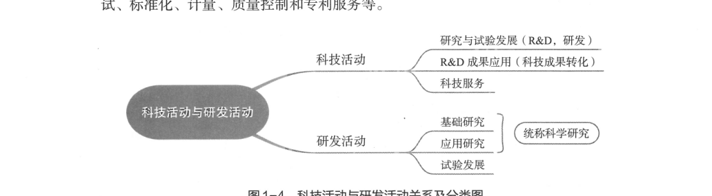
图 1-4 科技活动与研发活动关系及分类图

#### （三）R&D活动与科技活动的关系

R&D活动是科技活动的核心组成部分。与其他科技活动相比，R&D活动的最显著特征是创造性，体现新知识的产生、积累和应用，常常会取得新的发现发明或新产品（技术）等，R&D活动预定目标能否实现往往存在不确定性。其他科技活动都是围绕R&D活动发生的，要么是为R&D成果向生产和市场转化提供支持（R&D成果应用），要么是为R&D活动及知识传播提供全方位的配套支持服务（科技服务）。这些活动与R&D活动的根本区别在于，它们只涉及技术的一般性应用，本身不具有创造性。

### 二、研发活动的界定与类型

#### （一）研发活动的税法概念与分类

厘清研发活动的概念，有助于正确理解和把握研发费用加计扣除政策。而研发活动在科技上、财务上与税收上的表述不完全相同。

企业申请享受研发费用加计扣除政策，首先需要明确其研发项目是否为研发活动。根据财税〔2015〕119号文件的规定，研发活动是指企业为获得科学与技术新

<!-- PDF 第 41 页（页眉：| 研发费用加计扣除与高新技术企业优惠实务及案例 |；页脚：022） -->
知识，创造性运用科学技术新知识，或实质性改进技术、产品（服务）、工艺而持续进行的具有明确目标的系统性活动。

该定义主要参照《弗拉斯卡蒂手册》《企业会计准则第6号——无形资产》《企业会计制度》对研发活动的界定。研发活动可分为基础研究、应用研究、试验发展三种类型（如表1-3所示）。

表1-3 研发活动类型及形式

| 类型 | 研发活动 | | 非研发活动 |
| --- | --- | --- | --- |
| | 主要目的 | 具体形式 | |
| 基础研究 | 基础研究不预设某一特定的应用或使用目的，主要是为获得关于现象和可观察事实的基本原理的新知识，可针对已知或具有前沿性的科学问题，或者针对人们普遍感兴趣的某些广泛领域，以未来广泛应用为目标 | 分为两种类型：一是自由探索性基础研究，即为了增进知识，不追求经济或社会效益，也不积极谋求将其应用于实际问题或把成果转移到负责应用的部门；二是目标导向（定向）基础研究，旨在获取某方面知识、期望为探索解决当前已知或未来可能发现的问题奠定基础 | 艺术或人文学方面的研究 |
| 应用研究 | 主要针对某一特定的实际应用目的或目标，为获取新知识或寻找已有知识的实际应用途径而开展的创造性研究 | 包括辨别基础研究成果的可应用性，或者研究出一套使企业能够完成预先设定的发展目标的新方案等 | 对某项科研成果的直接应用，对现存产品、服务、技术、材料或工艺流程进行的重复或简单改变 |
| 试验发展 | 主要是利用从科学研究和实际经验中获得的现有知识，为生产新材料、新产品、新设备，建立新工艺、新系统，或对已产生和已建立的上述各项进行实质性改进而进行的开发、试制、小试、中试等试验性、系统性工作 | 原型样机设计、制造、测试，设计新工艺所需要的专用设备和架构，对新产品和新工艺的构思、开发和样品制造等 | 市场调查、质量控制、测试分析、维修维护、常规测试、为生产工艺而进行的设计、试生产等 |

#### （二）科技与财务关于研发活动的界定

在科技上，企业研发活动是指具有明确创新目标、系统组织形式和较强创造性

<!-- PDF 第 42 页（页眉：| 第一章 研发费用加计扣除概述 |；页脚：023） -->
的企业活动。

根据《企业会计准则第6号——无形资产》及其应用指南（2006年版）的规定，企业内部研究开发项目的支出，应当区分研究阶段支出与开发阶段支出。企业应当根据研究与开发的实际情况加以判断，将研究开发项目区分为研究阶段与开发阶段，其定义与特征如表1-4所示。

表1-4 研发活动研究阶段与开发阶段定义及特征

| 研发阶段 | 定 义 | 特 征 | 活动举例 |
| --- | --- | --- | --- |
| 研究阶段 | 为获取新的科学或技术知识并理解它们而进行的独创性的有计划调查 | 研究阶段是探索性的，为进一步开发活动进行资料及相关方面的准备，已进行的研究活动将来是否会转入开发、开发后是否会形成无形资产等均具有较大的不确定性 | 意在获取知识而进行的活动，研究成果或其他知识的应用研究、评价和最终选择，材料、设备、产品、工序系统或服务替代品的研究，新的或经改进的材料、设备、产品、工序系统或服务的可能替代品的配置、设计、评价和最终选择等 |
| 开发阶段 | 在进行商业性生产或使用前，将研究成果或其他知识应用于某项计划或设计，以生产出新的或具有实质性改进的材料、装置、产品等 | 已完成研究阶段的工作，在很大程度上具备了形成一项新产品或新技术的基本条件 | 生产前或使用前的原型和模型的设计、建造和测试，不具有商业性生产经济规模的试生产设施的设计、建造和运营等 |

《企业会计制度》则规定，研究与开发活动是指企业开发新产品、新技术所进行的活动。研究和开发活动的目的是实质性改进技术、产品和服务，将科研成果转化为质量可靠、成本可行、具有创新性的产品、材料、装置、工艺和服务。

#### （三）研发活动判断的基本要点

根据研发活动的判断要点（见表1-5），企业可自行判断其相关项目是否为研发活动。

<!-- PDF 第 43 页（页眉：| 研发费用加计扣除与高新技术企业优惠实务及案例 |；页脚：024） -->
表1-5 研发活动判断要点及内涵

| 序号 | 要点 | 内 涵 |
| --- | --- | --- |
| 1 | 有明确创新目标 | 研发活动一般具有明确的创新目标，如获得新知识、新技术、新工艺、新材料、新产品、新标准等。可通过一些问题予以明确，例如：该活动是否要探索以前未发现的现象、结构或关系？是否在一定范围要突破现有的技术瓶颈？研发成果是否不可预期？如果回答为“是”，则说明该活动具有明确的创新目标 |
| 2 | 有系统组织形式 | 研发活动以项目、课题等方式组织进行，围绕具体目标，有较为确定的人、财、物等支持，经过立项、实施、结题的组织过程，因此是有边界的和可度量的 |
| 3 | 研发结果不确定 | 研发活动的结果是不能完全事先预期的，必须经过反复不断的试验、测试，具有较大的不确定性，存在失败的可能 |

【例1-2】C公司主营计算机周边设备制造业务，其某款显示器已获得专利并上市销售。现应客户要求在现有产品基础上进行一些简单升级改进，但企业仍将本次简单升级改造的人员人工费用、折旧费用、无形资产摊销费加计扣除。

请判断以上是否属于研发费用加计扣除政策的“研发活动”。

【解析】《财政部 国家税务总局 科技部关于完善研究开发费用税前加计扣除政策的通知》（财税〔2015〕119号）强调，研发活动，是指企业为获得科技与技术新知识，创造性运用科学技术新知识，或实质性改进技术、产品（服务）、工艺而持续进行的具有明确目标的系统性活动，要满足先进性、创新性。个别企业将产品的常规升级或简单集成判断为研发活动，会给企业带来涉税风险。建议企业在判断其行为是否属于研发活动时，重点关注财税〔2015〕119号文件中规定的不适用加计扣除政策的一般的知识性、技术性活动。财税〔2015〕119号文件还规定，当税企双方对研发项目产生争议时，由税务机关转请科技部门提供鉴定意见。如果企业确实无法准确把握是否属于“研发活动”，可以向科技部门咨询。

#### （四）不适用加计扣除政策的活动

研发费用加计扣除政策有两个负面清单，一个是研发活动负面清单，另一个是行业负面清单。凡是上述两个负面清单之外的研发活动和行业企业均允许研发费用

<!-- PDF 第 44 页（页眉：| 第一章 研发费用加计扣除概述 |；页脚：025；装饰：案例栏目标题条右侧有斜线装饰） -->
加计扣除。

为提高政策的精准性、可操作性，财税〔2015〕119号文件明确企业发生的以下一般的知识性、技术性活动不属于税收意义上的研发活动，其支出不适用研发费用加计扣除政策：

（1）企业产品（服务）的常规性升级；

（2）对某项科研成果的直接应用，如直接采用公开的新工艺、材料、装置、产品、服务或知识等；

（3）企业在商品化后为顾客提供的技术支持活动；

（4）对现存产品、服务、技术、材料或工艺流程进行的重复或简单改变；

（5）市场调查研究、效率调查或管理研究；

（6）作为工业（服务）流程环节或常规的质量控制、测试分析、维修维护；

（7）社会科学、艺术或人文学方面的研究。

其中，第（1）至（6）类活动虽与研发活动有密切关系，但都不属于研发活动。

为加深对研发活动的理解和准确把握，根据研发活动的定义，财税〔2015〕119号文件将企业发生的一般性的知识性、技术性活动，如产品（服务）的常规性升级，对某项科研成果的直接应用，社会科学、艺术或人文学方面的研究等7项活动排除在税收上可加计扣除的研发活动之外。由于此类活动不属于税收意义上的研发活动，因而此类活动所发生的支出不适用研发费用加计扣除优惠政策。

上述所列举的7类活动，仅是采取反列举的方法，对什么活动属于研发活动所做的有助于理解和把握的说明，并不意味着上述7类活动以外的活动都属于研发活动。企业开展的可适用研发费用加计扣除政策的活动，通常须符合税法有关研发活动的基本定义等相关条件。

案例1 智能××多功能办公桌

##### 1.企业提供的项目基本情况

（1）项目研发目标和内容。

针对市场上办公桌的传统办公单一属性，企业认为“智能××多功能办公桌”

<!-- PDF 第 45 页（页眉：| 研发费用加计扣除与高新技术企业优惠实务及案例 |；页脚：026） -->
项目的研发目标旨在办公智能化、舒适度等方面实现突破性的创新。

（2）拟突破的核心技术和技术创新点。

“关键技术”“创新点”“技术指标”等介绍内容，均笼统地描述为“包含×××功能”“实现×××功能”。

（3）拟达到的技术指标。

未设定定量的技术指标。

##### 2.专家鉴定情况

该项目提请科技部门组织专家鉴定，专家判断该项目不具有创新性，不属于研发活动。主要理由如下：

（1）项目目标没有体现创新性。

“智能××多功能办公桌”项目是将现有成熟产品“办公桌”“旋转式抽屉”“USB接口”“电源插座”“LED灯”等组件简单组合，这些组件在当下市场中已经是十分成熟的工业产品。项目的整体设计方案属于对现有成熟工业化产品的简单组合。

（2）项目组织实施的关键材料缺失，系统性体现不足。

项目技术路线未从技术实现的路径角度充分论证，仅简单介绍为“立项可行性分析——总体设计——技术方案与加工工艺确认——样品制作……”，实施过程中未制定定量的技术指标。

（3）项目实施过程缺乏实验记录，无法证明研发结果不确定性。

项目完成情况仅简单描述为“按照立项要求完成，且实现了相应技术目标”，未提供任何相关实验测试记录、性能数据、产品照片等佐证材料。在未设定定量的考核指标的前提下，结论描述为“各项参数均已达标，满足立项设计要求”。

综上所述，该项目不具有创新性，属于《财政部 国家税务总局 科技部关于完善研究开发费用税前加计扣除政策的通知》（财税〔2015〕119号）第一条第（二）款“下列活动不适用税前加计扣除政策”第4项“对现存产品、服务、技术、材料或工艺流程进行的重复或简单改变”的情形，不是符合条件的研发活动，无法适用研发费用加计扣除政策。

<!-- PDF 第 46 页（页眉：| 第一章 研发费用加计扣除概述 |；页脚：027；装饰：案例栏目标题条右侧有斜线装饰） -->
案例2 微信社群粉丝经营平台

##### 1.企业提供的项目基本情况

（1）项目研发目标和内容。

随着业务发展和社群规模的不断扩张，企业发现运营人员承压、服务相应不足，存在安全隐患等问题，希望通过粉丝经营平台实现会话监测、引入AI客服，减轻运营压力、提升响应水平、保障运营安全。在企业微信社群粉丝经营平台项目的开发过程中，会话存档部分使用了Kafka消息队列，有效解决了大批量会话存档以及分发给数据室备份等并发问题，同时增强了系统的稳定性与实时性能。为了满足增强系统可靠性的要求，开发团队进一步优化了会话存档相关流程，以及为保证数据稳定，实时使用了Kafka将数据发送给数据室，进而保证了数据可靠性。

（2）拟突破的核心技术和技术创新点。

该项目在开发过程中运用了诸多新技术，如：

①ACS云技术：多可用区架构部署、快速交付、弹性扩容，提升运维效率及核心竞争力。

②数据传输安全技术：敏感信息使用国密算法进行加密传输，定时漏洞扫描，数据多渠道备份，多维度保障系统安全。

③数据保障技术：业务数据基于重要程度进行入库，使数据能够沉淀并保障数据安全，数据库层面主备共存，保证数据安全可靠保存。

（3）拟达到的技术指标。

未设定定量的技术指标。

##### 2.专家鉴定情况

该项目提请科技部门组织专家鉴定，专家认为该项目不具有创新性，不属于研发活动。主要理由如下：

（1）项目目标没有体现创新性。

该项目是企业微信平台的简单应用开发，目标是实现会话监测、引入AI客服，减轻运营压力、提升响应水平、保障运营安全等。这些目标与当前市场上多类型的在线客户社群管理相似，缺乏明确的创新性。

<!-- PDF 第 47 页（页眉：| 研发费用加计扣除与高新技术企业优惠实务及案例 |；页脚：028） -->
（2）拟突破的核心技术属于现有成熟技术。

该项目前端技术采用微信小程序技术框架，后台技术涉及ACS云技术、数据加密、数据传输等现有技术，同时基于Redis和Kafka实现快速的消息订阅与分发，上述技术是较为成熟的软件技术框架和PAAS服务，可用性和易用性已经得到充分论证，在实践中基本不存在技术风险。该项目主要是运用现有成熟技术对业务流程的改变，不能体现技术创新性。

（3）研发结果没有体现不确定性。

该项目作为企业微信应用开发，属于运用现有信息技术进行的常规软件相关活动，活动的结果事先具有确定性。同时研发结果的性能指标主要由其依赖的ACS节点数量、Redis框架和Kafka框架决定，而项目自身的主要工作内容对最终性能影响不大，并未体现研发结果不具确定性的特点。

综上所述，该项目不具有创新性，是“运用已知方法和现有软件工具进行商业应用软件和信息系统的开发”，属于《财政部 国家税务总局 科技部关于完善研究开发费用税前加计扣除政策的通知》（财税〔2015〕119号）第一条第（二）款“下列活动不适用税前加计扣除政策”第2项“对某项科研成果的直接应用，如直接采用公开的新工艺、材料、装置、产品、服务或知识等”的情形，不是符合条件的研发活动，不能适用研发费用加计扣除政策。

#### （五）研发活动判断的边界与说明

在某些情况下，研发活动与生产活动、科技活动等较难区分，有时甚至同时进行。根据财税〔2015〕119号文件和《弗拉斯卡蒂手册》对研发活动的界定，下面进一步说明研发活动的边界。

##### 1.研发活动与其他产业活动之间的边界说明

详见表1-6。

表1-6 研发活动（R&D）与其他产业活动之间的边界说明

| 项目 | 处理方式 | 备 注 |
| --- | --- | --- |
| 原型 | 计入R&D | 原型的设计、制造和测试都属于研发活动；但为了进行批量生产而试生产的首批产品不是原型，其制造不属于研发活动 |

<!-- PDF 第 48 页（页眉：| 第一章 研发费用加计扣除概述 |；页脚：029） -->
续表

| 项目 | 处理方式 | 备 注 |
| --- | --- | --- |
| 小试 | 计入R&D | 为了验证新产品、新工艺等能否正常运行的研发活动 |
| 中试 | 计入R&D | 为了验证新产品、新工艺等在大规模投产前能否正常运行的研发活动 |
| 中试工厂（中试设施） | 区别对待 | 主要目的是研发活动，其建造与运行则属于研发活动，包括为了对假设进行评估、编写新产品方案、确定新成品规则、设计新工艺所需要的专用设备和建筑物、编制工艺操作说明书或手册等搜集数据，或者获得经验；否则，不属于研发活动 |
| 工业设计 | 区别对待 | 为研发活动开展的设计属于研发活动，如设计程序、制定技术规格、开发其他用途等；为生产进行的设计不属于研发活动 |
| 工业工程和工装准备 | 区别对待 | “反馈”研发及与创新过程中的工装准备和工程属于研发活动；为产品流程而开展的工作不属于研发活动 |
| 软件开发 | 区别对待 | 在不以软件为最终产品的情况下，如果软件开发是研发项目整体组成的一部分，属于研发活动；否则，需要进一步判断 |
| 试生产 | 区别对待 | 为新产品、新工艺全面测试及随后进一步的设计和工程化进行的试生产属于研发活动；否则，不属于研发活动 |
| 售后服务和故障排除 | 不属于R&D | “反馈”研发除外 |
| 专利与许可证工作 | 不属于R&D | 与研发项目直接相关的专利工作除外 |
| 常规测试 | 不属于R&D | 即使由R&D人员进行的常规测试也不属于研发活动 |
| 数据收集 | 区别对待 | 作为研发项目必不可少组成部分的数据收集属于研发活动；否则，不属于研发活动 |
| 公共检验控制、标准与规章的执行 | 不属于R&D | |

说明：“反馈”研发是指一项新产品或者新工艺转到生产部门后，仍然存在需要解决的技术问题，其中一些可能需要进一步开展的研发活动。

##### 2.研发活动与其他科技活动之间的边界说明

科技活动的范围更广，包括研究开发、科技服务、科技成果转化等与科学技术相关的各类活动总称。

很多科技活动单独看并不是研发活动，但如果主要是为了实现研发需求，则可

<!-- PDF 第 49 页（页眉：| 研发费用加计扣除与高新技术企业优惠实务及案例 |；页脚：030） -->
视为研发活动。例如，科技信息服务、通用信息收集和编制、测试与规范化、质量控制、可行性研究等；否则，不是研发活动。

以下科技服务活动不属于研发活动：

（1）以常规手段或者为生产经营目的进行一般加工、定作、修理、修缮、广告、印刷、测绘、标准化测试，建设工程的勘察、设计、安装、施工、监理等服务，但以非常规技术手段，解决复杂、特殊技术问题而提供的服务除外；

（2）描晒复印图纸、摄影摄像等服务；

（3）计量检定单位提供的强制性计量检定服务；

（4）理化测试分析单位提供的仪器设备的购售、租赁及用户服务。

##### 3.软件相关研发活动与非研发活动说明

软件开发活动即使取得了软件著作权，也不一定是研发活动。只有当软件开发活动符合研发活动的界定时，才属于研发活动。

（1）软件研发活动典型事例。

①在计算机科学领域产生新的原理、语言、操作系统；

②基于独创技术，对新搜索引擎的设计和执行；

③基于系统或者网络的流程再造，试图解决硬件或者软件的冲突；

④创建新的或者更有效的算法，开发计算专业领域中的软件工具，如图像处理、地理数据显示、字符识别等；

⑤建立新的、独创的加密技术或者安全技术；

⑥在操作系统、编程语言、数据管理、通讯软件和软件开发工具层面上的信息技术开发；

⑦开源软件的开发；

⑧互联网技术的发展；

⑨软件的设计、开发、配置和维护等方面方法的研究；

⑩在捕捉、传输、存储、检索、处理或显示信息等通用方法上产生进步的软件开发；

⑪开发软件程序或系统所必需的，旨在填补技术知识空白的试验发展；

⑫对现有程序或系统的升级、扩充或改变体现了科学和（或）技术的进步，并

<!-- PDF 第 50 页（页眉：| 第一章 研发费用加计扣除概述 |；页脚：031） -->
带来了知识存量的增加，可将其归为研发活动，如软件适配不同的操作系统或硬件、产品运行性能得以显著提升；

⑬针对新应用场景的软件开发，如算法的优化迭代、产品基础架构和功能模块的重新设计等。

（2）软件相关非研发活动的典型。

常规性的软件相关活动，由于不涉及科学和（或）技术的进步或技术不确定性的解决，不属于研发，例如：

①运用已知方法和现有软件工具进行商业应用软件和信息系统的开发；

②使用标准的加密方法进行安全性验证和数据完整性测试；

③使用现有工具对网页或者软件的制作；

④定制具有特殊用途的产品，在这个过程中，增加的知识对原有项目有重大改进的除外；

⑤为应用程序添加用户功能（包括基础数据输入功能）；

⑥试验发展过程结束后，对现有系统或者程序的日常调试，如功能、界面、性能等方面的简单优化；

⑦转换和（或）编译计算机语言；

⑧用户使用说明书的编写。

### 三、研发项目管理

适用研发费用加计扣除政策的两大核心是“研发活动的判断”和“研发费用的准确核算归集”，而两者都需要以研发项目为基础，即判断研发项目是否为研发活动且按照研发项目进行研发费用准确核算归集。因此，规范的研发项目管理是研发费用加计扣除政策适用的基础和前提。

#### （一）研发项目的组织形式

##### 1.主要组织形式

根据企业研发活动组织方式的不同，企业研发项目一般分为自主研发、委托研

<!-- PDF 第 51 页（页眉：| 研发费用加计扣除与高新技术企业优惠实务及案例 |；页脚：032） -->
发、合作研发与集中研发。

（1）自主研发是指企业依靠自身资源，独立进行研发，并对研发成果拥有完全独立的知识产权。

（2）委托研发是指企业委托外部机构或个人基于企业研发需求而开展的研发项目，企业以支付报酬的形式获得受托方的研发成果所有权。如果研发成果所有权仅属于受托方，委托方不能享受研发费用加计扣除政策。

（3）合作研发是指立项企业通过契约形式与其他企业共同投入资金、技术、人力等资源的研发项目。合作研发共同完成的知识产权，其归属由合同约定，如果合同没有约定，则由合作各方共同所有。

（4）集中研发是指企业集团根据生产经营和科技开发的实际情况，对技术要求高、投资数额大、单个企业难以独立承担的项目进行集中开发。

##### 2.委托研发与合作研发的确认

根据《技术合同认定登记管理办法》（国科发政字〔2000〕63号）第六条的规定，未申请认定登记和未予登记的技术合同，不得享受国家对有关促进科技成果转化规定的税收、信贷和奖励等方面的优惠政策。因此，委托研发与合作研发项目应签订合同，委托、合作研发的合同须经科技行政主管部门登记。其中，根据《财政部 税务总局 科技部关于企业委托境外研究开发费用税前加计扣除政策问题的通知》（财税〔2018〕64号）规定，委托境外进行研发活动由委托方到科技行政主管部门进行登记。

#### （二）研发项目的流程管理

研发项目是以研发任务为中心，以研发团队为基本活动单位，在相应研发条件的保障下，开展研发活动。企业对研发项目从立项、实施到结题，建议建立全流程的管理制度，以便更好地适用研发费用加计扣除政策。

##### 1.研发项目的立项

企业研发项目立项需要有企业决议文件与项目计划书。项目计划书需回答以下问题：为什么做、做什么、怎样做、做的条件、做后取得的成果和达到的水平、有什么创新点。

<!-- PDF 第 52 页（页眉：| 第一章 研发费用加计扣除概述 |；页脚：033） -->
因此，项目计划书建议包括以下基本要素：

（1）研发目标，包括研发意义、国内外现状、预期研发成果、预期实现的技术指标、预期应用价值等。

（2）研发内容，包括技术难点或拟解决的关键技术问题、创新点、技术路线等。

（3）研发条件，包括研发基础、项目人员编制、经费预算等。

（4）项目进度安排，包括研发准备、技术攻关、试验测试等进度安排。

（5）成果形式与考核指标。

##### 2.研发项目的实施

为保证研发项目得以有效实施，并便于享受研发费用加计扣除政策，建议企业建立规范的研发项目实施管理制度。例如，企业可以根据实际情况，采取以下管理制度：

（1）研发项目归口管理制度。企业可设立研发项目的归口管理部门，对项目实施全程管理，包括项目计划书的编制、项目招标、合同签订与管理、科技成果鉴定、资料归档等工作。

（2）项目责任人负责制度。为保证项目的顺利进行，可明确项目的管理权责，实行项目责任人负责制，并明确权利与责任。每一个项目一般确定一或两个项目责任人。

（3）研发费用全流程记录制度。为保证研发费用的准确归集，从每个研发项目开始实施起，建议研发部门与财务部门协调配合，对该项目的资源投入情况进行全流程记录。例如，通过工时系统对研发活动人员参与某一研发项目的工时进行记录、通过材料领料单对某一研发项目的研发领用材料进行记录等。

（4）研发进度记录制度。例如，可对研发新材料关键技术攻关节点进行记录，包括技术路线、使用的关键设备和材料等；可对新材料是否达到某一关键技术指标的测试过程进行记录，包括测试的方法、结果、结论等。

（5）项目调整制度。在项目的执行过程中，如果出现技术路线或主要研究内容调整、主要研究人员变动以及其他可能影响项目顺利完成的重大事项，项目责任人可及时向归口的科研管理部门报告，并按规定的程序进行项目变更、暂停、终止等。

<!-- PDF 第 53 页（页眉：| 研发费用加计扣除与高新技术企业优惠实务及案例 |；页脚：034） -->
##### 3.研发项目的结题

研发项目结束后，建议项目组及时形成结题报告，包括项目进展情况、知识产权成果、研发成果先进性、关键技术突破点、失败原因分析、技术测试报告等内容；建议财务部门形成财务决算报告。

##### 4.研发项目的资料管理

企业应建立研发项目资料全程规范化管理制度，明确企业内部相关部门的资料管理职能。每个研发项目从立项、实施到结题形成的各类文件、资料等，由相关部门归档管理，从而为享受研发费用加计扣除政策提供资料支撑。

#### （三）研发项目异议鉴定

##### 1.研发项目无须事先通过鉴定或立项

自2016年1月1日起，企业申报享受研发费用加计扣除优惠，无须事前通过科技部门鉴定。企业自主研发的项目，需经过企业有权部门审核立项。也就是说，无须经过科技部门和税务部门进行立项备案，只需企业内部有决策权的部门，如董事会等做出决议即可。政府及相关部门支持的重点项目，根据政府部门立项管理的相关要求，需科技部门备案的特殊情况除外，但税务部门对自主研发项目没有登记的硬性要求。

委托研发及合作研发项目合同则需要到科技部门登记。根据《技术合同认定登记管理办法》（国科发政字〔2000〕63号）第六条规定，未申请认定登记和未予登记的技术合同，不得享受国家对有关促进科技成果转化规定的税收、信贷和奖励等方面的优惠政策；另据《国家税务总局关于企业研究开发费用税前加计扣除政策有关问题的公告》（国家税务总局公告2015年第97号）规定，委托及合作研发的，须提供经科技行政主管部门登记的委托、合作研究开发项目的合同留存备查。因此，经科技行政主管部门登记的委托、合作研发项目合同是享受研发费用加计扣除的留存备查资料之一。

##### 2.对研发项目有异议的由税务机关转请科技部门鉴定

《科技部 财政部 国家税务总局关于进一步做好企业研发费用加计扣除政策落实工作的通知》（国科发政〔2017〕211号）规定，税务部门事中管理或事后核查中，

<!-- PDF 第 54 页（页眉：| 第一章 研发费用加计扣除概述 |；页脚：035） -->
对企业享受加计扣除优惠的研发项目有异议的，应及时通过县（区）级科技部门将项目资料送地市级（含）以上科技部门进行鉴定；由省直接管理的县/市，可直接由县级科技部门进行鉴定。鉴定部门在收到税务部门的鉴定需求后，应及时组织专家进行鉴定，并在规定时间内通过原渠道将鉴定意见反馈税务部门。鉴定时，应由三名以上相关领域的产业、技术、管理等专家参加。企业承担省部级（含）以上科研项目的，以及以前年度已鉴定的跨年度研发项目，不再需要鉴定。

这与研发费用加计扣除的旧政策规定不同。在2016年以前，已作废的《企业研究开发费用税前扣除管理办法（试行）》（国税发〔2008〕116号文件印发）第十三条曾规定，主管税务机关对企业申报的研究开发项目有异议的，可要求企业提供政府科技部门的鉴定意见书。这样的规定增加了企业的工作量和享受优惠的难度。

#### （四）项目鉴定存在的主要问题

科技部门在鉴定研发项目时，主要发现以下共性问题：

（1）项目计划书只有工作进度安排，无具体技术研发内容。

（2）项目计划书过于简单，研究内容无法体现技术创新性。

（3）提供的科技计划项目合同书不符合《财政部 国家税务总局 科技部关于完善研究开发费用税前加计扣除政策的通知》（财税〔2015〕119号）加计扣除政策要求的研发项目，如技术研发中心项目、实验室建设项目、技术改造项目等。

（4）提供的科技计划项目合同书或企业自立项项目计划书执行期不在申请享受研发费用税前加计扣除的年度，且没有项目实际研发时间变更的相关说明。

（5）企业变更了项目研发时间，但无法提供材料证明项目变更后在申请享受加计扣除年度所开展的真实有效的技术创新研发工作。

（6）政府立项项目只提供项目申报书或提供的合同书无项目签订各方的盖章签字，项目无法证明政府立项的真实性。

（7）企业当年存在多个研发项目的，未按照项目为单位，并形成每个项目独立完整的留存备查资料。

（8）企业在系统填报上传的留存备查资料，如项目立项决议和项目的一些流程审批文件涉及要签字盖章的地方未签字盖章（须保证上传资料的严谨性和完整性）。

<!-- PDF 第 55 页（页眉：| 研发费用加计扣除与高新技术企业优惠实务及案例 |；页脚：036） -->
（9）企业提供的项目资料属于企业产品（服务）的常规性升级。

（10）企业提供的项目资料属于对某项科研成果的直接应用，如直接采用公开的新工艺、材料、装置、产品、服务或知识等。

（11）企业提供的项目资料属于企业在商品化后为顾客提供的技术支持活动。

（12）企业提供的项目资料属于对现存产品、服务、技术、材料或工艺流程进行的重复或简单改变。

（13）企业提供的项目资料属于市场调查研究、效率调查或管理研究。

（14）企业提供的项目资料属于作为工业（服务）流程环节或常规的质量控制、测试分析、维修维护。

（15）企业提供的项目资料属于社会科学、艺术或人文学方面的研究。

（16）根据企业提供的项目资料，无法判断是否为研发项目。

（17）企业提供的项目资料属于其他形式的非研发项目。

（18）企业提供的项目资料属于受托研发项目。

（19）企业未按政策要求提供经科技行政主管部门登记的委托、合作研究开发项目的合同。

（20）企业提供的项目资料前后不一致、逻辑矛盾，如项目名称和项目研发内容前后不一致，项目立项决议文件审批时间在项目完成时间之后等。

#### （五）广东为研发项目提供事前技术鉴定服务的实践

2021年1月，广东省科技厅、省财政厅、省税务局联合印发《关于深入推进企业研发费用税前加计扣除政策落实的若干措施》，立足广东省实际情况，进一步完善企业研发异议项目鉴定处理：对企业承担的地市级科研项目如有异议的，税务机关应先与科技部门进行充分沟通，对确有必要的再转请鉴定；企业自行申报享受政策以前，鼓励有条件的地市科技部门对企业没把握、难判断的存疑项目以企业自愿为原则提供技术鉴定服务，减少企业后顾之忧。对于企业在研发费加计扣除前申请研发项目鉴定的，以企业自愿为原则，依企业需求而开展，税务机关不以申报扣除前企业是否提请项目鉴定作为享受优惠政策的前提。当前已有佛山市、肇庆市等地科技部门对企业存疑研发项目提供事前技术鉴定服务。

<!-- PDF 第 56 页（页眉：| 第一章 研发费用加计扣除概述 |；页脚：037；装饰：案例栏目标识为灰色平行四边形加斜线） -->
### 四、研发费用加计扣除项目鉴定案例

企业享受研发费用加计扣除政策的前提之一，是企业开展的项目属于研发活动范畴。从政策执行情况来看，研发活动的判断具有较强的专业性，是准确执行研发费用加计扣除政策的难点。为推动解决这一问题，科技部政策法规与创新体系建设司、税务总局所得税司从研发费用加计扣除提请专家鉴定的项目中挑选了典型案例（此案例来源于国家税务总局网站），并详细解释判断依据，帮助纳税人和税务人员更好地理解研发活动特征。

案例　机电伺服电子助力器

##### 1.企业提供的项目基本情况

（1）项目研发目标和内容。

企业分析国内外电子助力制动系统的现状以及汽车智能化和电动化技术的发展前景，提出了该项目研发目标，使制动系统在具备足够制动效能的基础上，实现比现行标准更快的响应速度、更精确的制动压力控制及主动制动能力。在电动及混动车型上，还需要具备一定的解耦能力，能够配合再生制动，提高制动能量回收效率。项目属于国家重点支持的高新技术领域—先进制造与自动化—“汽车关键零部件技术”。

（2）企业拟突破的核心技术和技术创新点。

企业认为该项目的核心技术包括基础助力踏板支撑感、能量回收过程中车辆减速度平顺性、无真空制动助力情况下的刹车助力、其他软硬件技术等。技术创新点包括通过系统及算法开发、电控软件及硬件开发、机械结构开发以及系统集成验证等设计开发，达到项目设定的六大功能；具有十个“创新点”、两个“先进性”，具备技术上的创新性和先进性。

（3）已达到的技术指标。

通过项目研发，企业认为基本实现了目标提出的六项技术指标，且将六项技术指标数值（或数值范围）与目前国内外同类产品技术指标数值（或数值范围）比较，

<!-- PDF 第 57 页（页眉：| 研发费用加计扣除与高新技术企业优惠实务及案例 |；页脚：038） -->
显示本项目处于国内领先水平。

##### 2.专家鉴定情况

该项目经提请科技部门组织专家鉴定，专家认为属于研发活动。专家判断的理由如下：

（1）项目具有明确创新目标。

该项目的目标是使制动系统在具备足够制动效能的基础上，实现比现行标准更快的响应速度、更精确的制动压力控制及主动制动能力，属于“突破现有的技术瓶颈”的情形。实施过程中，实现了“××××+××××+××××”的技术组合，提供了3-box制动解决方案，使制动系统在具备足够制动效能的基础上，还具备了比现行标准更快的响应速度、更精确的制动压力控制及主动制动能力六项功能；掌握了基础助力踏板支撑感、能量回收过程中车辆减速度平顺性、无真空制动助力的情况下的刹车助力、其他软硬件技术等四大关键技术；所实现的制动效能与响应速度、制动压力控制及主动制动能力、解耦能力、制动能量回收等六大技术指标数值（或数值范围）与目前国内外同类产品六大技术指标数值（或数值范围）比较，处于国内领先水平。

（2）项目具有系统组织形式。

①项目由研发部门提出可行性研究报告，组织专家会议讨论确定，并经董事会会议决议立项通过。

②项目由研发部门组织实施，由包括电路、传感器、机械、算法设计，以及测试、试验（台架、整车）等方面人员参加，组成的研发团队配置合理、专业齐全、分工明确。

③企业现有的技术积累、技术装备、设施等软硬件，满足研发必备条件和能力。

（3）研发结果具有不确定性。

项目对三年实施期间从“资料吸收、产品设计开发”到“小批量试制生产”的研发进度进行规划，对每个阶段进行必要的测试、改进和提高，在不断试错过程中逐步达到预期的技术指标。项目结束后聘请专家进行验收，并已获得通过。

（4）项目的佐证资料情况。

企业已就该技术提出专利申请。

<!-- PDF 第 58 页（页眉：| 第一章 研发费用加计扣除概述 |；页脚：039） -->
综上所述，该项目立项依据充分，项目研发内容和目标明确，技术上具有一定的先进性、创新性。项目已按要求完成和验收，达到预期效果，并已向专利管理部门提出申请。专家鉴定该项目属于研发活动，可以适用研发费用加计扣除政策。

请注意，以上鉴定结论是基于当时的技术水平作出的判断，随着技术发展可能发生变化。

<!-- PDF 第 59 页（页眉：无；页脚：无）（本页空白） -->

<!-- PDF 第 60 页（页眉：无；页脚：未显示；装饰：TAXING） -->
# 第二章 研发费用加计扣除优惠

但凡天下大事，乱世看兵事，盛世谈科举，日常则论刑诉，然则天下之根基乃是财税！

—— 二月河《雍正王朝》

<!-- PDF 第 61 页（页眉：无；页脚：未显示；装饰：正文段左上、右下有直角装饰线） -->
加计扣除，是现行企业所得税税制中一类重要的政策工具，是企业所得税的一种税基式优惠方式，一般是指按照税法规定在实际扣除额的基础上，再加成一定比例，作为计算应纳税所得额时的扣除额。主要包括研发费用加计扣除、企业投入基础研究的支出加计扣除、创意设计活动相关费用加计扣除等。对企业的研发费用实施加计扣除，则称之为研发费用加计扣除。具体内容如图2-1所示。

<!-- PDF 第 62 页（页眉：| 第二章 研发费用加计扣除优惠 |；页脚：043） -->
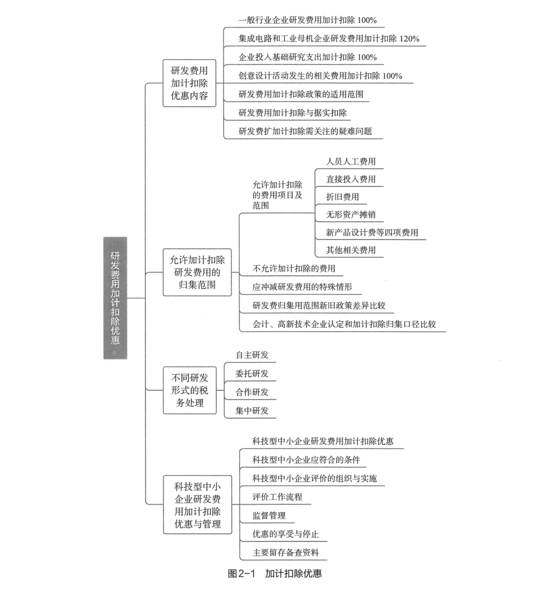
图 2-1 加计扣除优惠

<!-- PDF 第 63 页（页眉：| 研发费用加计扣除与高新技术企业优惠实务及案例 |；页脚：044） -->
## 第一节 研发费用加计扣除优惠内容

根据《企业所得税法》第三十条的规定，企业的下列支出，可以在计算应纳税所得额时加计扣除：①开发新技术、新产品、新工艺发生的研究开发费用；②安置残疾人员及国家鼓励安置的其他就业人员所支付的工资。

### 一、一般行业企业研发费用加计扣除 100%

研究开发费用的加计扣除简称研发费加计扣除。为进一步激励企业加大研发投入，更好地支持科技创新，《财政部 税务总局关于进一步完善研发费用税前加计扣除政策的公告》（财政部 税务总局公告2023年第7号）第一条规定，企业开展研发活动中实际发生的研发费用，未形成无形资产计入当期损益的，在按规定据实扣除的基础上，自2023年1月1日起，再按照实际发生额的100%在税前加计扣除；形成无形资产的，自2023年1月1日起，按照无形资产成本的200%在税前摊销。详见表2-1。

表 2-1 研发费用加计扣除

| 企业研发活动中实际发生的研发费用 | 会计处理 | 加计扣除 |
| --- | --- | --- |
| 企业研发活动中实际发生的研发费用 | 未形成无形资产计入当期损益的 | 在按规定据实扣除的基础上，按照本年度实际发生额的100%，从本年度应纳税所得额中扣除 |
| | 形成无形资产的 | 按照该无形资产成本的200%在税前摊销 |

<!-- PDF 第 64 页（页眉：| 第二章 研发费用加计扣除优惠 |；页脚：045） -->
该公告第二条规定，企业享受研发费用加计扣除政策的其他政策口径和管理要求，按照《财政部 国家税务总局 科技部关于完善研究开发费用税前加计扣除政策的通知》（财税〔2015〕119号）、《财政部 税务总局 科技部关于企业委托境外研究开发费用税前加计扣除有关政策问题的通知》（财税〔2018〕64号）等文件相关规定执行。

研发费用的费用化或资本化处理要根据财务会计核算规定来划分。企业根据财务会计核算和研发项目的实际情况，对发生的研发费用进行费用化或资本化处理的，可按下述方法计算加计扣除：①研发费用计入当期损益未形成无形资产的，允许再按其当年费用化的研发费用实际发生额的100%，直接抵扣当年的应纳税所得额。②研发支出形成无形资产的，按照该无形资产成本的200%在税前摊销（集成电路和工业母机企业等另有加计扣除比例规定的除外）。除税法另有规定外，摊销年限不得低于10年。作为投资或者受让的无形资产，有关法律规定或者合同约定了使用年限的，可以按照法律规定或者合同约定的使用年限分期摊销。

因此，纳税人应注意分清研究开发费用的费用化和资本化处理，如果构成了无形资产，则不能在当期全额扣除，要按照无形资产摊销的有关规定处理。

【例2-1】甲公司是一家化妆品生产企业，2023年发生研发费用100万元。

要求：分析说明如何计算享受研发费用加计扣除优惠。

【解析】企业开展研发活动中实际发生的研发费用，需将研发费用分别进行“费用化”或“资本化”处理，“资本化”的部分将来如形成无形资产，将通过摊销方式计入会计利润，“费用化”部分直接计入当期利润。享受研发费用加计扣除税收优惠政策时，对于未形成无形资产计入当期损益的，在按规定据实扣除的基础上，再按照实际发生额的100%在税前加计扣除；形成无形资产的，按照无形资产成本的200%在税前摊销。

假设甲公司2023年发生的研发费用全部费用化，则在据实扣除100万元的基础上，可再在税前加计扣除100万元。如果发生的研发费用全部资本化，100万元将计入无形资产成本，在形成无形资产后，在以后年度按照无形资产成本的200%在税前摊销。

<!-- PDF 第 65 页（页眉：| 研发费用加计扣除与高新技术企业优惠实务及案例 |；页脚：046） -->
### 二、集成电路和工业母机企业研发费用加计扣除120%

#### （一）优惠政策内容

为进一步鼓励企业研发创新，促进集成电路产业和工业母机产业高质量发展，《财政部 税务总局 国家发展改革委 工业和信息化部关于提高集成电路和工业母机企业研发费用加计扣除比例的公告》（财政部 税务总局 国家发展改革委 工业和信息化部公告2023年第44号）第一条规定，集成电路企业和工业母机企业开展研发活动中实际发生的研发费用，未形成无形资产计入当期损益的，在按规定据实扣除的基础上，在2023年1月1日至2027年12月31日期间，再按照实际发生额的120%在税前扣除；形成无形资产的，在上述期间按照无形资产成本的220%在税前摊销。详见表2-2。

表 2-2 研发费用加计扣除120%

| | 会计处理 | 加计扣除 |
| --- | --- | --- |
| 集成电路和工业母机企业研发活动中实际发生的研发费用 | 未形成无形资产计入当期损益的 | 在按规定据实扣除的基础上，再按照本年度实际发生额的120%，从本年度应纳税所得额中扣除 |
| | 形成无形资产的 | 按照该无形资产成本的220%在税前摊销 |

关于资本化费用的适用时点问题。提高集成电路和工业母机企业研发费用加计扣除比例的政策从2023年开始执行。费用化研发费用仅涉及发生这一时点，因此自2023年起开始执行对于费用化研发费用是没有异议的，即2023年及以后年度发生的费用化研发费用均能适用加计扣除120%政策。但是，资本化研发费用存在发生、形成无形资产、摊销三个时点，自2023年开始执行具体指哪个时点，是政策顶层设计时面临的一个问题。现行政策出于可操作性的考虑，以摊销时点来判断是否可以适用政策，与其他提高研发费用加计扣除比例的政策口径保持一致。例如，某集成电路企业在2020—2022年发生了研发费用并予以资本化，在2022年10月结转形成无形资产，2022年10月开始摊销，那么按照规定，该企业研发费用发生和形成资产的时点虽然在2023年以前，但按照摊销时点判断，2023年及以后年度如果符合条

<!-- PDF 第 66 页（页眉：| 第二章 研发费用加计扣除优惠 |；页脚：047） -->
件，则可以按220%进行摊销，2022年度的摊销由于摊销时点在2023年以前，则按一般行业企业研发费用加计扣除政策200%进行摊销。

#### （二）享受加计扣除120%优惠的集成电路企业应符合的条件

《财政部 税务总局 国家发展改革委 工业和信息化部关于提高集成电路和工业母机企业研发费用加计扣除比例的公告》（财政部 税务总局 国家发展改革委 工业和信息化部公告2023年第44号）第二条规定，该公告第一条所称享受加计扣除120%优惠的集成电路企业是指国家鼓励的集成电路生产、设计、装备、材料、封装、测试企业。具体按以下条件确定：

第一，国家鼓励的集成电路生产企业，是指符合《财政部 税务总局 发展改革委 工业和信息化部关于促进集成电路产业和软件产业高质量发展企业所得税政策的公告》（财政部 税务总局 发展改革委 工业和信息化部公告2020年第45号）第一条规定的生产企业或项目归属企业，企业清单由国家发展改革委、工业和信息化部会同财政部、税务总局等部门制定。

第二，国家鼓励的集成电路设计企业，是指符合《财政部 税务总局 发展改革委 工业和信息化部关于促进集成电路产业和软件产业高质量发展企业所得税政策的公告》（财政部 税务总局 发展改革委 工业和信息化部公告2020年第45号）第四条规定的重点集成电路设计企业，企业清单由国家发展改革委、工业和信息化部会同财政部、税务总局等部门制定。

第三，国家鼓励的集成电路装备、材料、封装、测试企业，是指符合《中华人民共和国工业和信息化部 国家发展改革委 财政部 国家税务总局公告2021年第9号》规定条件的企业。如有更新，从其规定。

（1）享受优惠的国家鼓励的集成电路装备企业应符合的条件。根据《中华人民共和国工业和信息化部 国家发展改革委 财政部 国家税务总局公告2021年第9号》第二条的规定，国家鼓励的集成电路装备企业，必须同时满足以下条件：

①在中国境内（不包括港澳台地区）依法设立，从事集成电路专用装备或关键零部件研发、制造并具有独立法人资格的企业；

②汇算清缴年度具有劳动合同关系或劳务派遣、聘用关系且具有大学专科及以

<!-- PDF 第 67 页（页眉：| 研发费用加计扣除与高新技术企业优惠实务及案例 |；页脚：048） -->
上学历月平均职工人数占企业当年月平均职工总人数的比例不低于40%，研究开发人员月平均数占企业当年月平均职工总数的比例不低于20%；

③汇算清缴年度用于集成电路装备或关键零部件研究开发费用总额占企业销售（营业）收入总额的比例不低于5%；

④汇算清缴年度集成电路装备或关键零部件销售收入占企业销售（营业）收入总额的比例不低于30%，且企业销售（营业）收入总额不低于（含）1500万元；

⑤拥有核心关键技术和属于本企业的知识产权，企业拥有与集成电路装备或关键零部件研发、制造相关的已授权发明专利数量不少于5个；

⑥具有与集成电路装备或关键零部件生产相适应的经营场所、软硬件设施等基本条件；

⑦汇算清缴年度未发生严重失信行为，重大安全、重大质量事故或严重环境违法行为。

（2）享受优惠的国家鼓励的集成电路材料企业应符合的条件。根据《中华人民共和国工业和信息化部 国家发展改革委 财政部 国家税务总局公告2021年第9号》第三条的规定，国家鼓励的集成电路材料企业，必须同时满足以下条件：

①在中国境内（不包括港澳台地区）依法设立，从事集成电路专用材料研发、生产并具有独立法人资格的企业；

②汇算清缴年度具有劳动合同关系或劳务派遣、聘用关系且具有大学专科及以上学历月平均职工人数占企业当年月平均职工总人数的比例不低于40%，研究开发人员月平均数占企业当年月平均职工总数的比例不低于15%；

③汇算清缴年度用于集成电路材料研究开发费用总额占企业销售（营业）收入总额的比例不低于5%；

④汇算清缴年度集成电路材料销售收入占企业销售（营业）收入总额的比例不低于30%，且企业销售（营业）收入总额不低于（含）1000万元；

⑤拥有核心关键技术和属于本企业的知识产权，且企业拥有与集成电路材料研发、生产相关的已授权发明专利数量不少于5个；

⑥具有与集成电路材料生产相适应的经营场所、软硬件设施等基本条件；

⑦汇算清缴年度未发生严重失信行为，重大安全、重大质量事故或严重环境违

<!-- PDF 第 68 页（页眉：| 第二章 研发费用加计扣除优惠 |；页脚：049） -->
法行为。

（3）享受优惠的国家鼓励的集成电路封装、测试企业应符合的条件。根据《中华人民共和国工业和信息化部 国家发展改革委 财政部 国家税务总局公告2021年第9号》第四条的规定，国家鼓励的集成电路封装、测试企业，必须同时满足以下条件：

①在中国境内（不包括港澳台地区）依法设立，从事集成电路封装、测试并具有独立法人资格的企业；

②汇算清缴年度具有劳动合同关系或劳务派遣、聘用关系且具有大学专科以上学历月平均职工人数占企业当年月平均职工总人数的比例不低于40%，研究开发人员月平均数占企业当年月平均职工总数的比例不低于15%；

③汇算清缴年度研究开发费用总额占企业销售（营业）收入总额的比例不低于3%；

④汇算清缴年度集成电路封装、测试销售（营收）收入占企业收入总额的比例不低于60%，且企业收入总额不低于（含）2000万元；

⑤拥有核心关键技术和属于本企业的知识产权，且企业拥有与集成电路封装、测试相关的已授权发明专利、计算机软件著作权合计不少于5个；

⑥具有与集成电路芯片封装、测试相适应的经营场所、软硬件设施等基本条件；

⑦汇算清缴年度未发生严重失信行为，重大安全、重大质量事故或严重环境违法行为。

#### （三）享受加计扣除120%优惠的工业母机企业应符合的条件

《财政部 税务总局 国家发展改革委 工业和信息化部关于提高集成电路和工业母机企业研发费用加计扣除比例的公告》（财政部 税务总局 国家发展改革委 工业和信息化部公告2023年第44号）第三条规定，该公告第一条所称享受加计扣除120%优惠工业母机企业是指生产销售符合该公告附件《先进工业母机产品基本标准》产品的企业，具体适用条件和企业清单由工业和信息化部会同国家发展改革委、财政部、税务总局等部门制定。

<!-- PDF 第 69 页（页眉：| 研发费用加计扣除与高新技术企业优惠实务及案例 |；页脚：050；装饰：栏目标签“延伸阅读”置于斜切色块内，右侧有三道斜线） -->
延伸阅读 先进工业母机产品基本标准

一、金属切削机床

定位精度≤10微米/米，并安装数控系统。

二、铸造装备

1.真空熔铸装备：坩埚容量≥50千克。

2.感应熔炼电炉：熔化量≥10吨。

3.粘土砂造型线：静压造型生产线造型效率≥100型/小时，砂箱尺寸1200毫米×1000毫米及以上；垂直造型线造型效率≥400型/小时。

4.大型自硬砂成套设备：处理能力≥60吨/小时的连续式混砂机，60吨级及以上振实台、起模机。

5.高压压铸机：合模力≥6000吨。

6.挤压铸造成套设备：锁模力≥1000吨。

7.气力输送铸造废砂再生设备：处理能力30吨/小时以上，旧砂回用率水玻璃砂90%以上、树脂砂94%以上。

三、锻压装备

1.数控液压机：公称压力≥1000吨。

2.数控多连杆机械压力机：公称压力≥1000吨，冲压生产线≥2000吨（总吨位）。

3.冷锻机械压力机：公称压力≥630吨。

4.热模锻压力机：公称压力≥2000吨。

5.热等静压装备：有效热区直径≥1000毫米。

四、焊接装备

1.数字化弧焊装备：数控系统跟踪补偿精度0.1～0.5毫米、焊接工艺参数波动小于2%～5%。

2.激光、电子束等高能束焊接装备：机电协同控制精度1%、跟踪补偿精度0.1～0.5毫米、焊接工艺参数波动小于2%。

3.惯性、搅拌摩擦焊及电阻焊装备：机电协同控制精度1%、响应速度5～10毫秒；数控系统跟踪补偿精度0.05～0.1毫米。

<!-- PDF 第 70 页（页眉：| 第二章 研发费用加计扣除优惠 |；页脚：051） -->
五、热表面处理装备

1.真空热处理装备：装炉量≥1吨。

2.控制气氛热处理装备：装炉量≥1吨。

3.绝缘栅双极型晶体管电源感应热处理装备。

4.连续热处理生产线：生产能力≥1吨/小时。

5.自动电镀设备：行车上自带独立控制箱和主可编程逻辑控制器网络通信，具备四轴运动能力。

6.低压等离子喷涂设备：真空室尺寸≥Φ2000毫米×3000毫米，喷枪使用功率≥80千瓦。

7.溶液等离子喷涂设备：喷枪使用功率≥100千瓦，浆料输送率≥0.5升/分。

8.真空镀膜装备：膜层不均匀性≤±10%，故障诊断节点数≥1000。

六、数控装置

具备三轴及以上联动控制功能。

七、滚动功能部件（丝杠/导轨）

P3精度以上。

八、电主轴

动态回转精度≤10微米。

九、数控转台

定位精度≤15″。

十、位置反馈元件（光栅尺/编码器）

直线准确度≤±3微米；旋转准确度≤±2.5″。

十一、摆角头

定位精度≤15″。

十二、动力刀架刀库

分度精度≤±6″，换刀时间（T-T）≤2.5秒。

十三、真空系统

1.镀膜机：整机漏率达到1.0×10-8帕斯卡·升/秒量级，工作真空度保持时间≥6个月。

<!-- PDF 第 71 页（页眉：| 研发费用加计扣除与高新技术企业优惠实务及案例 |；页脚：052） -->
2.工业炉：漏率达到1.0×10-7帕斯卡·升/秒量级，工作真空度保持时间≥6个月。

企业享受研发费用加计扣除政策的其他政策口径和管理要求，按照《财政部 国家税务总局 科技部关于完善研究开发费用税前加计扣除政策的通知》（财税〔2015〕119号）、《财政部 税务总局 科技部关于企业委托境外研究开发费用税前加计扣除有关政策问题的通知》（财税〔2018〕64号）等文件相关规定执行。

《工业和信息化部 国家发展和改革委员会 财政部 国家税务总局关于开展2023年度享受研发费用加计扣除政策的工业母机企业清单制定工作的通知》（工信部联通装函〔2024〕60号）第一条规定，适用加计扣除120%政策的工业母机企业需同时符合以下条件：

（1）生产销售先进工业母机主机、关键功能部件、数控系统（以下称先进工业母机产品，详见财政部、税务总局、国家发展改革委、工业和信息化部公告2023年第44号的附件《先进工业母机产品基本标准》）的工业母机企业；

（2）申请优惠政策的企业具有劳动合同关系或劳务派遣、聘用关系的先进工业母机产品研究开发人员月平均人数占企业月平均职工总数的比例不低于15%；

（3）申请优惠政策的企业研究开发费用总额占企业销售（营业）收入（主营业务收入与其他业务收入之和，下同）总额的比例不低于5%；

（4）申请优惠政策的企业生产销售规定的先进工业母机产品收入占企业销售（营业）收入总额的比例不低于60%，且企业收入总额不低于3000万元（含）。

#### （四）享受加计扣除120%政策的工业母机企业实行清单管理

根据《工业和信息化部 国家发展和改革委员会 财政部 国家税务总局关于开展2023年度享受研发费用加计扣除政策的工业母机企业清单制定工作的通知》（工信部联通装函〔2024〕60号）的规定，申请列入清单的企业应于2024年3月31日前登录网站www.gymjtax.com，选择“工业母机企业研发费用加计扣除政策申报入口”提交申请，并生成纸质文件加盖企业公章，连同必要佐证材料（电子版、纸质版）报各省、自治区、直辖市及计划单列市、新疆生产建设兵团工业和信息化主管部门

<!-- PDF 第 72 页（页眉：| 第二章 研发费用加计扣除优惠 |；页脚：053） -->
（以下称地方工信主管部门）。

地方工信主管部门根据企业条件，登录网站www.gymjtax.com:8888/对企业申报信息进行初核，并于4月15日前将初核通过名单报送至工业和信息化部。对于初核不通过企业，在系统内备注不通过理由。

工业和信息化部组织第三方机构，根据企业申报信息开展资格复核。根据复核意见，综合考虑工业母机产业链重点领域企业情况，工业和信息化部、国家发展改革委、财政部、税务总局进行联审并确认最终清单。企业可于5月10日后，从信息填报系统中查询是否列入清单。

列入清单的企业在下一年度企业所得税预缴申报时，可自行判断是否符合条件，如符合条件，在预缴申报时可先行享受优惠；年度汇算清缴时，如未被列入2024年度清单，按规定补缴税款，依法不加收滞纳金。

地方工信主管部门会同发展改革、财政、税务部门按职责分工对列入清单的企业加强日常监管。在监管过程中，如发现企业存在以虚假信息获得减免税资格，应及时联合核查，并联合报送工业和信息化部进行复核。工业和信息化部会同国家发展改革委、财政部、税务总局复核，对确不符合条件的企业，取消其享受政策资格，三年之内不得申请列入清单享受该优惠政策。

企业对所提供材料和数据的真实性负责。申报企业应签署承诺书，承诺申报出现失信行为，接受有关部门按照法律、法规和国家有关规定处理。

#### （五）享受加计扣除120%政策的工业母机企业需提交的材料

享受研发费用加计扣除120%政策的工业母机企业需要提交的材料清单如下：

（1）企业法人营业执照副本、企业取得相关资质及荣誉证书等（包括但不限于高新技术企业、国家级专精特新“小巨人”企业、制造业单项冠军企业等资质证书）。

（2）企业员工总数、学历结构、研究开发人员总数、从事先进工业母机产品研发人员总数说明及其月平均人数占月平均职工总数比例的说明（具有劳动合同关系或劳务派遣、聘用关系），并附上企业从事申报产品研发人员名单，以上材料请逐一统计说明并加盖企业公章；申请优惠政策2023年度最后一个月企业职工社会保险

<!-- PDF 第 73 页（页眉：| 研发费用加计扣除与高新 技术企业优惠实务及案例 |；页脚：054） -->
缴纳证明（包括劳务派遣人员代缴社保付款凭证）等证明材料。

（3）经具有资质的中介机构鉴证的2023年度企业财务会计报告（包括会计报表、会计报表附注和财务情况说明书等）以及先进工业母机产品销售收入、研究开发费用等情况说明。先进工业母机产品销售收入如在财务会计报告中不能体现，请企业自行核算并加盖企业公章；研究开发费用按财税〔2015〕119号文件及国家税务总局公告2017年第40号要求的口径归集后，在会计报告中单独说明，不能说明的需提供按照上述口径的研究开发费用专项审计报告或税务鉴证报告。

（4）企业开发/拥有的与申报产品强相关的十条以内代表性实用新型、发明专利材料。

（5）第三方机构提供的可证明所申报产品符合财政部、税务总局、国家发展改革委、工业和信息化部公告2023年第44号附件《先进工业母机产品基本标准》的关键技术参数证明材料（须为第三方提供，企业自证材料无效）。

（6）2023年度关于申报产品的10份（以内）订单额度最大的销售合同复印件（须为申报产品本身的销售合同，其他产品无效）。

（7）一至两份关于申报产品的具有代表性的用户报告。

（8）2023年度未发生重大安全、重大质量事故或严重环境违法行为的承诺书。

（9）企业拥有与申报产品强相关的工程实验室、重点实验室、工程技术研究中心、博士后工作站、企业技术中心等创新平台建设情况的证明材料，并注明平台名称、主管部委、属于国家级或者省级等。

（10）近10年企业承担与申报产品强相关的、具有代表性的十份以内省级以上研发项目（作脱密处理）的证明材料，包括项目名称、项目编号、项目金额、委托单位以及国家级或者省级等。

（11）10条以内企业牵头/参与申报产品标准制修订情况清单。

（12）申报产品获得的奖项证明。

（13）机床装备/机械基础装备制造成熟度评价等级证书。

（14）当地工信部门、发展改革部门、财政部门、税务部门要求出具的其他材料。

注意：所有证明材料复印件均须加盖企业公章，其中第（1）~（8）项为必须

<!-- PDF 第 74 页（页眉：| 第二章 研发费用加计扣除优惠 |；页脚：055） -->
提供项。

#### （六）优惠管理方式

根据《财政部 税务总局 国家发展改革委 工业和信息化部关于提高集成电路和工业母机企业研发费用加计扣除比例的公告》（财政部 税务总局 国家发展改革委 工业和信息化部公告2023年第44号）第五条的规定，该公告规定的集成电路和工业母机企业研发费用加计扣除120%税收优惠政策，采用清单管理的，由国家发展改革委、工业和信息化部于每年3月底前按规定向财政部、税务总局提供上一年度可享受优惠的企业清单；不采取清单管理的，税务机关可按《财政部 税务总局 发展改革委 工业和信息化部关于促进集成电路产业和软件产业高质量发展企业所得税政策的公告》（财政部 税务总局 发展改革委 工业和信息化部公告2020年第45号）规定的核查机制转请发展改革、工业和信息化部门进行核查。

### 三、企业投入基础研究支出加计扣除100%

#### （一）企业投入基础研究支出加计扣除优惠内容

为鼓励企业加大创新投入，支持我国基础研究发展，《财政部 税务总局关于企业投入基础研究税收优惠政策的公告》（财政部 税务总局公告2022年第32号）第一条规定，自2022年1月1日起，对企业出资给非营利性科学技术研究开发机构（科学技术研究开发机构以下简称科研机构）、高等学校和政府性自然科学基金用于基础研究的支出，在计算应纳税所得额时可按实际发生额在税前扣除，并可按100%在税前加计扣除。

对非营利性科研机构、高等学校接收企业、个人和其他组织机构基础研究资金收入，免征企业所得税。

企业出资基础研究应签订相关协议或合同，协议或合同中需明确资金用于基础研究领域。

企业投入基础研究的企业所得税优惠如图2-2所示。

<!-- PDF 第 75 页（页眉：| 研发费用加计扣除与高新 技术企业优惠实务及案例 |；页脚：056） -->
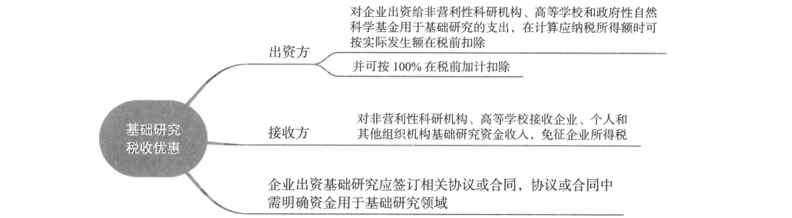
图2-2 基础研究企业所得税优惠

#### （二）享受优惠的非营利性科研机构、高等学校应符合的条件

《财政部 税务总局关于企业投入基础研究税收优惠政策的公告》（财政部 税务总局公告2022年第32号）第二条规定，所称非营利性科研机构、高等学校包括国家设立的科研机构和高等学校、民办非营利性科研机构和高等学校，具体按以下条件确定：

（1）国家设立的科研机构和高等学校是指利用财政性资金设立的、取得《事业单位法人证书》的科研机构和公办高等学校，包括中央和地方所属科研机构和高等学校。

（2）民办非营利性科研机构和高等学校，是指同时满足以下条件的科研机构和高等学校：

①根据《民办非企业单位登记管理暂行条例》在民政部门登记，并取得《民办非企业单位（法人）登记证书》。

②对于民办非营利性科研机构，其《民办非企业单位（法人）登记证书》记载的业务范围应属于科学研究与技术开发、成果转让、科技咨询与服务、科技成果评估范围。对业务范围存在争议的，由税务机关转请县级（含）以上科技行政主管部门确认。

对于民办非营利性高等学校，应取得教育主管部门颁发的《民办学校办学许可证》，记载学校类型为“高等学校”。

<!-- PDF 第 76 页（页眉：| 第二章 研发费用加计扣除优惠 |；页脚：057） -->
③经认定取得企业所得税非营利组织免税资格。

#### （三）享受优惠的政府性自然科学基金应符合的条件

《财政部 税务总局关于企业投入基础研究税收优惠政策的公告》（财政部 税务总局公告2022年第32号）第三条规定，所称政府性自然科学基金是指国家和地方政府设立的自然科学基金委员会管理的自然科学基金。

#### （四）享受优惠的基础研究应符合的条件

《财政部 税务总局关于企业投入基础研究税收优惠政策的公告》（财政部 税务总局公告2022年第32号）第四条规定，所称基础研究是指通过对事物的特性、结构和相互关系进行分析，从而阐述和检验各种假设、原理和定律的活动。具体依据以下内容判断：

（1）基础研究不预设某一特定的应用或使用目的，主要是为获得关于现象和可观察事实的基本原理的新知识，可针对已知或具有前沿性的科学问题，或者针对人们普遍感兴趣的某些广泛领域，以未来广泛应用为目标。

（2）基础研究可细分为两种类型：一是自由探索性基础研究，即为了增进知识，不追求经济或社会效益，也不积极谋求将其应用于实际问题或把成果转移到负责应用的部门；二是目标导向（定向）基础研究，旨在获取某方面知识、期望为探索解决当前已知或未来可能发现的问题奠定基础。

（3）基础研究成果通常表现为新原理、新理论、新规律或新知识，并以论文、著作、研究报告等形式为主。同时，由于基础研究具有较强的探索性、存在失败的风险，论文、著作、研究报告等也可以体现为试错或证伪等成果。

上述享受优惠的基础研究不包括在境外开展的研究，也不包括社会科学、艺术或人文学方面的研究。

#### （五）优惠管理与留存备查资料

《财政部 税务总局关于企业投入基础研究税收优惠政策的公告》（财政部 税务总局公告2022年第32号）第六条规定，企业和非营利性科研机构、高等学校和

<!-- PDF 第 77 页（页眉：| 研发费用加计扣除与高新 技术企业优惠实务及案例 |；页脚：058；装饰：本页首行左边距处有一墨点） -->
政府性自然科学基金管理单位应将相关资料留存备查，包括企业出资协议、出资合同、相关票据等，出资协议、出资合同和出资票据应包含出资方、接收方、出资用途（注明用于基础研究）、出资金额等信息。

该公告第七条规定，非营利性科研机构、高等学校和政府性自然科学基金管理单位应做好企业投入基础研究的资金管理，建立健全监督机制，确保资金用于基础研究，提高资金使用效率。

### 四、创意设计活动发生的相关费用加计扣除100%

《国务院关于推进文化创意和设计服务与相关产业融合发展的若干意见》（国发〔2014〕10号）第三条第（六）项提出，在文化创意和设计服务领域开展高新技术企业认定管理办法试点，将文化创意和设计服务内容纳入文化产业支撑技术等领域，对经认定为高新技术企业的文化创意和设计服务企业，减按15%的税率征收企业所得税。文化创意和设计服务企业发生的职工教育经费支出，不超过工资薪金总额8%的部分，准予在计算应纳税所得额时扣除。企业发生的符合条件的创意和设计费用，执行税前加计扣除政策。对纳入增值税征收范围的国家重点鼓励的文化创意和设计服务出口实行增值税零税率或免税，对国家重点鼓励的创意和设计产品出口实行增值税零税率。

为落实国发〔2014〕10号文件精神，《财政部 国家税务总局 科技部关于完善研究开发费用税前加计扣除政策的通知》（财税〔2015〕119号）第二条第4项特别规定，企业为获得创新性、创意性、突破性的产品进行创意设计活动而发生的相关费用，可按照规定进行加计扣除。

创意设计活动是指多媒体软件、动漫游戏软件开发，数字动漫、游戏设计制作；房屋建筑工程设计（绿色建筑评价标准为三星）、风景园林工程专项设计；工业设计、多媒体设计、动漫及衍生产品设计、模型设计等。

值得一提的是，财税〔2015〕119号文件虽允许“创意设计活动”适用加计扣除政策，但其属于一项单独的优惠政策，并不代表此类“创意设计活动”属于研发活动。

<!-- PDF 第 78 页（页眉：| 第二章 研发费用加计扣除优惠 |；页脚：059） -->
### 五、研发费用加计扣除政策的适用范围

研发费用加计扣除政策适用于会计核算健全、实行查账征收并能够准确归集研发费用的居民企业。此外，为获得创新性、创意性、突破性的产品进行创意设计活动的企业发生的相关费用，也可按照规定进行加计扣除。

#### （一）负面清单行业企业不适用研发费用加计扣除优惠

##### 1.不适用税前加计扣除政策的行业

根据财税〔2015〕119号文件第四条的规定，不适用税前加计扣除政策的行业有：

（1）烟草制造业。

（2）住宿和餐饮业。

（3）批发和零售业。

（4）房地产业。

（5）租赁和商务服务业。

（6）娱乐业。

（7）财政部和国家税务总局规定的其他行业。

上述行业以《国民经济行业分类（GB/T 4754—2011）》为准，并随之更新。

【例2-2】A公司是一家房地产开发企业，近年来也会对房屋建筑工程设计开展一些研发活动。

请分析说明相关的研发费用是否可以享受研发费用加计扣除优惠政策。

【解析】按照《财政部 国家税务总局 科技部关于完善研究开发费用税前加计扣除政策的通知》（财税〔2015〕119号）的规定，烟草制造业、住宿和餐饮业、批发和零售业、房地产业、租赁和商务服务业、娱乐业以及财政部和国家税务总局规定的其他行业，属于不可以享受研发费用加计扣除政策的行业范围。若A公司在研发费用发生当年的房地产业务收入占收入总额减除不征税收入和投资收益的余额50%（不含）以上，则属于房地产行业的企业，不得享受研发费用加计扣除优惠。

<!-- PDF 第 79 页（页眉：| 研发费用加计扣除与高新 技术企业优惠实务及案例 |；页脚：060） -->
##### 2.不适用税前加计扣除政策行业企业的判定

不适用税前加计扣除政策行业的企业，是指以6个规定的负面清单行业业务为主营业务，其研发费用发生当年的主营业务收入占企业按《企业所得税法》第六条规定计算的收入总额减除不征税收入和投资收益的余额50%（不含）以上的企业。

对于不适用加计扣除政策行业的判定问题，《国家税务总局关于企业研究开发费用税前加计扣除政策有关问题的公告》（国家税务总局公告2015年第97号）第四条进一步规定，不适用税前加计扣除政策行业的企业，是指以财税〔2015〕119号文件所列行业业务为主营业务，其研发费用发生当年的主营业务收入占企业按《企业所得税法》第六条规定计算的收入总额减除不征税收入和投资收益的余额50%（不含）以上的企业。也就是说，如果企业主营业务所属行业不属于负面清单所列示的行业，则该企业发生的符合条件的研发费用可以享受研发费用加计扣除优惠。

【例2-3】A食品贸易公司2023年度取得收入3 500万元，其中零售收入2 000万元，兼营生产烘烤食品取得销售收入500万元，取得投资收益800万元，取得作为不征税收入处理的政府补助收入为200万元。

要求：分析说明是否可以享受研发费用加计扣除优惠。

【解析】零售业务收入占比=2 000÷（3 500-800-200）=80%。

投资收益、不征税收入不计算在主营业务收入中，因此，该企业属于批发零售行业，不得享受研发费用加计扣除政策优惠。

财税〔2015〕119号文件第四条列举了不适用研发费用加计扣除政策的行业，包括烟草制造业、住宿和餐饮业、批发和零售业、房地产业、租赁和商务服务业、娱乐业、财政部和国家税务总局规定的其他行业。上述行业以《国民经济行业分类与代码》为准，并随之更新［目前最新版本为《国民经济行业分类（GB/T4754—2017）》］。

国家税务总局公告2015年第97号将负面清单行业企业的判断口径具体细化为：以列举的不适用税前加计扣除政策的六大行业为主营业务，其研发费用发生当年的主营业务收入占企业按《企业所得税法》第六条规定计算的收入总额减除不征税收

<!-- PDF 第 80 页（页眉：| 第二章 研发费用加计扣除优惠 |；页脚：061） -->
入和投资收益的余额50%（不含）以上的企业。从收入总额中减除的投资收益包括税法规定的股息、红利等权益性投资收益以及股权转让所得。

在计算收入总额时，应注意收入总额的完整性和准确性，税收上确认的收入总额不能简单等同于会计收入，应重点关注税法与会计收入确认差异及调整情况。在判定主营业务时，应将企业当年取得的各项不适用加计扣除行业业务收入汇总确定。

##### 3.税务登记行业与实际不符的税务处理

例如，企业税务登记中的行业为批发和零售业，但其实际主营业务为技术服务业，该企业能否享受研发费用加计扣除税收优惠？关于这一问题，北京市税务局《企业所得税实务操作政策指引》明确，根据财税〔2015〕119号文件的规定，应以企业实际主营业务判断企业所属行业是否属于负面清单列示的行业，对于企业税务登记中的行业属于负面清单列示行业而实际主营业务不是负面清单列示行业的，该企业可以享受研发费用加计扣除政策，但需根据实际主营业务调整税务登记中的所属行业。

##### 4.事业单位是否可以享受研发费用加计扣除优惠问题

按照《企业所得税法》第三十条的规定，企业开发新技术、新产品、新工艺发生的研究开发费用可以在计算应纳税所得额时加计扣除。《企业所得税法实施条例》第三条规定，依法在中国境内成立的企业，包括依照中国法律、行政法规在中国境内成立的企业、事业单位、社会团体以及其他取得收入的组织。

据此，北京市税务局《企业所得税实务操作政策指引》明确，事业单位属于企业所得税纳税人，因此其开展研发活动发生的研究开发费，可以按相关规定享受加计扣除优惠。

【例2-4】甲单位是一家事业单位，目前正在开展科研攻关。

要求：分析说明是否可以享受研发费加计扣除优惠政策。

【解析】可以。根据《企业所得税法》及其实施条例，企业为开发新技术、新产品、新工艺发生的研究开发费用可以在计算应纳税所得额时加计扣除。依法在中国境内成立的企业，包括依照中国法律、行政法规在中国境内成立的企业、事业单

<!-- PDF 第 81 页（页眉：| 研发费用加计扣除与高新 技术企业优惠实务及案例 |；页脚：062） -->
位、社会团体以及其他取得收入的组织。事业单位属于企业所得税的纳税人，因此，其开展研发活动发生的研究开发费，可以按相关规定享受加计扣除优惠政策。

【例2-5】A公司主营计算机设备的销售、研发等业务，2023年度终端设备批发销售收入15 000万元，兼营出租房屋取得租金收入5 000万元，投资收益300万元，收到市政府拨付的200万元财政补贴（符合不征税收入条件）。全年用于计算机设备研发发生的费用支出500万元。

要求：分析说明是否可以适用研发费用加计扣除政策。

【解析】2023年度A公司批发销售收入占比=15 000÷（15 000+5 000+300+200-300-200）×100%＝75%>50%，其2023年度主营业务为“批发和零售业”，为不能享受研发费用加计扣除优惠政策的行业。

并不是所有行业企业发生研发活动都适用研发费用加计扣除政策，应重点关注六个负面清单行业。财税〔2015〕119号文件规定，不适用加计扣除的行业有烟草制造业、住宿和餐饮业、批发和零售业、房地产业、租赁和商务服务业、娱乐业（以下简称六大行业）。上述行业以《国民经济行业分类（GB/T4754—2017）》为准，并随之更新。对于同时从事多种行业的纳税人，判断是否属于不适用税前加计扣除政策行业的企业，是指以六个行业业务为主营业务，其研发费用发生当年的主营业务收入占企业按《企业所得税法》第六条规定计算的收入总额减除不征税收入和投资收益的余额50%（不含）以上的企业。

#### （二）核定征收企业不适用研发费用加计扣除优惠

根据财税〔2015〕119号文件的规定，研发费用加计扣除政策适用于会计核算健全、实行查账征收并能够准确归集研发费用的居民企业。按核定征收方式缴纳企业所得税的企业不能享受此项优惠政策。

#### （三）非居民与不能准确归集研发费用的企业不适用加计扣除

企业享受研发费用加计扣除优惠，除关注不适用加计扣除政策的活动和不适用加计扣除政策的行业外，还应注意如下企业不适用研发费用加计扣除优惠：

<!-- PDF 第 82 页（页眉：| 第二章 研发费用加计扣除优惠 |；页脚：063） -->
（1）非居民企业。

（2）会计核算不健全、不能准确归集研发费用的企业。

（3）个人独资企业和合伙企业等不缴纳企业所得税的企业。

【例2-6】乙公司既不是高新技术企业，也不是科技型中小企业。

要求：请分析说明其能否享受研发费用加计扣除。

【解析】可以。会计核算健全、实行查账征收并能够准确归集研发费用的（非负面清单行业）居民企业可适用研发费用加计扣除。

不适用研发费用加计扣除优惠的行业企业，如图2-3所示。

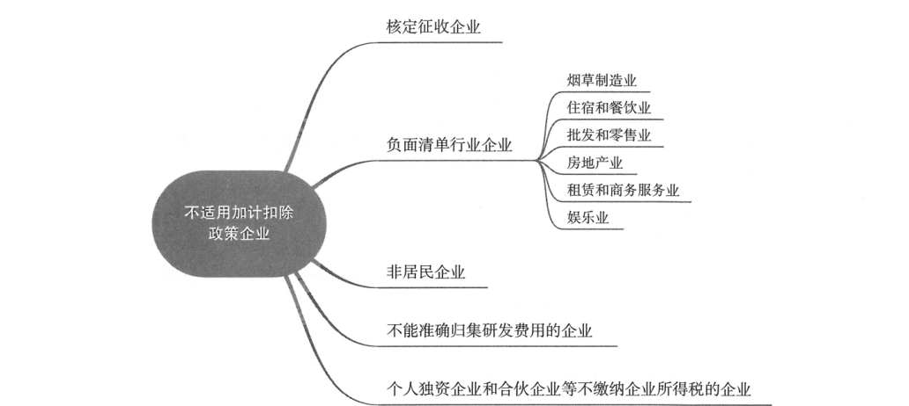
图2-3 不适用研发费用加计扣除的行业企业

### 六、研发费用加计扣除与据实扣除

“研发费用加计扣除”与“研发费用据实扣除”既有相同点又有不同点。

其相同点主要体现在以下方面：

<!-- PDF 第 83 页（页眉：| 研发费用加计扣除与高新 技术企业优惠实务及案例 |；页脚：064） -->
（1）研发活动特征相同。两者都是企业为获得科学与技术（不包括人文、社会科学）新知识，创造性运用科学技术新知识，或实质性改进技术、工艺、产品（服务）而持续进行的具有明确目标的研究开发活动。

（2）研发费用处理方式相同。企业实际发生的研发支出费用化与资本化处理的原则，按照财务会计制度规定执行。

（3）不允许税前扣除费用范围相同。法律、行政法规和国务院财税主管部门规定不允许企业所得税前扣除的费用和支出项目，同样不允许加计扣除。

（4）核算要求基本相同。企业未设立专门的研发机构或企业研发机构同时承担生产经营任务的，应对研发费用和生产经营费用分开进行核算，准确、合理地计算研发费用。

其不同点主要体现在以下方面：

（1）适用对象不同。研发费用加计扣除仅适用于财务核算健全并能准确归集核算研发费用的居民企业，而研发费用据实扣除适用于能够准确核算研发费用的所有企业。

（2）行业限制不同。享受研发费用加计扣除的企业有负面清单行业的限制，而据实扣除则没有负面清单行业的限制。

（3）研发费用范围不同。加计扣除的研发费用范围限于财税〔2015〕119号和《国家税务总局关于研发费用税前加计扣除归集范围有关问题的公告》（国家税务总局公告2017年第40号）等文件列举的6项费用及明细项，而据实扣除的研发费用范围按照税收及财务会计制度的规定确定。

### 七、研发费用加计扣除需关注的疑难问题

#### （一）加计扣除可以形成或扩大企业亏损

有关研究开发费用加计扣除形成亏损的处理问题，《国家税务总局关于企业所得税若干税务事项衔接问题的通知》（国税函〔2009〕98号）规定，企业研究开发费用加计扣除部分已形成企业年度亏损，可以用以后年度所得弥补，但结转年限最长不得超过5年（作者注：亏损结转弥补年限延长的行业企业，不超过政策文件规定的亏损结转弥补年限）。

<!-- PDF 第 84 页（页眉：| 第二章 研发费用加计扣除优惠 |；页脚：065） -->
另外，根据企业所得税年度纳税申报表主表的逻辑关系，免税收入、减计收入与加计扣除优惠都可以形成、扩大企业的亏损，形成的企业年度亏损，可以用以后规定年度的所得弥补。

因而，企业发生的研发费用，不论企业当年是盈利还是亏损，都可以加计扣除。

不过，《国家税务总局关于进一步做好企业研究开发费用税前加计扣除政策贯彻落实工作的通知》（税总函〔2016〕685号）要求，如企业申报享受加计扣除优惠政策，但账证不健全、资料不齐全或适用优惠政策不准确的，各级税务机关要积极做好辅导解释工作，帮助企业建账建制，补充资料，确保企业享受加计扣除优惠政策。

#### （二）符合条件未享受加计扣除优惠可追溯3年享受

企业符合财税〔2015〕119号文件规定的研发费用加计扣除条件而在2016年1月1日以后未及时享受该项税收优惠的，可以追溯享受，追溯期限最长为3年。即在2016纳税年度及以后的纳税年度中，纳税人发生的符合规定可享受加计扣除优惠而未及时享受的研发费用支出，在费用发生年度起3年内可追溯享受。例如，2020年度发生了研发支出未享受加计扣除优惠的，最迟需在2023年度汇缴期内，也就是2024年5月31日前更正申报2020年度企业所得税年度纳税申报表，追溯享受研发费用加计扣除优惠的同时做好有关资料的留存备查工作。

【例2-7】2023年，A公司发现在申报享受2020年度企业所得税研发费用加计扣除时，只对“在职”直接从事研发活动人员的工资及“五险一金”做了加计扣除处理，而没有对“外聘”研发人员的劳务费用进行加计扣除。这种处理方法，在2023年可以依据财税〔2015〕119号文件的规定，对此项研发费用进行追溯加计扣除处理。

B公司申报缴纳2015年度企业所得税时，对于研发费用加计扣除事项，只对“在职”直接从事研发活动人员的工资及“五险一金”进行了加计扣除，按当时的政策对“外聘”研发人员的劳务费用没有加计扣除。

【解析】这样处理符合2015年度政策规定，不能在2016年及以后年度依据财

<!-- PDF 第 85 页（页眉：| 研发费用加计扣除与高新 技术企业优惠实务及案例 |；页脚：066） -->
税〔2015〕119号文件对此项费用追溯税前加计扣除，即在汇算清缴2015年度企业所得税时，仍应按照《国家税务总局关于印发〈企业研究开发费用税前扣除管理办法（试行）〉的通知》（国税发〔2008〕116号，自2016年1月1日起被财税〔2015〕119号文件废止）和《财政部 国家税务总局关于研究开发费用税前加计扣除有关政策问题的通知》（财税〔2013〕70号，自2016年1月1日起被财税〔2015〕119号文件废止）的规定执行。

#### （三）研发费用资本化的时点税收与会计处理一致

“费用化”是指研发支出直接计入当期损益，在发生年度一次性扣除；“资本化”是指相关研发支出计入无形资产的成本，待其研发成功后，从无形资产可供使用时起，通过分期摊销的方式跨年度扣除。

税收上对研发费用资本化的时点没有明确规定，因此，企业研发活动中实际发生的研发费用形成无形资产的，其开始资本化的时点与会计处理保持一致。

【例2-8】E公司是计算机设备制造企业，其4个研发项目已形成专利权并开始利用该技术进行新产品研制，但企业仍将开发部门的后续支出在“研发支出——费用化支出”科目中归集，全年没有无形资产摊销费用产生，未按照《企业会计准则》的要求作资本化处理。

【解析】财税〔2015〕119号文件规定，企业应按照国家财务会计制度要求对研发支出进行会计处理。企业按照会计准则把握研发费用归集时的资本化时点，形成无形资产的，按照无形资产成本的200%在税前摊销。

#### （四）研发失败也可享受税前加计扣除优惠

企业的研发活动具有一定的风险和不可预测性，既可能成功也可能失败，政策是对研发活动予以鼓励，并非单纯强调结果。此外，失败的研发活动也并不是毫无价值的，在一般情况下的“失败”是指没有取得预期的结果，但可以积累经验，取得其他有价值的成果。另外，许多研发项目的执行是跨年度的，在研发项目执行当年，其发生的费用化的研发费用就可以享受加计扣除，而不是在项目执

<!-- PDF 第 86 页（页眉：| 第二章 研发费用加计扣除优惠 |；页脚：067） -->
行完成并取得最终结果以后才申请加计扣除。在享受加计扣除时实际无法预知研发结果，如强调只有研发成功才能加计扣除，将极大地增加企业享受优惠的成本，降低政策激励的有效性。

因而，国家税务总局公告2017年第40号明确，失败的研发活动所发生的研发费用可享受税前加计扣除政策。

#### （五）加计扣除与其他企业所得税优惠可叠加享受

企业所得税优惠，是指《企业所得税法》规定的优惠事项，以及税法授权国务院和民族自治地方制定的优惠事项。包括免税收入、减计收入、加计扣除、加速折旧、所得减免、抵扣应纳税所得额、减低税率、税额抵免、民族自治地方分享部分减免等。

按照《财政部 国家税务总局关于执行企业所得税优惠政策若干问题的通知》（财税〔2009〕69号）的规定，《企业所得税法》及其实施条例中规定的各项税收优惠，凡企业符合规定条件的，可以同时享受。因此，企业既符合享受研发费用加计扣除政策条件，又符合享受其他优惠政策条件的，可以同时享受有关优惠政策。

【例2-9】部分专用设备产品研发上市后，公司持续跟踪产品后续使用效果并对该产品与其他不同产品搭配使用方式产生的不同效果进行深化研究，这部分费用是否可以纳入加计扣除范围？

【解析】根据《财政部 国家税务总局 科技部关于完善研究开发费用税前加计扣除政策的通知》（财税〔2015〕119号）的规定，企业在商品化后为顾客提供的技术支持活动不适用税前加计扣除政策。企业须准确把握研发活动结束时点，一般情况下，当企业研发产品达到批量生产条件（或商品化后），则该项目研发阶段结束。因此，企业研发的专用设备产品上市后所发生的活动，不适用税前加计扣除政策。

<!-- PDF 第 87 页（页眉：| 研发费用加计扣除与高新 技术企业优惠实务及案例 |；页脚：068；装饰：节标题下方有一条短横线） -->
## 第二节 允许加计扣除研发费用的归集范围

允许加计扣除的研发费用可以分为六个费用项目，具体包括：人员人工费用、直接投入费用、折旧费用、无形资产摊销、新产品设计费等四项费用、其他相关费用。企业发生的自主研发、合作研发和集中研发，对发生的研发费用，需要按照上述六个费用项目分别归集研发费用。具体内容与高新技术企业认定研发费用项目略有不同，详见表2-3。

表2-3 研发费用项目

| 可加计扣除的研发费用项目 | 高新技术企业认定研发费用项目 |
| --- | --- |
| （一）人员人工费用 | （一）人员人工费用 |
| （二）直接投入费用 | （二）直接投入费用 |
| （三）折旧费用 | （三）折旧费用与长期待摊费用 |
| （四）无形资产摊销 | （四）无形资产摊销费用 |
| （五）新产品设计费、新工艺规程制定费、新药研制的临床试验费、勘探开发技术的现场试验费 | （五）设计费用 |
| | （六）装备调试费用与试验费用 |
| （六）其他相关费用 | （七）其他相关费用 |

### 一、人员人工费用

人员人工费用，指直接从事研发活动人员的工资薪金、基本养老保险费、基本医疗保险费、失业保险费、工伤保险费、生育保险费和住房公积金（本书简称“五险一金”），以及外聘研发人员的劳务费用。这可从以下几方面理解。

<!-- PDF 第 88 页（页眉：| 第二章 研发费用加计扣除优惠 |；页脚：069） -->
#### （一）研发人员的分类与界定

直接从事研发活动人员包括研究人员、技术人员、辅助人员三类。

研究人员是指主要从事研究开发项目的专业人员；技术人员是指具有工程技术、自然科学和生命科学中一个或一个以上领域的技术知识和经验，在研究人员指导下参与研发工作的人员；辅助人员是指参与研究开发活动的技工。

直接从事研发活动人员既可以是本企业的员工，也可以是外聘研发人员。外聘研发人员是指与本企业或劳务派遣企业签订劳务用工协议（合同）和临时聘用的研究人员、技术人员、辅助人员。

上述人员中辅助人员不应包括为研发活动提供后勤服务的人员。

#### （二）劳务派遣研发人员的劳务费

接受劳务派遣的企业按照协议（合同）约定支付给劳务派遣企业，且由劳务派遣企业实际支付给外聘研发人员的工资薪金等费用，属于外聘研发人员的劳务费用。

研发费用加计扣除新政适当扩大了外聘研发人员范围。《国家税务总局关于企业工资薪金和职工福利费等支出税前扣除问题的公告》（国家税务总局公告2015年第34号）将劳务派遣分为两种形式，并分别适用不同的税前扣除规定：一种是按照协议（合同）约定将直接支付给劳务派遣公司的费用作为劳务费支出在税前扣除，另一种是将直接支付给员工个人的费用作为工资薪金和职工福利费支出在税前扣除。直接支付给员工个人的工资薪金属于人员人工费用范围，可以加计扣除。考虑到直接支付给员工个人和支付给劳务派遣公司，仅是支付方式不同，并未改变企业劳务派遣用工的实质，为体现税收公平，研发费用加计扣除政策明确外聘研发人员包括与劳务派遣公司签订劳务用工协议（合同）的形式，将按照协议（合同）约定直接支付给劳务派遣公司，且由劳务派遣公司实际支付给研发人员的工资薪金等费用，纳入加计扣除范围。

这与《监管规则适用指引——发行类第9号：研发人员及研发投入》对研发人员的认定不同。根据《监管规则适用指引——发行类第9号：研发人员及研发投入》的规定，研发人员原则上应为与发行人签订劳动合同的人员。劳务派遣人员原则上不能认定为研发人员。发行人将签订其他形式合同的人员认定为研发人员的，应当结合相

<!-- PDF 第 89 页（页眉：| 研发费用加计扣除与高新技术企业优惠实务及案例 |；页脚：070） -->
关人员的专业背景、工作内容、未签订劳动合同的原因等，审慎论证认定的合理性。

#### （三）对研发人员的股权激励支出

允许加计扣除的研发费用中的工资薪金，包括按规定可以在税前扣除的对研发人员的股权激励支出。由于股权激励支付方式的特殊性，对其能否作为加计扣除的基数有不同理解。《国家税务总局关于我国居民企业实行股权激励计划有关企业所得税处理问题的公告》（国家税务总局公告2012年第18号）明确，符合条件的股权激励支出可以作为工资薪金在税前扣除。工资薪金包括按规定可以在税前扣除的对研发人员股权激励的支出，即符合条件的对研发人员股权激励支出，属于可加计扣除的研发费用归集范围。需要强调的是，享受加计扣除的股权激励支出，需要符合国家税务总局公告2012年第18号规定的条件。

对于研发人员的股权激励支出，如在税前扣除的当年，该人员仍从事研发工作，则可将可加计扣除的金额填入《2021版研发支出辅助账（样式）》“人员人工费”栏次；如果该人员不再从事研发活动，则对其应归属于研发费用的部分不再填写该表，直接填入《2021版研发支出辅助账汇总表》“其中：其他事项”行“人员人工费用”列。

【例2-10】甲公司是一家股票在上海证券交易所挂牌交易的境内居民企业。2020年6月1日，实施股票期权激励计划，向A研发项目的200名研发人员每人授予10万份股票期权。这些被激励员工从2020年6月1日起在公司连续服务满3年，即可以10元/股的价格购买公司股票10万股，差额由公司补足。在授予日该期权的公允价格为15元/份。

第一年有20名被激励研发人员离职，甲公司估计三年离职的比例将达到20%；

第二年又有10名被激励研发人员离职，甲公司估计的离职比例修正为15%；

第三年又有15名被激励研发人员离职。

根据股票期权激励计划约定，分两期行权，每期各行权50%。第一期可行权日为2023年6月1日，员工在6月8日全部行权购入股票。当日公司股票收盘价为30元/股；第二期可行权日为2024年6月1日，6月10日员工行权，收盘价为24元/股。

股权激励费用和资本公积计算过程如表2-4所示。

<!-- PDF 第 90 页（页眉：| 第二章 研发费用加计扣除优惠 |；页脚：071） -->
表2-4 股权激励费用计算表

单位：万元

| 年份 | 第一期费用 | 第二期费用 | 当期费用 | 累计费用 |
| --- | --- | --- | --- | --- |
| 2020年 | 200×（1-20%）×10×15×50%×1/3=4 000 | 200×（1-20%）×10×15×50%×1/4=3 000 | 7 000 | 7 000 |
| 2021年 | 200×（1-15%）×10×15×50%×2/3=8 500 | 200×（1-15%）×10×15×50%×2/4=6 375 | 7 875 | 14 875 |
| 2022年 | （200-20-10-15）×10×15×50%×3/3=11 625 | （200-20-10-15）×10×15×50%×3/4=8 718.75 | 5 468.75 | 20 343.75 |
| 2023年 | — | （200-20-10-15）×10×15×50%×4/4=11 625 | 2 906.25 | 23 250 |

企业处理是：按照会计计入成本费用的金额进行税前扣除，并在等待期内按会计计入成本费用金额代扣代缴个人所得税。

要求：进行相关的财税处理与纳税调整。

【解析】1.2020年的处理。

（1）会计处理。

借：研发支出——费用化支出    7 000

贷：资本公积——其他资本公积    7 000

借：管理费用    7 000

贷：研发支出——费用化支出    7 000

（2）税务处理与纳税调整。

等待期内股权激励可税前扣除金额为0，纳税调增7 000万元。

2.2021年的处理。

（1）会计处理。

借：研发支出——费用化支出    7 875

贷：资本公积——其他资本公积    7 875

借：管理费用    7 875

贷：研发支出——费用化支出    7 875

（2）税务处理与纳税调整。

等待期内股权激励可税前扣除金额为0，纳税调增7 875万元。

<!-- PDF 第 91 页（页眉：| 研发费用加计扣除与高新技术企业优惠实务及案例 |；页脚：072） -->
3.2022年的处理。

（1）会计处理。

借：研发支出——费用化支出    5 468.75

贷：资本公积——其他资本公积    5 468.75

借：管理费用    5 468.5

贷：研发支出——费用化支出    5 468.5

（2）税务处理与纳税调整。

等待期内股权激励可税前扣除金额为0，纳税调增5 468.75万元。

4.2023年6月8日行权，会计处理为：

借：银行存款    7 750〔（200-45）×10×10×50%〕

资本公积——其他资本公积    11 625〔23 250×50%〕

贷：股本    775〔（200-45）×10×50%〕

资本公积——资本溢价    18 600

税前扣除与纳税调整：

行权日所在年度税前可扣除的股权激励费用金额为：

（200-45）×10×（30-10）×50%=15 500（万元）。

小于会计上计入成本费用金额20 343.75万元，可以税前扣除15 500万元。需调减应纳税所得额。同时，可按规定加计扣除100%。

5.2024年6月10日行权，会计处理为：

借：银行存款    7 750〔（200-45）×10×10×50%〕

资本公积——其他资本公积    11 625〔23 250×50%〕

贷：股本    775〔（200-45）×10×50%〕

资本公积——资本溢价    18 600

计提激励费用的会计处理：

借：研发支出——费用化支出    2 906.25

贷：资本公积——其他资本公积    2 906.25

借：管理费用    2 906.25

贷：研发支出——费用化支出    2 906.25

<!-- PDF 第 92 页（页眉：| 第二章 研发费用加计扣除优惠 |；页脚：073） -->
税前扣除与纳税调整：

税前可扣除的股权激励费用累计为：15 500+（200-45）×10×（24-10）×50%=15 500+10 850=26 350（万元）。

会计上已计入成本费用的金额累计为23 250万元，可以税前扣除的金额累计为23 250万元，以前年度已税前扣除15 500万元，本期可税前扣除：23 250-15 500=7 750（万元），同时，可按规定加计扣除100%。也有观点认为可税前扣除股权激励费用26 350万元。

#### （四）研发人员同时从事非研发活动的处理

直接从事研发活动的人员、外聘研发人员同时从事非研发活动的，企业应对其人员活动情况做必要记录，并将其实际发生的相关费用按实际工时占比等合理方法在研发费用和生产经营费用间分配，未分配的不得加计扣除。

#### （五）支付兼职人员报酬享受加计扣除优惠问题

企业开展自主研发，研发人员属于外聘人员，该人员还在其他企业兼职，企业发生的此类兼职人员人工费用是否可以享受加计扣除优惠？是否要求企业必须与兼职人员签订劳务用工协议（合同）？

针对上述问题，北京市税务局《企业所得税实务操作政策指引》（第一期）明确，根据《国家税务总局关于研发费用税前加计扣除归集范围有关问题的公告》（国家税务总局公告2017年第40号）第一条的规定，外聘研发人员是指与本企业或劳务派遣企业签订劳务用工协议（合同）和临时聘用的研究人员、技术人员、辅助人员。国家税务总局公告2017年第40号未规定外聘研发人员必须是专职人员，也未要求必须与外聘研发人员签订劳务用工协议（合同），因此未签订劳务用工协议（合同）的兼职人员可以享受研发费加计扣除优惠。

【例2-11】有很多公司为节省人力成本，研发人员既是生产技术人员又是产品开发人员，研发费归集时是否必须明确区分研发人员和生产人员？

【解析】根据《国家税务总局关于研发费用税前加计扣除归集范围有关问题的公告》（国家税务总局公告2017年第40号）的规定，直接从事研发活动的人员、外

<!-- PDF 第 93 页（页眉：| 研发费用加计扣除与高新技术企业优惠实务及案例 |；页脚：074） -->
聘研发人员同时从事非研发活动的，企业应对其人员活动情况做必要记录，并将其实际发生的相关费用按实际工时占比等合理方法在研发费用和生产经营费用间分配，未分配的不得加计扣除。

【例2-12】研发部门的工作人员兼职生产车间的技术监督，直接从事研发活动，其工资薪金可以计入研发费用享受加计扣除优惠政策吗？

【解析】可以。企业应对该人员活动情况做必要记录，将其实际发生的相关费用按实际工时占比等合理方法在研发费用和生产经营费用间分配，未分配的不得加计扣除。

【例2-13】食品制造业企业的公司副总经理，分管研发部门，但不直接从事研发活动，其工资薪金是否可以计入研发费用享受加计扣除优惠政策？

【解析】不可以。企业副总经理不直接从事研发活动，其有关的人员人工费用不能计入可享受加计扣除优惠政策的研发费用。

#### （六）证监会监管规则适用指引对研发人员的认定

税收上研发费用加计扣除政策对研发人员的认定，与证监会的监管规则适用指引的要求不同。根据《监管规则适用指引——发行类第9号：研发人员及研发投入》第一条“研发人员认定”的规定，研发人员指直接从事研发活动的人员以及与研发活动密切相关的管理人员和直接服务人员。主要包括：在研发部门及相关职能部门中直接从事研发项目的专业人员；具有相关技术知识和经验，在专业人员指导下参与研发活动的技术人员；参与研发活动的技工等。发行人应准确、合理认定研发人员，不得将与研发活动无直接关系的人员，如提供后勤服务的文秘、前台、餐饮、安保等人员，认定为研发人员。

##### 1.关于非全时研发人员

对于既从事研发活动又从事非研发活动的人员，当期研发工时占比低于50%的，原则上不应认定为研发人员。如将其认定为研发人员，发行人应结合该人员对研发活动的实际贡献等，审慎论证认定的合理性。

##### 2.从事定制化产品研发生产或提供受托研发服务（以下简称受托研发）的人员

发行人与客户签订合同，为客户提供受托研发服务，除有充分证据表明履约过

<!-- PDF 第 94 页（页眉：| 第二章 研发费用加计扣除优惠 |；页脚：075；装饰：案例栏目标题带斜纹装饰块） -->
程中形成发行人能够控制的并预期能给发行人带来收益的研发成果外，原则上单纯从事受托研发的人员不能认定为研发人员。

##### 3.关于研发人员聘用形式

研发人员原则上应为与发行人签订劳动合同的人员。劳务派遣人员原则上不能认定为研发人员。发行人将签订其他形式合同的人员认定为研发人员的，应当结合相关人员的专业背景、工作内容、未签订劳动合同的原因等，审慎论证认定的合理性。研发人员聘用形式的计算口径，应与按照《公开发行证券的公司信息披露内容与格式准则第57号——招股说明书》第四十二条披露的员工人数口径一致。

案例

《关于湖南湘投金天钛业科技股份有限公司首次公开发行股票并在科创板上市申请文件的第二轮审核问询函的回复》中披露：

关于研发费用和研发人员认定核算准确性根据招股说明书及问询回复：（1）发行人研发领料于发生时计入研发费用；（2）产品预计能够实现销售或继续加工后能实现销售的，于产品入库时，按照账面归集的实际成本结转至存货；（3）研发废料主要作为废料销售，废料产生当月按照上年度同类废料平均售价确认废料入库成本并冲减研发费用；（4）报告期内，发行人委外研发项目截至问询函回复出具之日尚未形成技术成果，对发行业绩贡献较小；（5）发行人存在研发人员从事生产、管理活动的情形。请发行人说明：

（1）发行人研发领料至实际投入研发的时间周期，发行人于领料时全额计入研发费用是否恰当；（2）发行人针对研发过程，形成预计能够实现销售或继续加工后能实现销售的产品的，其成本归集过程，成本归集的准确性；研发废料按照上年度同类废料平均售价确认废料入库成本的依据及合理性；（3）发行人委外研发均未形成技术成果，对发行业绩贡献较小，发行人将委外研发支出计入研发费用的合理性，相关支出计入研发费用的具体时点及恰当性；（4）发行人研发人员认定是否合理，是否存在将与研发活动无直接关系的人员认定为研发人员的情况；（5）对于同时从事生产、管理等活动的研发人员，其研发活动工时占比情况，是否存在将研发工时占比较低的

<!-- PDF 第 95 页（页眉：| 研发费用加计扣除与高新技术企业优惠实务及案例 |；页脚：076） -->
人员认定为研发人员的情况。请保荐机构及申报会计师核查并发表明确意见。

回复：发行人研发人员认定是否合理，是否存在将与研发活动无直接关系的人员认定为研发人员的情况。

##### 1.发行人研发人员的认定情况

发行人按照员工所属部门及具体工作职责进行分类管理，将从事产品研发、技术研发和相关技术创新活动，以及从事前述研发活动管理工作的员工认定为研发人员。报告期内，研发人员均与发行人签署了劳动合同，具体为：技术研发部员工（含专职研发人员、兼职从事少量生产管理活动且研发工时占比超过50%的研发人员）及公司总经理兼核心技术人员樊某。公司总经理兼核心技术人员樊某主要工作职责之一为主管发行人的研发工作，综合考虑学历背景、专业资质、科研成果、获得奖项以及对公司研发活动具体贡献等方面，将其认定为公司研发人员具有合理性，具体情况如下：樊某，材料加工工程学博士研究生，正高级工程师，中南大学、西北工业大学校外导师。在金属材料液固相变与固态相变机理方面具有丰富的理论知识，长期从事高端装备用高性能钛合金材料工程技术研究工作。截至2022年底在国内外期刊发表学术论文21篇，在公司任职期间参与撰写专利申请29项（其中发明专利18项），获中国有色金属工业科学技术奖一等奖、2016年度陕西省青年科技新星、湖南省工业新兴优势产业链中层骨干人才、湖南省省属监管企业第二届“国企楷模”及2022年芙蓉计划——省企业科技创新创业团队带头人等荣誉称号和奖励。在公司任职期间负责公司重大关键技术难题的科技攻关。

##### 2.发行人研发人员认定与同行业上市公司不存在重大差异

详见表2-5。

表2-5 同行业上市公司研发人员认定标准

| 同行业上市公司 | 研发人员认定标准 |
| --- | --- |
| 西部超导 | 未披露 |
| 宝钛股份 | 未披露 |
| 隆达股份 | 公司按照员工所属部门、岗位及具体工作内容认定研发人员，即参与或管理研发项目的专业人员，以及具有相关技术知识和经验并开展研发活动的人员为研发人员 |

<!-- PDF 第 96 页（页眉：| 第二章 研发费用加计扣除优惠 |；页脚：077） -->
续表

| 同行业上市公司 | 研发人员认定标准 |
| --- | --- |
| 新锐股份 | 公司对研发人员的认定标准为研发中心及各事业部研发部人员，研发中心负责基础技术研发，各事业部研发部负责产品创新及工艺改进 |
| 斯瑞新材 | 公司报告期内研发人员包括专职研发人员和兼职研发人员。其中，专职研发人员均为研发部员工，兼职研发人员包括生产、管理等部门中部分兼职从事研发活动的人员 |
| 金天钛业 | 发行人按照员工所属部门及具体工作职责进行分类管理，将从事产品研发、技术研发和相关技术创新活动，以及从事前述研发活动管理工作的员工认定为研发人员；具体为：发行人将主要从事研发活动的技术研发部员工（含专职研发人员、兼职从事少量生产管理活动但研发工时占比超过50%的研发人员）及公司总经理兼核心技术人员樊某认定为研发人员。 |

说明：数据来源于上市公司问询回复等公开披露资料，因同行业可比公司西部超导、宝钛股份未披露研发人员认定标准，故查询与发行人同属“有色金属冶炼和压延加工业”的科创板上市公司隆达股份、新锐股份及斯瑞新材相关信息，并进行对比分析。

根据表2-5，发行人研发人员认定标准与同行业上市公司不存在重大差异，符合行业惯例。综上所述，发行人的研发人员认定标准符合中国证监会《监管规则适用指引——发行类第9号：研发人员及研发投入》中关于研发人员认定的规定，与同行业上市公司不存在重大差异，因此，发行人研发人员认定合理，不存在将与研发活动无直接关系的人员认定为研发人员的情况。关于同时从事生产、管理等活动的研发人员，其研发活动工时占比情况，是否存在将研发工时占比较低的人员认定为研发人员的情况，报告期内，公司研发人员包含以下几类：技术研发部员工（含专职研发人员、兼职从事少量生产管理活动且研发工时占比超过50%的研发人员）及公司总经理兼核心技术人员樊某，其中，公司研发人员研发工时占比情况如表2-6所示。

表2-6 研发人员研发工时占比情况

| 研发工时占比区间 | 期末人数（人） | | | |
| --- | --- | --- | --- | --- |
| | 2023年6月末 | 2022年末 | 2021年末 | 2020年末 |
| 100% | 18 | 13 | 12 | 10 |
| 85%≤X<100% | 47 | 45 | 34 | 27 |

<!-- PDF 第 97 页（页眉：| 研发费用加计扣除与高新技术企业优惠实务及案例 |；页脚：078） -->
续表

| 研发工时占比区间 | 期末人数（人） | | | |
| --- | --- | --- | --- | --- |
| | 2023年6月末 | 2022年末 | 2021年末 | 2020年末 |
| 70%≤X<85% | 1 | 1 | 1 | 1 |
| 未填报工时 | 1 | 1 | 1 | 1 |
| 合计 | 67 | 60 | 48 | 39 |

说明：公司总经理兼核心技术人员樊某系公司研发人员，出于谨慎性考虑，其薪酬全部计入管理费用，未填报工时。

根据上表工时统计情况，报告期各期末，公司专职、兼职研发人员数量情况如表2-7所示。

表2-7 专职、兼职研发人员数量情况

| 研发人员人数 | 期末人数（人） | | | |
| --- | --- | --- | --- | --- |
| | 2023年6月末 | 2022年末 | 2021年末 | 2020年末 |
| 专职研发人员 | 18 | 13 | 12 | 10 |
| 兼职研发人员 | 49 | 47 | 36 | 29 |
| 合计 | 67 | 60 | 48 | 39 |

说明：兼职研发人员包含兼职从事少量生产管理活动且研发工时占比超过50%的研发人员、公司总经理兼核心技术人员樊某。

由表2-7可知，除发行人总经理兼核心技术人员樊凯未填报工室外，同时从事生产、管理等活动的研发人员研发工时占比均超过50%，且大部分研发人员工时占比在85%以上，发行人不存在将研发工时占比较低的人员认定为研发人员的情况。

### 二、直接投入费用

#### （一）直接投入费用的归集范围

可加计扣除的研发费用中的直接投入费用具体包括以下几项。

（1）研发活动直接消耗的材料、燃料和动力费用。

（2）用于中间试验和产品试制的模具、工艺装备开发及制造费，不构成固定资

<!-- PDF 第 98 页（页眉：| 第二章 研发费用加计扣除优惠 |；页脚：079） -->
产的样品、样机及一般测试手段购置费，试制产品的检验费。

（3）用于研发活动的仪器、设备的运行维护、调整、检验、维修等费用。

（4）通过经营租赁方式租入的用于研发活动的仪器、设备租赁费。

【例2-14】A公司主要从事计算机制造，研发过程中需要开发制造一些模具，该部分费用可以享受加计扣除政策吗？

【解析】根据《财政部 国家税务总局 科技部关于完善研究开发费用税前加计扣除政策的通知》（财税〔2015〕119号）和《国家税务总局关于研发费用税前加计扣除归集范围有关问题的公告》（国家税务总局公告2017年第40号）的规定，用于中间试验和产品试制的模具、工艺装备开发及制造费用，是可以享受加计扣除政策的。

【例2-15】研发部门在研发活动过程中领用生产车间的原材料进行研究试验，这部分原材料可以计入研发费用享受加计扣除优惠政策吗？

【解析】可以。研发部门在研究新产品过程中领用生产车间的原材料进行研究试制，该部分的费用支出应按照研发活动和生产经营实际情况分别核算、正确划分，对划分不清的，不得加计扣除。

#### （二）研发与生产经营混用仪器、设备租赁费的处理

以经营租赁方式租入的用于研发活动的仪器、设备，同时用于非研发活动的，企业应对其仪器设备使用情况做必要记录，并将其实际发生的租赁费按实际工时占比等合理方法在研发费用和生产经营费用间分配，未分配的不得加计扣除。

#### （三）应扣减研发费用的不得加计扣除的材料费用

生产单机、单品的企业，研发活动直接形成产品或作为组成部分形成的产品对外销售，产品所耗用的料、工、费全部计入研发费用加计扣除不符合政策鼓励本意。考虑到材料费用占比较大且易于计量，《国家税务总局关于研发费用税前加计扣除归集范围有关问题的公告》（国家税务总局公告2017年第40号）第二条第（二）项规定，企业研发活动直接形成产品或作为组成部分形成的产品对外销售的，研发费用中对应的材料费用不得加计扣除。产品销售与对应的材料费用发生在不同纳税

<!-- PDF 第 99 页（页眉：| 研发费用加计扣除与高新技术企业优惠实务及案例 |；页脚：080） -->
年度且材料费用已计入研发费用的，可在销售当年以对应的材料费用发生额直接冲减当年的研发费用，不足冲减的，结转以后年度继续冲减。

【例2-16】公司研发出来的专用设备样机直接作为产品移交客户使用的，研发费用加计扣除时如何处理？

【解析】根据《国家税务总局关于研发费用税前加计扣除归集范围有关问题的公告》（国家税务总局公告2017年第40号）的规定，企业研发活动直接形成产品或作为组成部分形成的产品对外销售的，研发费用中对应的材料费用不得加计扣除。产品销售与对应的材料费用发生在不同纳税年度且材料费用已计入研发费用的，可在销售当年以对应的材料费用发生额直接冲减当年的研发费用，不足冲减的，结转以后年度继续冲减。

公司新研发的专用设备样机直接形成产品对外销售的，其研发过程中消耗的材料费用应冲减销售当年的研发费用，不得加计扣除。

### 三、折旧费用

#### （一）允许加计扣除的折旧费用的归集范围

允许加计扣除的研发费用中的折旧费用，是指用于研发活动的仪器、设备的折旧费。对于研发用房屋等建筑物的折旧费用，不得加计扣除。

【例2-17】企业以融资租赁方式租入的固定资产，用于研发活动发生的折旧费用，能否加计扣除？

【解析】根据《企业所得税法实施条例》和《财政部 国家税务总局 科技部关于完善研究开发费用税前加计扣除政策的通知》（财税〔2015〕119号）的规定，企业以融资租赁方式租入的固定资产，其租赁费支出通过提取折旧分期扣除；融资租入的仪器、设备若用于研发活动的，属于允许加计扣除的研发费用范围，其折旧费用可以加计扣除。融资租入仪器、设备之外的固定资产，其折旧费用不得税前加计扣除。

【例2-18】B公司为进行研发，以经营租赁方式租入了用于研发活动的仪器、

<!-- PDF 第 100 页（页眉：| 第二章 研发费用加计扣除优惠 |；页脚：081） -->
设备，并根据需要进行了改装。请问：在改装过程中发生的长期待摊费用属于研发费加计扣除范围吗？

【解析】根据《国家税务总局关于研发费用税前加计扣除归集范围有关问题的公告》（国家税务总局公告2017年第40号）的规定，用于研发活动的仪器、设备的运行维护、调整、检验、维修等费用，以及通过经营租赁方式租入的用于研发活动的仪器、设备租赁费可享受加计扣除。对于改装过程中发生的长期待摊费用，由于研发费用的归集范围以正列举的方式限定为六大类费用，长期待摊费用不属于这六大类费用中的任何一种，因此无法享受研发费用加计扣除政策优惠。

【例2-19】为研发项目新建的化验室或临时搭建的厂房，其折旧费用是否可以享受加计扣除？

【解析】根据《财政部 国家税务总局 科技部关于完善研究开发费用税前加计扣除政策的通知》（财税〔2015〕119号）和《国家税务总局关于研发费用税前加计扣除归集范围有关问题的公告》（国家税务总局公告2017年第40号）的规定，允许加计扣除的折旧费用为用于研发活动的仪器、设备的折旧费，不包括不动产的折旧费。

【例2-20】企业的研发用房屋折旧费用可以纳入加计扣除范围吗？

【解析】根据《财政部 国家税务总局 科技部关于完善研究开发费用税前加计扣除政策的通知》（财税〔2015〕119号）和《国家税务总局关于研发费用税前加计扣除归集范围有关问题的公告》（国家税务总局公告2017年第40号）的规定，允许加计扣除的折旧费用为用于研发活动的仪器、设备的折旧费，不包括不动产的折旧费。

#### （二）研发与生产经营混用仪器、设备折旧费的加计扣除

用于研发活动的仪器、设备，同时用于非研发活动的，企业应对其仪器设备使用情况做必要记录，并将其实际发生的折旧费按实际工时占比等合理方法在研发费用和生产经营费用间分配，未分配的不得加计扣除。

纳税人在对研发与生产经营共用费用，按实际工时占比等合理方法分配时，需有平时人员活动及仪器设备、无形资产使用情况的必要记录。

<!-- PDF 第 101 页（页眉：| 研发费用加计扣除与高新技术企业优惠实务及案例 |；页脚：082） -->
【例2-21】对于同时用于研发活动和非研发活动的仪器、设备、无形资产以及同时参与生产经营管理的研发人员可以享受研发费用加计扣除政策吗？

【解析】根据《国家税务总局关于研发费用税前加计扣除归集范围有关问题的公告》（国家税务总局公告2017年第40号）的规定，企业从事研发活动的人员和用于研发活动的仪器、设备、无形资产，同时从事或用于非研发活动的，应对人员活动情况及共用的仪器、设备、无形资产的使用情况做必要记录，并将其实际发生的相关费用按实际工时占比等合理方法在研发费用和生产经营费用间分配，对于归属于研发的部分，可以享受研发费用加计扣除政策；未分配的不得加计扣除。企业按照实际工时占比法分配费用存在困难的，可根据自身生产经营情况，按照受益原则，以作业成本法、最终成果决定法等方法合理分配各项费用。

【例2-22】研发部门在食品研发活动的开发阶段和生产车间共用一套专用设备进行产品小试、中试，该阶段生产车间的设备折旧费、生产车间的水电费可以计入研发费用享受加计扣除优惠政策吗？

【解析】可以。研发部门在开发阶段和生产车间共用设备，生产设备实际发生的折旧费及产生的水电费应按实际工时占比等合理方法在研发费用和生产经营费用间分配，未分配的不得加计扣除。

#### （三）加速折旧费用的加计扣除

企业用于研发活动的仪器、设备，符合税法规定且选择加速折旧优惠政策的，在享受研发费用税前加计扣除政策时，就税前扣除的折旧部分计算加计扣除。

【例2-23】甲企业2023年12月购入了价值400万元的研发用仪器设备，会计按10年计算折旧，年折旧额40万元。税务处理享受购入固定资产一次性扣除的优惠，2024年1月一次性扣除400万元。企业2024年享受研发费用加计扣除时，是按照40万元计算加计扣除，还是按照400万元计算加计扣除？

【解析】北京市税务局《企业所得税实务操作政策指引》（第一期）明确，《国家税务总局关于研发费用税前加计扣除归集范围有关问题的公告》（国家税务总局公告2017年第40号）第三条第（二）项规定，“企业用于研发活动的仪器、设备，

<!-- PDF 第 102 页（页眉：| 第二章 研发费用加计扣除优惠 |；页脚：083） -->
符合税法规定且选择加速折旧优惠政策的，在享受研发费用税前加计扣除政策时，就税前扣除的折旧部分计算加计扣除。”因此，在享受研发费用税前加计扣除政策时，就税前扣除的400万元折旧额计算加计扣除。

【例2-24】甲汽车制造业企业2023年12月购入并投入使用一专门用于研发活动的设备，单位价值1 200万元，会计处理按8年计提折旧。企业所得税法规定的最低折旧年限为10年，不考虑残值。甲企业对该项设备选择缩短折旧年限的加速折旧方法计算折旧税前扣除，折旧年限缩短为6年。要求：

（1）计算会计折旧额、税前可扣除的折旧额以及可加计扣除的折旧额。

（2）如果会计按4年折旧，计算可以加计扣除的折旧额。

【解析】1.会计处理按8年计提折旧。

2024年企业会计处理计提折旧额150万元（1 200/8），税收上因享受加速折旧优惠可以扣除的折旧额是200万元（1 200/6），申报研发费用加计扣除时，直接就其税前扣除“仪器、设备折旧费”200万元进行加计扣除200万元（200×100%），不需要比较会计、税收折旧孰小，也不需要根据会计折旧年限的变化而调整享受加计扣除的金额，计算过程大为简化。

若该设备6年内用途未发生变化，每年均符合加计扣除政策规定，则企业6年内每年均可直接就其税前扣除“仪器、设备折旧费”200万元进行加计扣除200万元（200×100%）。

2.会计处理按4年计提折旧。

如果企业会计处理时按4年计提折旧，则2024年企业会计处理计提折旧额300万元（1 200/4），税收上可扣除的加速折旧额为200万元（1 200/6），申报享受研发费用加计扣除时，对其在实际会计处理上已确认的“仪器、设备的折旧费”中未超过税法规定的税前扣除金额200万元可以进行加计扣除200万元（200×100%）。若该设备6年内用途未发生变化，每年均符合加计扣除政策规定，则企业6年内每年均可对其税前扣除的“仪器、设备的折旧费”200万元进行加计扣除200万元。

<!-- PDF 第 103 页（页眉：| 研发费用加计扣除与高新技术企业优惠实务及案例 |；页脚：084） -->
### 四、无形资产摊销

#### （一）允许加计扣除的无形资产摊销的归集范围

允许加计扣除的研发费用中的无形资产摊销费用，是指用于研发活动的软件、专利权、非专利技术（包括许可证、专有技术、设计和计算方法等）的摊销费用。

【例2-25】研发部门开发一种新产品，产品包装物上印有动漫人物形象涉及的版权费，可以计入研发费用享受加计扣除优惠政策吗？

【解析】可以。根据《国家税务总局关于研发费用税前加计扣除归集范围有关问题的公告》（国家税务总局公告2017年第40号）的规定，新产品设计费、新工艺规程制定费、新药研制的临床试验费、勘探开发技术的现场试验费，指企业在新产品设计、新工艺规程制定、新药研制的临床试验、勘探开发技术的现场试验过程中发生的与开展该项活动有关的各类费用。企业在新产品设计过程中涉及的相关版权费，可以计入研发费用享受加计扣除优惠政策。

#### （二）研发与生产经营混用无形资产的摊销

用于研发活动的无形资产，同时用于非研发活动的，企业应对其无形资产使用情况做必要记录，并将其实际发生的摊销费用按实际工时占比等合理方法在研发费用和生产经营费用间分配，未分配的不得加计扣除。

企业需要留存无形资产使用情况的必要记录。

#### （三）无形资产加速摊销费的加计扣除

用于研发活动的无形资产，符合税法规定且选择缩短摊销年限的，在享受研发费用税前加计扣除政策时，就税前扣除的摊销部分计算加计扣除。

根据《财政部 国家税务总局关于进一步鼓励软件产业和集成电路产业发展企业所得税政策的通知》（财税〔2012〕27号）的规定，企业外购的软件作为无形资产管理的可以适当缩短摊销年限，最短可为2年（含）。自2020年1月1日起至2024年12月31日止，根据《财政部 税务总局关于海南自由贸易港企业所得税优惠政策

<!-- PDF 第 104 页（页眉：| 第二章 研发费用加计扣除优惠 |；页脚：085） -->
的通知》（财税〔2020〕31号）第三条的规定，对在海南自由贸易港设立的企业，新购置（含自建、自行开发）固定资产或无形资产，单位价值不超过500万元（含）的，允许一次性计入当期成本费用在计算应纳税所得额时扣除，不再分年度计算折旧和摊销；新购置（含自建、自行开发）固定资产或无形资产，单位价值超过500万元的，可以缩短折旧、摊销年限或采取加速折旧、摊销的方法。该项优惠所称固定资产，是指除房屋、建筑物以外的固定资产。

为提高政策的确定性，无形资产缩短摊销年限的摊销归集方法，与固定资产加速折旧的归集方法保持一致，就税前扣除的摊销部分计算加计扣除。

【例2-26】J公司从事计算机产品的生产和研发，该公司从事研发活动的人员同时也从事非研发活动，用于研发活动的仪器、设备、无形资产，同时也用于生产经营，企业未采用合理方法在研发费用和生产经营费用间分配。

要求：分析说明存在的涉税风险。

【解析】根据《国家税务总局关于研发费用税前加计扣除归集范围有关问题的公告》（国家税务总局公告2017年第40号）的规定，研发人员、仪器、设备等同时用于非研发活动的，企业应“做必要记录，并将其实际发生的相关费用按实际工时占比等合理方法在研发费用和生产经营费用间分配，未分配的不得加计扣除。”因此，共用的费用未合理分配不能加计扣除。

【例2-27】研发部门购入新设备开展研发活动，研发过程中对设备进行调试及程序编制，程序编制的算法属企业知识产权范畴，需要支付一笔知识产权许可使用费用，符合税法规定且选择缩短摊销年限，应如何享受研发费用加计扣除优惠政策？

【解析】企业用于研发活动的无形资产，符合税法规定且选择缩短摊销年限，在享受研发费用税前加计扣除政策时，就税前扣除的摊销部分计算加计扣除。

### 五、新产品设计费等四项费用

允许计入研发费用加计扣除的新产品设计费、新工艺规程制定费、新药研制的

<!-- PDF 第 105 页（页眉：| 研发费用加计扣除与高新技术企业优惠实务及案例 |；页脚：086） -->
临床试验费、勘探开发技术的现场试验费，是指企业在新产品设计、新工艺规程制定、新药研制的临床试验、勘探开发技术的现场试验过程中发生的与开展该项活动有关的各类费用。

新产品设计费、新工艺规程制定费、新药研制的临床试验费、勘探开发技术的现场试验费等由辅助生产部门提供的，为按照一定的分配标准分配给研发项目的金额。

【例2-28】甲是一家从事计算机制造的公司，在研发项目开展过程中，需要对新产品进行设计。请问这部分费用可以享受研发费加计扣除政策吗？

【解析】根据《财政部 国家税务总局 科技部关于完善研究开发费用税前加计扣除政策的通知》（财税〔2015〕119号）和《国家税务总局关于研发费用税前加计扣除归集范围有关问题的公告》（国家税务总局公告2017年第40号）的规定，新产品设计费是可以享受加计扣除政策的。

### 六、其他相关费用

#### （一）可加计扣除的其他相关费用的归集范围

允许加计扣除的其他相关费用，是指与研发活动直接相关的其他费用，如技术图书资料费、资料翻译费、专家咨询费、高新科技研发保险费，研发成果的检索、分析、评议、论证、鉴定、评审、评估、验收费用，知识产权的申请费、注册费、代理费，差旅费、会议费，职工福利费、补充养老保险费、补充医疗保险费。

此类费用总额不得超过可加计扣除研发费用总额的10%。

【例2-29】公司研发活动中发生“试制试产费用”是否可以享受研发费用加计扣除政策？

【解析】根据《国家税务总局关于研发费用税前加计扣除归集范围有关问题的公告》（国家税务总局公告2017年第40号）的有关规定，企业用于中间试验和产品

<!-- PDF 第 106 页（页眉：| 第二章 研发费用加计扣除优惠 |；页脚：087） -->
试制的模具、工艺装备开发及制造费，不构成固定资产的样品、样机及一般测试手段购置费，试制产品的检验费属于可加计扣除的研发费用。

企业归集加计扣除研发费用时，需对研发费用和生产经营费用分别核算，例如发生的水费、电费应按合理的方法分摊到各相关研发项目中。划分不清的，不得加计扣除。

【例2-30】在企业研发过程中，发生的不在《国家税务总局关于研发费用税前加计扣除归集范围有关问题的公告》（国家税务总局公告2017年第40号）列举范围内的其他费用，能否加计扣除？

【解析】《国家税务总局关于研发费用税前加计扣除归集范围有关问题的公告》（国家税务总局公告2017年第40号）与《财政部 国家税务总局 科技部关于完善研究开发费用税前加计扣除政策的通知》（财税〔2015〕119号）相比，增加了职工福利费、补充养老保险费、补充医疗保险费的内容，采取正列举方式规定了其他费用具体范围，对于其他未列明的费用类型，不得作为其他费用在税前加计扣除。

【例2-31】企业为研发人员购买的补充医疗保险，能否加计扣除？

【解析】可以。根据《国家税务总局关于研发费用税前加计扣除归集范围有关问题的公告》（国家税务总局公告2017年第40号）的规定，其他相关费用包括补充医疗保险费，因此企业为研发人员购买的补充医疗保险可以列入其他相关费用，在税前加计扣除。

【例2-32】企业为研发人员缴纳的年金，能否加计扣除？

【解析】可以。根据《国家税务总局关于研发费用税前加计扣除归集范围有关问题的公告》（国家税务总局公告2017年第40号）的规定，与研发活动直接相关的其他费用包括补充养老保险费。补充养老保险包括企业年金。

#### （二）其他相关费用限额计算

##### 1.其他相关费用限额计算新政策

自2021年度起，根据《国家税务总局关于进一步落实研发费用加计扣除政策

<!-- PDF 第 107 页（页眉：| 研发费用加计扣除与高新技术企业优惠实务及案例 |；页脚：088） -->
有关问题的公告》（国家税务总局公告2021年第28号）第三条“关于其他相关费用限额计算的问题”的规定，企业在一个纳税年度内同时开展多项研发活动的，由原来按照每一研发项目分别计算“其他相关费用”限额，改为统一计算全部研发项目“其他相关费用”限额。

企业按照以下公式计算《财政部 国家税务总局 科技部关于完善研究开发费用税前加计扣除政策的通知》（财税〔2015〕119号）第一条第（一）项“允许加计扣除的研发费用”第6目规定的“其他相关费用”的限额，其中资本化项目发生的费用在形成无形资产的年度统一纳入计算：

全部研发项目的其他相关费用限额＝全部研发项目的人员人工等五项费用之和×10%/（1-10%）

“人员人工等五项费用”是指财税〔2015〕119号文件第一条第（一）项“允许加计扣除的研发费用”第1目至第5目费用，包括“人员人工费用”“直接投入费用”“折旧费用”“无形资产摊销”和“新产品设计费、新工艺规程制定费、新药研制的临床试验费、勘探开发技术的现场试验费”。

假设所有研发项目的其他相关费用的限额为X，允许加计扣除的研发费用中的第（一）项至第（五）项费用之和为Y，那么X=（X+Y）×10%，即X=Y×10%/（1-10%）。

当“其他相关费用”实际发生数小于限额时，按实际发生数计算税前加计扣除额；当“其他相关费用”实际发生数大于限额时，按限额计算税前加计扣除额。

按现行政策规定，其他相关费用采取限额管理方式，不得超过可加计扣除研发费用总额的10%。在2021年以前，《国家税务总局关于企业研究开发费用税前加计扣除政策有关问题的公告》（国家税务总局公告2015年第97号）曾明确按每一研发项目分别计算其他相关费用限额，对于有多个研发项目的企业，其有的研发项目其他相关费用占比不到10%，有的超过10%，不同研发项目的限额不能调剂使用。为进一步减轻企业负担、方便计算，让企业更多地享受优惠，自2021年度起国家税务总局公告2021年第28号将其他相关费用限额的计算方法调整为按全部研发项目统一计算，不再分项目计算。

<!-- PDF 第 108 页（页眉：| 第二章 研发费用加计扣除优惠 |；页脚：089） -->
【例2-33】甲企业2023年开展了C、D两个研发项目，C项目人员人工等五项费用之和为88万元，与研发活动直接相关的其他相关费用12万元；D项目人员人工等五项费用之和为84万元，与研发活动直接相关的其他相关费用8万元。假设两项研发活动均符合加计扣除100%相关规定。

要求：计算可加计扣除的研发费用金额。

【解析】2023年度该企业C、D两个项目的其他相关费用限额为19.11万元[（88+84）×10%/（1-10%）]，小于实际发生数20万元（12+8）。则该企业当年允许加计扣除的其他相关费用为19.11万元，允许加计扣除的研发费用为191.11万元（88+84+19.11）。

2023年该企业的研发费用加计扣除额为191.11万元（191.11×100%）。

##### 2.其他相关费用限额计算旧政策

2020年12月31日以前，根据国家税务总局公告2015年第97号的相关规定，企业在一个纳税年度内进行多项研发活动的，应按照不同研发项目分别归集可加计扣除的研发费用，并按项目分别计算其他相关费用限额。在计算每个项目其他相关费用的限额时应当按照以下公式计算：

其他相关费用限额＝不含其他相关费用的允许加计扣除的研发费用之和×10%/（1-10%）

当其他相关费用实际发生数小于限额时，按实际发生数计算税前加计扣除数额；当其他相关费用实际发生数大于限额时，按限额计算税前加计扣除数额。

【例2-34】甲某公司2020年度有A和B两个研发项目。项目A人员人工等五项费用之和为88万元，其他相关费用为12万元；项目B人员人工等五项费用之和为92万元，其他相关费用为8万元。

要求：（1）计算其他相关费用限额。

（2）如上述业务发生在2023年，请计算可扣除的其他相关费用。

【解析】1.按照国家税务总局公告2015年第97号规定的方法计算。

A项目其他相关费用限额=88×10%/（1-10%）=9.78（万元）[而不是100×10%=10（万元）]，小于实际发生数12万元，则A项目允许加计扣除的研发费用应

<!-- PDF 第 109 页（页眉：| 研发费用加计扣除与高新技术企业优惠实务及案例 |；页脚：090） -->
为88+9.78=97.78（万元）。

B项目其他相关费用限额=92×10%/（1-10%）=10.22（万元）[而不是100×10%=10（万元）]，大于实际发生数8万元，则B项目允许加计扣除的研发费用应为100万元。

两个项目可加计扣除的其他相关费用合计为：9.78+8=17.78（万元）。

2.如上述业务发生在2023年，则应按照国家税务总局公告2021年第28号明确的计算方法统一计算全部研发项目的其他相关费用限额。

两个项目的其他相关费用限额为20万元[（88+92）×10%/（1-10%）]，可加计扣除的其他相关费用为实际发生数20万元（12+8），大于17.78万元，且仅需计算一次，减轻了工作量。

#### （三）资本化项目中其他相关费用的处理

按照现行政策规定，2021年及以后年度，对于资本化项目“其他相关费用”的处理分以下四步：

第一步，按当年全部费用化项目和当年已结束的资本化项目统一计算出当年全部项目“其他相关费用”限额；

第二步，比较“其他相关费用”限额与其实际发生数的大小，确定可以加计扣除的“其他相关费用”金额；

第三步，用可加计扣除的“其他相关费用”金额除以全部项目实际发生的“其他相关费用”，得出可加计扣除比例；

第四步，用可加计扣除比例乘以每个资本化项目实际发生的“其他相关费用”金额，得出单个资本化项目可加计扣除的“其他相关费用”金额，与该项目其他可加计扣除的研发费用一并在以后年度摊销。

### 七、不允许加计扣除的费用

#### （一）不允许税前扣除的费用和支出不得加计扣除

法律、行政法规和国务院财税主管部门规定不允许企业所得税税前扣除的费用和支出项目不得计算加计扣除。

<!-- PDF 第 110 页（页眉：| 第二章 研发费用加计扣除优惠 |；页脚：091） -->
#### （二）无形资产中不属于加计扣除范围的项目摊销时不得加计扣除

研发费用的核算无论是计入当期损益还是形成无形资产，可加计扣除的研发费用都应属于规定可加计扣除的范围，已计入无形资产但不属于允许加计扣除研发费用范围的，企业摊销时不得计算加计扣除。

#### （三）不符合规定的研发费用加计扣除被稽查案例

案例

2023年8月21日，国家税务总局×××市税务局稽查局发布《国家税务总局×××市税务局稽查局税务行政处罚事项告知书》（×××税稽罚告〔2023〕×××号），对×××材料有限公司（纳税人识别号：9144×××KU70）涉税违法行为拟进行行政处罚。税务行政处罚的事实、理由、依据及拟作出的处罚决如下：

经查，你公司未按规定申报缴纳企业所得税：

（1）你公司2018年至2020年违规计提坏账准备和不合规的资产减值损失共计1 790 919.72元，其中2018年税前列支未经核定的准备金（坏账准备）612 565.50元、2019年税前列支未经核定的准备金（资产减值准备）1 726 163.22元、2020年税前列支未经核定的准备金（资产减值准备）3 500.00元，违反了《企业所得税法》第十条的规定。

（2）你公司2018年至2020年在账簿上多列管理费用分别为18 163 332.75元、130 495.83元，共计18 293 828.58元；

税前多列研发费用分别是27 762 551.18元、20 421 068.45元、16 790 440.79元，合计64 974 060.42元（其中，你公司在不使用黄金的研发项目列支黄金涉及的金额分别为13 968 449.90元、13 884 916.19元、7 219 889.55元），违反了《企业所得税法》第八条的规定。

（3）你公司2018年至2020年多申报研发费用加计扣除金额分别为24 105 531.21元、17 295 534.44元、13 982 747.90元，合计55 383 813.55元（其中，你公司对不

<!-- PDF 第 111 页（页眉：| 研发费用加计扣除与高新技术企业优惠实务及案例 |；页脚：092） -->
使用黄金的研发项目填报黄金研发费用加计扣除涉及的金额分别为10 476 337.43元，10 413 612.14元、5 414 917.16元），违反了《企业所得税法》第三十条、《企业所得税法实施条例》第九十五条的规定。

根据《企业所得税法》第一条、第四条、第五条、第二十一条、第五十四条的规定，你公司2018年度自报应纳税所得额11 932 988.07元，经上述调整后，共计应调增应纳税所得额为70 092 671.64元，已申报缴纳企业所得税2 983 247.02元，少申报缴纳企业所得税17 523 167.91元；

你公司2019年度自报应纳税所得额16 686 432.00元，经上述调整后，共计应调增应纳税所得额为39 573 261.94元，已申报缴纳企业所得税2 502 964.80元，少申报缴纳企业所得税5 935 989.29元；

你公司2020年度自报应纳税所得额2 161 578.24元，经上述调整后，共计应调增应纳税所得额为30 776 688.69元，已申报缴纳企业所得税324 236.74元，少申报缴纳企业所得税4 616 503.30元。

上述违法事实2、3中，你公司2018年至2020年通过在账簿上多列支出（多列管理费用、在不使用黄金的研发项目列支黄金原材料等）、对不使用黄金的研发项目填报黄金研发费用加计扣除等造成少缴企业所得税，是偷税，涉及税款分别为10 652 030.02元、3 664 338.62元、1 895 221.01元，合计16 211 589.65元。

上述违法事实，主要有以下证据证实：你公司2018年至2020年期间计提和冲销坏账准备和资产减值准备的凭证、附件及加计扣除备案资料、银行流水、纳税申报资料、询问笔录、发函协查资料等。

根据《税收征收管理法》第六十三条第一款的规定，拟对你公司2018年度至2020年度少缴的企业所得税16 211 589.65元处以少缴税款百分之五十的罚款，合计8 105 794.83元。

以上罚款8 105 794.83元。

<!-- PDF 第 112 页（页眉：| 第二章 研发费用加计扣除优惠 |；页脚：093） -->
### 八、应冲减研发费用的特殊情形

#### （一）与研发直接相关的特殊收入应扣减研发费用

企业开展研发活动中实际发生的研发费用可按规定享受加计扣除优惠政策，实际研发中常有已归集计入研发费用，但在当期取得的研发过程中形成的下脚料、残次品、中间试制品等特殊收入，此类收入均为与研发活动直接相关的收入，应冲减可加计扣除的研发费用。

因而，《国家税务总局关于研发费用税前加计扣除归集范围有关问题的公告》（国家税务总局公告2017年第40号）第七条第（二）项规定，企业取得研发过程中形成的下脚料、残次品、中间试制品等特殊收入，在计算确认收入当年的加计扣除研发费用时，应从已归集研发费用中扣减该特殊收入，不足扣减的，加计扣除研发费用按零计算。

【例2-35】A公司为计算机制造企业，2024年研发某项目，发生费用化的研发费用500万元（均符合加计扣除相关规定），当年处置以前年度研发过程中形成的一批下脚料、残次品、中间试制品，取得收入100万元，则2024年度A公司可加计扣除的研发费用为400万元（500-100），加计扣除额为400万元。

【例2-36】H计算机设备生产企业在2023年取得高新技术企业资格，在2024年度汇缴申报中，申报可加计扣除的研发费用金额为5 000万元，申报特殊收入为0。该企业的研发活动中普遍存在长达数月多次大批量试生产过程，并产生大量试制品对外销售，并未将试制品销售收入从已归集的研发费用中扣减。经纳税调整，该企业2024年多列可加计扣除研发费用金额为1 500万元，按100%加计扣除比例计算多列研发费用可加计扣除金额为1 500万元，补缴企业所得税225万元（1 500×15%）。

【解析】企业开展研发活动，在当期取得的研发过程中形成的下脚料、残次品、中间试制品等特殊收入，应冲减对应的可加计扣除的研发费用；不足扣减的，加计扣除研发费用按零计算。

<!-- PDF 第 113 页（页眉：| 研发费用加计扣除与高新技术企业优惠实务及案例 |；页脚：094） -->
#### （二）符合规定的研发活动直接消耗的材料应冲减研发费用

生产单机、单品的企业，研发活动直接形成产品或作为组成部分形成的产品对外销售，产品所耗用的料、工、费全部计入研发费用加计扣除不符合政策鼓励本意。考虑到材料费用占比较大且易于计量，企业研发活动直接形成产品或作为组成部分形成的产品对外销售的，研发费用中对应的材料费用不得加计扣除。产品销售与对应的材料费用发生在不同纳税年度且材料费用已计入研发费用的，可在销售当年以对应的材料费用发生额直接冲减当年的研发费用，不足冲减的，结转以后年度继续冲减。

【例2-37】C公司为制造业企业，2021年1月与客户甲公司签订合同生产某设备。该设备某项关键技术需要进行研发，C公司对该研发项目进行自主研发项目立项（甲项目）。假设生产周期约为3年。

2021年C公司发生研发支出100万元，其中甲项目领用材料30万元。假设全部费用化，不考虑其他因素。2021年C公司可加计扣除的研发费用为100万元，当期实际加计扣除额100万元（2021年制造业企业研发费加计扣除比例为100%）。

2022年C公司发生研发支出80万元，其中甲项目领用材料20万元（研发成功并交付生产部门）。假设全部费用化，不考虑其他因素。2022年C公司可加计扣除研发费用为80万元，当期实际加计扣除额80万元（2022年制造业企业研发费加计扣除比例为100%）。

2023年12月完工并按合同约定交付给甲公司，取得设备价款1 000万元。当年发生研发支出150万元。假设全部费用化，不考虑其他因素。

2023年C公司可加计研发费用为100万元（150-30-20），当期实际加计扣除额100万元（2023年制造业企业研发费加计扣除比例提高至100%）。

【例2-38】I计算机制造企业为高新技术企业，2023年开展A项目的研发活动，共发生研发费用1 000万元，已全部申报享受研发费用加计扣除政策。该企业在A项目研发过程中，进行少量试生产并形成产品对外销售。其对应的材料费用为100万元，并未冲减当年的研发费用。经纳税调整，该企业2023年多列可加计扣除的研发

<!-- PDF 第 114 页（页眉：| 第二章 研发费用加计扣除优惠 |；页脚：095） -->
费用金额为100万元，按100%加计扣除比例计算，其多列研发费用可加计扣除金额为100万元，补缴企业所得税15万元（100×15%）。

【解析】企业研发活动直接形成产品或作为组成部分形成的产品对外销售的，研发费用中对应的材料费用不得加计扣除。产品销售与对应的材料费用发生在不同纳税年度且材料费用已计入研发费用的，可在销售当年以对应的材料费用发生额直接冲减当年的研发费用，不足冲减的，结转以后年度继续冲减。

#### （三）政府补助用于研发应区别情形处理

根据《企业所得税法实施条例》的规定，企业的不征税收入用于支出所形成的费用或者资产，不得扣除或者计算对应的折旧、摊销扣除。据此，《国家税务总局关于企业研究开发费用税前加计扣除政策有关问题的公告》（国家税务总局公告2015年第97号）第二条第（五）项规定，企业取得作为不征税收入处理的财政性资金用于研发活动所形成的费用或无形资产，不得计算加计扣除或摊销。

当然，未作为不征税收入处理（而是作为应税收入处理）的财政性资金用于研发活动所形成的费用或无形资产，可按规定计算加计扣除或摊销扣除。

根据国家税务总局公告2017年第40号规定，企业取得的政府补助，会计处理时采用直接冲减研发费用方法且税务处理时未将其确认为应税收入的，应按冲减后的余额计算加计扣除金额。

2016年财政部修订了《企业会计准则第16号——政府补助》。修订后的政府补助准则在总额法的基础上，新增了净额法核算。净额法是将政府补助确认为对相关资产账面价值或者所补偿成本费用等的扣减。按照《企业所得税法》的相关规定，企业取得的政府补助应确认为收入，计入收入总额。净额法产生了税会差异。企业在税收上将政府补助确认为应税收入，同时增加研发费用，加计扣除应以税前扣除的研发费用为基数。但企业未进行相应调整的，税前扣除的研发费用与会计的扣除金额相同，应以会计上冲减后的余额计算加计扣除金额。

比如，某制造业企业当年发生研发支出200万元，取得政府补助50万元，当年会计上按净额法核算的研发费用为150万元，未进行相应的纳税调整，则税前加计扣除金额为：150×100%=150（万元）。

<!-- PDF 第 115 页（页眉：| 研发费用加计扣除与高新技术企业优惠实务及案例 |；页脚：096） -->
又如，某计算机制造企业2023年发生研发支出200万元，取得政府补助50万元（企业选择作不征税收入处理），则税前加计扣除金额为150×100%=150（万元）；若企业取得的50万元政府补助选择按应税收入处理，则税前加计扣除金额为200×100%=200（万元）。

【例2-39】B公司是一家制造业企业，2021年取得科技部门一笔财政性资金用于研发。

要求：分析说明所形成的研发支出可否税前加计扣除。

【解析】分两种情况处理：

（1）企业取得的财政性资金如作为不征税收入处理，用于研发活动所形成的费用或无形资产，不得计算加计扣除或摊销。

（2）企业取得的财政性资金若作为应税收入处理，用于研发活动所形成的费用或无形资产可以计算加计扣除或摊销。

企业可自行选择最适宜的处理方式。

例如，某制造业企业当年发生研发支出200万元，其中50万元是属于政府财政补助，符合不征税收入条件，企业选择作为不征税收入处理，则该项研发支出可税前加计扣除金额为150×100%=150（万元）；若企业取得的50万元政府补助选择按应税收入处理，则税前加计扣除金额为200×100%=200（万元）。

### 九、研发费用归集范围差异比较

#### （一）新旧政策差异比较

与原政策相比，现行研发费用加计扣除政策增加了外聘研发人员的劳务费用、试制产品的检验费、专家咨询费、高新科技研发保险费、与研发相关的差旅费、会议费、职工福利费、补充养老保险费、补充医疗保险费等。但对于研发用房屋的折旧费和租赁费用，仍不允许税前加计扣除。

研发费用税前加计扣除范围新老政策差异情况如表2-8所示。

<!-- PDF 第 116 页（页眉：| 第二章 研发费用加计扣除优惠 |；页脚：097；装饰：本页表格为横排印刷） -->
表2-8 新旧研发费用加计扣除归集范围比较

| 序号 | 项目 | 加计扣除新政策 | 加计扣除旧政策 | | 差异分析 |
| --- | --- | --- | --- | --- | --- |
| | 依据 | 《财政部 国家税务总局 科技部关于完善研究开发费用税前加计扣除政策的通知》（财税〔2015〕119号）、《国家税务总局关于研发费用税前加计扣除归集范围有关问题的公告》（国家税务总局公告2017年第40号）等 | 《企业研究开发费用税前扣除管理办法（试行）》（国税发〔2008〕116号，已废止） | 《财政部 国家税务总局关于研究开发费用税前加计扣除有关问题的通知》（财税〔2013〕70号，已废止） | |
| 1 | 人员人工费用 | 直接从事研发活动人员的工资薪金、基本养老保险费、基本医疗保险费、失业保险费、工伤保险费、生育保险费和住房公积金，以及外聘研发人员的劳务费用。包括研发人员的股权激励 | 在职直接从事研发活动人员的工资、薪金、奖金、津贴、补贴 | 企业依照国务院有关主管部门或者省级人民政府规定的范围和标准为在职直接从事研发活动人员缴纳的基本养老保险费、基本医疗保险费、失业保险费、工伤保险费、生育保险费和住房公积金 | 新增股权激励支出 |
| 2 | 直接投入费用 | 研发活动直接消耗的材料、燃料和动力费用 | 从事研发活动直接消耗的材料、燃料和动力费用 | | |
| | | 用于中间试验和产品试制的模具、工艺装备开发及制造费，不构成固定资产的样品、样机及一般测试手段购置费，试制产品的检验费 | 专门用于中间试验和产品试制的模具、工艺装备开发及制造费 | 不构成固定资产的样品、样机及一般测试手段购置费 | 取消“专门用于”的限制规定 |
| | | 用于研发活动的仪器、设备的运行维护、调整、检验、维修等费用，以及通过经营租赁方式租入的用于研发活动的仪器、设备租赁费 | 专门用于研发活动的仪器、设备的折旧费或租赁费 | 专门用于研发活动的仪器、设备的运行维护、调整、检验、维修等费用 | |

<!-- PDF 第 117 页（页眉：| 研发费用加计扣除与高新技术企业优惠实务及案例 |；页脚：098；装饰：本页表格为横排印刷） -->
续表

| 序号 | 项目 | 加计扣除新政策 | 加计扣除旧政策 | | 差异分析 |
| --- | --- | --- | --- | --- | --- |
| | 依据 | 《财政部 国家税务总局 科技部关于完善研究开发费用税前加计扣除政策的通知》（财税〔2015〕119号）、《国家税务总局关于研发费用税前加计扣除归集范围有关问题的公告》（国家税务总局公告2017年第40号）等 | 《企业研究开发费用税前扣除管理办法（试行）》（国税发〔2008〕116号，已废止） | 《财政部 国家税务总局关于研究开发费用税前加计扣除有关问题的通知》（财税〔2013〕70号，已废止） | |
| 3 | 折旧费用 | 用于研发活动的仪器、设备的折旧费 | | | |
| 4 | 无形资产摊销 | 用于研发活动的软件、专利权、非专利技术（包括许可证、专有技术、设计和计算方法等）的摊销费用 | 专门用于研发活动的软件、专利权、非专利技术等无形资产的摊销费用 | | |
| 5 | | 新产品设计费、新工艺规程制定费、新药研制的临床试验费、勘探开发技术的现场试验费 | 新产品设计费、新工艺规程制定费 | 新药研制的临床试验费 | |
| | | | 勘探开发技术的现场试验费 | | |
| 6 | 其他相关费用 | 与研发活动直接相关的其他费用，如技术图书资料费、资料翻译费、专家咨询费、高新科技研发保险费，研发成果的检索、分析、评议、论证、鉴定、评审、评估、验收费用，知识产权的申请费、注册费、代理费，差旅费、会议费，职工福利费、补充养老保险费、补充医疗保险费。此项费用总额不得超过可加计扣除研发费用总额的10% | 与研发活动直接相关的技术图书资料费、资料翻译费 | 研发成果的鉴定费用 | 增加专家咨询费、高新科技研发保险费，研发成果的检索、分析、评议、评估，知识产权的申请费、注册费、代理费，差旅费、会议费职工福利费、补充养老保险费、补充医疗保险费等。增加限额10%比例限制 |
| | | | 研发成果的论证、评审、验收费用 | | |

<!-- PDF 第 118 页（页眉：| 第二章 研发费用加计扣除优惠 |；页脚：099） -->
#### （二）IPO案例：研发费归集范围差异及其分析

案例

《〈关于武汉达梦数据库股份有限公司首次公开发行股票并在科创板上市申请文件的审核问询函〉之回复》“8.关于研发费用和政府补助”披露了如下将不符合研发加计扣除范围的费用、基于谨慎性考虑未申请加计扣除的费用计入研发费用的原因及合理性。

申报材料显示：报告期内，研发加计扣除申报金额低于实际发生的研发费用3 292.38万元、4 249.63万元和1 685.25万元，主要包括不符合研发加计扣除范围的费用、基于谨慎性考虑未申请加计扣除的费用等。请发行人说明：将不符合研发加计扣除范围的费用、基于谨慎性考虑未申请加计扣除的费用计入研发费用的原因及合理性，研发费用归集是否准确。

##### 1.将不符合研发加计扣除范围的费用、基于谨慎性考虑未申请加计扣除的费用计入研发费用的原因及合理性，研发费用归集是否准确

报告期公司的研发加计扣除申报金额低于实际发生的研发费用的金额分别为3 292.38万元、4 249.63万元和1 685.25万元（由于2022年1—6月尚未申报研发费用加计扣除，故未予参与比较）。产生差异的主要原因系研发费用加计扣除范围的税收规定口径小于研发费用会计核算的口径造成的。其中，研发费用加计扣除税收规定口径由《财政部 国家税务总局 科技部关于完善研究开发费用税前加计扣除政策的通知》（财税〔2015〕119号）和《国家税务总局关于研发费用税前加计扣除归集范围有关问题的公告》（国家税务总局公告2017年第40号，以下简称40号公告）等文件规范，而研发费用会计核算的口径则由《财政部关于企业加强研发费用财务管理的若干意见》（财企〔2007〕194号）以及企业会计相关准则确定。除上述口径差异外，公司部分研发费用也基于谨慎性考虑而未予申报加计扣除。公司的研发加计扣除申报金额与报告期内各年度研发费用具体差异情况如表2-9所示。

<!-- PDF 第 119 页（页眉：| 研发费用加计扣除与高新技术企业优惠实务及案例 |；页脚：100） -->
表2-9 研发费用加计扣除申报金额与各年度研发费用差异情况表

单位：万元

| 项 目 | 2021年度 | 2020年度 | 2019年度 |
| --- | --- | --- | --- |
| 按规定不允许加计扣除的人员薪酬 | 211.68 | 141.63 | 14.61 |
| 按规定不允许加计扣除的房租物业费 | 376.55 | 135.47 | 133.35 |
| 按规定不允许加计扣除的折旧与摊销 | 92.72 | 66.60 | 10.11 |
| 不符合加计扣除条件的测试化验加工费及软件购置费 | 66.37 | 431.12 | 187.85 |
| 已备案委托研发费的20%不得加计扣除 | 44.92 | 131.89 | 245.28 |
| 未备案的委托研发费用 | 578.93 | 2 313.02 | 271.30 |
| 软件购置费、专利费 | 3.46 | 416.58 | 196.19 |
| 涉及政府补助的研发项目 | — | 191.16 | 1 977.07 |
| 股份支付费用 | 180.11 | 193.43 | 160.18 |
| 其他差异 | 130.52 | 228.72 | 96.44 |
| 合 计 | 1 685.25 | 4 249.63 | 3 292.38 |

说明：合计金额尾数有调整。

（1）按规定不允许加计扣除的人员薪酬。

公司研发费用中职工薪酬严格依据工时填报情况将从事研发活动的直接人工成本及间接人工成本进行归集，但根据财税〔2015〕119号文件及40号公告的相关规定，允许加计扣除的人工费用仅包括直接从事研发活动人员的工资薪金、基本养老保险费、基本医疗保险费、失业保险费、工伤保险费、生育保险费和住房公积金，以及外聘研发人员的劳务费用。因此，报告期各期，公司在申报研发费用加计扣除时，将不符合上述规定的职工薪酬，如按工时填报情况分摊进研发费用的综合辅助人员所对应的间接人工成本，进行了调整扣减，该事项影响金额分别为14.61万元、141.63万元、211.68万元。该等调整扣减系税收规定口径小于研发费用会计核算口径造成，公司研发费用中人员薪酬核算准确，计入研发费用具备合理性。

（2）按规定不允许加计扣除的房租物业费。

公司研发费用中房租物业费根据研发部门所占房间面积或人数比例及投入研发

<!-- PDF 第 120 页（页眉：| 第二章 研发费用加计扣除优惠 |；页脚：101） -->
项目的工时填报情况分摊计入研发费用，但根据财税〔2015〕119号文件的规定，用于研发费用加计扣除的租赁费用仅限于研发活动的仪器、设备的租赁费用，房屋租赁费用不能加计扣除。因此，报告期各期，公司在申报研发费用加计扣除时按上述规定将房屋租赁费用进行了调整扣减，该事项影响金额分别为133.35万元、135.47万元、376.55万元。该等调整扣减系税收规定口径小于研发费用会计核算口径造成，公司研发费用中房租物业费核算准确，计入研发费用具备合理性。

（3）按规定不允许加计扣除的折旧与摊销。

公司将研发部门固定资产（包括服务器、存储设备、交换机以及办公家具、办公电子设备等）的折旧费用按研发项目的工时填报情况分摊计入研发费用，但根据40号公告的相关规定，用于研发活动的仪器、设备的折旧费可以加计扣除，对于非仪器、设备的折旧费用，如办公家具的折旧不能加计扣除。报告期各期公司在申报研发费用加计扣除时按上述规定将研发费用中非仪器、设备的折旧费用进行了调整扣减，该事项影响金额分别为10.11万元、66.60万元、92.72万元。该等调整扣减系税收规定口径小于研发费用会计核算口径造成。

（4）不符合加计扣除条件的测试化验加工费及软件购置费。

报告期内，公司发生的测试化验加工费主要是支付给第三方机构的数据库性能测试、系统适配及规范性测试以及软件仿真验证费用（包含测试软件的购置费用），均为公司研发项目实施过程中测试验证环节所发生的必要费用。但根据40号公告的相关规定，研发活动直接消耗的材料、燃料和动力费用可以加计扣除。前述测试化验加工费及软件购置费不属于《研发费用加计扣除优惠明细表》的正列举项目，因而未予申请加计扣除。该事项影响金额分别为187.85万元、431.12万元、66.37万元。

（5）已备案委托研发费用的20%不得加计扣除。

根据财税〔2015〕119号文件的规定，企业委托外部机构或个人进行研发活动所发生的费用，按照费用实际发生额的80%计入委托方研发费用并计算加计扣除。报告期各期，公司在申报研发费用加计扣除时按上述规定将对已备案的委托研发费用不允许加计扣除的20%部分进行了调整扣减，该事项影响金额分别为245.28万元、131.89万元、44.92万元。上述委托研发费用均与具体研发项目的实施相关，计入研发费用具备合理性。

<!-- PDF 第 121 页（页眉：| 研发费用加计扣除与高新技术企业优惠实务及案例 |；页脚：102） -->
（6）未备案的委托研发费用。

根据财税〔2015〕119号文件的规定，企业委托外部机构或个人进行研发活动所发生的费用，按照费用实际发生额的80%计入委托方研发费用并计算加计扣除。主管税务局在审核时，一般以备案作为可以进行加计扣除的前提条件。因此，报告期内，公司将受托方未予备案的委托研发费用进行了调整扣减，该事项影响金额分别为271.30万元、2 313.02万元、578.93万元。上述委托研发费用均与具体研发项目的实施相关，计入研发费用具备合理性。

（7）软件购置费、专利费。

公司在研发活动中产生的软件购置费和专利费由于无法用于其他经营活动和以后期间的研发项目，公司将其一次性计入研发费用，但根据《企业所得税法实施条例》第六十七条相关规定，无形资产按照直线法计算的摊销费用，准予扣除。因此，报告期内各期，公司在申报研发费用加计扣除时按上述规定将一次性计入的软件购置费、专利费按当年应计摊销额进行了加计扣除，其余部分调整扣减，该事项影响金额分别为3.46万元、416.58万元、196.19万元。前述调整扣减主要系税法与账面上对此类费用的摊销方式不同所导致，前述软件购置费及专利费均系具体研发项目实施所需，计入研发费用具备合理性。

（8）涉及政府补助的研发项目。

上海达梦数据库有限公司所承担的工业和信息化部产业发展促进中心的研发课题“面向党政办公的基础软件升级优化及办公平台研制——基础软件平台达梦数据库子课题”于2020年完成验收。公司将该项目所收到的政府补助作为2020年的应纳税所得额进行申报纳税。公司对该项目完成验收前所发生的研发费用在发生当年申报加计扣除时予以调整扣减，该事项影响金额分别为1 977.07万元、191.16万元、0.00万元。该项目相关的研发费用真实、准确，计入研发费用具备合理性。

（9）股份支付费用。

公司将股份支付费用按股份激励人员所在部门及经审批的工时填报系统中记录的研发项目工时情况分配计入研发费用，但《国家税务总局关于我国居民企业实行股权激励计划有关企业所得税处理问题的公告》（国家税务总局公告2012年第18号）中所称“股权激励”要求“以本公司股票为标的”作为前提条件，由于公司涉及股

<!-- PDF 第 122 页（页眉：| 第二章 研发费用加计扣除优惠 |；页脚：103） -->
份支付的员工所持有的并非股份公司的股份，而是合伙企业的合伙份额，因此，公司对报告期内股份支付费用未予申报税前扣除，并在申报加计扣除时对股份支付费用进行了调整扣减，该事项影响金额分别为180.11万元、193.43万元、160.18万元。

（10）其他差异。

根据财税〔2015〕119号文件的规定，允许加计扣除的其他费用范围包括与研发活动直接相关的其他费用，如技术图书资料费、资料翻译费、专家咨询费、高新科技研发保险费，研发成果的检索、分析、评议、论证、鉴定、评审、评估、验收费用，知识产权的申请费、注册费、代理费，差旅费、会议费等。根据40号公告的相关规定且此项扣除金额不得超过可加计扣除研发费用总额的10%。报告期各期，公司发生的部分研发费用不属于前述正列举项目范围或超出了可扣除标准，公司在申报研发费用加计扣除时进行了调整扣减，该事项影响金额分别为60.15万元、192.08万元及127.03万元。除上述原因外，对于涉密的研发项目及部分子公司发生研发费用较少的年度亦未申请加计扣除。公司研发活动中所发生研发费用均依据合同、发票及项目人员填报的项目信息分配计入对应的研发项目，或根据研发项目工时占比分配计入对应的研发项目中，具备合理性。综上，公司向税务机关申报加计扣除的研发费用与研发费用账面金额存在一定差异，相关差异的原因具有合理性，研发费用归集准确。

##### 2.核查程序

针对上述事项，保荐机构及申报会计师履行的主要核查程序包括：

（1）了解技术服务人员和研发人员的区别和划分标准以及其人工成本归集与分摊方法。

（2）获取并查阅了报告期内发行人员工花名册，对报告期内研发人员及技术服务人员的薪酬明细表及工时统计表进行抽样核查，检查研发人员及技术服务人员人工成本归集与分摊的准确性。

（3）获取并查阅了发行人报告期内固定资产明细表，核查新增研发设备情况，了解报告期新增研发设备的类别及用途，对固定资产进行折旧测试，检查折旧费计提是否正确，并与研发费用中折旧摊销费用进行钩稽。

（4）了解发行人报告期内材料费的核算内容及核算方法，获取报告期内按研发

<!-- PDF 第 123 页（页眉：| 研发费用加计扣除与高新技术企业优惠实务及案例 |；页脚：104） -->
项目归集的研发费用明细表，分析材料费及研发费用内部结构变化的主要原因。

（5）了解发行人重大科研项目的背景及开展情况，获取并查阅相关合同及政府补助文件；获取并查阅发行人报告期内研发费用中政府补助与自筹资金的明细表。

（6）查阅发行人软件产品销售明细表、获取并查阅软件产品增值税即征即退金额计算过程以及与软件产品销售收入的匹配情况，抽样检查发行人相关退税的收款凭证。

（7）获取报告期内公司研发费用加计扣除与账面研发费用差异表，分析核实公司不符合研发加计扣除范围的相关费用是否符合研发费用的入账标准，分析核实公司出于谨慎性考虑未申报研发加计扣除的研发费用，分析其未申报研发加计扣除部分研发费用的原因，相关费用计入研发费用是否合规。

##### 3.核查意见

经核查，保荐机构及申报会计师认为：

（1）公司技术服务人员和研发人员划分标准合理，二者工作内容存在重合的情况，相关的人工成本归集与分摊准确。

（2）新增的研发设备全部用于研发部门，未被生产部门等其他部门使用。但因公司研发人员及技术服务人员可能从事研发活动及非研发活动，公司将研发部门固定资产的折旧费用按当月该部门各项目所投入的工时占比进行分摊并分别计入销售费用、研发费用及技术成本等。材料费及研发费用内部结构变化合理。

（3）公司部分研发投入来自政府补助，相关会计核算符合《企业会计准则》要求，公司研发活动对政府补助不存在依赖；发行人已完善招股说明书“第四节 风险因素”之“二、经营风险”之“（四）政府补助及税收优惠不能持续风险”的相关风险提示。

（4）报告期内发行人增值税纳税申报表的即征即退销售额与软件产品销售收入存在差异，差异原因合理，发行人增值税即征即退金额与即征即退销售额匹配。

（5）报告期内，发行人不符合研发加计扣除范围的相关费用及出于谨慎性考虑未予申报研发加计扣除部分研发费用符合研发费用的入账标准、相关费用计入研发费用合规。

<!-- PDF 第 124 页（页眉：| 第二章 研发费用加计扣除优惠 |；页脚：105；装饰：节标题下方有一条横线） -->
## 第三节 不同研发形式的税务处理

### 一、研发形式简介

企业研发活动一般分为自主研发、委托研发、合作研发、集中研发以及以上方式的组合。不同类型的研发活动对研发费用归集的要求不尽相同，企业在享受加计扣除优惠时要注意区分。

### 二、自主研发

#### （一）自主研发的界定

自主研发，是指企业主要依靠自己的资源，独立进行研发，并在研发项目的主要方面拥有完全独立的知识产权。

#### （二）自主研发的税务处理

根据《财政部 税务总局关于进一步完善研发费用税前加计扣除政策的公告》（财政部 税务总局公告2023年第7号）第一条的规定，企业开展研发活动中实际发生的研发费用，未形成无形资产计入当期损益的，在按规定据实扣除的基础上，自2023年1月1日起，再按照实际发生额的100%在税前加计扣除；形成无形资产的，自2023年1月1日起，按照无形资产成本的200%在税前摊销。

根据《财政部 税务总局 国家发展改革委 工业和信息化部关于提高集成电路

<!-- PDF 第 125 页（页眉：| 研发费用加计扣除与高新技术企业优惠实务及案例 |；页脚：106） -->
和工业母机企业研发费用加计扣除比例的公告》（财政部 税务总局 国家发展改革委 工业和信息化部公告2023年第44号）第一条的规定，集成电路企业和工业母机企业开展研发活动中实际发生的研发费用，未形成无形资产计入当期损益的，在按规定据实扣除的基础上，在2023年1月1日至2027年12月31日期间，再按照实际发生额的120%在税前扣除；形成无形资产的，在上述期间按照无形资产成本的220%在税前摊销。

### 三、委托研发

#### （一）委托研发的界定

委托研发，是指被委托机构或个人基于企业委托而研发的项目。企业以支付报酬的形式获得被委托机构或个人的研发成果。

委托研发项目，是指被委托人基于他人委托而研究开发的项目。委托人以支付报酬的形式获得被委托人的研发成果的所有权。委托研发项目的特点是：研发经费由委托人支付，项目成果必须体现委托人的意志和实现委托人的使用目的。

#### （二）委托境内研发的税务处理

《财政部 国家税务总局 科技部关于完善研究开发费用税前加计扣除政策的通知》（财税〔2015〕119号）第二条第（一）项规定，企业委托外部机构或个人进行研发活动所发生的费用，按照费用实际发生额的80%计入委托方研发费用并计算加计扣除，受托方不得再进行加计扣除。委托外部研究开发费用实际发生额应按照独立交易原则确定。委托方与受托方存在关联关系的，受托方应向委托方提供研发项目费用支出明细情况。

《国家税务总局关于企业研究开发费用税前加计扣除政策有关问题的公告》（国家税务总局公告2015年第97号）第三条“委托研发”进一步规定，企业委托外部机构或个人开展研发活动发生的费用，可按规定税前扣除；加计扣除时按照研发活动发生费用的80%作为加计扣除基数。委托个人研发的，应凭个人出具的发票等合

<!-- PDF 第 126 页（页眉：| 第二章 研发费用加计扣除优惠 |；页脚：107） -->
法有效凭证在税前加计扣除。受托研发的个人可通过电子税务局等渠道申请开具发票或到税务机关申请代开发票。

根据2018年4月25日国务院常务会议有关取消企业委托境外机构研发费用不得加计扣除限制的精神，《财政部 税务总局 科技部关于企业委托境外研究开发费用税前加计扣除有关政策问题的通知》（财税〔2018〕64号）第一条规定，委托境外（作者注：指境外机构）进行研发活动所发生的费用，按照费用实际发生额的80%计入委托方的委托境外研发费用。委托境外研发费用不超过境内符合条件的研发费用三分之二的部分，可以按规定在企业所得税前加计扣除。

需要强调的是，委托方委托关联方开展研发活动的，受托方需向委托方提供研发过程中实际发生的研发项目费用支出明细情况。委托研发情形下，考虑到涉及商业秘密等原因，除受托方与委托方存在关联关系情况外，委托方加计扣除时不再需要提供研发项目的费用支出明细情况。委托方与受托方存在关联关系的，受托方应向委托方提供研发项目费用支出明细情况。实际执行中往往将提供研发费用支出明细情况错误地理解为委托关联方研发的需执行不同的加计扣除政策，导致各地理解和执行不一。要求提供研发项目费用支出明细情况，是为了判断关联方交易是否符合独立交易原则。因此，委托关联方和委托非关联方开展研发活动，其加计扣除的口径是一致的。为避免歧义，在保证委托研发加计扣除的口径不变的前提下，《国家税务总局关于研发费用税前加计扣除归集范围有关问题的公告》（国家税务总局公告2017年第40号）第七条第（五）项对相关表述进行了解释，明确国家税务总局公告2015年第97号第三条所称“研发活动发生费用”是指委托方实际支付给受托方的费用。无论委托方是否享受研发费用税前加计扣除政策，受托方均不得加计扣除。

针对委托研发加计扣除额的计算问题，北京市税务局《企业所得税实务操作政策指引》（第一期）明确，在委托研发中，要求受托关联方提供研发支出明细情况是为了判断该交易是否符合独立交易原则，并不是要求委托方根据受托方的研发支出确认委托方的研发支出。因此，在享受加计扣除优惠时，对于符合独立交易原则的委托研发支出，委托方按照实际发生额的80%计入研发费用并计算加计扣除。

<!-- PDF 第 127 页（页眉：| 研发费用加计扣除与高新技术企业优惠实务及案例 |；页脚：108） -->
【例2-40】L企业为家电制造业企业，2023年委托其H关联企业研发，假设该研发符合研发费用加计扣除的相关条件。L企业支付给H企业100万元。H企业实际发生费用90万元（其中按可加计扣除口径归集的费用为85万元），利润10万元。2023年，L企业的加计扣除金额=100×80%×100%=80（万元）。但H企业只为L企业提供80万元的研发费用支出明细情况。

【解析】研发费用支出明细情况应为受托方实际发生的费用情况，H企业应提供实际发生费用90万元的明细情况。

【例2-41】M公司为计算机设备制造业企业，2021年度开展A产品的研发，其中部分项目委托其他单位进行研发，但未就委托开发合同到科技行政主管部门进行登记，导致无法加计扣除。

【解析】实务中，存在委托研发行为的企业，往往忽略了委托、合作研究开发项目的合同须经科技行政主管部门登记的要求。此要求在财税〔2015〕119号文件中虽无直接规定，但在企业享受研发费用加计扣除政策的“留存备查资料”中，要求企业提供经科技行政主管部门登记的委托、合作研发项目合同。该项要求的依据是《技术合同认定登记管理办法》（国科发政字〔2000〕63号文件印发）第六条的规定：“未申请认定登记和未予登记的技术合同，不得享受国家对有关促进科技成果转化规定的税收、信贷和奖励等方面的优惠政策。”因此，经科技行政主管部门登记的委托、合作研发项目合同是享受研发费用加计扣除的要件之一。

需要说明的是，根据《财政部 国家税务总局 科技部关于完善研究开发费用税前加计扣除政策的通知》（财税〔2015〕119号）相关规定，委托方与受托方存在关联关系的，受托方应向委托方提供研发项目费用支出明细情况。委托非关联方研发，考虑到涉及商业秘密等情况，不再需要提供研发项目费用支出明细，但委托研发费用实际发生额应符合独立交易原则。

#### （三）委托境内研发案例分析

【例2-42】2023年，A公司（制造业企业）委托其境内关联企业B公司研发，该研发符合研发费用加计扣除的相关条件。A公司支付给B公司委托研发费用100

<!-- PDF 第 128 页（页眉：| 第二章 研发费用加计扣除优惠 |；页脚：109） -->
万元。B公司实际发生费用90万元，其中按可加计扣除口径归集的研发费用为85万元，利润10万元。

要求：计算A公司可加计扣除的研发费用金额。

【解析】2023年，A公司可加计扣除的金额=100×80%×100%=80（万元）。

B公司应向A公司提供实际发生费用90万元的明细情况。

年终汇算清缴时按规定填报《研发费用加计扣除优惠明细表》（A107012），详见表2-10。

表2-10 A107012研发费用加计扣除优惠明细表

| 行次 | 项 目 | 金额（数量） |
| --- | --- | --- |
| 1 | 本年可享受研发费用加计扣除项目数量 | 1 |
| 2 | 一、自主研发、合作研发、集中研发（3+7+16+19+23+34） | |
| 3 | （一）人员人工费用（4+5+6） | |
| 7 | （二）直接投入费用（8+9+10+11+12+13+14+15） | |
| 16 | （三）折旧费用（17+18） | |
| 19 | （四）无形资产摊销（20+21+22） | |
| 23 | （五）新产品设计费等（24+25+26+27） | |
| 28 | （六）其他相关费用（29+30+31+32+33） | |
| 34 | （七）经限额调整后的其他相关费用 | |
| 35 | 二、委托研发（36+37+39） | 1 000 000 |
| 36 | （一）委托境内机构或个人进行研发活动所发生的费用 | 1 000 000 |
| 37 | （二）委托境外机构进行研发活动发生的费用 | |
| 38 | 其中：允许加计扣除的委托境外机构进行研发活动发生的费用 | |
| 39 | （三）委托境外个人进行研发活动发生的费用 | |
| 40 | 三、年度研发费用小计（2+36×80%+38） | 800 000 |
| 41 | （一）本年费用化金额 | 800 000 |
| 42 | （二）本年资本化金额 | |
| 43 | 四、本年形成无形资产摊销额 | |
| 44 | 五、以前年度形成无形资产本年摊销额 | |
| 45 | 六、允许扣除的研发费用合计（41+43+44） | 800 000 |

<!-- PDF 第 129 页（页眉：| 研发费用加计扣除与高新 技术企业优惠实务及案例 |；页脚：110） -->
续表

| 行次 | 项 目 | 金额（数量） |
| --- | --- | --- |
| 46 | 减：特殊收入部分 | |
| 47 | 七、允许扣除的研发费用抵减特殊收入后的金额（45-46） | 800 000 |
| 48 | 减：当年销售研发活动直接形成产品（包括组成部分）对应的材料部分 | |
| 49 | 减：以前年度销售研发活动直接形成产品（包括组成部分）对应材料部分结转金额 | |
| 50 | 八、加计扣除比例及计算方法 | 100 |
| L1 | 本年允许加计扣除的研发费用总额（47-48-49） | 800 000 |
| L1.1 | 其中：第四季度允许加计扣除的研发费用金额 | |
| L1.2 | 前三季度允许加计扣除的研发费用金额（L1-L1.1） | |
| 51 | 九、本年研发费用加计扣除总额（47-48-49）×50 | 800 000 |
| 52 | 十、销售研发活动直接形成产品（包括组成部分）对应材料部分结转以后年度扣减金额（当47-48-49≥0，本行=0；当47-48-49<0，本行=47-48-49的绝对值） | |

#### （四）委托境外研发的税务处理

##### 1.委托境外研发的加计扣除

自2018年1月1日起，根据《财政部 税务总局 科技部关于企业委托境外研究开发费用税前加计扣除有关政策问题的通知》（财税〔2018〕64号）第一条的规定，委托境外（作者注：指境外机构）进行研发活动所发生的费用，按照费用实际发生额的80%计入委托方的委托境外研发费用。委托境外研发费用不超过境内符合条件的研发费用三分之二的部分，可以按规定在企业所得税前加计扣除。上述费用实际发生额应按照独立交易原则确定。委托方与受托方存在关联关系的，受托方应向委托方提供研发项目费用支出明细情况。委托境外进行研发活动应签订技术开发合同，并由委托方到科技行政主管部门进行登记。相关事项按技术合同认定登记管理办法及技术合同认定规则执行。

根据财税〔2018〕64号文件第六条的规定，这里所称委托境外进行研发活动不包括委托境外个人进行的研发活动。也就是说，委托境外个人进行的研发活动不适

<!-- PDF 第 130 页（页眉：| 第二章 研发费用加计扣除优惠 |；页脚：111） -->
用加计扣除政策。

【例2-43】根据财税〔2018〕64号文件相关规定，企业委托境外研发费用不超过境内符合条件的研发费用三分之二的部分可按规定在企业所得税前加计扣除，其中“境内符合条件的研发费用三分之二的部分”是否包括资本化部分？若企业同时存在委托境内研发，“境内符合条件的委托研发费用”是否需要乘以80%来计算“境内符合条件的研发费用三分之二的部分”？

【解析】境内符合条件的研发费用既包括费用化的研发费用也包括资本化的研发费用，因此，用于计算三分之二限额的基数“境内符合条件的研发费用”包括资本化的研发费用。企业委托境内机构或个人研发，加计扣除时按照研发活动发生费用的80%计入委托方研发费用并计算加计扣除，因此，企业委托境内机构或个人研发活动所发生的费用也应乘以80%，用于计算“境内符合条件的研发费用三分之二的部分”。

在2018年以前，根据《财政部 国家税务总局 科技部关于完善研究开发费用税前加计扣除政策的通知》（财税〔2015〕119号）第二条的规定，企业委托境外机构或个人进行研发活动所发生的费用，不得加计扣除（该条款已废止）。《国家税务总局关于企业研究开发费用税前加计扣除政策有关问题的公告》（国家税务总局公告2015年第97号）第三条也规定，企业委托境外研发所发生的费用不得加计扣除，其中受托研发的境外机构是指依照外国和地区（含港澳台）法律成立的企业和其他取得收入的组织。受托研发的境外个人是指外籍（含港澳台）个人。

##### 2.加计扣除口径与管理要求

委托境外研发费用加计扣除其他政策口径和管理要求按照《财政部 国家税务总局 科技部关于完善研究开发费用税前加计扣除政策的通知》（财税〔2015〕119号）、《财政部 国家税务总局 科技部关于提高科技型中小企业研究开发费用税前加计扣除比例的通知》（财税〔2017〕34号）、《国家税务总局关于企业研究开发费用税前加计扣除政策有关问题的公告》（国家税务总局公告2015年第97号）等文件规定执行。

##### 3.资本化金额计入“境内符合条件的研发费用”计算基数问题

委托境外机构进行研发活动所发生的费用，按照费用实际发生额的80%计入委

<!-- PDF 第 131 页（页眉：| 研发费用加计扣除与高新 技术企业优惠实务及案例 |；页脚：112） -->
托方的委托境外研发费用。委托境外研发费用不超过境内符合条件的研发费用三分之二的部分，可以按规定在企业所得税前加计扣除。其中形成无形资产的部分，用于计算三分之二限额的基数“境内符合条件的研发费用”是否包括已资本化的研发费用？针对这一问题，北京市税务局《企业所得税实务操作政策指引》（第一期）明确，境内符合条件的研发费用既包括费用化的研发费用也包括资本化的研发费用，因此，用于计算三分之二限额的基数“境内符合条件的研发费用”包括资本化的研发费用。

【例2-44】K公司2023年发生委托境外研发费用100万元，当年境内符合条件的研发费用为110万元，企业按照80万元计入可适用加计扣除的委托境外研发费用。

【解析】按照政策规定，委托境外进行研发活动所发生的费用，按照费用实际发生额的80%计入委托方的委托境外研发费用，即80万元。委托境外研发费用不超过境内符合条件的研发费用三分之二的部分，可以按规定在企业所得税前加计扣除。本案例中当年境内符合条件的研发费用110万元的三分之二的部分为73.33万元，因此委托境外研发费用只有73.33万元可以按规定适用加计扣除政策。

委托境外进行研发活动和委托境内进行研发活动在享受加计扣除时的差异主要体现在以下几个方面：

一是加计扣除金额的限额不同。根据《财政部 国家税务总局 科技部关于完善研究开发费用税前加计扣除政策的通知》（财税〔2015〕119号）及《财政部 税务总局 科技部关于企业委托境外研究开发费用税前加计扣除有关政策问题的通知》（财税〔2018〕64号）相关规定，企业委托境内进行研发活动所发生的费用，按照费用实际发生额的80%计入委托方研发费用并计算加计扣除；企业委托境外进行研发活动所发生的费用，按照费用实际发生额的80%计入委托方的委托境外研发费用，同时委托境外研发费用不超过境内符合条件的研发费用三分之二的部分，才可以计算加计扣除。

二是企业委托境内个人进行研发活动所发生的费用可适用加计扣除，但是委托境外个人进行研发活动所发生的费用不可加计扣除。

三是委托境内进行研发活动由受托方到科技行政主管部门进行登记，委托境外

<!-- PDF 第 132 页（页眉：| 第二章 研发费用加计扣除优惠 |；页脚：113） -->
进行研发活动由委托方到科技行政主管部门进行登记。

#### （五）资本化项目委托境外研发费可加计扣除额的计算

委托境外研发费用、其他相关费用均采取限额管理的方式，按照现行政策规定，其限额均是全部研发项目统一计算，进而得出全部项目的可加计扣除额。由于资本化项目涉及以后年度无形资产摊销的问题，因此在计算出全部项目的可加计扣除额的基础上，还须准确计算出每个资本化项目的可加计扣除的委托境外研发费用、其他相关费用。其具体计算步骤如下：

第一步，按当年全部费用化项目和当年已结束的资本化项目统一计算出当年全部项目委托境外研发项目费用限额。

第二步，比较委托境外研发费用限额与其实际发生数的大小，确定可加计扣除的委托境外研发费用金额。

第三步，用可加计扣除的委托境外研发费用金额除以全部项目实际发生的委托境外研发费用金额，得出可加计扣除比例。

第四步，用可加计扣除比例乘以每个资本化项目实际发生的委托境外研发费用发生额，得出单个资本化项目可加计扣除的委托境外研发费用金额，与该项目其他可加计扣除的研发费用一并在以后年度摊销。

2021版研发支出辅助账样式在委托境外研发费用、其他相关费用列次详细写明了计算公式，按公式计算即可。采用2015版或自行设计研发支出辅助账样式的企业，也可按照上述步骤或2021版的计算公式进行计算。

#### （六）委托关联方和非关联方研发的区别

委托方委托关联方开展研发活动的，受托方需向委托方提供研发过程中实际发生的研发项目费用支出明细情况。

委托非关联方研发，考虑到涉及商业秘密等原因，财税〔2015〕119号文件规定，除委托方与受托方存在关联关系情况外，委托方加计扣除时不再需要提供研发项目的费用支出明细情况。

<!-- PDF 第 133 页（页眉：| 研发费用加计扣除与高新 技术企业优惠实务及案例 |；页脚：114） -->
【例2-45】A公司为计算机制造企业，2023年委托其B关联企业研发，假设该研发符合研发费用加计扣除的相关条件。A公司支付给B公司100万元。B公司实际发生费用90万元（其中按可加计扣除口径归集的费用为85万元），利润10万元。2023年，A公司可加计扣除的金额=100×80%×100%=80（万元），B企业应向A企业提供实际发生费用90万元的明细情况。

### 四、合作研发

#### （一）合作研发的界定

合作研发，是指研发立项企业通过契约的形式与其他企业共同对同一项目的不同领域分别投入资金、技术、人力等，共同参与产生智力成果的创作活动，共同完成研发项目。

合作研发共同完成的知识产权，其归属由合同约定，如果合同没有约定，则由合作各方共同所有。可以享受研发费用加计扣除优惠政策的合作方应该拥有合作研发项目成果的所有权。合作各方应直接参与研发活动，而非仅提供咨询、物质条件或其他辅助性活动。

#### （二）合作研发的税务处理

根据财税〔2015〕119号文件第三条第（二）项的规定，企业共同合作开发的项目，由合作各方就自身实际承担的研发费用分别计算加计扣除。

企业共同合作研发的项目，由合作各方按照《企业（合作）研究开发项目计划书》和经登记的《技术开发（合作）合同》分项目设置“研发支出辅助账”，就自身实际承担的研发费用按照会计核算要求分项目核算，并按照研发费用归集范围分别计算加计扣除。

#### （三）委托研发与合作研发的区别

有些大型的研究开发项目，往往不是企业自身独立完成的，需要与其他单位合

<!-- PDF 第 134 页（页眉：| 第二章 研发费用加计扣除优惠 |；页脚：115） -->
作。由于委托研发和合作研发适用的加计扣除政策不一致，为了准确享受优惠，纳税人需要明确研发项目是委托研发，还是合作研发。

委托研发，是指被委托人基于他人委托而研发的项目。委托人以支付报酬的形式获得被委托人的研发成果的所有权。委托项目的特点是研发经费由委托人支付，项目成果必须体现委托人的意志和实现委托人的使用目的。

合作研发，是指研发立项企业通过契约的形式与其他企业共同对项目的某一个关键领域分别投入资金、技术、人力，共同参与产生智力成果的创作活动，共同完成研发项目。合作研发共同完成的知识产权，其归属由合同约定，如果合同没有约定，则由合作各方共同所有。可以享受研发费用加计扣除优惠政策的合作方应该拥有合作研发项目成果的所有权。合作各方应直接参与研发活动，而非仅提供咨询、物质条件或其他辅助性活动。

除了委托指向的具体技术指标、研发时间和合同的常规条款外，还有关于知识产权的归属问题，或规定双方共有，或规定一方拥有。只有在委托方部分或全部拥有时，才可按照委托研发享受加计扣除政策。若知识产权最后属于受托方，则不能按照委托研发享受加计扣除政策。

合作开发在合同中应注明，双方分别投入、各自承担费用、知识产权双方共有或各自拥有自己的研究成果的知识产权。

#### （四）合作研发项目的核算要求

财税〔2015〕119号文件规定，企业共同合作开发的项目，由合作各方就自身实际承担的研发费用分别计算加计扣除。企业共同合作研发的项目，由合作各方就自身实际承担的研发费用，按照项目计划书、经登记的技术开发（合作）合同等进行分项目会计核算、设置研发支出辅助账，并按照研发费用归集范围分别计算加计扣除。

#### （五）委托研发与合作研发项目的合同需经科技部门登记

##### 1.技术合同的认定登记

根据《技术合同认定登记管理办法》的规定，该办法适用于法人、个人和其他

<!-- PDF 第 135 页（页眉：| 研发费用加计扣除与高新 技术企业优惠实务及案例 |；页脚：116） -->
组织依法订立的技术开发合同、技术转让合同、技术咨询合同和技术服务合同的认定登记工作。法人、个人和其他组织依法订立的技术培训合同、技术中介合同，可以参照该办法规定申请认定登记。经认定登记的技术合同，当事人可以持认定登记证明，向主管税务机关提出申请，享受国家规定的税收优惠政策。技术合同认定登记实行按地域一次登记制度。技术开发合同的研究开发人、技术转让合同的让与人、技术咨询和技术服务合同的受托人，以及技术培训合同的培训人、技术中介合同的中介人，应当在合同成立后向所在地区的技术合同登记机构提出认定登记申请。当事人申请技术合同认定登记，应当向技术合同登记机构提交完整的书面合同文本和相关附件。合同文本可以采用由科学技术部监制的技术合同示范文本；采用其他书面合同文本的，应当符合《合同法》[1]的有关规定。采用口头形式订立技术合同的，技术合同登记机构不予受理。

技术合同登记机构应当自受理认定登记申请之日起30日内完成认定登记事项。技术合同登记机构对认定符合登记条件的合同，应当分类登记和存档，向当事人发给技术合同登记证明，并载明经核定的技术性收入额。对认定为非技术合同或者不符合登记条件的合同，应当不予登记，并在合同文本上注明“未予登记”字样，退还当事人。

《技术合同认定登记管理办法》第六条规定，未申请认定登记和未予登记的技术合同，不得享受国家对有关促进科技成果转化规定的税收、信贷和奖励等方面的优惠政策。

##### 2.委托研发、合作研发的合同需经科技行政主管部门登记

委托研发、合作研发的合同需经科技主管部门登记。未申请认定登记和未予登记的技术合同，不得享受研发费用加计扣除优惠政策。

委托研发与合作研发项目应签订合同，委托、合作研发的合同需经科技行政主管部门登记。委托境内进行研发活动的，由境内受托方到科技行政主管部门进行登记。根据财税〔2018〕64号文件的规定，委托境外进行研发活动的，由委托方到科技行政主管部门进行登记。

[1] 现为《民法典》。

<!-- PDF 第 136 页（页眉：| 第二章 研发费用加计扣除优惠 |；页脚：117） -->
《国家税务总局 科技部关于加强企业研发费用加计扣除政策贯彻落实工作的通知》（税总发〔2017〕106号）规定，各级税务部门和科技部门要简化管理方式，优化操作流程，确保政策落地。优化委托研发与合作研发项目合同登记管理方式，坚持“实质重于形式”的原则。凡研发项目合同具备技术合同登记的实质性要素，仅在形式上与技术合同示范文本存在差异的，也应予以登记，不得要求企业重新按照技术合同示范文本进行修改报送。

【例2-46】为什么委托境内和委托境外机构的研发活动需到科技主管部门认定登记的主体分别为受托方和委托方？

【解析】根据《国家税务总局关于企业研究开发费用税前加计扣除政策有关问题的公告》（国家税务总局公告2015年第97号）相关规定，企业享受研发费用税前加计扣除政策的留存备查资料包括经科技行政主管部门登记的委托、合作研究开发项目的合同。未申请认定登记和未予登记的技术合同，不得享受研发费用加计扣除优惠政策。

由于受托方一般是享受增值税等其他税种税收优惠政策的主体，科技部门为便于管理、统计，避免双重登记，因此明确发生委托境内研发活动的，由受托方到科技部门进行登记。

而委托境外进行研发活动的受托方在国外，不受我国相关法律管辖，要求受托方登记不具有操作性，因此《财政部 税务总局 科技部关于企业委托境外研究开发费用税前加计扣除有关政策问题的通知》（财税〔2018〕64号）对委托境外机构研发的登记要求进行了调整，将登记方由受托方调整为委托方，以保证委托方能顺利享受政策。

【例2-47】由于委托研发项目登记在企业内部是由技术部门负责，因此财务部门直到事后归集研发费用时才发现合同未到科技部门认定登记的情况。

请问：事后到科技部门补办认定登记手续，税务机关是否认可？

【解析】根据《国家税务总局关于企业研究开发费用税前加计扣除政策有关问题的公告》（国家税务总局公告2015年第97号）相关规定，企业享受研发费用税前加计扣除政策的留存备查资料包括经科技行政主管部门登记的委托、合作研究开发

<!-- PDF 第 137 页（页眉：| 研发费用加计扣除与高新 技术企业优惠实务及案例 |；页脚：118） -->
项目的合同。未申请认定登记和未予登记的技术合同，不得享受研发费用加计扣除优惠政策。

根据《财政部 国家税务总局 科技部关于完善研究开发费用税前加计扣除政策的通知》（财税〔2015〕119号）的规定，企业符合该通知规定的研发费用加计扣除条件而在2016年1月1日以后未及时享受该项税收优惠的，可以追溯享受，追溯期限最长为3年。

### 五、集中研发

#### （一）集中研发的界定

集中研发，是指企业集团根据生产经营和科技开发的实际情况，对技术要求高、投资数额大、单个企业难以独立承担，或者研发力量集中在企业集团，由企业集团统筹管理研发的项目进行集中研发。

#### （二）财务上集团集中收付研发费用

对技术要求高、投资数额大、单个企业难以独立承担的研发项目，或者研发力量集中在集团公司、由其统筹管理集团研发活动的，集团公司可以在所属全资及控股企业范围内集中使用研发费用。

集团公司集中使用的研发费用总额，原则上不超过集团合并会计报表年营业收入的2%。使用后的年末余额连续3年超过当年集中总额20%或者出现赤字的，集团公司应当调整集中的标准。

集团公司集中使用研发费用的，应当按照权责利一致等原则，确定研发费用集中收付方式以及研发成果的分享办法，维护所属全资及控股企业的合法权益。

#### （三）集中研发的税务处理

财税〔2015〕119号文件第三条第（三）项规定，企业集团根据生产经营和科技开发的实际情况，对技术要求高、投资数额大，需要集中研发的项目，其实际发

<!-- PDF 第 138 页（页眉：| 第二章 研发费用加计扣除优惠 |；页脚：119） -->
生的研发费用，可以按照权利和义务相一致、费用支出和收益分享相配比的原则，合理确定研发费用的分摊方法，在受益成员企业间进行分摊，由相关成员企业分别计算加计扣除。

对于集团统一集中进行研发，研发费用在各子公司间分摊，可以根据研发投入确定分配率。参照合作研发的模式，对集团统一发生的研发费在各子公司之间进行分摊时，以各子公司在研发过程中的实际投入为标准进行分摊。一方面，按投入进行分配较易量化计算，能合理体现各子公司对研发结果的实际贡献度，符合配比原则；另一方面，也能有效解决按销售收入分配不能完全反映出研发成果使用情况的问题，便于后续管理跟踪核实。

集团分摊研发费用后，遵照“谁享受、谁负责”的原则，由享受优惠政策的主体承担相关后续管理资料留存备查工作。集团公司在分摊费用的同时，也应将集中研发项目研发费决算表、集中研发项目费用分摊明细情况表和实际分享收益比例等资料交给各子公司，各子公司主管税务机关对分配比例有异议时，可请集团公司主管税务机关对集团公司开展后续管理，重新确认研发费金额及分配率。

【例2-48】如果是集团统一进行研发，子公司可以享受加计扣除优惠政策吗？

【解析】可以。根据《财政部 国家税务总局 科技部关于完善研究开发费用税前加计扣除政策的通知》（财税〔2015〕119号）的规定，企业集团根据生产经营和科技开发的实际情况，对技术要求高、投资数额大，需要集中研发的项目，其实际发生的研发费用，可以按照权利和义务相一致、费用支出和收益分享相配比的原则，合理确定研发费用的分摊方法，在受益成员企业间进行分摊，由相关成员企业分别计算加计扣除。

#### （四）集中研发项目研发费用分摊的关联申报

企业集团根据生产经营和科技开发的实际情况，对集中研发项目按照规定归集的可加计扣除的研发费用，按照权利和义务相一致、费用支出和收益分享相配比的原则，合理确定研发费用的分摊方法，在受益成员企业间进行分摊，由相关成员企业分别计算加计扣除。

<!-- PDF 第 139 页（页眉：| 研发费用加计扣除与高新 技术企业优惠实务及案例 |；页脚：120） -->
企业集团应将集中研发项目的协议或合同、集中研发项目研发费用决算表，集中研发项目费用分摊明细情况表和实际分享收益比例等资料提供给相关成员企业。协议或合同应明确参与各方在该研发项目中的权利和义务、费用分摊方法等内容。

根据《国家税务总局关于完善关联申报和同期资料管理有关事项的公告》（国家税务总局公告2016年第42号）的规定，企业集团开发、应用无形资产及确定无形资产所有权归属的整体战略，包括主要研发机构所在地和研发管理活动发生地及其主要功能、风险、资产和人员情况等应在主体文档中披露。

#### （五）境外集团公司向境内企业分摊研发费用可否加计扣除

针对境外集团公司向境内企业分摊研发费用是否可享受研发费用加计扣除税收优惠政策问题，JS省《2019年度汇缴政策问题解答》第17点明确，境外集团公司向境内企业分摊的研发费用，由于其研发活动发生在境外，不属于《财政部 国家税务总局 科技部关于完善研究开发费用税前加计扣除政策的通知》（财税〔2015〕119号）第二条第（三）项所述企业集团发生的研发费用可在成员企业间进行分摊的情形，因此不能享受研发费用税前加计扣除政策。

<!-- PDF 第 140 页（页眉：| 第二章 研发费用加计扣除优惠 |；页脚：121；装饰：节标题下有一条横线） -->
## 第四节 科技型中小企业研发费用加计扣除优惠与管理

为进一步激励中小企业加大研发投入，支持科技创新，2017年4月19日国务院常务会议决定，将科技型中小企业研发费用税前加计扣除比例由50%提高至75%。根据国务院决定，2017年5月2日，财政部、税务总局和科技部制定下发了《关于提高科技型中小企业研究开发费用税前加计扣除比例的通知》（财税〔2017〕34号），对提高科技型中小企业研究开发费用税前加计扣除比例问题进行了明确。2017年5月4日，科技部、财政部、税务总局联合发布了《关于印发〈科技型中小企业评价办法〉的通知》（国科发政〔2017〕115号），明确了科技型中小企业的条件和管理办法。为进一步明确政策执行口径，保证优惠政策的贯彻实施，国家税务总局制定发布了《关于提高科技型中小企业研究开发费用税前加计扣除比例有关问题的公告》（国家税务总局公告2017年第18号）。为做好科技型中小企业评价工作，确保提高科技型中小企业研究开发费用税前加计扣除比例优惠政策落实到位，2018年4月27日，科技部、国家税务总局下发了《关于做好科技型中小企业评价工作有关事项的通知》（国科发火〔2018〕11号）。

根据2022年3月5日的政府工作报告和国务院常务会议精神，《财政部 税务总局 科技部关于进一步提高科技型中小企业研发费用税前加计扣除比例的公告》（财政部 税务总局 科技部公告2022年第16号）规定，科技型中小企业开展研发活动中实际发生的研发费用，未形成无形资产计入当期损益的，在按规定据实扣除的基础上，自2022年1月1日起，再按照实际发生额的100%在税前加计扣除；形成无形资产的，自2022年1月1日起，按照无形资产成本的200%在税前摊销。

<!-- PDF 第 141 页（页眉：| 研发费用加计扣除与高新 技术企业优惠实务及案例 |；页脚：122） -->
提高科技型中小企业研发费用加计扣除政策的实施取得了良好效果，登记数量快速增长。根据全国科技型中小企业信息服务平台（http://www.innofund.gov.cn/）统计，截至2024年1月1日，全国科技型中小企业注册数为470 959家，其中江苏省达155 115家，广东省达93 584家，浙江省达55 037家（如图2-4所示）。当年登记入库数为470 959家，当年企业自评为402 535家。

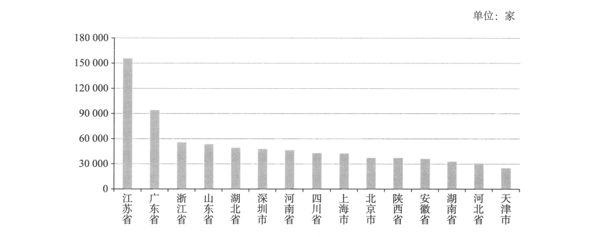
图 2-4 科技型中小企业注册情况

### 一、科技型中小企业研发费用加计扣除优惠

#### （一）科技型中小企业的界定

根据《科技型中小企业评价办法》第二条的规定，科技型中小企业，是指依托一定数量的科技人员从事科学技术研究开发活动，取得自主知识产权并将其转化为高新技术产品或服务，从而实现可持续发展的中小企业。

#### （二）科技型中小企业研发费用加计扣除优惠政策

根据《财政部 国家税务总局 科技部关于提高科技型中小企业研究开发费用税前加计扣除比例的通知》（财税〔2017〕34号）的规定，科技型中小企业开展研

<!-- PDF 第 142 页（页眉：| 第二章 研发费用加计扣除优惠 |；页脚：123） -->
发活动中实际发生的研发费用，未形成无形资产计入当期损益的，在按规定据实扣除的基础上，在2017年1月1日至2019年12月31日期间，再按照实际发生额的75%在税前加计扣除；形成无形资产的，在上述期间按照无形资产成本的175%在税前摊销。

2019年12月31日，《财政部 国家税务总局 科技部关于提高科技型中小企业研究开发费用税前加计扣除比例的通知》（财税〔2017〕34号）规定的科技型中小企业研发费加计扣除政策到期后，符合条件的科技型中小企业可以按照《财政部 税务总局 科技部关于提高研究开发费用税前加计扣除比例的通知》（财税〔2018〕99号）规定，适用普惠性研发费用加计扣除75%优惠。即自2020年1月1日起，科技型中小企业发生的符合规定的研究开发费用，可以按照《财政部 税务总局 科技部关于提高研究开发费用税前加计扣除比例的通知》（财税〔2018〕99号）和《财政部 税务总局关于延长部分税收优惠政策执行期限的公告》（财政部 税务总局公告2021年第6号）的规定，加计扣除75%。

自2021年1月1日起，符合条件的科技型中小企业中的制造业企业，可以适用《财政部 税务总局关于进一步完善研发费用税前加计扣除政策的公告》（财政部 税务总局公告2021年第13号）的规定，制造业企业研发费用加计扣除100%优惠。

自2022年1月1日起，根据《财政部 税务总局 科技部关于进一步提高科技型中小企业研发费用税前加计扣除比例的公告》（财政部 税务总局 科技部公告2022年第16号）的规定，科技型中小企业开展研发活动中实际发生的研发费用，未形成无形资产计入当期损益的，在按规定据实扣除的基础上，自2022年1月1日起，再按照实际发生额的100%在税前加计扣除；形成无形资产的，自2022年1月1日起，按照无形资产成本的200%在税前摊销。科技型中小企业条件和管理办法按照《科技型中小企业评价办法》（国科发政〔2017〕115号文件印发）执行。科技型中小企业享受研发费用税前加计扣除政策的其他政策口径和管理要求，按照《财政部 国家税务总局 科技部关于完善研究开发费用税前加计扣除政策的通知》（财税〔2015〕119号）、《财政部 税务总局 科技部关于企业委托境外研究开发费用税前加计扣除有关政策问题的通知》（财税〔2018〕64号）等文件相关规定执行。

根据《财政部 税务总局关于进一步完善研发费用税前加计扣除政策的公告》

<!-- PDF 第 143 页（页眉：| 研发费用加计扣除与高新 技术企业优惠实务及案例 |；页脚：124） -->
（财政部 税务总局公告2023年第7号）第一条的规定，企业开展研发活动中实际发生的研发费用，未形成无形资产计入当期损益的，在按规定据实扣除的基础上，自2023年1月1日起，再按照实际发生额的100%在税前加计扣除；形成无形资产的，自2023年1月1日起，按照无形资产成本的200%在税前摊销。因而，科技型中小企业，自2023年1月1日起，可适用上述研发费用加计扣除100%的普惠性优惠。

根据《财政部 税务总局 国家发展改革委 工业和信息化部关于提高集成电路和工业母机企业研发费用加计扣除比例的公告》（财政部 税务总局 国家发展改革委 工业和信息化部公告2023年第44号）第一条的规定，集成电路企业和工业母机企业开展研发活动中实际发生的研发费用，未形成无形资产计入当期损益的，在按规定据实扣除的基础上，在2023年1月1日至2027年12月31日期间，再按照实际发生额的120%在税前扣除；形成无形资产的，在上述期间按照无形资产成本的220%在税前摊销。对于科技型中小企业中的符合条件的集成电路和工业母机企业，可适用研发费用加计扣除120%优惠政策。

科技型中小企业研发费用加计扣除比例调整情况如图2-5所示。

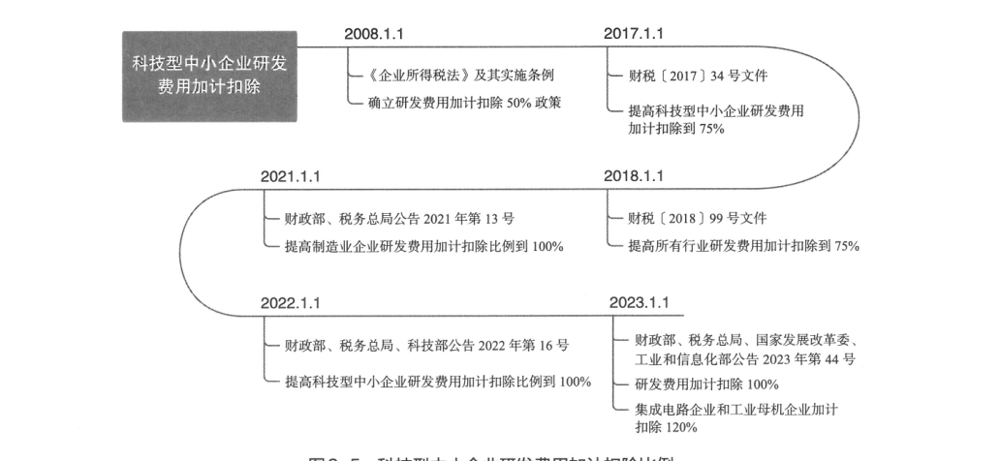
图 2-5 科技型中小企业研发费用加计扣除比例

<!-- PDF 第 144 页（页眉：| 第二章 研发费用加计扣除优惠 |；页脚：125） -->
#### （三）科技型中小企业研发费用加计扣除口径

科技型中小企业享受研发费用税前加计扣除政策的其他政策口径和管理事项仍按照《财政部 国家税务总局 科技部关于完善研究开发费用税前加计扣除政策的通知》（财税〔2015〕119号）、《国家税务总局关于企业研究开发费用税前加计扣除政策有关问题的公告》（国家税务总局公告2015年第97号）、《企业所得税优惠政策事项办理办法》（国家税务总局公告2018年第23号）、《国家税务总局关于研发费用税前加计扣除归集范围有关问题的公告》（国家税务总局公告2017年第40号）和《国家税务总局关于进一步落实研发费用加计扣除政策有关问题的公告》（国家税务总局公告2021年第28号）等文件的规定执行。

### 二、科技型中小企业应符合的条件

#### （一）基本条件

根据《科技型中小企业评价服务工作指引》（国科火字〔2022〕67号文件印发）第三条第（一）项的规定，科技型中小企业须同时满足以下条件：

（1）在中国境内（不包括港澳台地区）注册成立或依照外国（地区）法律成立但实际管理机构在中国境内的会计核算健全、实行查账征收并能够准确归集研发费用，并缴纳企业所得税的居民企业。

这是关于主体条件的规定，非居民企业、核定征收居民企业以及个人独资企业和合伙企业，不能评价为科技型中小企业。

（2）职工总数不超过500人、年销售收入不超过2亿元、资产总额不超过2亿元。资产总额应以上一会计年度企业资产负债表中的期末数为准。

（3）企业所在行业不属于国家发展改革委《产业结构调整指导目录》规定的限制类和淘汰类范围，不属于《财政部 国家税务总局 科技部关于完善研究开发费用税前加计扣除政策的通知》（财税〔2015〕119号）规定的不适用税前加计扣除政策的行业。

这是关于不属于负面清单行业条件的规定，与原规定条件相比，增加了不适用

<!-- PDF 第 145 页（页眉：| 研发费用加计扣除与高新技术企业优惠实务及案例 |；页脚：126） -->
加计扣除政策负面清单行业企业的限制。

（4）企业在上一会计年度及当年未发生重大安全、重大质量事故、严重环境违法、严重弄虚作假和科研严重失信行为，且在上一会计年度及当年未列入经营异常名录和严重违法失信企业名单。

这是有关企业信用条件的规定，这里所称“发生重大安全、重大质量事故和严重环境违法、科研严重失信行为”“列入经营异常名录和严重违法失信企业名单”以有关部门根据相关法律法规出具的意见为准或参考国家公共信用信息中心“信用中国”网站（https://www.creditchina.gov.cn）和国家市场监督管理总局“国家企业信用信息公示系统”（http://www.gsxt.gov.cn）。

（5）企业根据科技型中小企业评价指标进行综合评价所得分值不低于60分，且科技人员指标得分不得为0分。

企业科技人员是指企业直接从事研发和相关技术创新活动，以及专门从事上述活动管理和提供直接服务的人员，包括在职、兼职和临时聘用人员，兼职、临时聘用人员全年须在企业累计工作6个月以上。

#### （二）“直通车”条件

根据《科技型中小企业评价服务工作指引》（国科火字〔2022〕67号文件印发）第三条第（二）项的规定，符合上述评价条件的企业，若同时符合下列条件中的一项，则不受综合评价所得分值高低限制，可直接确认符合科技型中小企业条件。

##### 1.企业拥有有效期内高新技术企业资格证书

高新技术企业是指拥有有效期内高新技术企业证书编号的企业，其编号在“高新技术企业认定管理工作网”可查。科技型中小企业评价与高新技术企业认定工作已实现数据对接，高新技术企业状态可自动获取。

##### 2.企业近五年内获得过国家级科技奖励

近五年内获得过的国家级科技奖励包括国家最高科学技术奖、国家自然科学奖、国家技术发明奖、国家科学技术进步奖和中华人民共和国国际科学技术合作奖，以奖励证书为准，近五年包括填报当年。科技型中小企业获得国家级科技奖励以国家科学技术奖励办公室公告为准，获奖情况可自动获取。

<!-- PDF 第 146 页（页眉：| 第二章 研发费用加计扣除优惠 |；页脚：127） -->
##### 3.企业拥有经认定的省部级以上研发机构

企业拥有的省部级以上研发机构包括国家部委、省直单位批准认定的企业牵头建立的实验室、研究中心、技术中心、设计中心、创新中心及研究院等各类国家级、省（部）级创新平台（基地）。证明材料以出具的研发机构批准认定文件为准。

##### 4.企业近五年内主导制定过国际标准、国家标准或行业标准

企业近五年内主导制定过国际标准、国家标准或行业标准的，应出具相关标准文本或证明文件。国家标准以国家标准化管理委员会网站发布的国家标准为准，行业标准以国家标准化管理委员会网站备案的行业标准为准，国际标准应是国家标准化管理委员会网站公布的国际标准化机构制定的标准。相关标准可在全国标准信息公共服务平台查询（http://std.samr.gov.cn）。企业应排名标准起草单位前五名。近五年包括填报当年。

#### （三）评价指标

科技型中小企业评价指标具体包括科技人员、研发投入、科技成果三类，满分100分。

##### 1.科技人员指标

科技人员指标满分20分。按科技人员数占企业职工总数的比例分档评价。

A.30%（含）以上（20分）
B.25%（含）～30%（16分）
C.20%（含）～25%（12分）
D.15%（含）～20%（8分）
E.10%（含）～15%（4分）
F.10%以下（0分）

企业职工总数包括企业上一会计年度在职、兼职和临时聘用人员。在职人员可以通过是否签订了劳动合同、缴纳社会保险费、缴纳工资薪金个人所得税等方式之一进行鉴别，兼职、临时聘用人员全年须在企业累计工作6个月以上。这与原规定相比，对在职人员增加了缴纳工资薪金个人所得税这一鉴别方式。

企业科技人员是指企业直接从事研发和相关技术创新活动，以及专门从事上述活动管理和提供直接服务的人员，包括在职、兼职和临时聘用人员，兼职、临时聘用人员全年须在企业累计工作6个月以上。

职工总数、科技人员数和资产总额指标，应按企业全年的季度平均值确定。具

<!-- PDF 第 147 页（页眉：| 研发费用加计扣除与高新技术企业优惠实务及案例 |；页脚：128） -->
体计算公式如下：

季度平均值=（季初值+季末值）÷2

全年季度平均值=全年各季度平均值之和÷4

年度中间开业或者终止经营活动的，以其实际经营期作为一个纳税年度确定上述相关指标。

##### 2.研发投入指标

研发投入指标满分50分。企业从下列（1）、（2）两项指标中选择一个指标进行评分。

（1）按企业研发费用总额占销售收入的比例分档评价。

A.6%（含）以上（50分）
B.5%（含）～6%（40分）
C.4%（含）～5%（30分）
D.3%（含）～4%（20分）
E.2%（含）～3%（10分）
F.2%以下（0分）

（2）按企业研发费用总额占成本费用支出总额的比例分档评价。

A.30%（含）以上（50分）
B.25%（含）～30%（40分）
C.20%（含）～25%（30分）
D.15%（含）～20%（20分）
E.10%（含）～15%（10分）
F.10%以下（0分）

销售收入采用上一会计年度财务数据，为主营业务与其他业务收入之和，按照企业所得税年度纳税申报表的口径。因而，不包括视同销售收入、投资收益和营业外收入。

成本费用支出总额包括营业成本、税金及附加和期间费用，根据企业会计制度，采用上一会计年度财务数据。成本费用按照企业所得税年度纳税申报表口径。成本费用支出总额=营业成本+税金及附加+销售费用+管理费用+研发费用+财务费用。

##### 3.科技成果指标

科技成果指标满分30分。按企业拥有的在有效期内的与主要产品（或服务）相关的知识产权类别和数量（知识产权应没有争议或纠纷）分档评价。

A.1项及以上Ⅰ类知识产权（30分）
B.4项及以上Ⅱ类知识产权（24分）
C.3项Ⅱ类知识产权（18分）
D.2项Ⅱ类知识产权（12分）

<!-- PDF 第 148 页（页眉：| 第二章 研发费用加计扣除优惠 |；页脚：129） -->
E.1项Ⅱ类知识产权（6分）
F.没有知识产权（0分）

知识产权须在中国境内授权或审批审定，并在中国法律的有效保护期内。知识产权权属人应为评价申请企业。

知识产权采用分类评价，其中：发明专利（不含国防专利）、植物新品种、国家级农作物品种、国家新药、国家一级中药保护品种、集成电路布图设计专有权等按Ⅰ类评价；实用新型专利、外观设计专利、软件著作权等按Ⅱ类评价。

专利的有效性以企业进行评价前获得授权证书或授权通知书并能提供缴费收据为准。

发明专利、实用新型专利、外观设计专利、集成电路布图设计专有权可在国家知识产权局网站（http://www.cnipa.gov.cn）查询专利标记和专利号；植物新品种可在农业农村部科技发展中心网站（http://www.nybkjfzzx.cn）和国家林业和草原局植物新品种保护办公室网站（http://www.cnpvp.net）查询；国家农作物品种是指农业农村部国家农作物品种审定委员会审定公告的农作物品种；国家新药须提供国家药品监督管理局签发的新药证书；国家一级中药保护品种须提供国家药品监督管理局签发的中药保护品种证书；软件著作权可在国家版权局中国版权保护中心网站（http://www.ccopyright.com.cn）查询软件著作权标记（亦称版权标记）。

#### （四）研发费用总额

研发费用，是指企业进行研发活动和创意设计活动而发生的相关费用。研发活动是指企业为获得科学与技术新知识，创造性运用科学技术新知识，或实质性改进技术、产品（服务）、工艺而持续进行的具有明确目标的系统性活动。创意设计活动，是指企业为获得创新性、创意性、突破性的产品进行的设计活动，包括多媒体软件、动漫游戏软件开发，数字动漫、游戏设计制作；房屋建筑工程设计（绿色建筑评价标准为三星）、风景园林工程专项设计；工业设计、多媒体设计、动漫及衍生产品设计、模型设计等。

以下活动产生的费用不计入研发费用：企业产品（服务）的常规性升级；对某项科研成果的直接应用，如直接采用公开或者直接购买的新工艺、材料、装置、产品、服务或知识等商品；企业在商品化后为顾客提供的技术服务、技术咨询等支

<!-- PDF 第 149 页（页眉：| 研发费用加计扣除与高新技术企业优惠实务及案例 |；页脚：130） -->
持活动；对现存产品、服务、技术、材料或工艺流程进行的重复或简单改变；市场调查研究、效率调查或管理研究；作为工业（服务）流程环节或常规的质量控制、测试分析、维修维护；社会科学、艺术或人文学方面的研究。

研发费用应按照《财政部 国家税务总局 科技部关于完善研究开发费用税前加计扣除政策的通知》（财税〔2015〕119号）、《财政部 国家税务总局 科技部关于提高科技型中小企业研究开发费用税前加计扣除比例的通知》（财税〔2017〕34号）、《财政部 税务总局 科技部关于进一步提高科技型中小企业研发费用税前加计扣除比例的公告》（财政部 税务总局 科技部公告2022年第16号）及其他有关规定，依照《国家税务总局关于企业研究开发费用税前加计扣除政策有关问题的公告》（国家税务总局公告2015年第97号）、《国家税务总局关于研发费用税前加计扣除归集范围有关问题的公告》（国家税务总局公告2017年第40号）、《财政部 税务总局关于企业委托境外研究开发费用税前加计扣除有关政策问题的通知》（财税〔2018〕64号）、《财政部 税务总局关于进一步完善研发费用税前加计扣除政策的公告》〔财政部 税务总局公告2021年第13号，自2023年1月1日起被《财政部 税务总局关于进一步完善研发费用税前加计扣除政策的公告》（财政部 税务总局公告2023年第7号）废止〕、《国家税务总局关于进一步落实研发费用加计扣除政策有关问题的公告》〔国家税务总局公告2021年第28号，自2023年1月1日起被《财政部 税务总局关于进一步完善研发费用税前加计扣除政策的公告》（财政部 税务总局公告2023年第7号）废止〕等文件明确的方式、范围，对各研发项目以辅助账形式，开展研发费用归集，由企业留存备查。研发费用归集范围包括以下内容。

##### 1.人员人工费用

人员人工费用包括直接从事研发活动人员的工资薪金、基本养老保险费、基本医疗保险费、失业保险费、工伤保险费、生育保险费和住房公积金，以及外聘研发人员的劳务费用。

##### 2.直接投入费用

直接投入费用包括研发活动直接消耗的材料、燃料和动力费用；用于中间试验和产品试制的模具、工艺装备开发及制造费；不构成固定资产的样品、样机及一般

<!-- PDF 第 150 页（页眉：| 第二章 研发费用加计扣除优惠 |；页脚：131） -->
测试手段购置费，试制产品的检验费；用于研发活动的仪器、设备的运行维护、调整、检验、维修等费用，以及通过经营租赁方式租入的用于研发活动的仪器、设备租赁费。

##### 3.折旧费用

折旧费用包括用于研发活动的仪器、设备的折旧费。

##### 4.无形资产摊销

无形资产摊销包括用于研发活动的软件、专利权、非专利技术（包括许可证、专有技术、设计和计算方法等）的摊销费用。

##### 5.新产品设计费等四项费用

该项费用是指新产品设计费、新工艺规程制定费、新药研制的临床试验费、勘探开发技术的现场试验费。

##### 6.其他相关费用

其他相关费用，是指与研发活动直接相关的其他费用，如技术图书资料费、资料翻译费、专家咨询费、高新科技研发保险费，研发成果的检索、分析、评议、论证、鉴定、评审、评估、验收费用，知识产权的申请费、注册费、代理费，差旅费、会议费，职工福利费、补充养老保险费、补充医疗保险费。

此项费用总额不得超过研发费用总额的10%。

研发费用采用上一会计年度最后一个季度财务数据。根据项目研发形式按以下方法计算企业研发费用总额：

（1）企业内部自主研发项目，按实际发生费用额计入企业研发费用总额；

（2）企业共同合作研发项目，按自身实际承担费用额计入企业研发费用总额；

（3）企业参加企业集团的集中研发项目，按自身实际分摊费用额计入企业研发费用总额；

（4）企业委托境内外部机构或个人的研发项目，按实际发生费用额的80%计入企业研发费用总额；

（5）企业委托境外机构的研发项目，按实际发生费用额的80%计入企业研发费用总额，但不超过境内符合条件的研发费用的三分之二。

<!-- PDF 第 151 页（页眉：| 研发费用加计扣除与高新技术企业优惠实务及案例 |；页脚：132） -->
### 三、科技型中小企业评价的组织实施

科技型中小企业评价服务工作坚持统一规范、服务引领、放管结合、公开透明的原则，采取企业自主评价、省级科技主管部门组织实施、科技部服务监督的工作模式。

##### 1.科技部火炬高技术产业开发中心

科技部火炬高技术产业开发中心在科技部指导下承担科技型中小企业标准制定与执行及科技型中小企业评价工作协调与服务监督的日常工作。指导协调各地科技型中小企业评价组织工作，对省级科技主管部门管理工作进行监督检查。负责全国科技型中小企业信息服务平台和全国科技型中小企业信息库的建设与日常管理。协同各地开展科技型中小企业发展监测、创新能力评价，开展促进科技型中小企业创新发展的政策研究。完成科技部交办的其他相关工作。

##### 2.省级科技主管部门

省级（包括省、自治区、直辖市及计划单列市，新疆生产建设兵团，下同）科技主管部门负责组织辖区内科技型中小企业评价工作。负责科技型中小企业公示公告、入库登记及编号撤销。开展入库科技型中小企业抽查工作，及时处理相关异议、投诉、举报信息。开展科技型中小企业动态监测分析，编制本地区科技型中小企业年度发展报告。建立科技型中小企业诚信体系。强化企业创新政策服务，跟踪科技型中小企业享受税收优惠情况。

《科技部 国家税务总局关于做好科技型中小企业评价工作有关事项的通知》（国科发火〔2018〕11号）第一条要求，科技管理部门要组织好企业注册信息、自评信息的形式审查及科技型中小企业入库公示、公告工作，省级科技管理部门6月30日前应完成5月31日前提交自评信息（补正自评信息的按补正提交日期）的科技型中小企业入库公告，保障符合条件的企业及时入库并享受优惠政策。

##### 3.评价工作机构

省级科技主管部门可结合实际情况，依托本部门或委托所辖地级（或县级）科技管理部门、国家高新区管委会等组成评价工作机构，评价工作机构名单和业务办理联系方式应通过一定方式在社会公开并向全国科技型中小企业信息服务平台备

<!-- PDF 第 152 页（页眉：| 第二章 研发费用加计扣除优惠 |；页脚：133） -->
案。评价工作机构负责《科技型中小企业信息表》内容完整性和指标条件符合情况的确认工作，核实相关异议、投诉、举报信息。评价工作机构推动科技型中小企业创新政策和培训服务，调研科技型中小企业创新发展情况和政策需求。

省级科技主管部门要加强对评价工作机构指导监督。评价工作机构及所在地政府应对评价服务工作人员和工作经费予以保障，评价服务工作不向企业收取相关费用，不向中介机构委托相关工作。

##### 4.参与企业

企业按自愿和属地原则参与科技型中小企业评价工作。参与企业应遵守国家法律法规以及《科技型中小企业评价办法》和《科技型中小企业评价服务工作指引》的有关要求，严禁弄虚作假。

### 四、科技型中小企业评价工作流程

科技型中小企业评价服务工作实行全流程网上办理，依托全国科技型中小企业信息服务平台（http://www.innofund.gov.cn）进行。评价工作流程包括以下几个步骤。

#### （一）注册登记

用户访问全国一体化政务服务平台科学技术部政务服务平台（https://fuwu.most.gov.cn），选择“服务事项—科技型中小企业评价”，点击“我要办理”登录办理。

#### （二）自主评价

##### 1.信息填报

注册成功的企业登录“科学技术部政务服务平台”，点击“科技型中小企业评价”事项“办理入口”按钮，按要求在线填报《科技型中小企业信息表》（以下简称《信息表》），自主进行科技型中小企业评价。企业填报信息及上传文件不得涉及国家秘密。

##### 2.企业自评

企业填报信息和证明文件齐全且自评结果符合科技型中小企业条件的企业可提

<!-- PDF 第 153 页（页眉：| 研发费用加计扣除与高新技术企业优惠实务及案例 |；页脚：134） -->
交《信息表》，并应同时上传有法定代表人签章和加盖企业公章的《信息表》扫描件单页。企业对所填报信息和上传文件的准确、真实、合法、有效性承担相关法律责任。

#### （三）信息确认

省级科技主管部门组织评价工作机构对企业提交的《信息表》及相关附件内容是否完整且符合要求进行了确认，形成《科技型中小企业信息审核表》（以下简称《审核表》）。《审核表》包括以下内容：

（1）《信息表》首页是否有法定代表人签章、企业公章；

（2）《信息表》内容是否完整；

（3）《信息表》中信息与相关证明文档是否一致；

（4）《信息表》其他问题说明（如果有，评价工作机构需填写具体内容）。

《信息表》内容完整且符合要求的，信息确认通过，在线提交至省级科技主管部门；上述内容有一项信息不完整或不符合要求的，在线通知企业进行补正后再行提交；《信息表》中内容不符合《科技型中小企业评价办法》第六条规定的，则不通过。

#### （四）名单公示

省级科技主管部门汇总通过企业名单，按批次生成公示文件，同步在全国科技型中小企业信息服务平台和各省科技行政管理部门官网上公示10个工作日。公示异议的，由省级科技主管部门组织评价工作机构进行核实处理，并在线填写科技型中小企业评价公示异议核实处理情况表，相关结果在线告知企业。

#### （五）入库登记编号

公示无异议和经核实排除异议的，由省级科技主管部门赋予科技型中小企业入库登记编号，入库登记编号在线自动生成，包括18位数字或字母（4位年份+6位行政区划代码+1位企业成立日期和自评日期标识+1位直接确认标识+6位系统顺序号）。公众可通过全国科技型中小企业信息服务平台查询科技型中小企业入库登记编号。

<!-- PDF 第 154 页（页眉：| 第二章 研发费用加计扣除优惠 |；页脚：135） -->
省级科技主管部门应在每年10月底前完成企业公示。科技型中小企业入库登记编号自取得当年全年有效。

### 五、监督管理

科技部根据工作需要对省级科技管理部门管理工作进行监督检查。省级科技管理部门对已入库企业进行抽查，对经抽查或审核确认企业不符合条件的，由省级科技管理部门按照《科技型中小企业评价办法》第十四条规定处理。

#### （一）信息更新

已入库企业应在每年3月底前通过服务平台对《科技型中小企业信息表》中的信息进行更新，并对本企业是否仍符合科技型中小企业条件进行自主评价，仍符合条件的，由省级科技管理部门按《科技型中小企业评价办法》第十条和第十一条规定程序办理。

#### （二）企业诚信

入库企业应履行自主提交《科技型中小企业信息表》的内容和材料符合准确、真实、合法、有效、无涉密等要求的承诺，对发现的虚假不实等情况，可在全国科技型中小企业信息库诚信档案中进行记录。

根据《科技型中小企业评价办法》第十三条的规定，已入库企业发生更名或与规定的条件有关的重大变化的，应在三个月内通过服务平台填报变化情况。该办法所称入库企业发生变更，是指企业《营业执照》的统一社会信用代码不变的前提下，企业名称、住所、法人代表、经营范围等发生变更。发生变更的企业应及时通过科学技术部政务服务平台进行登记。

#### （三）日常监督

省级科技主管部门统筹考虑企业服务数量、区域布局需要和综合服务能力等因素合理设立、合并、调整评价工作机构，确保管理服务范围无死角、无交叉，在年

<!-- PDF 第 155 页（页眉：| 研发费用加计扣除与高新技术企业优惠实务及案例 |；页脚：136） -->
底前更新《科技型中小企业评价工作机构信息表》，通过一定方式向社会公开并在全国科技型中小企业信息服务平台进行备案，并加强对评价服务工作队伍的业务培训和指导监督，推动工作规范化、标准化。

省级科技主管部门应加强与税务部门密切配合，共享科技型中小企业入库登记信息（包含企业名称、统一社会信用代码、注册地、入库登记编号、入库日期等），掌握企业参与评价工作的进展和享受政策情况，协同提升科技型中小企业评价服务工作质量。

省级科技主管部门和评价工作机构应及时处理入库科技型中小企业的日常投诉、举报，并做好核实处理。积极开展日常巡检监督，及时对已破产清算、倒闭注销、经营关停或整体搬迁的企业进行清理汇总。对发生上述情况或不符合《科技型中小企业评价办法》第六条、第十四条规定的企业要及时进行处理。

省级科技主管部门和评价工作机构应认真履行科技型中小企业评价服务工作主体责任，重视和加强科技型中小企业诚信体系建设，严格执行评价条件和程序，为科技型中小企业高质量发展营造良好环境。

#### （四）集中抽查

省级科技主管部门每年度组织评价工作机构开展对入库科技型中小企业信息抽查，随机确定抽查企业名单，抽查比例不低于5%。原则上被抽查企业不含已拥有有效期内高新技术企业资格证书为条件直接确认的科技型中小企业，同一个科技型中小企业（经抽查符合条件）三年内仅抽查一次。

被抽查企业应按要求，在线上传上一会计年度职工人数统计表（注明科技人员数）、“研发支出”辅助账汇总表［可参考《国家税务总局关于企业研究开发费用税前加计扣除政策有关问题的公告》（国家税务总局公告2015年第97号）或《国家税务总局关于进一步落实研发费用加计扣除政策有关问题的公告》（国家税务总局公告2021年第28号）设置］及上一会计年度末《资产负债表》《利润表》等证明材料，以上材料需加盖企业公章。

评价工作机构在线核对《科技型中小企业信息表》与证明材料的数据一致性。重点核对被抽查企业上一会计年度的规模、科技人员指标和研发投入指标，具体包

<!-- PDF 第 156 页（页眉：| 第二章 研发费用加计扣除优惠 |；页脚：137） -->
括职工总数、科技人员数、年销售收入、资产总额、研发费用和成本费用等。评价工作机构可结合实际需要提出其他的抽查内容。

数据不一致且影响企业入库达标的，评价工作机构应组织实地检查。对抽查中发现不符合科技型中小企业条件、不配合集中抽查、不能提供符合要求的证明材料或存在严重弄虚作假等行为的企业，要依据《科技型中小企业评价办法》第十四条规定进行处理，按程序撤销相应的企业入库登记编号。

#### （五）撤销入库登记编号

《科技型中小企业评价办法》规定，已入库企业有下列行为之一的，由省级科技管理部门撤销其行为发生年度登记编号并在服务平台上公告：

（1）企业发生重大变化，不再符合规定条件的；

（2）存在严重弄虚作假行为的；

（3）发生科研严重失信行为的；

（4）发生重大安全、重大质量事故或有严重环境违法行为的；

（5）被列入经营异常名录和严重违法失信企业名单的；

（6）未按期更新《科技型中小企业信息表》信息的。

已入库企业存在《科技型中小企业评价办法》第十四条列出行为之一的，由省级科技主管部门撤销其行为发生年度登记编号并在全国科技型中小企业信息服务平台上公告。被撤销入库登记编号的企业撤销当年不得参与科技型中小企业评价。

### 六、优惠的享受与停止

#### （一）开始享受优惠

企业在汇算清缴期内按照规定取得科技型中小企业登记编号的，其汇算清缴年度可享受科技型中小企业研发费用加计扣除优惠政策。企业按规定更新信息后不再符合条件的，其汇算清缴年度不得享受科技型中小企业研发费用加计扣除优惠政策，但仍可以享受一般企业加计扣除优惠。

<!-- PDF 第 157 页（页眉：| 研发费用加计扣除与高新技术企业优惠实务及案例 |；页脚：138） -->
《科技部 国家税务总局关于做好科技型中小企业评价工作有关事项的通知》（国科发火〔2018〕11号）第二条规定，各省级科技管理部门应按企业成立日期和提交自评信息日期，在科技型中小企业入库登记编号（以下简称登记编号）上进行标识。入库年度之前成立且5月31日前提交自评信息的，其登记编号第11位（左数，下同）为0；入库年度之前成立但6月1日（含）以后提交自评信息的，其登记编号第11位为A；入库年度当年成立的，其登记编号第11位为B。入库登记编号第11位为0的企业，可在上年度汇算清缴中享受提高科技型中小企业税前研发费用加计扣除比例政策。省级科技管理部门应及时将科技型中小企业入库登记信息（包括企业名称、统一社会信用代码、注册地、入库登记编号、入库日期等）发送给省级税务部门。

#### （二）被撤销登记编号的企业不得享受优惠

因不符合科技型中小企业条件而被科技部门撤销登记编号的企业，相应年度不得享受科技型中小企业研发费用加计扣除优惠政策，但仍可以享受一般企业研发费用加计扣除优惠。

享受规定的提高科技型中小企业研发费用加计扣除比例优惠政策的主体是科技型中小企业，因此，能否符合科技型中小企业条件是享受优惠政策的前提。按照《科技型中小企业评价办法》的规定，科技型中小企业经公示确认并取得登记编号表明其符合科技型中小企业条件，相应地，不符合科技型中小企业条件而被科技部门撤销登记编号的企业，相应年度不得享受规定的优惠政策，已享受的应补缴相应年度的税款。

科技型中小企业是否符合条件，主要依据其上一年度数据进行判断，因此，科技型中小企业经公示并取得入库登记编号说明其上一年度符合科技型中小企业的条件。其中包括两种情况：一是企业上一年度没有取得入库登记编号，本年新取得入库登记编号的；二是上一年度已取得入库登记编号，本年更新信息后仍符合条件从而又取得入库登记编号的。由此，综合考虑《财政部 国家税务总局 科技部关于提高科技型中小企业研究开发费用税前加计扣除比例的通知》（财税〔2017〕34号）和《科技型中小企业评价办法》相关规定的有效衔接问题，《国家税务总局关于提

<!-- PDF 第 158 页（页眉：| 第二章 研发费用加计扣除优惠 |；页脚：139） -->
高科技型中小企业研究开发费用税前加计扣除比例有关问题的公告》（国家税务总局公告2017年第18号）明确，企业在汇算清缴期内按照《科技型中小企业评价办法》第十条至第十二条规定取得科技型中小企业入库登记编号的，其汇算清缴年度可享受规定的研发费用加计扣除优惠政策。企业按《科技型中小企业评价办法》第十二条规定更新信息后不再符合条件的，其汇算清缴年度不得享受规定的优惠政策。

比如，某科技型中小企业在2023年5月取得入库登记编号，2023年5月正值2022年度汇算清缴期间，因此，该企业可以在2022年度享受规定的科技型中小企业研发费用加计扣除的优惠政策；如该企业2024年3月底前更新信息后仍符合条件，则可以在2023年度享受科技型中小企业研发费用加计扣除100%的优惠政策；如该企业2024年3月底前更新信息后不符合条件，则该企业在2023年度不得享受研发费用加计扣除100%的优惠政策。

### 七、主要留存备查资料

科技型中小企业开发新技术、新产品、新工艺发生的研究开发费用加计扣除，需要准备的主要留存备查资料有：

（1）自主、委托、合作研究开发项目计划书和企业有权部门关于自主、委托、合作研究开发项目立项的决议文件；

（2）自主、委托、合作研究开发专门机构或项目组的编制情况和研发人员名单；

（3）经科技行政主管部门登记的委托、合作研究开发项目的合同；

（4）从事研发活动的人员（包括外聘人员）和用于研发活动的仪器、设备、无形资产的费用分配说明（包括工作使用情况记录及费用分配计算证据材料）；

（5）集中研发项目研发费决算表、集中研发项目费用分摊明细情况表和实际分享收益比例等资料；

（6）“研发支出”辅助账及汇总表；

（7）企业已取得的地市级（含）以上科技行政主管部门出具的鉴定意见；

（8）科技型中小企业取得的入库登记编号证明资料。

<!-- PDF 第 159 页（页眉：| 研发费用加计扣除与高新技术企业优惠实务及案例 |；页脚：140） -->
### 八、研发费用加计扣除综合案例

【案例2-49】A公司为一家从事生物药品研发与制造的高新技术企业，2023年度对甲、乙、丙三个研发项目进行研发，其中，甲项目为自主研发，乙项目委托中国境内某药科大学进行研发，丙项目委托香港某研发机构研发。

甲自主研发项目共计支出166万元，相关明细情况如下：

（1）2023年3月，支付直接从事研发活动的研发人员工资45万元、“五险一金”15万元，支付研发人员的职工教育经费5万元，发生研发人员的职工福利费4万元；

（2）研发消耗的直接材料、燃料和动力费用20万元，用于研发活动的仪器租赁费5万元，与研发活动有关的房屋租赁费10万元；

（3）研发中心办公用房折旧费19万元，研发设备折旧费10万元；

（4）支付新药研制的临床试验费用15万元；

（5）与研发活动直接相关的技术图书资料费、资料翻译费合计18万元。

2023年7月10日，甲项目有60万元研发支出由“研发支出——资本化支出”转入“无形资产”科目（按10年摊销），其余106万元均已作为当年费用化支出。

支付乙项目委托研发费用150万元，最终项目研发失败。

支付丙项目委托研发费用180万元（全部为费用化支出）。

另外，A公司2023年度销售研发过程中形成的下脚料取得收入15万元，以前年度B自主研发项目形成的无形资产每年摊销金额40万元。以上金额均不考虑增值税。

要求：计算可加计扣除的研发费用中的其他相关费用金额和研发费用加计扣除额。

【解析】1.甲自主研发项目。

职工薪酬中的职工教育经费5万元、与研发活动有关的房屋租赁费10万元、办公用房折旧费19万元，不得加计扣除。

研发失败发生的研发费用可以加计扣除。

研发人员的职工福利费4万元属于其他相关费用。

除其他相关费用外的允许加计扣除的研发费用=166-（5+10+19）-（4+18）

<!-- PDF 第 160 页（页眉：| 第二章 研发费用加计扣除优惠 |；页脚：141） -->
=110（万元）。

允许加计扣除的其他相关费用限额=110÷（1-10%）×10%=12.222 2（万元），小于实际发生的其他相关费用22万元（18+4），应按限额扣除。

因而，A公司2023年甲项目允许享受加计扣除优惠的研发费总额=110+12.222 2=122.222 2（万元）。

由于会计上按60万元作为资本化支出并结转无形资产，其余106万元费用化处理计入管理费用，因此应按比例计算允许加计扣除的资本化金额和费用化金额。

允许加计扣除的资本化金额=122.222 2×60/166=44.176 7（万元）；

允许加计扣除的费用化金额=122.222 2×106/166=78.045 5（万元）；

2023年度无形资产摊销金额=44.176 7÷10÷12×6+40=42.208 8（万元）。

2.委托研发。

自2018年1月1日起，委托境外机构进行研发活动所发生的费用，按照费用实际发生额的80%计入委托方的委托境外研发费用。

委托境外研发费用不超过境内符合条件的研发费用三分之二的部分，可按规定在企业所得税前加计扣除。

境内研发费用的2/3=（122.222 2+150×80%）×2/3=161.481 5（万元）；

委托境外研发费用的80%=180×80%=144（万元），小于境内研发费用的2/3，因而委托研发的加计扣除基数=150×80%+144=264（万元）。

3.当年可加计扣除的研发费用小计=122.222 2+264=386.222 2（万元），其中：

本年费用化金额=78.045 5+264=342.045 5（万元）；

本年资本化金额=122.222 2×60/166=44.176 7（万元）。

4.无形资产摊销额42.208 8万元，其中：

本年形成无形资产摊销额=44.176 7÷10÷12×6=2.208 8（万元）；

以前年度形成的无形资产摊销额为40万元。

5.本年允许扣除的研发费用合计=78.045 5+264+2.208 8+40=384.254 3（万元）。

6.扣减特殊收入后的允许加计扣除的研发费用。

研发过程中形成的下脚料收入15万元，应从当期研发费用中扣除。扣除特殊收入后的金额=384.254 3-15=369.254 3（万元）。

<!-- PDF 第 161 页（页眉：| 研发费用加计扣除与高新技术企业优惠实务及案例 |；页脚：142） -->
7.本年研发费用369.254 3万元加计扣除总额=369.254 3×100%=369.254 3（万元）。

填报表A107012，如表2-11所示。

表2-11 A107012研发费用加计扣除优惠明细表

单位：万元

| 行次 | 项目 | 金额（数量） |
| --- | --- | --- |
| 1 | 本年可享受研发费用加计扣除项目数量 | 3 |
| 2 | 一、自主研发、合作研发、集中研发（3+7+16+19+23+34） | 122.222 2 |
| 3 | （一）人员人工费用（4+5+6） | 60 |
| 4 | 1.直接从事研发活动人员工资薪金 | 45 |
| 5 | 2.直接从事研发活动人员五险一金 | 15 |
| 6 | 3.外聘研发人员的劳务费用 | |
| 7 | （二）直接投入费用（8+9+10+11+12+13+14+15） | 25 |
| 8 | 1.研发活动直接消耗材料费用 | 20 |
| 9 | 2.研发活动直接消耗燃料费用 | |
| 10 | 3.研发活动直接消耗动力费用 | |
| 11 | 4.用于中间试验和产品试制的模具、工艺装备开发及制造费 | |
| 12 | 5.用于不构成固定资产的样品、样机及一般测试手段购置费 | |
| 13 | 6.用于试制产品的检验费 | |
| 14 | 7.用于研发活动的仪器、设备的运行维护、调整、检验、维修等费用 | |
| 15 | 8.通过经营租赁方式租入的用于研发活动的仪器、设备租赁费 | 5 |
| 16 | （三）折旧费用（17+18） | 10 |
| 17 | 1.用于研发活动的仪器的折旧费 | |
| 18 | 2.用于研发活动的设备的折旧费 | 10 |
| 19 | （四）无形资产摊销（20+21+22） | |
| 20 | 1.用于研发活动的软件的摊销费用 | |
| 21 | 2.用于研发活动的专利权的摊销费用 | |

<!-- PDF 第 162 页（页眉：| 第二章 研发费用加计扣除优惠 |；页脚：143） -->
续表

| 行次 | 项目 | 金额（数量） |
| --- | --- | --- |
| 22 | 3.用于研发活动的非专利技术（包括许可证、专有技术、设计和计算方法等）的摊销费用 | |
| 23 | （五）新产品设计费等（24+25+26+27） | 15 |
| 24 | 1.新产品设计费 | |
| 25 | 2.新工艺规程制定费 | |
| 26 | 3.新药研制的临床试验费 | 15 |
| 27 | 4.勘探开发技术的现场试验费 | |
| 28 | （六）其他相关费用（29+30+31+32+33） | 22 |
| 29 | 1.技术图书资料费、资料翻译费、专家咨询费、高新科技研发保险费 | 18 |
| 30 | 2.研发成果的检索、分析、评议、论证、鉴定、评审、评估、验收费用 | |
| 31 | 3.知识产权的申请费、注册费、代理费 | |
| 32 | 4.职工福利费、补充养老保险费、补充医疗保险费 | 4 |
| 33 | 5.差旅费、会议费 | |
| 34 | （七）经限额调整后的其他相关费用 | 12.222 2 |
| 35 | 二、委托研发（36+37+39） | 330 |
| 36 | （一）委托境内机构或个人进行研发活动所发生的费用 | 150 |
| 37 | （二）委托境外机构进行研发活动发生的费用 | 180 |
| 38 | 其中：允许加计扣除的委托境外机构进行研发活动发生的费用 | 144 |
| 39 | （三）委托境外个人进行研发活动发生的费用 | |
| 40 | 三、年度研发费用小计（2+36×80%+38） | 386.222 2 |
| 41 | （一）本年费用化金额 | 342.045 5 |
| 42 | （二）本年资本化金额 | 44.176 7 |
| 43 | 四、本年形成无形资产摊销额 | 2.208 8 |
| 44 | 五、以前年度形成无形资产本年摊销额 | 40 |
| 45 | 六、允许扣除的研发费用合计（41+43+44） | 384.254 3 |
| 46 | 减：特殊收入部分 | 15 |
| 47 | 七、允许扣除的研发费用抵减特殊收入后的金额（45-46） | 369.254 3 |

<!-- PDF 第 163 页（页眉：| 研发费用加计扣除与高新技术企业优惠实务及案例 |；页脚：144） -->
续表

| 行次 | 项目 | 金额（数量） |
| --- | --- | --- |
| 48 | 减：当年销售研发活动直接形成产品（包括组成部分）对应的材料部分 | |
| 49 | 减：以前年度销售研发活动直接形成产品（包括组成部分）对应材料部分结转金额 | |
| 50 | 八、加计扣除比例及计算方法 | 100 |
| L1 | 本年允许加计扣除的研发费用总额（47-48-49） | |
| L1.1 | 其中：第四季度允许加计扣除的研发费用金额 | |
| L1.2 | 前三季度允许加计扣除的研发费用金额（L1-L1.1） | |
| 51 | 九、本年研发费用加计扣除总额（47-48-49）×50 | 369.254 3 |
| 52 | 十、销售研发活动直接形成产品（包括组成部分）对应材料部分结转以后年度扣减金额（当47-48-49≥0，本行=0；当47-48-49<0，本行=47-48-49的绝对值） | |

<!-- PDF 第 164 页（页眉：无；页脚：未显示；装饰：TAXING（右侧竖排大字）） -->
# 第三章 IPO研发投入监管要求与研发投入统计

税收与你获得的得益如影随形。

——〔美〕爱默生

<!-- PDF 第 165 页（页眉：无；页脚：未显示；装饰：正文段左上、右下有直角装饰线） -->
本章介绍IPO研发投入监管要求与研发投入统计相关内容，主要内容如图3-1所示。

<!-- PDF 第 166 页（页眉：| 第三章 IPO研发投入监管要求与研发投入统计 |；页脚：147） -->
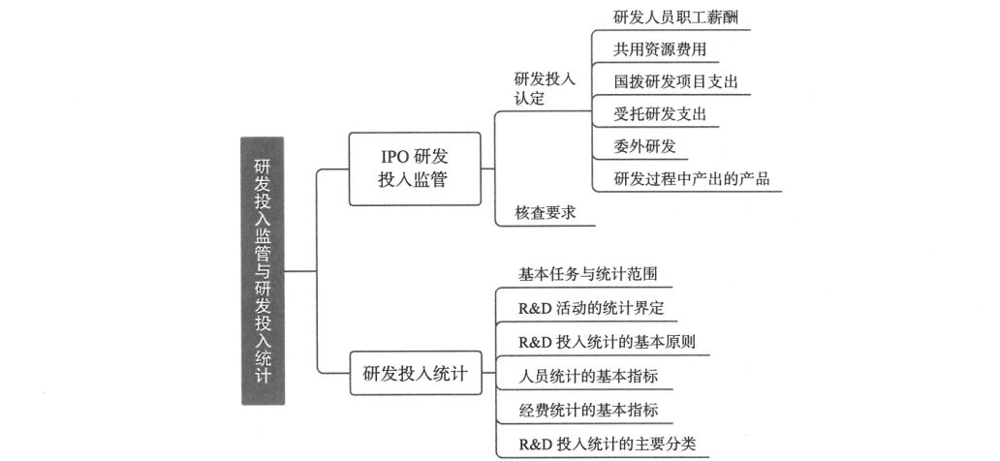
图3-1 研发投入监管与研发投入统计

<!-- PDF 第 167 页（页眉：| 研发费用加计扣除与高新技术企业优惠实务及案例 |；页脚：148；装饰：节标题下有横线） -->
## 第一节 IPO研发投入监管要求

为规范IPO企业研发人员及研发投入信息披露和中介机构核查工作，提高审核工作透明度，证监会起草了《监管规则适用指引——发行类第9号：研发人员及研发投入》，在沪深交易所各板块实施。

### 一、研发投入认定

研发投入为企业研发活动直接相关的支出，通常包括研发人员职工薪酬、直接投入费用、折旧费用与长期待摊费用、设计费用、装备调试费、无形资产摊销费用、委托外部研究开发费用、其他费用等。发行人应按照企业会计准则相关规定，通过“研发支出”科目准确核算相关支出。

研发投入的归集和计算应当以相关资源实际投入研发活动为前提。本期研发投入的计算口径原则上为本期费用化的研发费用与本期资本化的开发支出之和。

#### （一）研发人员职工薪酬

发行人存在非全时研发人员的，应能够清晰统计相关人员从事不同职能的工时情况，按照企业会计准则的规定将属于从事研发活动的薪酬准确、合理分摊计入研发支出。发行人将股份支付费用计入研发支出的，应具有明确合理的依据，不存在利用股份支付调节研发投入指标的情形。

<!-- PDF 第 168 页（页眉：| 第三章 IPO研发投入监管要求与研发投入统计 |；页脚：149） -->
#### （二）共用资源费用

发行人研发活动与其他生产经营活动共用设备、生产线、场地等资源的，应当准确记录相关资源使用情况，并将实际发生的相关费用按照工时占比、面积占比等标准进行合理分配，无法合理分配或未分配的不得计入研发支出。

#### （三）国拨研发项目支出

国拨研发项目支出，是指承担由国家或指定方拨付款项的研发项目（以下简称国拨研发项目）支出。

发行人承担国拨研发项目的，应结合项目目的和科研成果所有权归属等，判断从政府取得经济资源适用的具体会计准则，准确核算发行人的研发支出金额。

发行人从政府取得的经济资源适用《企业会计准则第14号——收入》的，相关支出原则上不得计入研发支出。

发行人从政府取得的经济资源适用《企业会计准则第16号——政府补助》的，如发行人采用净额法核算政府补助，在计算研发投入指标时，可以按照总额法做相应调整。

#### （四）受托研发支出

发行人与客户签订合同，为客户提供受托研发，对于合同履行过程中发生的支出，若发行人无法控制相关研发成果，发行人应按照《企业会计准则第14号——收入》中合同履约成本的规定进行会计处理，最终计入营业成本，相关支出原则上不得计入研发支出。若综合考虑历史经验、行业惯例、法律法规等因素后，发行人有充分证据表明能够控制相关研发成果，该成果预期能够给发行人带来经济利益，且发行人会计基础和内部控制能够确保准确归集核算该成果相关支出的，可以将相关支出计入研发支出；不能准确归集核算的，相关支出应计入合同履约成本，不得计入研发支出。

#### （五）委外研发

发行人存在委外研发的，应签订委外研发合同，相关研发项目应与发行人的研

<!-- PDF 第 169 页（页眉：| 研发费用加计扣除与高新技术企业优惠实务及案例 |；页脚：150） -->
发项目或经营活动直接相关，委外研发具有必要性、合理性和公允性，研发成果归属于发行人，不存在通过委外研发将与研发无关的成本费用计入研发支出或虚构研发支出的情形。

#### （六）研发过程中产出的产品

发行人在研发过程中产出的产品或副产品，符合《企业会计准则第1号——存货》规定的应当确认为存货，符合其他相关企业会计准则中有关资产确认条件的应当确认为相关资产。发行人应准确归集核算有关产品或副产品的成本，并在对外销售时，按照《企业会计准则第14号——收入》《企业会计准则第1号——存货》《企业会计准则解释第15号》等规定，对销售相关的收入和成本分别进行会计处理。原则上研发过程中产出的产品或副产品，其成本不得计入研发投入。

### 二、核查要求

#### （一）保荐机构及申报会计师的核查要求

保荐机构及申报会计师通常应关注并核查以下方面，并发表明确意见：

（1）研发活动认定是否合理，与同行业企业是否存在重大差异。

（2）研发人员认定是否合理，与同行业企业是否存在重大差异；对于研发人员数量在报告期内，尤其是最近一年存在异常增长（包括临时招募、从其他部门调岗等）、非全时研发人员占比较高、研发人员专业背景和工作经历与发行人研发活动不匹配等情形，应重点关注相关人员是否具备从事研发活动的能力，是否真正从事研发活动并作出实际贡献，是否属于发行人研发工作所需的必要人员，发行人研发人员数量和占比是否符合行业特点；研发人员学历、专业、从业和任职年限、全时与非全时分布等是否符合行业特点；研发人员普遍任职年限较短的，应关注原因及对发行人研发能力的影响；研发人员主要由非全时人员或未签订劳动合同人员构成的，应关注其合理性。

（3）研发投入计算口径是否合理；研发投入的归集是否准确；研发投入相关数

<!-- PDF 第 170 页（页眉：| 第三章 IPO研发投入监管要求与研发投入统计 |；页脚：151） -->
据来源是否可验证。

（4）研发相关内控制度是否健全且被有效执行；发行人是否建立研发项目的跟踪管理系统以及与研发项目相对应的人财物管理机制，有效监控、记录各研发项目的进展情况。

（5）是否已明确研发支出开支范围和标准，建立研发支出审批程序，并得到有效执行。

（6）报告期内研发支出核算是否符合企业会计准则的规定；是否严格按照研发支出开支范围和标准据实列支；是否按照研发制度准确记录员工工时、核算研发人员薪酬、归集研发领料用料等；是否存在将与研发无关的支出在研发支出中核算的情形。

（7）报告期内，研发投入金额、占比或构成发生显著变化的，应重点关注变化原因及合理性，是否符合行业变动趋势。

（8）报告期内，发行人委外研发支出金额较大或占研发投入比例较高的，应重点关注委外研发的真实性、必要性和交易价格公允性，是否符合行业惯例，委外研发主要成果及其对发行人生产经营的具体贡献，主要受托方及其研发能力；是否存在通过委外研发虚构研发支出的情形；是否存在发行人自身研发能力较弱的情形。

（9）发行人研发投入中包括股份支付费用的，应充分关注股份支付的背景，具体授予对象及其职务、职责；授予权益工具的数量及确定依据、与授予对象的贡献或职务是否匹配；权益工具的公允价值及确认方法、等待期及费用分摊方式等是否合理。

（10）发行人开展受托研发业务的，是否存在将受托研发人员或支出认定为发行人研发人员或研发投入的情况及其合理性。

（11）发行人研发投入计算口径与下列口径的差异情况：本期费用化的研发费用与本期资本化的开发支出之和、向税务机关申请加计扣除优惠政策的研发费用。存在较大差异的，应充分关注差异原因及合理性。

<!-- PDF 第 171 页（页眉：| 研发费用加计扣除与高新技术企业优惠实务及案例 |；页脚：152） -->
#### （二）发行人律师的核查要求

发行人律师应对研发人员聘用形式的计算口径与招股说明书披露的员工人数口径是否一致进行核查，并发表明确意见。对发行人存在将未签订劳动合同的人员认定为研发人员情形的，还应对该等人员聘用合同的法律性质、工作内容、未签订劳动合同的原因进行核查并发表明确意见。

<!-- PDF 第 172 页（页眉：| 第三章 IPO研发投入监管要求与研发投入统计 |；页脚：153；装饰：节标题下方有一条横线） -->
## 第二节 研发投入统计

研究与试验发展的英文全称为“Research and Experimental Development”，英文缩写为“R&D”，中文简称为“研发”。研究与试验发展是国际上对科学技术活动进行测度所使用的一个通用术语，R&D相关指标集中体现了一个国家或地区的科技实力，特别是自主创新的能力和水平。为适应新形势发展要求，进一步规范研究与试验发展（R&D）投入统计工作，提高科技统计工作效率和数据质量，实现与国际统计标准接轨，国家统计局发布了《研究与试验发展（R&D）投入统计规范（试行）》（国统字〔2019〕47号）。

### 一、基本任务与统计范围

R&D投入统计的基本任务，是通过统计调查收集全社会范围内从事R&D活动的人员和经费等方面的数据，以反映全社会R&D投入的资源总量及其分布情况。

R&D投入统计范围为R&D活动相对密集的行业，包括农、林、牧、渔业，采矿业，制造业，电力、热力、燃气及水生产和供应业，建筑业，交通运输、仓储和邮政业，信息传输、软件和信息技术服务业，金融业，租赁和商务服务业，科学研究和技术服务业，水利、环境和公共设施管理业，教育，卫生和社会工作，文化、体育和娱乐业等行业门类。

<!-- PDF 第 173 页（页眉：| 研发费用加计扣除与高新技术企业优惠实务及案例 |；页脚：154） -->
### 二、R&D活动的统计界定

#### （一）界定、分类与条件

R&D指为增加知识存量（也包括有关人类、文化和社会的知识）以及设计已有知识的新应用而进行的创造性、系统性工作，包括基础研究、应用研究和试验发展三种类型。基础研究和应用研究统称为科学研究。R&D活动应当满足五个条件：新颖性、创造性、不确定性、系统性、可转移性（可复制性）。

#### （二）基础研究

基础研究，是一种不预设任何特定应用或使用目的的实验性或理论性工作，其主要目的是获得（已发生）现象和可观察事实的基本原理、规律和新知识。基础研究的成果通常表现为提出一般原理、理论或规律，并以论文、著作、研究报告等形式为主。基础研究包括纯基础研究和定向基础研究。

纯基础研究，是指不追求经济或社会效益，也不谋求成果应用，只是为增加新知识而开展的基础研究。

定向基础研究，是指为当前已知的或未来可预料问题的识别和解决而提供某方面基础知识的基础研究。

#### （三）应用研究

应用研究，是为获取新知识，达到某一特定的实际目的或目标而开展的初始性研究。应用研究是为了确定基础研究成果的可能用途，或确定实现特定和预定目标的新方法，其研究成果以论文、著作、研究报告、原理性模型或发明专利等形式为主。

#### （四）试验发展

试验发展，是指利用从科学研究、实际经验中获取的知识和研究过程中产生的其他知识，开发新的产品、工艺或改进现有产品、工艺而进行的系统性研究。其研究

<!-- PDF 第 174 页（页眉：| 第三章 IPO研发投入监管要求与研发投入统计 |；页脚：155） -->
成果以专利、专有技术，以及具有新颖性的产品原型、原始样机及装置等形式为主。

#### （五）R&D活动的组织形式

R&D项目（或课题）是进行R&D活动的基本组织形式，通常由R&D活动执行单位依据项目立项书或合同书等形式明确项目任务、目标、人员和经费等。

R&D活动的统计特征包括投入和产出两个维度。R&D投入，是指为进行R&D活动所投入的人力和经费。R&D产出包括的范围比较宽泛，表现为R&D活动带来的新知识、新应用以及所引起的社会经济效应。《研究与试验发展（R&D）投入统计规范（试行）》仅对R&D投入统计做出规定。

### 三、R&D投入统计的基本原则

#### （一）法人单位在地统计原则

这里所称法人单位，是指同时具备下列条件的单位：一是依法成立，有自己的名称、组织机构和场所，能够独立承担民事责任；二是独立拥有和使用（或授权使用）资产，承担负债，有权与其他单位签订合同；三是会计上独立核算，能够编制资产负债表。法人单位应按照社会经济活动在中国境内所在地原则进行统计。

#### （二）条块结合原则

R&D投入统计由统计、科技、教育等行政主管部门按照职责分工，采取分级负责的方式分别组织实施，各级统计部门负责辖区内R&D投入情况的综合汇总。

#### （三）依托科技统计原则

R&D活动是科技活动的核心部分，科技、教育部门的R&D投入统计依托科技投入统计并在各有关部门科技统计框架内进行。

#### （四）多种调查方式相结合原则

R&D投入统计以提供年度数据为主，调查方式以年度重点调查和全面调查为主。

<!-- PDF 第 175 页（页眉：| 研发费用加计扣除与高新技术企业优惠实务及案例 |；页脚：156） -->
### 四、人员统计的基本指标

R&D投入统计包括人员统计和经费统计两部分，具体体现为R&D人员和R&D经费支出。

#### （一）R&D人员及其分类

##### 1. R&D人员

R&D人员，是指报告期内R&D活动单位中从事基础研究、应用研究和试验发展活动的人员。包括以下两大类：

（1）直接参加上述三类R&D活动的人员；

（2）与上述三类R&D活动相关的管理人员和直接服务人员，即直接为R&D活动提供资料文献、材料供应、设备维护等服务的人员。不包括为R&D活动提供间接服务的人员，如餐饮服务、安保人员等。

##### 2. R&D人员的分类

R&D人员按工作性质划分为研究人员、技术人员和辅助人员。研究人员是指从事新知识、新产品、新工艺、新方法、新系统的构想或创造的专业人员及R&D项目（课题）主要负责人员和R&D机构的高级管理人员。研究人员一般应具备中级及以上职称或博士学历。从事R&D活动的博士研究生应被视作研究人员。技术人员是指在研究人员指导下从事R&D活动的技术工作人员。辅助人员是指参加R&D活动或直接协助R&D活动的技工、文秘和办事人员等。

R&D人员按自身性质进行分类统计。按性别划分为男性和女性；按职称划分为正高级、副高级、中级、初级及其他人员；按学历（学位）划分为博士毕业、硕士毕业、大学本科及其他人员。

#### （二）R&D人员统计指标

R&D人员统计包括R&D人员数和R&D人员折合全时当量两个具体指标。R&D人员折合全时当量是指报告期内R&D人员按实际从事R&D活动时间计算的工作量，以“人年”为计量单位。

<!-- PDF 第 176 页（页眉：| 第三章 IPO研发投入监管要求与研发投入统计 |；页脚：157） -->
R&D人员按工作时间划分为全时人员和非全时人员。全时人员是指报告期从事R&D活动的实际工作时间占制度工作时间90%及以上的人员，其全时当量计为1人年；非全时人员是指报告期从事R&D活动的实际工作时间占制度工作时间10%（含）～90%（不含）的人员，其全时当量按工作时间比例计为0.1～0.9人年；从事R&D活动的实际工作时间占制度工作时间不足10%的人员，不计入R&D人员，也不计算全时当量。

### 五、经费统计的基本指标

R&D投入指标的统计方式有两种：一是由统计调查单位直接填报；二是基于科技投入统计指标，按R&D活动占科技活动的比例进行推算。

#### （一）R&D经费支出

R&D经费支出，是指报告期内为实施R&D活动而实际发生的全部经费支出。不论经费来源渠道、经费预算所属时期、项目实施周期，也不论经费支出是否构成对应当期收益的成本，只要报告期内发生的经费支出均应统计。其中，与R&D活动相关的固定资产，仅统计当期为固定资产建造和购置花费的实际支出，不统计已有固定资产当期的折旧。R&D经费支出以当年价格进行统计。

#### （二）内部支出和外部支出

R&D经费支出按经费使用主体分为内部支出和外部支出。内部支出是指报告期内调查单位内部为实施R&D活动而实际发生的全部经费，外部支出是指报告期内调查单位委托其他单位或与其他单位合作开展R&D活动而转拨给其他单位的全部经费。为避免重复计算，全社会R&D经费为调查单位R&D经费内部支出的合计。

##### 1. 内部支出按支出性质分类

R&D经费内部支出按支出性质分为日常性支出和资产性支出。

（1）日常性支出。日常性支出又称经常性支出，是指报告期内调查单位为实施

<!-- PDF 第 177 页（页眉：| 研发费用加计扣除与高新技术企业优惠实务及案例 |；页脚：158） -->
R&D活动发生的、可在当期直接作为费用计入成本的支出，包括人员劳务费和其他日常性支出。

人员劳务费，是指报告期内调查单位为实施R&D活动以货币或实物形式直接或间接支付给R&D人员的劳动报酬及各种费用，包括工资、奖金以及所有相关费用和福利。非全时人员劳务费应按其从事R&D活动实际工作时间进行折算。

其他日常性支出，是指报告期内调查单位为实施R&D活动而购置的原材料、燃料、动力、工器具等低值易耗品，以及各种相关直接或间接的管理和服务等支出。为R&D活动提供间接服务的人员费用包括在内。

（2）资产性支出。资产性支出又称投资性支出，是指报告期内调查单位为实施R&D活动而进行固定资产建造、购置、改扩建以及大修理等的支出，包括土地与建筑物支出、仪器与设备支出、资本化的计算机软件支出、专利和专有技术支出等。对于R&D活动与非R&D活动（生产活动、教学活动等）共用的建筑物、仪器与设备等，应按使用面积、使用时间等进行合理分摊。

土地与建筑物支出，是指报告期内调查单位为实施R&D活动而购置土地（例如测试场地、实验室和中试工厂用地）、建造或购买建筑物而发生的支出，包括大规模扩建、改建和大修理发生的支出。

仪器与设备支出，是指报告期内调查单位为实施R&D活动而购置的、达到固定资产标准的仪器和设备的支出，包括嵌入软件的支出。

资本化的计算机软件支出，是指报告期内调查单位为实施R&D活动而购置的使用时间超过一年的计算机软件支出。

专利和专有技术支出，是指报告期内调查单位为实施R&D活动而购置专利和专有技术的支出。

##### 2.内部支出按资金来源分类

R&D经费内部支出按资金来源划分为政府资金、企业资金、境外资金和其他资金。

（1）政府资金。是指R&D经费内部支出中来自各级政府财政的各类资金，包括财政科学技术支出和财政其他功能支出的资金用于R&D活动的实际支出。

（2）企业资金。是指R&D经费内部支出中来自企业的各类资金。对企业而言，

<!-- PDF 第 178 页（页眉：| 第三章 IPO研发投入监管要求与研发投入统计 |；页脚：159） -->
企业资金指企业自有资金、接受其他企业委托开展R&D活动而获得的资金，以及从金融机构贷款获得的开展R&D活动的资金；对科研院所、高校等事业单位而言，企业资金是指因接受从企业委托开展R&D活动而获得的各类资金。

（3）境外资金。是指R&D经费内部支出中来自境外（包括港澳台地区）的企业、研究机构、大学、国际组织、民间组织、金融机构及外国政府的资金。

（4）其他资金，是指R&D经费内部支出中从上述渠道以外获得的用于R&D活动的资金，包括来自民间非营利机构的资助和个人捐赠等。

### 六、R&D投入统计的主要分类

R&D投入统计分类包括基于R&D活动单位的分类和基于R&D活动的分类。

#### （一）基于R&D活动单位的分类

基于R&D活动单位的分类包括：（1）按执行部门分类；（2）按行政区划分类；（3）按国民经济行业分类；（4）按隶属关系分类。

##### 1.执行部门分类目录

按执行部门分为企业、政府属研究机构、高等学校和其他。具体代码如表3-1所示。

表3-1 执行部门代码

| 代码 | 执行部门 |
| --- | --- |
| 1 | 企业 |
| 2 | 政府属研究机构 |
| 3 | 高等学校 |
| 4 | 其他 |

##### 2.行政区划分类目录

R&D活动单位的所在区域划分按国家标准《中华人民共和国行政区划代码》（GB/T 2260—2002）划分到省。具体代码如表3-2所示。

<!-- PDF 第 179 页（页眉：| 研发费用加计扣除与高新技术企业优惠实务及案例 |；页脚：160） -->
表3-2 行政区划代码

| 代码 | 地区 | 代码 | 地区 | 代码 | 地区 |
| --- | --- | --- | --- | --- | --- |
| 11 | 北京 | 34 | 安徽 | 51 | 四川 |
| 12 | 天津 | 35 | 福建 | 52 | 贵州 |
| 13 | 河北 | 36 | 江西 | 53 | 云南 |
| 14 | 山西 | 37 | 山东 | 54 | 西藏 |
| 15 | 内蒙古 | 41 | 河南 | 61 | 陕西 |
| 21 | 辽宁 | 42 | 湖北 | 62 | 甘肃 |
| 22 | 吉林 | 43 | 湖南 | 63 | 青海 |
| 23 | 黑龙江 | 44 | 广东 | 64 | 宁夏 |
| 31 | 上海 | 45 | 广西 | 65 | 新疆 |
| 32 | 江苏 | 46 | 海南 | | |
| 33 | 浙江 | 50 | 重庆 | | |

##### 3.国民经济行业分类目录

R&D活动按实施单位或资助单位的行业所属进行划分，具体行业按《国民经济行业分类》（GB/T 4754—2017）分到大类（图表略）。

##### 4.隶属关系分类目录

R&D活动单位隶属关系代码遵循国家标准《单位隶属关系代码》（GB/T 12404—1997）。详见表3-3。

表3-3 单位隶属关系代码

| 代码 | 隶属关系名称 |
| --- | --- |
| 10 | 中央 |
| 20 | 地方 |

#### （二）基于R&D活动的分类

基于R&D活动的分类包括：（1）按R&D活动类型分类；（2）按社会经济目标分类；（3）按学科分类。

##### 1.R&D活动类型分类目录

R&D活动类型的分类情况，详见表3-4。

<!-- PDF 第 180 页（页眉：| 第三章 IPO研发投入监管要求与研发投入统计 |；页脚：161） -->
表3-4 R&D活动类型代码

| 代码 | R&D活动类型名称 |
| --- | --- |
| 1 | 基础研究 |
| 2 | 应用研究 |
| 3 | 试验发展 |

##### 2.社会经济目标分类目录

R&D投入统计中涉及对R&D活动的社会经济目标分类遵循国家标准《社会经济目标分类与代码》（GB/T 24450—2009）（图表略）。

##### 3.学科分类目录

学科领域的一级学科分类按国家标准《学科分类与代码》（GB/T 13745—2009）执行。详见表3-5。

表3-5 学科分类代码

| 代码 | 学科名称 | 代码 | 学科名称 |
| --- | --- | --- | --- |
| 110 | 数学 | 360 | 中医学与中药学 |
| 120 | 信息科学与系统科学 | 410 | 工程与技术科学基础学科 |
| 140 | 物理学 | 413 | 信息与系统科学相关工程与技术 |
| 150 | 化学 | 416 | 自然科学相关工程与技术 |
| 160 | 天文学 | 420 | 测绘科学技术 |
| 170 | 地球科学 | 430 | 材料科学 |
| 180 | 生物学 | 440 | 矿山工程技术 |
| 190 | 心理学 | 450 | 冶金工程技术 |
| 210 | 农学 | 460 | 机械工程 |
| 220 | 林学 | 470 | 动力与电气工程 |
| 230 | 畜牧、兽医科学 | 480 | 能源科学技术 |
| 310 | 基础医学 | 490 | 核科学技术 |
| 320 | 临床医学 | 510 | 电子与通信技术 |
| 330 | 预防医学与公共卫生学 | 520 | 计算机科学技术 |
| 340 | 军事医学与特种医学 | 530 | 化学工程 |

<!-- PDF 第 181 页（页眉：| 研发费用加计扣除与高新技术企业优惠实务及案例 |；页脚：162） -->
续表

| 代码 | 学科名称 | 代码 | 学科名称 |
| --- | --- | --- | --- |
| 535 | 产品应用相关工程与技术 | 760 | 艺术学 |
| 540 | 纺织科学技术 | 770 | 历史学 |
| 550 | 食品科学技术 | 780 | 考古学 |
| 560 | 土木建筑工程 | 790 | 经济学 |
| 570 | 水利工程 | 810 | 政治学 |
| 580 | 交通运输工程 | 820 | 法学 |
| 590 | 航空、航天科学技术 | 830 | 军事学 |
| 610 | 环境科学技术及资源科学技术 | 840 | 社会学 |
| 620 | 安全科学技术 | 850 | 民族学与文化学 |
| 630 | 管理学 | 860 | 新闻学与传播学 |
| 710 | 马克思主义 | 870 | 图书馆、情报与文献学 |
| 720 | 哲学 | 880 | 教育学 |
| 730 | 宗教学 | 890 | 体育科学 |
| 740 | 语言学 | 910 | 统计学 |
| 750 | 文学 | | |

<!-- PDF 第 182 页（页眉：无；页脚：未显示；装饰：TAXING） -->
# 第四章 研发费用财务处理与研发内部控制

官家不税商，税农服作苦。

——（唐）姚合《庄居野行》

<!-- PDF 第 183 页（页眉：无；页脚：未显示；装饰：正文段左上、右下有直角装饰线） -->
企业研发活动发生的研发费用，要按照企业会计准则等财务规定进行会计核算。在享受研发费用加计扣除时，需要按照税收规定设置研发支出辅助账，归集可加计扣除的研发费用。同时，企业还应加强研发活动内控制度建设，以控制相关财务与经营风险。本章主要内容如图4-1所示。

<!-- PDF 第 184 页（页眉：| 第四章 研发费用财务处理与研发内部控制 |；页脚：165） -->
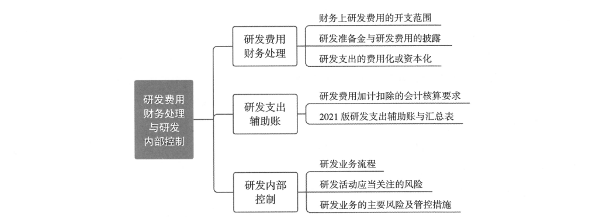
图4-1 研发费用财务处理与研发内部控制

<!-- PDF 第 185 页（页眉：| 研发费用加计扣除与高新技术企业优惠实务及案例 |；页脚：166；装饰：节标题下有一条横线） -->
## 第一节 研发费用财务处理

### 一、财务上研发费用的开支范围

根据《财政部关于企业加强研发费用财务管理的若干意见》（财企〔2007〕194号，实行企业化管理的科研事业单位参照执行）的规定，企业研发费用（即原“技术开发费”），是指企业在产品、技术、材料、工艺、标准的研究、开发过程中发生的各项费用，包括：

（1）研发活动直接消耗的材料、燃料和动力费用。

（2）企业在职研发人员的工资、奖金、津贴、补贴、社会保险费、住房公积金等人工费用以及外聘研发人员的劳务费用。

（3）用于研发活动的仪器、设备、房屋等固定资产的折旧费或租赁费以及相关固定资产的运行维护、维修等费用。

（4）用于研发活动的软件、专利权、非专利技术等无形资产的摊销费用。

（5）用于中间试验和产品试制的模具、工艺装备开发及制造费，设备调整及检验费，样品、样机及一般测试手段购置费，试制产品的检验费等。

（6）研发成果的论证、评审、验收、评估以及知识产权的申请费、注册费、代理费等费用。

（7）通过外包、合作研发等方式，委托其他单位、个人或者与之合作进行研发而支付的费用。

（8）与研发活动直接相关的其他费用，包括技术图书资料费、资料翻译费、会

<!-- PDF 第 186 页（页眉：| 第四章 研发费用财务处理与研发内部控制 |；页脚：167） -->
议费、差旅费、办公费、外事费、研发人员培训费、培养费、专家咨询费、高新科技研发保险费用等。

企业应当明确研发费用的开支范围和标准，严格审批程序，并按照研发项目或者承担研发任务的单位，设立台账归集核算研发费用。企业依法取得知识产权后，在境内外发生的知识产权维护费、诉讼费、代理费、“打假”及其他相关费用支出，从管理费用据实列支，不应纳入研发费用。企业研发机构发生的各项开支纳入研发费用管理，但同时承担生产任务的，要合理划分研发与生产费用。

企业研发机构，是指按照《国家认定企业技术中心管理办法》（国家发展改革委令第53号）认定的企业技术中心及分中心，企业按照国家有关规定组建的国家（重点、工程）实验室、国家工程（技术）研究中心及其他形式的研发机构，以及企业内部设置的、经当地市级以上有关主管部门认定的研发中心、研究院所，与高等院校及科研机构联合设立的博士后站、中试基地、实验室等。

需要说明的是，财企〔2007〕194号文件是有关企业的财务处理规定，企业研发费用的纳税扣除，按照财政部、国家税务总局有关规定执行。

### 二、研发准备金与研发费用的披露

#### （一）研发准备金

企业可以建立研发准备金制度，根据研发计划及资金需求，提前安排资金，确保研发资金的需要，研发费用按实际发生额列入成本（费用）。

#### （二）研发费用的披露与填报

企业应当在年度财务会计报告中，按规定披露研发费用相关财务信息，包括研发费用支出规模及其占销售收入的比例，集中收付研发费用情况等。会计师事务所在审计企业年度会计报表时，应当对企业研发费用的使用和管理情况予以关注。例如，华润微电子有限公司2020年年度报告摘要披露的有关研发投入占营业收入的比例情况如表4-1所示。

<!-- PDF 第 187 页（页眉：| 研发费用加计扣除与高新技术企业优惠实务及案例 |；页脚：168） -->
表4-1　华润微电子有限公司2020年年度报告摘要近3年的主要会计数据和财务指标

单位：元

| 项 目 | 2020年 | 2019年 | 2018年 |
| --- | --- | --- | --- |
| 营业收入 | 6 977 259 188.03 | 5 742 784 130.70 | 6 270 796 546.92 |
| 研发投入占营业收入的比例（%） | 8.11 | 8.4 | 8.4 |

根据《国家税务总局关于修订企业所得税年度纳税申报表的公告》（国家税务总局公告2020年第24号）附件《中华人民共和国企业所得税年度纳税申报表（A类）》（A100000）的规定，利润总额计算部分不设“研发费用”项目，对于已执行《财政部关于修订印发2019年度一般企业财务报表格式的通知》（财会〔2019〕6号）的纳税人，在《利润表》中归集的“研发费用”通过《期间费用明细表》（A104000）第19行“十九、研究费用”的管理费用相应列次填报；同时A100000第10行“二、营业利润”不执行“第10行=第1-2-3-4-5-6-7+8+9行”的表内关系，按照《利润表》“营业利润”项目直接填报。

### 三、研发支出的费用化或资本化

《企业会计准则第6号——无形资产》第七条规定，企业内部研究开发项目的支出，应当区分研究阶段支出与开发阶段支出。

#### （一）研究阶段支出

研究阶段，是指为获取新的科学或技术知识并理解它们而进行的独创性的有计划调查，主要是指为获取相关知识而进行的活动。

考虑到研究阶段的探索性及其成果的不确定性，企业无法证明其能够带来未来经济利益的无形资产的存在，因此，对于企业内部研究开发项目，研究阶段的有关支出应当在发生时全部费用化，计入当期损益（管理费用）。

<!-- PDF 第 188 页（页眉：| 第四章 研发费用财务处理与研发内部控制 |；页脚：169） -->
#### （二）开发阶段支出

开发阶段，是指在进行商业性生产或使用前，将研究成果或其他知识应用于某项计划或设计，以生产出新的或具有实质性改进的材料、装置、产品等，包括生产前或使用前的原型和模型的设计、建造和测试、小试、中试和试生产设施等。

考虑到进入开发阶段的研发项目往往形成成果的可能性较大，因此，如果企业能够证明开发支出符合无形资产的定义及相关确认条件，则可将其确认为无形资产。具体来讲，对于企业内部研究开发项目，只有开发阶段的支出同时满足下列条件的才能资本化，确认为无形资产，否则应当计入当期损益（管理费用）。

（1）完成该无形资产以使其能够使用或出售，在技术上具有可行性。

（2）具有完成该无形资产并使用或出售的意图。

（3）无形资产产生经济利益的方式，包括能够证明运用该无形资产生产的产品存在市场或无形资产自身存在市场，无形资产将在内部使用的，应当证明其有用性。

（4）有足够的技术、财务资源和其他资源支持，以完成该无形资产的开发，并有能力使用或出售该无形资产。

（5）归属于该无形资产开发阶段的支出能够可靠地计量。

#### （三）无法区分研究阶段和开发阶段的支出

无法区分研究阶段和开发阶段的支出，应当在发生时费用化，计入当期损益（管理费用）。费用化的研发支出，按照当年费用化的金额部分加计扣除，资本化的研发费用，按照形成的无形资产当年摊销额进行加计扣除。

<!-- PDF 第 189 页（页眉：| 研发费用加计扣除与高新技术企业优惠实务及案例 |；页脚：170；装饰：节标题下有一条横线） -->
## 第二节 研发支出辅助账

### 一、研发费用加计扣除的会计核算要求

企业需要关注税法对研发费用会计核算提出的若干要求。

#### （一）遵照国家统一会计制度

企业应按照国家财务会计制度要求，对研发支出进行会计处理。

企业开展研发活动中实际发生的研发费用形成无形资产的，其税收上资本化的时点应与会计处理保持一致。

企业应设置“研发支出”科目核算研发费用。对研究阶段支出与开发阶段支出应分别处理，研究阶段支出应当于发生时计入当期损益，开发阶段支出在满足一定条件后允许资本化。研究阶段支出属于费用化的范畴，支出发生时借记“研发支出—费用化支出”，期末转入“管理费用”。开发阶段分两种情形：一是不符合资本化条件时，和研究阶段会计处理相同；二是符合资本化条件时，借记“研发支出——资本化支出”科目，“研发支出——资本化支出”科目余额在编制资产负债表时填入开发支出，待达到预定用途之后，结转到无形资产。

#### （二）按研发项目设置研发支出辅助账

对享受加计扣除的研发费用，应按研发项目设置辅助账，准确归集核算当年可加计扣除的各项研发费用实际发生额。企业在一个纳税年度内进行多项研发活动的，应按照不同研发项目设置辅助账分别归集可加计扣除的研发费用。

<!-- PDF 第 190 页（页眉：| 第四章 研发费用财务处理与研发内部控制 |；页脚：171） -->
具体要求是，研发项目立项时应设置研发支出辅助账，由企业留存备查；企业可参照《国家税务总局关于企业研究开发费用税前加计扣除政策有关问题的公告》（国家税务总局公告2015年第97号）所附2015版研发支出辅助账样式或2021版研发支出辅助账样式或参照上述样式自行设计的研发支出辅助账样式，设置研发支出辅助账、编制研发支出辅助账汇总表。

#### （三）研发与生产经营费用应分别核算

企业应对研发费用和生产经营费用分别核算，准确、合理归集各项费用支出，对划分不清的，不得实行加计扣除。

#### （四）研发费用归集核算需部门间协调配合

研发费用的核算和享受加计扣除优惠需要做大量的准备工作，如研发费用加计扣除政策要求的留存备查资料，涉及公司决议、研发合同、会计账簿、相关科技成果资料等等，因此需要企业研发、财务等各职能部门密切配合。如果各部门不能有效配合，导致相关资料、会计凭证不全，记账不完整，会影响到研发费用的核算以及优惠政策的享受。

### 二、2021版研发支出辅助账与汇总表

#### （一）研发支出辅助账的样式

研发项目立项时应设置研发支出辅助账，由企业留存备查。国家税务总局公告2015年第97号和《国家税务总局关于进一步落实研发费用加计扣除政策有关问题的公告》（国家税务总局公告2021年第28号）为指导企业设置研发支出辅助账，明确了研发支出辅助账样式，供企业参照使用，以帮助企业防范相关风险。研发支出辅助账样式包括以下几种。

##### 1. 2015版研发支出辅助账样式及汇总表

根据国家税务总局公告2015年第97号的规定，研发支出辅助账样式包括4种形式，分别为自主研发“研发支出”辅助账样式、委托研发“研发支出”辅助账样

<!-- PDF 第 191 页（页眉：| 研发费用加计扣除与高新技术企业优惠实务及案例 |；页脚：172） -->
式、合作研发“研发支出”辅助账样式、集中研发“研发支出”辅助账样式。企业继续使用2015版研发支出辅助账样式的，可以参考2021版研发支出辅助账样式对委托境外研发费用、其他相关费用限额的计算公式等进行相应调整。

##### 2. 2021版研发支出辅助账样式及汇总表

与2015版研发支出辅助账样式相比，2021版研发支出辅助账样式将辅助账体系由“4张辅助账+1张汇总表”精简为“1张辅助账+1张汇总表”，并精简了辅助账填报项目，减少了企业填写工作量。

##### 3. 自行设计的研发支出辅助账样式

企业按照研发项目设置辅助账时，可以自主选择使用2015版研发支出辅助账样式或者2021版研发支出辅助账样式，也可以参照上述样式自行设计研发支出辅助账样式。企业自行设计的研发支出辅助账样式，应当包括2021版研发支出辅助账样式所列数据项，且逻辑关系一致，能准确归集允许加计扣除的研发费用。

#### （二）2021版研发支出辅助账

根据《国家税务总局关于进一步落实研发费用加计扣除政策有关问题的公告》（国家税务总局公告2021年第28号）第二条“关于研发支出辅助账样式的问题”的规定，国家税务总局公告2015年第97号发布的研发支出辅助账和研发支出辅助账汇总表样式（以下简称2015版研发支出辅助账样式）继续有效。另增设简化版研发支出辅助账和研发支出辅助账汇总表样式（以下简称2021版研发支出辅助账样式），具体样式如表4-2所示。

对享受加计扣除的研发费用按研发项目设置研发支出辅助账，用于归集已按照国家财务会计制度进行会计处理，且属于税前加计扣除归集范围的研发费用。

对于单个研发项目涉及多种研发形式的，该研发项目只需建立一套辅助账，无须再按不同研发形式分别设置辅助账。如某一研发项目，其一部分采取自主研发形式，另一部分采取委托研发形式，企业不必分别设置自主研发和委托研发两套辅助账，对同时包括两种及两种以上研发形式的支出，统一在一套辅助账中归集。

#### （三）2021版研发支出辅助账汇总表

2021版研发支出辅助账汇总表（样式），如表4-3所示。

<!-- PDF 第 192 页（页眉：| 第四章 研发费用财务处理与研发内部控制 |；页脚：173；装饰：本页表格为横排印刷） -->
表4-2　2021版研发支出辅助账（样式）

项目编号：　　项目名称：　　完成情况：　　支出类型：　　金额单位：元

| 日期 | 种类 | 号数 | 摘要 | 会计凭证记载金额 | 税法规定的归集金额 | 人员人工费用 | 直接投入费用 | 折旧费用 | 无形资产摊销 | 新产品设计费等 | 其他相关费用 | 委托境内机构或个人进行研发活动所发生的费用 | 委托境外机构进行研发活动所发生的费用 |
| --- | --- | --- | --- | --- | --- | --- | --- | --- | --- | --- | --- | --- | --- |
| 凭证信息 | | | | | | 费用明细（税法规定） | | | | | | 委托研发费用 | |
| | | | | | | | | | | | | | |
| | | | | | | | | | | | | | |
| | | | | | | | | | | | | | |
| | | | | | | | | | | | | | |
| | | | | | | | | | | | | | |
| | | | | | | | | | | | | | |
| | | | | | | | | | | | | | |
| | | | 合计金额 | | | | | | | | | | |

会计主管：　　录入人：

<!-- PDF 第 193 页（页眉：| 研发费用加计扣除与高新 技术企业优惠实务及案例 |；页脚：174） -->
表4-3　2021版研发支出辅助账汇总表（样式）

金额单位：元

纳税人识别号（统一社会信用代码）：　　纳税人名称：　　所属期：

| 项目 | 项目名称 | 完成情况 | 支出类型 | 允许加计扣除金额合计 | 人员人工费用 | 直接投入费用 | 折旧费用 | 无形资产摊销 | 新产品设计费等 | 前五项小计 | 其他相关费用合计 | 经调整后的其他相关费用 | 委托境内机构或个人进行研发活动所发生的费用 | 允许加计扣除的委托境内机构或个人进行研发活动所发生的费用 | 委托境外机构进行研发活动所发生的费用 | 经限额调整后的委托境外机构进行研发活动所发生的费用 |
| --- | --- | --- | --- | --- | --- | --- | --- | --- | --- | --- | --- | --- | --- | --- | --- | --- |
| | | | | | | | | | | | 其他相关费用及限额 | | 委托研发费用及限额 | | | |
| | | | | | 1 | 2 | 3 | 4 | 5 | 6 | 7.1 | 7.2 | 8.1 | 8.2 | 8.3 | 8.4 |
| 资本化金额小计 | | | | | | | | | | | | | | | | |
| 费用化金额小计 | | | | | | | | | | | | | | | | |
| 其中：其他事项 | | | | | | | | | | | | | | | | |
| 金额合计 | | | | | | | | | | | | | | | | |

法定代表人（签章）：

<!-- PDF 第 194 页（页眉：| 第四章 研发费用财务处理与研发内部控制 |；页脚：175） -->
#### （四）2021版研发支出辅助账的主要变化与填报口径

按现行政策规定，企业准确归集研发支出，按规定设置研发支出辅助账是企业享受研发费用加计扣除优惠的前提之一。在2015年之前，辅助账仅是会计上的概念，对其样式没有明确的规定。2015年，为帮助纳税人对辅助账形成清晰的认识，国家税务总局发布了自主、委托、合作和集中研发四类辅助账样式和辅助账汇总表样式，供纳税人参照使用。2021年，为响应纳税人诉求，便利纳税人享受政策，国家税务总局对研发支出辅助账样式进行了优化简化，在满足管理要求的同时，进一步降低了企业享受优惠的成本。

##### 1. 2021版研发支出辅助账的主要变化

与2015年的辅助账样式相比，2021版主要有以下变化。

一是简并辅助账样式。2015版研发支出辅助账样式包括自主研发、委托研发、合作研发、集中研发等4类辅助账和辅助账汇总表样式，共“4类辅助账+1张汇总表”。2021版研发支出辅助账将4类辅助账样式合并为一类，共“1类辅助账+1张汇总表”，总体上减少了辅助账样式的数量。除减少样式数量，便于纳税人学习和理解外，还有一个好处就是：当一个研发项目涉及自主、委托等多种研发形式时，可以全部在一张辅助账中体现，无须再填写多张辅助账。

二是精简辅助账信息。2015版研发支出辅助账样式要求填写人员人工等六大类费用的各项明细信息，并填报“借方金额”“贷方金额”等会计信息。2021版研发支出辅助账样式仅要求企业填写人员人工等六大类费用合计，不再填写具体明细费用，同时删除了部分会计信息，减少了企业填写的工作量。

三是调整优化操作口径。2015版研发支出辅助账样式未体现2015年之后的政策变化情况，如未明确委托境外研发费用的填写要求，企业需自行调整样式或分析填报。2021版研发支出辅助账样式充分考虑了税收政策的调整情况，增加了委托境外研发的相关列次，还体现了其他相关费用限额的计算方法的调整。

##### 2. 2021版、2015版辅助账样式的关系

无论是2015版还是2021版辅助账样式，其定位都是供纳税人参照使用。因此，2021版辅助账样式发布以后，2015版辅助账样式仍然有效，企业可根据自身情况选

<!-- PDF 第 195 页（页眉：| 研发费用加计扣除与高新 技术企业优惠实务及案例 |；页脚：176） -->
择使用。由于2021版辅助账体现了后续政策调整完善情况，如果企业选择使用2015版，建议可参考2021版研发支出辅助账样式对委托境外研发费用、其他相关费用限额的计算公式等进行相调整。

此外，纳税人也可自行设计辅助账样式。自行设计的辅助账样式至少要包含2021版研发支出辅助账样式所列数据项，且逻辑关系一致，这样做能与企业所得税年度纳税申报表附表《研发费用加计扣除优惠明细表》数据项相匹配，便于企业准确进行企业所得税汇算清缴。为使年度纳税申报表与2021版辅助账相衔接，2021年修订后的企业所得税年度纳税申报表还进行了相应调整：基础信息表中增加了研发支出辅助账样式的选项，选择2021版和自行设计的则《研发费用加计扣除优惠明细表》中相关明细行次可以不填写，选择2015版的需要填写全部行次。企业在年度纳税申报时，要准确选用采用的形式，并根据要求填写申报。

##### 3. 2021版辅助账样式的填写口径

为提高填写口径的统一性和确定性，避免实际操作过程中的误解，2021版辅助账样式对每列填写口径做出了明确说明：辅助账中除“会计凭证记载金额”列按会计口径填写外，其余涉及金额的列次均按税法口径填写。辅助账汇总表与辅助账存在着关联关系，其各列金额均是由辅助账税法口径汇总而成，因此也是税收口径金额，可以直接计算得出各类费用可加计扣除金额，填入企业所得税年度纳税申报表。

##### 4. 股权激励的计算口径

按照现行规定，研发人员对应的股权激励支出，在行权年度在税前扣除并加计扣除。实务中会出现某员工在股权授予年度从事研发，但是在行权年度不再从事研发活动的情况，该员工所对应的股权激励在行权年度无法归属到具体的研发项目。2021版辅助账样式对这种情况给出了处理口径：将该员工对应的股权激励支出直接填入辅助账汇总表“其中：其他事项”行次，进而纳入行权年度的研发费用可加计扣除额，无须填入具体某一项目的研发支出辅助账。

#### （五）研发支出辅助账核算流程

企业应根据研发项目的形式，在立项后按要求设置辅助账。其中，选择2015

<!-- PDF 第 196 页（页眉：| 第四章 研发费用财务处理与研发内部控制 |；页脚：177） -->
版研发支出辅助账样式的，应根据研发项目的形式选择相应的辅助账样式，如自主研发的项目，选择自主研发“研发支出”辅助账样式，委托研发的项目，选择委托研发“研发支出”辅助账样式等；选择2021版研发支出辅助账样式的，按研发项目设置辅助账即可。同一项目既涉及费用化又涉及资本化的，应分别设置辅助账。

企业应根据研发支出辅助账汇总填报辅助账汇总表。需注意的是，研发支出辅助账汇总表应填报所属期间的费用化及已结束的资本化项目的研发支出金额。具体核算流程如图4-2所示。

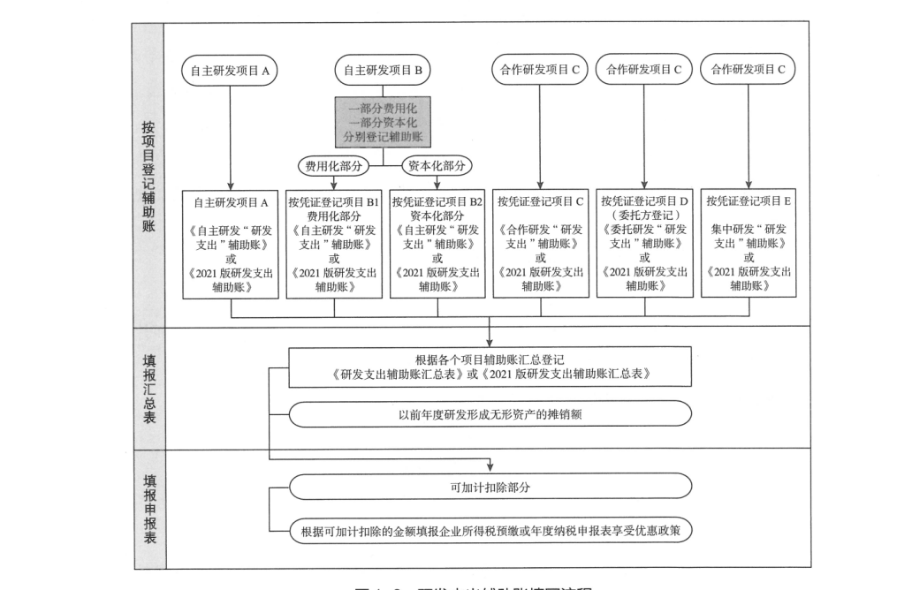
图4-2　研发支出辅助账填写流程

<!-- PDF 第 197 页（页眉：| 研发费用加计扣除与高新 技术企业优惠实务及案例 |；页脚：178） -->
#### （六）研发支出辅助账填报案例

【例4-1】甲公司2023年开展研发情况如下：

甲公司是一家财务健全的制造业企业，2023年度进行了三项研发活动，项目名称分别为A、B、C。其中A、B项目为自主研发、C项目为委托研发。

A项目共发生研发费用2 000 000元，全部费用化处理，2023年该研发项目未完成。

其中：直接从事研发活动的人员工资800 000元，“五险一金”200 000元，直接消耗材料费用300 000元、燃料费用100 000元、动力费用100 000元，用于研发活动的设备折旧费100 000元，用于研发活动的专利权摊销费用50 000元，新产品设计费50 000元，其他相关费用300 000元（包含差旅费200 000元、会议费100 000元）。

B项目共发生研发费用1 000 000元，2023年1月1日起开始资本化，至2023年7月10日结束资本化并结转形成无形资产，会计按直线法计算摊销费用，分10年摊销。

费用明细：直接从事研发活动的人员工资600 000元，“五险一金”100 000元，直接消耗材料费用50 000元、燃料费用30 000元、动力费用20 000元，用于研发活动的设备折旧费50 000元，用于研发活动的软件摊销费用50 000元，新产品设计费50 000元，资料翻译费50 000元。

C项目委托研发费用总额1 000 000元，2023年该研发项目未完成。

其中300 000元委托境外机构完成研发。

要求：分析说明如何填写2021版研发支出辅助账及其汇总表和《研发费用加计扣除情况明细表》（A107012）。

【解析】1. A项目的研发费用辅助账填写分析：

（1）“完成情况”栏：根据项目完成进度，该研发项目填写“未完成”。

（2）“支出类型”栏：根据会计处理情况，该研发项目填写“费用化”。

（3）“人员人工费用”列：该研发项目填写直接从事研发活动的人员工资800 000元，“五险一金”200 000元。

（4）“直接投入费用”列：该研发项目填写直接消耗材料费用300 000元、燃料100 000元、动力费用100 000元。

（5）“折旧费用”列：该研发项目填写设备折旧费100 000元。

<!-- PDF 第 198 页（页眉：| 第四章 研发费用财务处理与研发内部控制 |；页脚：179） -->
（6）“无形资产摊销”列：该研发项目填写专利权摊销费用50 000元。

（7）“新产品设计费等”列：该研发项目填写新产品设计费50 000元。

（8）“其他相关费用”列：该研发项目填写差旅费200 000元、会议费100 000元。

如表4-4所示。

2. B项目的研发费用辅助账填写分析：

（1）“完成情况”栏：根据项目完成进度，该研发项目填写“已完成”。

（2）“支出类型”栏：根据会计处理情况，该研发项目填写“资本化”。

（3）“人员人工费用”列：该研发项目填写直接从事研发活动的人员工资600 000元，“五险一金”100 000元。

（4）“直接投入费用”列：该研发项目填写直接消耗材料费用50 000元、燃料费用30 000元、动力费用20 000元。

（5）“折旧费用”列：该研发项目填写设备折旧费50 000元。

（6）“无形资产摊销”列：该研发项目填写软件摊销费用50 000元。

（7）“新产品设计费等”列：该研发项目填写新产品设计费50 000元。

（8）“其他相关费用”列：该研发项目填写资料翻译费50 000元。

如表4-5所示。

3. C项目的研发费辅助账填写分析：

（1）“完成情况”栏：根据项目完成进度，该研发项目填写“未完成”。

（2）“支出类型”栏：根据会计处理情况，该研发项目填写“费用化”。

（3）“委托研发费用”栏：该研发项目填写委托境内机构或个人研发费700 000元，委托境外机构研发费300 000元。

如表4-6所示。

4. 甲公司研发支出辅助账汇总表填写分析：

（1）其他相关费用的可加计扣除金额。

全部研发项目的其他相关费用限额=全部研发项目的人员人工等五项费用之和×10%/（1-10%）。

“人员人工等五项费用”是指“人员人工费用”、“直接投入费用”、“折旧费用”、“无形资产摊销”和“新产品设计费等”。

<!-- PDF 第 199 页（页眉：| 研发费用加计扣除与高新 技术企业优惠实务及案例 |；页脚：180） -->
表4-4　2021版研发支出辅助账（示例）

项目编号：　　项目名称：A项目　　完成情况：未完成　　支出类型：费用化　　金额单位：元

| 日期 | 种类 | 号数 | 摘要 | 会计凭证记载金额 | 税法规定的归集金额 | 人员人工费用 | 直接投入费用 | 折旧费用 | 无形资产摊销 | 新产品设计费等 | 其他相关费用 | 委托境内机构或个人进行研发活动所发生的费用 | 委托境外机构进行研发活动所发生的费用 |
| --- | --- | --- | --- | --- | --- | --- | --- | --- | --- | --- | --- | --- | --- |
| 凭证信息 | | | | | | 费用明细（税法规定） | | | | | | 委托研发费用 | |
| 2023年 | | | 人员人工 | 800 000 | 800 000 | 800 000 | | | | | | | |
| 2023年 | | | “五险一金” | 200 000 | 200 000 | 200 000 | | | | | | | |
| 2023年 | | | 材料费 | 300 000 | 300 000 | | 300 000 | | | | | | |
| 2023年 | | | 燃料 | 100 000 | 100 000 | | 100 000 | | | | | | |
| 2023年 | | | 动力费 | 100 000 | 100 000 | | 100 000 | | | | | | |
| 2023年 | | | 折旧费 | 100 000 | 100 000 | | | 100 000 | | | | | |
| 2023年 | | | 专利费 | 50 000 | 50 000 | | | | 50 000 | | | | |
| 2023年 | | | 设计费 | 50 000 | 50 000 | | | | | 50 000 | | | |
| 2023年 | | | 差旅费 | 200 000 | 200 000 | | | | | | 200 000 | | |
| 2023年 | | | 会议费 | 100 000 | 100 000 | | | | | | 100 000 | | |
| | | | 合计金额 | 2 000 000 | 2 000 000 | 1 000 000 | 500 000 | 100 000 | 50 000 | 50 000 | 300 000 | | |

会计主管：　　录入人：

<!-- PDF 第 200 页（页眉：| 第四章 研发费用财务处理与研发内部控制 |；页脚：181） -->
表4-5　2021版研发支出辅助账（示例）

项目编号：　　项目名称：B项目　　完成情况：已完成　　支出类型：资本化　　金额单位：元

| 日期 | 种类 | 号数 | 摘要 | 会计凭证记载金额 | 税法规定的归集金额 | 人员人工费用 | 直接投入费用 | 折旧费用 | 无形资产摊销 | 新产品设计费等 | 其他相关费用 | 委托境内机构或个人进行研发活动所发生的费用 | 委托境外机构进行研发活动所发生的费用 |
| --- | --- | --- | --- | --- | --- | --- | --- | --- | --- | --- | --- | --- | --- |
| 凭证信息 | | | | | | 费用明细（税法规定） | | | | | | 委托研发费用 | |
| 2023年 | | | 人员人工 | 600 000 | 600 000 | 600 000 | | | | | | | |
| 2023年 | | | 五险一金 | 100 000 | 100 000 | 100 000 | | | | | | | |
| 2023年 | | | 材料费 | 50 000 | 50 000 | | 50 000 | | | | | | |
| 2023年 | | | 燃料 | 30 000 | 30 000 | | 30 000 | | | | | | |
| 2023年 | | | 动力费 | 20 000 | 20 000 | | 20 000 | | | | | | |
| 2023年 | | | 折旧费 | 50 000 | 50 000 | | | 50 000 | | | | | |
| 2023年 | | | 摊销费 | 50 000 | 50 000 | | | | 50 000 | | | | |
| 2023年 | | | 设计费 | 50 000 | 50 000 | | | | | 50 000 | | | |
| 2023年 | | | 翻译费 | 50 000 | 50 000 | | | | | | 50 000 | | |
| | | | 合计金额 | 1 000 000 | 1 000 000 | 700 000 | 100 000 | 50 000 | 50 000 | 50 000 | 50 000 | | |

会计主管：　　录入人：

<!-- PDF 第 201 页（页眉：| 研发费用加计扣除与高新 技术企业优惠实务及案例 |；页脚：182；装饰：本页表格为横排印刷） -->
表4-6　2021版研发支出辅助账（样式）

项目编号：甲03　项目名称：C项目　完成情况：未完成　支出类型：费用化　金额单位：元

| 日期 | 种类 | 号数 | 摘要 | 会计凭证记载金额 | 税法规定的归集金额 | 人员人工费用 | 直接投入费用 | 折旧费用 | 无形资产摊销 | 新产品设计费等 | 其他相关费用 | 委托境内机构或个人进行研发活动所发生的费用 | 委托境外机构进行研发活动所发生的费用 |
| --- | --- | --- | --- | --- | --- | --- | --- | --- | --- | --- | --- | --- | --- |
| 凭证信息 | | | | | | 费用明细（税法规定） | | | | | | 委托研发费用 | |
| 2023年 | | | 委托研发 | 700 000 | 700 000 | | | | | | | 700 000 | |
| 2023年 | | | 委托研发 | 300 000 | 300 000 | | | | | | | | 300 000 |
| | | | 合计金额 | 1 000 000 | 1 000 000 | | | | | | | 700 000 | 300 000 |

会计主管：　　录入人：

<!-- PDF 第 202 页（页眉：| 第四章 研发费用财务处理与研发内部控制 |；页脚：183） -->
甲公司全部研发项目的其他相关费用限额=全部研发项目的人员人工等五项费用之和×10%/（1-10%）=（A项目的人员人工等五项费用之和+B项目的人员人工等五项费用之和+C项目的人员人工等五项费用之和）×10%（1-10%）=（1 700 000+950 000+0）×10%/（1-10%）=294 444.44（元）。

甲公司“其他相关费用”实际发生数=300 000+50 000=350 000（元）。

“其他相关费用”实际发生数大于限额时，按限额计算税前加计扣除额，A、B、C三个项目允许加计扣除“其他相关费用”为294 444.44元。

各研发项目可加计扣除“其他相关费用”，按照各研发项目“其他相关费用”实际发生数与总发生数占比确定。

其中，项目A可加计扣除的“其他相关费用”=294 444.44×300 000/（300 000+50 000）=252 380.95（元）。

项目B可加计扣除的“其他相关费用”=294 444.44×50 000/（300 000+50 000）=42 063.49（元）。

因此，A研发项目研发支出辅助账汇总表第7.2列填写252 380.95元，B研发项目研发支出辅助账汇总表第7.2列填写252 380.95元。

（2）委托研发费用的可加计扣除金额。

C研发项目可加计扣除的研发费用合计800 000元。

委托境内研发费用=700 000×80%=560 000（元），C研发项目研发支出辅助账汇总表第8.2列填写560 000元。

委托境外研发费用=300 000×80%=240 000（元）（不超过境内符合条件的研发费用三分之二，允许加计扣除240 000元），C研发项目研发支出辅助账汇总表第8.4列填写240 000元。

根据辅助账记录数据和企业研发项目资本化核算情况，甲公司年度研发费用小计=1 700 000+950 000+29 444.44+800 000=3 744 444.44（元），其中本年费用化金额为2 752 380.95元，资本化金额为992 063.49元，本年摊销额为49 603.17元（992 063.49/10/2）。

本年允许加计扣除的研发费用合计=2 752 380.95+49 603.17=2 801 984.12（元）；

研发费用加计扣除总额=2 801 984.12×100%=2 801 984.12（元）。

如表4-7所示。

<!-- PDF 第 203 页（页眉：| 研发费用加计扣除与高新 技术企业优惠实务及案例 |；页脚：184；装饰：本页表格为横排印刷） -->
表4-7　2021版研发支出辅助账汇总表（样式）

纳税人识别号（统一社会信用代码）：×××××××××××××××　纳税人名称：甲公司　金额单位：元　属期：2023年度

| 项目编号 | 项目名称 | 完成情况 | 支出类型 | 允许加计扣除金额合计 | 人员人工费用 | 直接投入费用 | 折旧费用 | 无形资产摊销 | 新产品设计费等 | 前五项小计 | 其他相关费用合计 | 经限额调整后的其他相关费用 | 委托境内机构或个人进行研发活动所发生的费用 | 允许加计扣除的委托境内机构或个人进行研发活动所发生的费用 | 委托境外机构进行研发活动所发生的费用 | 经限额调整后的委托境外机构进行研发活动所发生的费用 |
| --- | --- | --- | --- | --- | --- | --- | --- | --- | --- | --- | --- | --- | --- | --- | --- | --- |
| | | | | | | | | | | | 其他相关费用及限额 | | 委托研发费用及限额 | | | |
| | | | | | 1 | 2 | 3 | 4 | 5 | 6 | 7.1 | 7.2 | 8.1 | 8.2 | 8.3 | 8.4 |
| 甲0001 | A项目 | 未完成 | 费用化 | 1 952 380.95 | 1 000 000 | 500 000 | 100 000 | 50 000 | 50 000 | 1 700 000 | 300 000 | 252 380.95 | | | | |
| 甲0002 | B项目 | 已完成 | 资本化 | 992 063.49 | 700 000 | 100 000 | 50 000 | 50 000 | 50 000 | 950 000 | 50 000 | 42 063.49 | | | | |
| 甲0003 | C项目 | 未完成 | 费用化 | 800 000.00 | | | | | | | | | 700 000 | 560 000 | 300 000 | 240 000 |
| 资本化金额小计 | | | | 992 063.49 | 700 000 | 100 000 | 50 000 | 50 000 | 50 000 | 950 000 | 50 000 | 42 063.49 | | | | |
| 费用化金额小计 | | | | 2 752 380.95 | 1 000 000 | 500 000 | 100 000 | 50 000 | 50 000 | 1 700 000 | 300 000 | 252 380.95 | 700 000 | 560 000 | 300 000 | 240 000 |
| 其中：其他事项 | | | | | | | | | | | | | | | | |
| 金额合计 | | | | 3 744 444.44 | 1 700 000 | 600 000 | 150 000 | 100 000 | 100 000 | 2 650 000 | 350 000 | 294 444.44 | 700 000 | 560 000 | 300 000 | 240 000 |

法定代表人（签章）：×××

<!-- PDF 第 204 页（页眉：| 第四章 研发费用财务处理与研发内部控制 |；页脚：185） -->
（3）《研发费用加计扣除优惠明细表》（A107012）填报。

企业享受企业所得税研发费用加计扣除优惠实行“真实发生、自行判别、申报享受、相关资料留存备查”方式。企业享受研发费用加计扣除优惠时，将2021版研发支出辅助账汇总表“金额合计”行全部栏次、“资本化金额小计”行及“费用化金额小计”行对应的“允许加计扣除金额合计”栏次，填写至《研发费用加计扣除优惠明细表》（A107012）相应栏次。

2023年预缴申报时，企业依据实际发生的研发费用支出，自行计算加计扣除金额，填报《中华人民共和国企业所得税月（季）度预缴纳税申报表（A类）》享受税收优惠，留存备查《研发费用加计扣除优惠明细表》（A107012）及政策规定的其他资料。汇算清缴期间，企业填报《研发费用加计扣除优惠明细表》（A107012，如表4-8所示），享受研发费加计扣除企业所得税优惠。

表4-8　A107012研发费用加计扣除优惠明细表

金额单位：人民币元（列至角分）

| 行次 | 项　目 | 金额（数量） |
| --- | --- | --- |
| 1 | 本年可享受研发费用加计扣除项目数量 | 3 |
| 2 | 一、自主研发、合作研发、集中研发（3+7+16+19+23+34） | 2 944 444.44 |
| 3 | （一）人员人工费用（4+5+6） | 1 700 000.00 |
| 4 | 1.直接从事研发活动人员工资薪金 | |
| 5 | 2.直接从事研发活动人员五险一金 | |
| 6 | 3.外聘研发人员的劳务费用 | |
| 7 | （二）直接投入费用（8+9+10+11+12+13+14+15） | 600 000.00 |
| 8 | 1.研发活动直接消耗材料费用 | |
| 9 | 2.研发活动直接消耗燃料费用 | |
| 10 | 3.研发活动直接消耗动力费用 | |
| 11 | 4.用于中间试验和产品试制的模具、工艺装备开发及制造费 | |
| 12 | 5.用于不构成固定资产的样品、样机及一般测试手段购置费 | |
| 13 | 6.用于试制产品的检验费 | |

<!-- PDF 第 205 页（页眉：| 研发费用加计扣除与高新 技术企业优惠实务及案例 |；页脚：186） -->
续表

| 行次 | 项　目 | 金额（数量） |
| --- | --- | --- |
| 14 | 7.用于研发活动的仪器、设备的运行维护、调整、检验、维修等费用 | |
| 15 | 8.通过经营租赁方式租入的用于研发活动的仪器、设备租赁费 | |
| 16 | （三）折旧费用（17+18） | 150 000.00 |
| 17 | 1.用于研发活动的仪器的折旧费 | |
| 18 | 2.用于研发活动的设备的折旧费 | |
| 19 | （四）无形资产摊销（20+21+22） | 100 000.00 |
| 20 | 1.用于研发活动的软件的摊销费用 | |
| 21 | 2.用于研发活动的专利权的摊销费用 | |
| 22 | 3.用于研发活动的非专利技术（包括许可证、专有技术、设计和计算方法等）的摊销费用 | |
| 23 | （五）新产品设计费等（24+25+26+27） | 100 000.00 |
| 24 | 1.新产品设计费 | |
| 25 | 2.新工艺规程制定费 | |
| 26 | 3.新药研制的临床试验费 | |
| 27 | 4.勘探开发技术的现场试验费 | |
| 28 | （六）其他相关费用（29+30+31+32+33） | 350 000 |
| 29 | 1.技术图书资料费、资料翻译费、专家咨询费、高新科技研发保险费 | |
| 30 | 2.研发成果的检索、分析、评议、论证、鉴定、评审、评估、验收费用 | |
| 31 | 3.知识产权的申请费、注册费、代理费 | |
| 32 | 4.职工福利费、补充养老保险费、补充医疗保险费 | |
| 33 | 5.差旅费、会议费 | |
| 34 | （七）经限额调整后的其他相关费用 | 294 444.44 |
| 35 | 二、委托研发（36+37+39） | 1 000 000.00 |
| 36 | （一）委托境内机构或个人进行研发活动所发生的费用 | 700 000.00 |
| 37 | （二）委托境外机构进行研发活动发生的费用 | 300 000.00 |
| 38 | 其中：允许加计扣除的委托境外机构进行研发活动发生的费用 | 240 000.00 |

<!-- PDF 第 206 页（页眉：| 第四章 研发费用财务处理与研发内部控制 |；页脚：187；装饰：栏目标签“案例”置于灰色平行四边形内，右侧有三道斜线） -->
续表

| 行次 | 项　目 | 金额（数量） |
| --- | --- | --- |
| 39 | （三）委托境外个人进行研发活动发生的费用 | 0 |
| 40 | 三、年度研发费用小计（2+36×80%+38） | 3 744 444.44 |
| 41 | （一）本年费用化金额 | 2 752 380.95 |
| 42 | （二）本年资本化金额 | 992 063.49 |
| 43 | 四、本年形成无形资产摊销额 | 49 603.17 |
| 44 | 五、以前年度形成无形资产本年摊销额 | 0 |
| 45 | 六、允许扣除的研发费用合计（41+43+44） | 2 801 984.12 |
| 46 | 减：特殊收入部分 | 0 |
| 47 | 七、允许扣除的研发费用抵减特殊收入后的金额（45-46） | 2 801 984.12 |
| 48 | 减：当年销售研发活动直接形成产品（包括组成部分）对应的材料部分 | 0 |
| 49 | 减：以前年度销售研发活动直接形成产品（包括组成部分）对应材料部分结转金额 | 0 |
| 50 | 八、加计扣除比例（%） | 100% |
| 51 | 九、本年研发费用加计扣除总额（47-48-49）×50 | 2 801 984.12 |
| 52 | 十、销售研发活动直接形成产品（包括组成部分）对应材料部分结转以后年度扣减金额（当47-48-49≥0，本行=0；当47-48-49<0，本行=47-48-49的绝对值） | 0 |

案例

行政处罚决定书

（×××税稽罚〔2024〕×××号）

案件名称：×××网络科技有限公司——发票违法

处罚事由：

1.你单位取得的由×××新能源科技有限公司开具的5份增值税普通发票已被认

<!-- PDF 第 207 页（页眉：| 研发费用加计扣除与高新 技术企业优惠实务及案例 |；页脚：188） -->
定为虚开发票，属于不合法抵扣凭证。

2.你单位在没有真实业务的情况下列支了相关成本，存在在账簿上多列支出的问题，应调增2019年度管理费用504 500元。

3.你单位2019年度将该5张发票金额计作研发费用加计扣除的基数。

延伸检查中发现，你单位2019年度申报的研发费用加计扣除均无法提供立项文书和辅助账，无法准确归集核算当年可加计扣除的各项研发费用的实际发生额。

根据《财政部 国家税务总局 科技部关于完善研究开发费用税前加计扣除政策的通知》（财税〔2015〕119号）之规定，企业应对研发费用和生产经营费用分别核算，准确、合理归集各项费用支出，对划分不清的，不得实行加计扣除，据此调减2019年度加计扣除927 309元（全额）。

4.综上，调整后你单位2019年企业所得税应纳税所得额为62 904.36元，应纳企业所得税额3 145.22元，2021年企业所得税应纳税所得额为120 205.09元，应纳企业所得税额3 005.13元。

处罚依据：根据《税收征收管理法》（主席令第49号）第六十三条之规定，你单位以上行为属于偷税，应追缴2019年度企业所得税3 145.22元，2021年度企业所得税3 005.13元。

纳税人名称：×××网络科技有限公司

统一社会信用代码：9132×××UPE5L

纳税人识别号：91320×××PE5L

法人证件号码：3××××××××××××××××8

法人姓名：崔×××

处罚结果：处所偷税款0.8倍罚款计4 920.28元。

违法行为登记日期：2024-01-04

处罚决定书制作日期：2024-01-04

处罚机关：国家税务总局×××税务局稽查局

<!-- PDF 第 208 页（页眉：| 第四章 研发费用财务处理与研发内部控制 |；页脚：189；装饰：节标题下方有一条横线） -->
## 第三节 研发内部控制

为促进企业自主创新，增强核心竞争力，有效控制研发风险，实现发展战略，财政部制定印发了《企业内部控制应用指引第10号——研究与开发》，旨在有效控制研发风险，提升企业自主创新能力，充分发挥科技的支撑引领作用，促进实现企业发展战略。该指引所称研究与开发，是指企业为获取新产品、新技术、新工艺等所开展的各种研发活动。

《监管规则适用指引——发行类第9号：研发人员及研发投入》第三条也要求：发行人应制定并严格执行研发相关内控制度，包括研发活动和研发人员认定制度、研发业务流程、研发项目管理、研发人员管理等，明确研发支出的开支范围、标准、审批程序。同时，应按照研发项目设立台账归集核算研发支出，准确记录员工工时、核算研发人员薪酬、归集研发领料用料和资产摊销等。

### 一、研发业务流程

企业应当着力梳理研究与开发业务流程，针对主要风险点和关键环节，制定切实有效的控制措施，不断提升研发活动全过程的风险管控效能。

一般生产企业研究开发活动的业务流程如图4-3所示。

<!-- PDF 第 209 页（页眉：| 研发费用加计扣除与高新 技术企业优惠实务及案例 |；页脚：190） -->
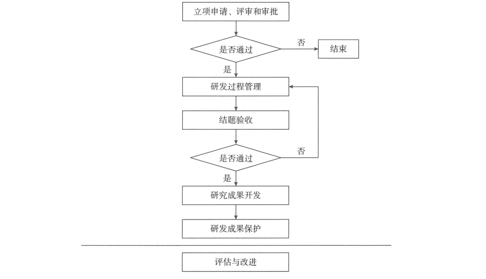
图 4-3 研究开发活动的业务流程

### 二、研发活动应当关注的风险

企业开展研发活动至少应当关注下列风险。

（1）研究项目未经科学论证或论证不充分，可能导致创新不足或资源浪费。

（2）研发人员配备不合理或研发过程管理不善，可能导致研发成本过高、舞弊或研发失败。

（3）研究成果转化应用不足、保护措施不力，可能导致企业利益受损。

企业应当重视研发工作，根据发展战略，结合市场开拓和技术进步要求，科学制定研发计划，强化研发全过程管理，规范研发行为，促进研发成果的转化和有效利用，不断提升企业自主创新能力。

<!-- PDF 第 210 页（页眉：| 第四章 研发费用财务处理与研发内部控制 |；页脚：191） -->
### 三、研发业务的主要风险及管控措施

研究开发的基本流程，主要涉及立项、研发过程管理、结题验收、研发成果的开发和保护等。

#### （一）立项阶段

研发项目立项主要包括立项申请、评审和审批。

《企业内部控制应用指引第10号——研究与开发》要求，企业应当根据实际需要，结合研发计划，提出研究项目立项申请，开展可行性研究，编制可行性研究报告。企业可以组织独立于申请及立项审批之外的专业机构和人员进行评估论证，出具评估意见。研究项目应当按照规定的权限和程序进行审批，重大研究项目应当报经董事会或类似权力机构集体审议决策。审批过程中，应当重点关注研究项目促进企业发展的必要性、技术的先进性以及成果转化的可行性。

该环节的主要的风险是：研发计划与国家（或企业）科技发展战略不匹配；研发承办单位或专题负责人不具有相应资质；研究项目未经科学论证或论证不充分；评审和审批环节把关不严；可能导致创新不足或资源浪费。

主要的控制措施有以下几方面。

（1）建立完善的立项、审批制度，确定研究开发计划制定原则和审批人，审查承办单位或专题负责人的资质条件和评估、审批流程等。

（2）结合企业发展战略、市场及技术现状，制定研究项目开发计划。

（3）企业应当根据实际需要，结合研发计划，提出研究项目立项申请，开展可行性研究，编制可行性研究报告。企业可以组织独立于申请及立项审批之外的专业机构和人员进行评估论证，出具评估意见。

（4）研究项目应当按照规定的权限和程序进行审批，重大研究项目应当报经董事会或类似权力机构集体审议决策。审批过程中，应当重点关注研究项目促进企业发展的必要性、技术的先进性以及成果转化的可行性。

（5）制定开题计划和报告，开题计划经科研管理部门负责人审批，开题报告应对市场需求与效益、国内外在该方向的研究现状、主要技术路线、研究开发目标与

<!-- PDF 第 211 页（页眉：| 研发费用加计扣除与高新 技术企业优惠实务及案例 |；页脚：192） -->
进度、已有条件与基础、经费等进行充分论证、分析，以保证项目符合企业需求。

#### （二）研发过程管理

研发过程是研发的核心环节。实务中，研发通常分为自主研发、委托研发和合作研发。

##### 1.自主研发

自主研发是指企业依靠自身的科研力量，独立完成项目研发，包括原始创新、集成创新和在引进消化基础上的再创新三种类型。

《企业内部控制应用指引第10号——研究与开发》第七条规定，企业应当加强对研究过程的管理，合理配备专业人员，严格落实岗位责任制，确保研究过程高效、可控。企业应当跟踪检查研究项目进展情况，评估各阶段研究成果，提供足够的经费支持，确保项目按期、保质完成，有效规避研究失败风险。

自主研发的主要风险包括以下几方面。

（1）研究人员配备不合理，导致研发成本过高、舞弊或研发失败。

（2）研发过程管理不善，费用失控或科技收入形成账外资产，影响研发效率，提高研发成本甚至造成资产流失。

（3）多个项目同时进行时，相互争夺资源，出现资源的短期局部缺乏，可能造成研发效率下降。

（4）研究过程中未能及时发现错误，导致修正成本提高。

（5）科研合同管理不善，导致权属不清，知识产权存在争议。

自主研发风险的主要的控制措施有以下几方面。

（1）建立研发项目管理制度和技术标准，建立信息反馈制度和研发项目重大事项报告制度；严格落实岗位责任制。

（2）合理设计项目实施进度计划和组织结构，跟踪项目进展，建立良好的工作机制，保证项目顺利实施。

（3）精确预计工作量和所需资源，提高资源使用效率。

（4）建立科技开发费用报销制度，明确费用支付标准及审批权限，遵循不相容岗位牵制原则，完善科技经费入账管理程序，按项目正确划分资本性支出和费用性

<!-- PDF 第 212 页（页眉：| 第四章 研发费用财务处理与研发内部控制 |；页脚：193） -->
支出，准确开展会计核算，建立科技收入管理制度。

（5）开展项目中期评审，及时纠偏调整；优化研发项目管理的任务分配方式。

##### 2.委托（合作）研发

委托研发是指企业委托具有资质的外部承办单位进行研究和开发。合作研发是指合作双方基于研发协议，就共同的科研项目，以某种合作形式进行研究或开发。

《企业内部控制应用指引第10号——研究与开发》第七条规定，企业研究项目委托外单位承担的，应当采用招标、协议等适当方式确定受托单位，签订外包合同，约定研究成果的产权归属、研究进度和质量标准等相关内容。该指引第八条还规定，企业与其他单位合作进行研究的，应当对合作单位进行尽职调查，签订书面合作研究合同，明确双方投资、分工、权利义务、研究成果产权归属等。

委托（合作）研发的主要风险包括委托（合作）单位选择不当，知识产权界定不清。合作研发的风险还包括与合作单位沟通障碍、合作方案设计不合理、责权利不能合理分配、资源整合不当等。

委托（合作）研发风险的主要控制措施有以下几方面。

（1）加强委托（合作）研发单位资信、专业能力等方面的管理。

（2）委托研发应采用招标、议标等方式确定受托单位，制定规范详尽的委托研发合同，明确产权归属、研究进度和质量标准等相关内容。

（3）合作研发应对合作单位进行尽职调查，签订书面合作研发合同，明确双方投资、分工、权利义务、研究成果产权归属等。

（4）加强项目的管理监督，严格控制项目费用，防止挪用、侵占等。

（5）根据项目进展情况、国内外技术最新发展趋势和市场需求变化情况，对项目的目标、内容、进度、资金进行适当调整。

#### （三）结题验收

结题验收是指对研究过程形成的交付物进行质量验收。

《企业内部控制应用指引第10号——研究与开发》第九条要求，企业应当建立和完善研究成果验收制度，组织专业人员对研究成果进行独立评审和验收。企业对于通过验收的研究成果，可以委托相关机构进行审查，确认是否申请专利或作为非

<!-- PDF 第 213 页（页眉：| 研发费用加计扣除与高新 技术企业优惠实务及案例 |；页脚：194） -->
专利技术、商业秘密等进行管理。企业对于需要申请专利的研究成果，应当及时办理有关专利申请手续。

结题验收分检测鉴定、专家评审、专题会议等三种方式。其主要风险包括：由于验收人员的技术、能力、独立性等造成验收成果与事实不符；测试与鉴定投入不足，导致测试与鉴定的不充分，不能有效地降低技术失败的风险。

结题验收风险的主要控制措施有以下几方面。

（1）建立健全技术验收制度，严格执行测试程序。

（2）验收过程中发现异常情况的应重新进行验收申请或补充进行研发，直至研发项目达到研发标准为止。

（3）落实技术主管部门验收责任，由独立的、具备专业胜任能力的测试人员进行鉴定试验，并按计划进行正式的、系统的、严格的评审。

（4）加大企业在测试和鉴定阶段的投入，对重要的研究项目可以组织外部专家参加鉴定。

#### （四）研究成果开发

研究成果开发是指企业将研究成果经过开发过程，转换为企业的产品。

《企业内部控制应用指引第10号——研究与开发》第十一条要求，企业应当加强研究成果的开发，形成科研、生产、市场一体化的自主创新机制，促进研究成果转化。研究成果的开发应当分步推进，通过试生产充分验证产品性能，在获得市场认可后方可进行批量生产。

其主要风险包括：研究成果转化应用不足，导致资源闲置；新产品未经充分测试，导致大批量生产不成熟或成本过高；营销策略与市场需求不符，导致营销失败。

开发阶段风险的主要管控措施有以下几方面。

（1）建立健全研究成果开发制度，促进成果及时有效转化。

（2）科学鉴定大批量生产的技术成熟度，力求降低产品成本。

（3）坚持开展以市场为导向的新产品开发消费者测试。

（4）建立研发项目档案，推进有关信息资源的共享和应用。

<!-- PDF 第 214 页（页眉：| 第四章 研发费用财务处理与研发内部控制 |；页脚：195） -->
#### （五）研究成果保护

研究成果保护是企业研发管理工作的有机组成部分。《企业内部控制应用指引第10号——研究与开发》第十二条要求，企业应当建立研究成果保护制度，加强对专利权、非专利技术、商业秘密及研发过程中形成的各类涉密图纸、程序、资料的管理，严格按照制度规定借阅和使用。禁止无关人员接触研究成果。该指引第十条规定，企业应当建立严格的核心研究人员管理制度，明确界定核心研究人员范围和名册清单，签署符合国家有关法律法规要求的保密协议。企业与核心研究人员签订劳动合同时，应当特别约定研究成果归属、离职条件、离职移交程序、离职后保密义务、离职后竞业限制年限及违约责任等内容。

有效的研发成果保护，可保护研发企业的合法权益。其主要风险是：未能有效识别和保护知识产权，权属未能得到明确规范，开发出的新技术或产品被限制使用；核心研究人员缺乏管理激励制度，导致形成新的竞争对手或技术秘密外泄。

该阶段风险的主要控制措施有以下几方面。

（1）进行知识产权评审，及时取得权属。

（2）研发完成后确定采取专利或技术秘密等不同保护方式。

（3）利用专利文献选择较好的工艺路线。

（4）建立研究成果保护制度，加强对专利权、非专利技术、商业秘密及研发过程中形成的各类涉密图纸、程序、资料的管理，严格按照制度规定借阅和使用。禁止无关人员接触研究成果。

（5）建立严格的核心研究人员管理制度，明确界定核心研究人员范围和名册清单并与之签署保密协议。

（6）企业与核心研究人员签订劳动合同时，应当特别约定研究成果归属、离职条件、离职移交程序、离职后保密义务、离职后竞业限制年限及违约责任等内容。

（7）实施合理有效的研发绩效管理，制定科学的核心研发人员激励体系，注重长效激励。

<!-- PDF 第 215 页（页眉：| 研发费用加计扣除与高新 技术企业优惠实务及案例 |；页脚：196） -->
#### （六）研发活动评估

评估是研究与开发内部控制建设的重要环节。《企业内部控制应用指引第10号——研究与开发》第十三条要求，企业应当建立研发活动评估制度，加强对立项与研究、开发与保护等过程的全面评估，认真总结研发管理经验，分析存在的薄弱环节，完善相关制度和办法，不断改进和提升研发活动的管理水平。

<!-- PDF 第 216 页（页眉：无；页脚：未显示；装饰：TAXING） -->
# 第五章 研发费用加计扣除的申报与风险识别及应对

赋敛厚，则下怨上矣。

——《管子·权修》

<!-- PDF 第 217 页（页眉：无；页脚：未显示；装饰：正文段左上、右下有直角装饰线） -->
研发费用加计扣除优惠采取“真实发生、自行判别、申报享受、相关资料留存备查”的办理方式。本章介绍加计扣除的申报与风险识别及应对，主要内容如图5-1所示。

<!-- PDF 第 218 页（页眉：| 第五章 研发费用加计扣除的申报与风险识别及应对 |；页脚：199） -->
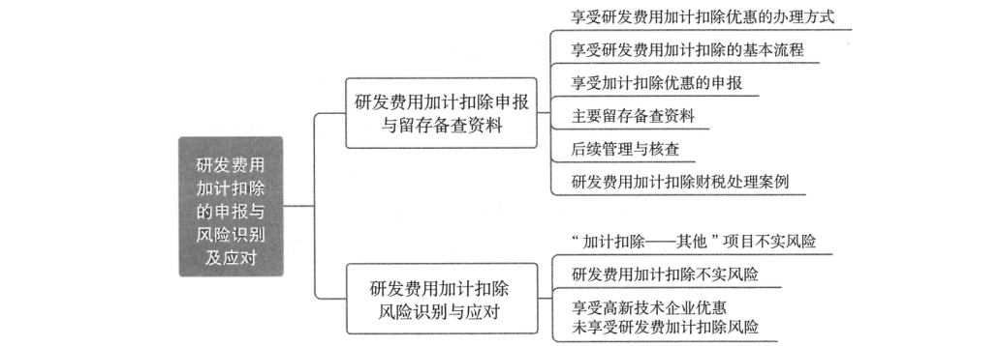
图 5-1 加计扣除的申报与风险识别及应对

<!-- PDF 第 219 页（页眉：| 研发费用加计扣除与高新 技术企业优惠实务及案例 |；页脚：200；装饰：节标题下有一条横线） -->
## 第一节 研发费用加计扣除申报与留存备查资料

### 一、享受研发费用加计扣除优惠的办理方式

企业享受研发费用加计扣除优惠采取“真实发生、自行判别、申报享受、相关资料留存备查”的办理方式。

企业应当根据实际经营情况以及相关税收规定自行判断是否符合研发费用加计扣除优惠享受条件，符合条件的自行计算加计扣除金额，并通过填报企业所得税纳税申报表申报享受税收优惠。

### 二、享受研发费用加计扣除的基本流程

自2021年度起，研发费用加计扣除优惠既可以在预缴环节享受，也可以在汇算清缴环节享受。

（1）在预缴环节享受研发费用加计扣除优惠的流程如图5-2所示。

<!-- PDF 第 220 页（页眉：| 第五章 研发费用加计扣除的申报与风险识别及应对 |；页脚：201） -->
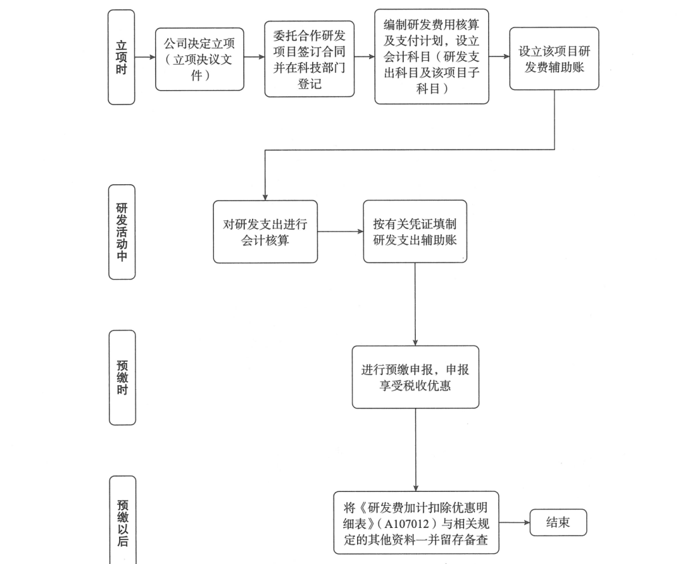
图 5-2 在预缴环节享受加计扣除优惠流程

（2）在企业所得税汇算清缴环节享受加计扣除优惠的流程如图5-3所示。

<!-- PDF 第 221 页（页眉：| 研发费用加计扣除与高新 技术企业优惠实务及案例 |；页脚：202） -->
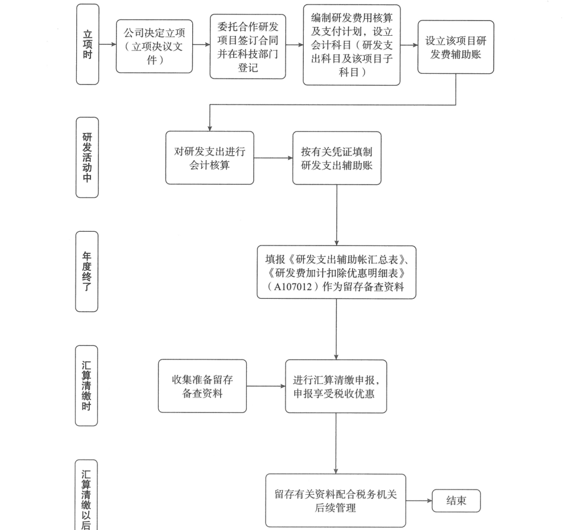
图 5-3 在汇算清缴环节享受加计扣除优惠流程

<!-- PDF 第 222 页（页眉：| 第五章 研发费用加计扣除的申报与风险识别及应对 |；页脚：203） -->
### 三、享受加计扣除优惠的申报

根据现行政策规定，企业可在当年7月份预缴、10月份预缴以及企业所得税年度汇算清缴时申报享受研发费用加计扣除政策。

2020年以及前年度，研发费用加计扣除政策需在企业所得税年度汇算清缴时一并享受，在预缴时不能享受。2021年，《国家税务总局关于进一步落实研发费用加计扣除政策有关问题的公告》（国家税务总局公告2021年第28号）印发，明确在10月征期预缴申报第三季度（按季预缴）或9月份（按月预缴）企业所得税时，允许企业就前三季度研发费用加计扣除，将享受时点至少提前3个月以上。但企业在10月征期享受并不是强制性规定，而是给企业提供了一个选择权，如果企业因自身等原因，在10月征期没有享受，还可在汇算清缴时一并享受。由于汇算清缴是企业一年生产经营结果的体现，对于10月征期已经享受的，企业应该将第四季度研发费用与前三季度研发费用统一计算，按政策规定进行年度纳税申报。

#### （一）预缴申报时加计扣除优惠的享受

《国家税务总局 财政部关于优化预缴申报享受研发费用加计扣除政策有关事项的公告》（国家税务总局 财政部公告2023年第11号）规定，企业7月份预缴申报第二季度（按季预缴）或6月份（按月预缴）企业所得税时，能准确归集核算研发费用的，可以结合自身生产经营实际情况，自主选择就当年上半年研发费用享受加计扣除政策。对7月份预缴申报期未选择享受优惠的企业，在10月份预缴申报或年度汇算清缴时能够准确归集核算研发费用的，可结合自身生产经营实际情况，自主选择在10月份预缴申报或年度汇算清缴时统一享受。

企业10月份预缴申报第三季度（按季预缴）或9月份（按月预缴）企业所得税时，能准确归集核算研发费用的，可结合自身生产经营实际情况，自主选择就当年前三季度研发费用享受加计扣除政策。对10月份预缴申报期未选择享受优惠的企业，在年度汇算清缴时能够准确归集核算研发费用的，可结合自身生产经营实际情况，自主选择在年度汇算清缴时统一享受。

例如，A公司为医疗仪器设备制造企业，2024年1—9月发生可加计扣除研发费

<!-- PDF 第 223 页（页眉：| 研发费用加计扣除与高新 技术企业优惠实务及案例 |；页脚：204） -->
用550万元，其中1—3月的研发费用为200万元，3—6月的研发费用为150万元，7—9月的研发费用为200万元。企业在10月份预缴申报时，可以就前三季度（即1—9月）合计发生的研发费用550万元享受加计扣除优惠政策。

【例5-1】甲公司为一家财务健全的制造业企业，2023年前三季度进行了三项研发活动，项目名称分别为A、B、C。其中A、B项目为自主研发、C项目为委托研发。

2023年前三季度A项目共发生研发费用100万元，全部费用化处理。其中：直接从事研发活动的人员工资为40万元，“五险一金”10万元，直接消耗材料费用15万元、燃料费用5万元、动力费用5万元，用于研发活动的设备折旧费5万元，用于研发活动的专利权摊销费用2.5万元，新产品设计费2.5万元，其他相关费用15万元（包含差旅费10万元、会议费5万元）。

B项目共发生研发费用50万元，全部费用化处理。其中：直接从事研发活动的人员工资为30万元，“五险一金”5万元，直接消耗材料费用2.5万元、燃料费用1.5万元、动力费用1万元，用于研发活动的设备折旧费2.5万元，用于研发活动的软件摊销费用2.5万元，新工艺设计费2.5万元，资料翻译费2.5万元。

C项目委托研发费用总额50万元，其中15万元由境外机构完成。

要求：分析填报相关纳税申报表。

【解析】填报分析如下：

1.其他相关费用的可加计扣除金额计算。

全部研发项目的其他相关费用限额=全部研发项目的人员人工等五项费用之和×10%/（1-10%）=（A项目的人员人工等五项费用之和+B项目的人员人工等五项费用之和+C项目的人员人工等五项费用之和）×10%/（1-10%）=（85+47.5+0）×10%/（1-10%）=14.722 222（万元）；

而“其他相关费用”实际发生数=15+2.5=17.50（万元）。当“其他相关费用”实际发生数大于限额时，按限额计算税前加计扣除额，因此，A、B、C三个项目允许加计扣除“其他相关费用”为14.722 222万元。

2.委托研发费用的可加计扣除金额计算。

C项目可加计扣除的研发费用合计40万元，其中委托境内研发费用=35×80%=

<!-- PDF 第 224 页（页眉：| 第五章 研发费用加计扣除的申报与风险识别及应对 |；页脚：205） -->
28（万元），委托境外研发费用=15×80%=12（万元）（不超过境内符合条件的研发费用的三分之二）。

因此，2023年前三季度研发费用=85+47.5+14.722 222+40=187.22 222（万元），其中费用化金额为187.22 222万元，资本化金额为零。允许加计扣除的研发费用合计187.22 222万元，因此，前三季度研发费用加计扣除总额=187.22 222×100%=187.22 222（万元）。如表5-1所示。

表5-1 A107012研发费用加计扣除优惠明细表

金额单位：人民币元（列至角分）

| 行次 | 项 目 | 金额（数量） |
| --- | --- | --- |
| 1 | 本年可享受研发费用加计扣除项目数量 | 3 |
| 2 | 一、自主研发、合作研发、集中研发（3+7+16+19+23+34） | 1 472 222.22 |
| 3 | （一）人员人工费用（4+5+6） | 850 000 |
| 4 | 1.直接从事研发活动人员工资薪金 | 700 000 |
| 5 | 2.直接从事研发活动人员五险一金 | 150 000 |
| 6 | 3.外聘研发人员的劳务费用 | 0 |
| 7 | （二）直接投入费用（8+9+10+11+12+13+14+15） | 300 000 |
| 8 | 1.研发活动直接消耗材料费用 | 175 000 |
| 9 | 2.研发活动直接消耗燃料费用 | 65 000 |
| 10 | 3.研发活动直接消耗动力费用 | 60 000 |
| 11 | 4.用于中间试验和产品试制的模具、工艺装备开发及制造费 | 0 |
| 12 | 5.用于不构成固定资产的样品、样机及一般测试手段购置费 | 0 |
| 13 | 6.用于试制产品的检验费 | 0 |
| 14 | 7.用于研发活动的仪器、设备的运行维护、调整、检验、维修等费用 | 0 |
| 15 | 8.通过经营租赁方式租入的用于研发活动的仪器、设备租赁费 | 0 |
| 16 | （三）折旧费用（17+18） | 75 000 |
| 17 | 1.用于研发活动的仪器的折旧费 | 0 |
| 18 | 2.用于研发活动的设备的折旧费 | 75 000 |
| 19 | （四）无形资产摊销（20+21+22） | 50 000 |

<!-- PDF 第 225 页（页眉：| 研发费用加计扣除与高新 技术企业优惠实务及案例 |；页脚：206） -->
续表

| 行次 | 项 目 | 金额（数量） |
| --- | --- | --- |
| 20 | 1.用于研发活动的软件的摊销费用 | 25 000 |
| 21 | 2.用于研发活动的专利权的摊销费用 | 25 000 |
| 22 | 3.用于研发活动的非专利技术（包括许可证、专有技术、设计和计算方法等）的摊销费用 | 0 |
| 23 | （五）新产品设计费等（24+25+26+27） | 50 000 |
| 24 | 1.新产品设计费 | 25 000 |
| 25 | 2.新工艺规程制定费 | 25 000 |
| 26 | 3.新药研制的临床试验费 | 0 |
| 27 | 4.勘探开发技术的现场试验费 | 0 |
| 28 | （六）其他相关费用（29+30+31+32+33） | 175 000 |
| 29 | 1.技术图书资料费、资料翻译费、专家咨询费、高新科技研发保险费 | 25 000 |
| 30 | 2.研发成果的检索、分析、评议、论证、鉴定、评审、评估、验收费用 | 0 |
| 31 | 3.知识产权的申请费、注册费、代理费 | 0 |
| 32 | 4.职工福利费、补充养老保险费、补充医疗保险费 | 0 |
| 33 | 5.差旅费、会议费 | 150 000 |
| 34 | （七）经限额调整后的其他相关费用 | 147 222.22 |
| 35 | 二、委托研发（36+37+39） | 500 000 |
| 36 | （一）委托境内机构或个人进行研发活动所发生的费用 | 350 000 |
| 37 | （二）委托境外机构进行研发活动发生的费用 | 150 000 |
| 38 | 其中：允许加计扣除的委托境外机构进行研发活动发生的费用 | 120 000 |
| 39 | （三）委托境外个人进行研发活动发生的费用 | 0 |
| 40 | 三、年度研发费用小计（2+36×80%+38） | 1 872 222.22 |
| 41 | （一）本年费用化金额 | 1 872 222.22 |
| 42 | （二）本年资本化金额 | 0 |
| 43 | 四、本年形成无形资产摊销额 | 0 |
| 44 | 五、以前年度形成无形资产本年摊销额 | 0 |
| 45 | 六、允许扣除的研发费用合计（41+43+44） | 1 872 222.22 |

<!-- PDF 第 226 页（页眉：| 第五章 研发费用加计扣除的申报与风险识别及应对 |；页脚：207） -->
续表

| 行次 | 项 目 | 金额（数量） |
| --- | --- | --- |
| 46 | 减：特殊收入部分 | 0 |
| 47 | 七、允许扣除的研发费用抵减特殊收入后的金额（45-46） | 1 872 222.22 |
| 48 | 减：当年销售研发活动直接形成产品（包括组成部分）对应的材料部分 | 0 |
| 49 | 减：以前年度销售研发活动直接形成产品（包括组成部分）对应材料部分结转金额 | 0 |
| 50 | 八、加计扣除比例（%） | 100% |
| 51 | 九、本年研发费用加计扣除总额（47-48-49）×50 | 1 872 222.22 |
| 52 | 十、销售研发活动直接形成产品（包括组成部分）对应材料部分结转以后年度扣减金额（当47-48-49≥0，本行=0；当47-48-49<0，本行=47-48-49的绝对值） | 0 |

企业在A200000表的下拉选项“加计扣除优惠事项”选择对应事项，并根据上表的计算结果填报（如表5-2所示）。

表5-2 A200000中华人民共和国企业所得税月（季）度预缴纳税申报表（A类）

税款所属期间：　　年　　月　　日至　　年　　月　　日

纳税人识别号（统一社会信用代码）：

纳税人名称：　　　　　　　　　　　　　　　　　　　　金额单位：人民币元（列至角分）

| 优惠及附报事项有关信息 | | | | | | | | | |
| --- | --- | --- | --- | --- | --- | --- | --- | --- | --- |
| 项 目 | 一季度 | | 二季度 | | 三季度 | | 四季度 | | 季度平均值 |
| | 季初 | 季末 | 季初 | 季末 | 季初 | 季末 | 季初 | 季末 | |
| 从业人数 | | | | | | | | | |
| 资产总额（万元） | | | | | | | | | |
| 国家限制或禁止行业 | □是 □否 | | | | 小型微利企业 | | | | □是 □否 |
| | 附报事项名称 | | | | | | | | 金额或选项 |
| 事项1 | （填写特定事项名称） | | | | | | | | |
| 事项2 | （填写特定事项名称） | | | | | | | | |
| | 预缴税款计算 | | | | | | | | 本年累计 |
| 1 | 营业收入 | | | | | | | | |

<!-- PDF 第 227 页（页眉：| 研发费用加计扣除与高新 技术企业优惠实务及案例 |；页脚：208） -->
| | | | |
| --- | --- | --- | --- |
| 2 | 营业成本 | | |
| 3 | 利润总额 | | |
| 4 | 加：特定业务计算的应纳税所得额 | | |
| 5 | 减：不征税收入 | | |
| 6 | 减：资产加速折旧、摊销（扣除）调减额（填写A201020） | | |
| 7 | 减：免税收入、减计收入、加计扣除（7.1+7.2+…） | | 1 872 222.22 |
| 7.1 | 企业开发新技术、新产品、新工艺发生的研究开发费用加计扣除（制造业按100%加计扣除） | | 1 872 222.22 |
| 8 | 减：所得减免（8.1+8.2+…） | | |
| 8.1 | （填写优惠事项名称） | | |
| 8.2 | （填写优惠事项名称） | | |
| 9 | 减：弥补以前年度亏损 | | |
| 10 | 实际利润额（3+4-5-6-7-8-9）/按照上一纳税年度应纳税所得额平均额确定的应纳税所得额 | | |
| 11 | 税率（25%） | | |
| 12 | 应纳所得税额（10×11） | | |
| 13 | 减：减免所得税额（13.1+13.2+…） | | |
| 13.1 | （填写优惠事项名称） | | |
| 13.2 | （填写优惠事项名称） | | |
| 14 | 减：本年实际已缴纳所得税额 | | |
| 15 | 减：特定业务预缴（征）所得税额 | | |
| 16 | 本期应补（退）所得税额（12-13-14-15）/税务机关确定的本期应纳所得税额 | | |
| 汇总纳税企业总分机构税款计算 | | | |
| 17 | 总机构 | 总机构本期分摊应补（退）所得税额（18+19+20） | |
| 18 | | 其中：总机构分摊应补（退）所得税额（16×总机构分摊比例%） | |
| 19 | | 财政集中分配应补（退）所得税额（16×财政集中分配比例%） | |

<!-- PDF 第 228 页（页眉：| 第五章 研发费用加计扣除的申报与风险识别及应对 |；页脚：209） -->
| | | | |
| --- | --- | --- | --- |
| 20 | 总机构 | 总机构具有主体生产经营职能的部门分摊所得税额（16×全部分支机构分摊比例%×总机构具有主体生产经营职能部门分摊比例%） | |
| 21 | 分支机构 | 分支机构本期分摊比例 | |

根据《国家税务总局关于进一步落实研发费用加计扣除政策有关问题的公告》（国家税务总局公告2021年第28号）第一条“关于2021年度享受研发费用加计扣除政策问题”的规定，企业2021年10月份预缴申报第三季度（按季预缴）或9月份（按月预缴）企业所得税时，可以自主选择就前三季度研发费用享受加计扣除优惠政策。对10月份预缴申报期未选择享受优惠的，可以在2022年办理2021年度企业所得税汇算清缴时统一享受。

企业享受研发费用加计扣除政策采取“真实发生、自行判别、申报享受、相关资料留存备查”的办理方式，由企业依据实际发生的研发费用支出，自行计算加计扣除金额，填报《中华人民共和国企业所得税月（季）度预缴纳税申报表（A类）》（A200000）享受税收优惠，并根据享受加计扣除优惠的研发费用情况（前三季度）填写《研发费用加计扣除优惠明细表》（A107012）。《研发费用加计扣除优惠明细表》（A107012）与政策规定的其他资料一并留存备查。

企业享受此项研发费用加计扣除优惠采取“真实发生、自行判别、申报享受、相关资料留存备查”方式，依据实际发生的研发费用支出，按税收政策规定在预缴申报表中直接填写前三季度的加计扣除金额，准备前三季度的研发支出辅助账和《研发费用加计扣除优惠明细表》（A107012）等留存备查。企业在10月份预缴申报期没有选择享受优惠的，可以在次年5月底前办理汇算清缴时享受。

#### （二）汇算清缴时享受加计扣除优惠涉及的主要表单

在汇算清缴申报时享受税收优惠，是指符合条件的企业在汇算清缴期间自行计算减免税额，并通过填报《免税、减计收入及加计扣除优惠明细表》（A107010）和《研发费用加计扣除优惠明细表》（A107012）等申报表享受该项税收优惠。同时，按照规定归集和留存相关资料备查。

<!-- PDF 第 229 页（页眉：| 研发费用加计扣除与高新 技术企业优惠实务及案例 |；页脚：210） -->
企业享受加计扣除优惠，在企业所得税年度纳税申报时，需填报基础信息表A000000“210科技型中小企业”、“224研发支出辅助账样式”等栏次（如表5-3所示），主表A100000第17行“减：免税、减计收入及加计扣除”，附表《免税、减计收入及加计扣除优惠明细表》（A107010，如表5-4所示）“三、加计扣除”部分第25行至30行、《研发费加计扣除优惠明细表》（A107012）。

表5-3 A000000企业所得税年度纳税申报基础信息表

| 基本经营情况（必填项目） | | | | |
| --- | --- | --- | --- | --- |
| 有关涉税事项情况（存在或者发生下列事项时必填） | | | | |
| 210科技型中小企业 | 210-1年（申报所属期年度）入库编号1 | | 210-2入库时间1 | |
| | 210-3年（所属期下一年度）入库编号2 | | 210-4入库时间2 | |
| 211高新技术企业申报所属期年度有效的高新技术企业证书 | 211-1证书编号1 | | 211-2发证时间1 | |
| | 211-3证书编号2 | | 211-4发证时间2 | |
| 224研发支出辅助账样式 | □2015版 □2021版 □自行设计 | | | |

表5-4 A107010免税、减计收入及加计扣除优惠明细表

| 行次 | 项 目 | 金额 |
| --- | --- | --- |
| 1 | 一、免税收入（2+3+9+…+16） | |
| 2 | （一）国债利息收入免征企业所得税 | |
| 3 | （二）符合条件的居民企业之间的股息、红利等权益性投资收益免征企业所得税（4+5+6+7+8） | |
| 9 | （三）符合条件的非营利组织的收入免征企业所得税 | |
| 10 | （四）中国清洁发展机制基金取得的收入免征企业所得税 | |
| 11 | （五）投资者从证券投资基金分配中取得的收入免征企业所得税 | |
| 12 | （六）取得的地方政府债券利息收入免征企业所得税 | |
| 13 | （七）中国保险保障基金有限责任公司取得的保险保障基金等收入免征企业所得税 | |
| 14 | （八）中国奥委会取得北京冬奥组委支付的收入免征企业所得税 | |
| 15 | （九）中国残奥委会取得北京冬奥组委分期支付的收入免征企业所得税 | |

<!-- PDF 第 230 页（页眉：| 第五章 研发费用加计扣除的申报与风险识别及应对 |；页脚：211） -->
续表

| 行次 | 项 目 | 金额 |
| --- | --- | --- |
| 16 | （十）其他（16.1+16.2） | |
| 17 | 二、减计收入（18+19+23+24） | |
| 18 | （一）综合利用资源生产产品取得的收入在计算应纳税所得额时减计收入 | |
| 19 | （二）金融、保险等机构取得的涉农利息、保费减计收入（20+21+22） | |
| 23 | （三）取得铁路债券利息收入减半征收企业所得税 | |
| 24 | （四）其他（24.1+24.2） | |
| 25 | 三、加计扣除（26+27+28+29+30） | |
| 26 | （一）开发新技术、新产品、新工艺发生的研究开发费用加计扣除（填写A107012） | |
| 27 | （二）科技型中小企业开发新技术、新产品、新工艺发生的研究开发费用加计扣除（填写A107012） | |
| 28 | （三）企业为获得创新性、创意性、突破性的产品进行创意设计活动而发生的相关费用加计扣除（加计扣除比例及计算方法：__________） | |
| 28.1 | 其中：第四季度相关费用加计扣除 | |
| 28.2 | 前三季度相关费用加计扣除 | |
| 29 | （四）安置残疾人员所支付的工资加计扣除 | |
| 30 | （五）其他（30.1+30.2+30.3） | |
| 30.1 | 1.企业投入基础研究支出加计扣除 | |
| 30.2 | 2.高新技术企业设备器具加计扣除 | |
| 30.3 | 3.其他 | |
| 31 | 合计（1+17+25） | |

创意设计活动加计扣除的比例及计算方法代码，详见表5-5。

表5-5 创意设计活动加计扣除比例及计算方法代码表

| 代码 | 类 型 | |
| --- | --- | --- |
| 110 | 全年100%（制造业企业、科技型中小企业） | |
| 121 | 前三季度75%且第四季度100%（其他企业） | 按比例计算 |
| 122 | | 按实际发生金额计算 |

<!-- PDF 第 231 页（页眉：| 研发费用加计扣除与高新 技术企业优惠实务及案例 |；页脚：212） -->
#### （三）研发费用加计扣除优惠明细表及其填报

《研发费用加计扣除优惠明细表》（A107012，如表5-6所示）适用于享受研发费用加计扣除优惠（含结转）的纳税人填报。纳税人根据税收政策规定，填报本年发生的研发费用加计扣除优惠情况及以前年度结转情况。

凡是当年度享受研发费用加计扣除优惠的纳税人以及存在有关结转情况的纳税人均应填报该表。该表不再要求纳税人按照研发项目逐一填报，但是为了保持必要的管理，设置第1行“本年可享受研发费用加计扣除项目数量”填报行次，纳税人仅需填写本年研发项目中可享受研发费用加计扣除优惠政策的项目数量。

该表应当根据税收政策规定填报。作为不征税收入处理的财政性资金用于研发的部分等应按规定扣除，并填报扣除后的金额。其他相关费用、委托研发活动所发生的费用应按规定计算限额并调整。研发活动与生产活动共同支出的相关费用应按规定分摊计算后填报。

表5-6 A107012研发费用加计扣除优惠明细表

| 行次 | 项 目 | 金额（数量） |
| --- | --- | --- |
| 1 | 本年可享受研发费用加计扣除项目数量 | |
| 2 | 一、自主研发、合作研发、集中研发（3+7+16+19+23+34） | |
| 3 | （一）人员人工费用（4+5+6） | |
| 4 | 1.直接从事研发活动人员工资薪金 | |
| 5 | 2.直接从事研发活动人员五险一金 | |
| 6 | 3.外聘研发人员的劳务费用 | |
| 7 | （二）直接投入费用（8+9+10+11+12+13+14+15） | |
| 8 | 1.研发活动直接消耗材料费用 | |
| 9 | 2.研发活动直接消耗燃料费用 | |
| 10 | 3.研发活动直接消耗动力费用 | |
| 11 | 4.用于中间试验和产品试制的模具、工艺装备开发及制造费 | |
| 12 | 5.用于不构成固定资产的样品、样机及一般测试手段购置费 | |
| 13 | 6.用于试制产品的检验费 | |

<!-- PDF 第 232 页（页眉：| 第五章 研发费用加计扣除的申报与风险识别及应对 |；页脚：213） -->
续表

| 行次 | 项 目 | 金额（数量） |
| --- | --- | --- |
| 14 | 7.用于研发活动的仪器、设备的运行维护、调整、检验、维修等费用 | |
| 15 | 8.通过经营租赁方式租入的用于研发活动的仪器、设备租赁费 | |
| 16 | （三）折旧费用（17+18） | |
| 17 | 1.用于研发活动的仪器的折旧费 | |
| 18 | 2.用于研发活动的设备的折旧费 | |
| 19 | （四）无形资产摊销（20+21+22） | |
| 20 | 1.用于研发活动的软件的摊销费用 | |
| 21 | 2.用于研发活动的专利权的摊销费用 | |
| 22 | 3.用于研发活动的非专利技术（包括许可证、专有技术、设计和计算方法等）的摊销费用 | |
| 23 | （五）新产品设计费等（24+25+26+27） | |
| 24 | 1.新产品设计费 | |
| 25 | 2.新工艺规程制定费 | |
| 26 | 3.新药研制的临床试验费 | |
| 27 | 4.勘探开发技术的现场试验费 | |
| 28 | （六）其他相关费用（29+30+31+32+33） | |
| 29 | 1.技术图书资料费、资料翻译费、专家咨询费、高新科技研发保险费 | |
| 30 | 2.研发成果的检索、分析、评议、论证、鉴定、评审、评估、验收费用 | |
| 31 | 3.知识产权的申请费、注册费、代理费 | |
| 32 | 4.职工福利费、补充养老保险费、补充医疗保险费 | |
| 33 | 5.差旅费、会议费 | |
| 34 | （七）经限额调整后的其他相关费用 | |
| 35 | 二、委托研发（36+37+39） | |
| 36 | （一）委托境内机构或个人进行研发活动所发生的费用 | |
| 37 | （二）委托境外机构进行研发活动发生的费用 | |
| 38 | 其中：允许加计扣除的委托境外机构进行研发活动发生的费用 | |

<!-- PDF 第 233 页（页眉：| 研发费用加计扣除与高新 技术企业优惠实务及案例 |；页脚：214） -->
续表

| 行次 | 项  目 | 金额（数量） |
| --- | --- | --- |
| 39 | （三）委托境外个人进行研发活动发生的费用 | |
| 40 | 三、年度研发费用小计（2+36×80%+38） | |
| 41 | （一）本年费用化金额 | |
| 42 | （二）本年资本化金额 | |
| 43 | 四、本年形成无形资产摊销额 | |
| 44 | 五、以前年度形成无形资产本年摊销额 | |
| 45 | 六、允许扣除的研发费用合计（41+43+44） | |
| 46 | 减：特殊收入部分 | |
| 47 | 七、允许扣除的研发费用抵减特殊收入后的金额（45-46） | |
| 48 | 减：当年销售研发活动直接形成产品（包括组成部分）对应的材料部分 | |
| 49 | 减：以前年度销售研发活动直接形成产品（包括组成部分）对应材料部分结转金额 | |
| 50 | 八、加计扣除比例及计算方法 | |
| L1 | 本年允许加计扣除的研发费用总额（47-48-49） | |
| L1.1 | 其中：第四季度允许加计扣除的研发费用金额 | |
| L1.2 | 前三季度允许加计扣除的研发费用金额（L1-L1.1） | |
| 51 | 九、本年研发费用加计扣除总额（47-48-49）×50 | |
| 52 | 十、销售研发活动直接形成产品（包括组成部分）对应材料部分结转以后年度扣减金额（当47-48-49≥0，本行=0；当47-48-49<0，本行=47-48-49的绝对值） | |

研发费用加计扣除比例及计算方法代码，详见表5-7。

表5-7 研发费用加计扣除比例及计算方法代码表

| 代码 | 类  型 | |
| --- | --- | --- |
| 110 | 全年100%（制造业企业、科技型中小企业） | |
| 121 | 前三季度75%且第四季度100%（其他企业） | 按比例计算 |
| 122 | | 按实际发生金额计算 |

<!-- PDF 第 234 页（页眉：| 第五章 研发费用加计扣除的申报与风险识别及应对 |；页脚：215） -->
【例5-2】甲公司为一家财务健全的制造业企业，2023年度进行了三项研发活动，项目名称分别为A、B、C。其中A、B项目为自主研发、C项目为委托研发。

A项目共发生研发费用200万元，全部费用化处理。其中：直接从事研发活动的人员工资为80万元，“五险一金”20万元，直接消耗材料费用30万元、燃料费用10万元、动力费用10万元，用于研发活动的设备折旧费10万元，用于研发活动的专利权摊销费用5万元，新产品设计费5万元，其他相关费用30万元（包含差旅费20万元、会议费10万元）。

B项目共发生研发费用100万元，2023年2月起开始资本化，至2023年7月10日结束资本化并结转形成无形资产，会计按直线法计算摊销费用，分10年摊销。费用明细：直接从事研发活动的人员工资为60万元，“五险一金”10万元，直接消耗材料费用5万元、燃料费用3万元、动力费用2万元，用于研发活动的设备折旧费5万元，用于研发活动的软件摊销费用5万元，新工艺设计费5万元，资料翻译费5万元。

C项目委托研发费用总额100万元，其中30万元为委托境外机构完成。

要求：分析说明企业在汇算清缴时享受加计扣除优惠该如何填报相关申报表。

【解析】1.其他相关费用的可加计扣除金额。

全部研发项目的其他相关费用限额=全部研发项目的人员人工等五项费用之和×10%/（1-10%）=（A项目的人员人工等五项费用之和+B项目的人员人工等五项费用之和+C项目的人员人工等五项费用之和）×10%/（1-10%）=（170+95+0）×10%/（1-10%）=294 444.44（元）；甲公司“其他相关费用”实际发生数=30+5=35（万元），当“其他相关费用”实际发生数大于限额时，按限额计算税前加计扣除额，A、B、C三个项目允许加计扣除“其他相关费用”为294 444.44元，其中资本化项目B可加计扣除的“其他相关费用”为4.21万元（29.44万元×5/35）。

2.委托研发费用的可加计扣除金额。

C项目：可加计扣除的研发费用合计80万元，其中委托境内研发费用=70×80%=56（万元），委托境外研发费用=30×80%=24（万元）（不超过境内符合条件的研发费用的三分之二）。

因此，年度研发费用小计=170万元+95万元+294 444.44元+80万元=3 744 444.44元，其中本年费用化金额为2 752 380.95元，资本化金额为992 063.49元，本年摊销额

<!-- PDF 第 235 页（页眉：| 研发费用加计扣除与高新 技术企业优惠实务及案例 |；页脚：216） -->
为49 603.17元（992 063.49/10/2）。本年允许加计扣除的研发费用合计=2 752 380.95+49 603.17=2 801 984.12（元），研发费用加计扣除总额=2 801 984.12×100%=2 801 984.12（元）。

申报表填报如表5-8所示。

表5-8 A107012研发费用加计扣除优惠明细表

金额单位：人民币元（列至角分）

| 行次 | 项  目 | 金额（数量） |
| --- | --- | --- |
| 1 | 本年可享受研发费用加计扣除项目数量 | 3 |
| 2 | 一、自主研发、合作研发、集中研发（3+7+16+19+23+34） | 2 944 444.44 |
| 3 | （一）人员人工费用（4+5+6） | 1 700 000 |
| 4 | 1.直接从事研发活动人员工资薪金 | 1 400 000 |
| 5 | 2.直接从事研发活动人员五险一金 | 300 000 |
| 6 | 3.外聘研发人员的劳务费用 | 0 |
| 7. | （二）直接投入费用（8+9+10+11+12+13+14+15） | 600 000 |
| 8 | 1.研发活动直接消耗材料费用 | 350 000 |
| 9 | 2.研发活动直接消耗燃料费用 | 130 000 |
| 10 | 3.研发活动直接消耗动力费用 | 120 000 |
| 11 | 4.用于中间试验和产品试制的模具、工艺装备开发及制造费 | 0 |
| 12 | 5.用于不构成固定资产的样品、样机及一般测试手段购置费 | 0 |
| 13 | 6.用于试制产品的检验费 | 0 |
| 14 | 7.用于研发活动的仪器、设备的运行维护、调整、检验、维修等费用 | 0 |
| 15 | 8.通过经营租赁方式租入的用于研发活动的仪器、设备租赁费 | 0 |
| 16 | （三）折旧费用（17+18） | 150 000 |
| 17 | 1.用于研发活动的仪器的折旧费 | 0 |
| 18 | 2.用于研发活动的设备的折旧费 | 150 000 |
| 19 | （四）无形资产摊销（20+21+22） | 100 000 |
| 20 | 1.用于研发活动的软件的摊销费用 | 50 000 |
| 21 | 2.用于研发活动的专利权的摊销费用 | 50 000 |

<!-- PDF 第 236 页（页眉：| 第五章 研发费用加计扣除的申报与风险识别及应对 |；页脚：217） -->
续表

| 行次 | 项  目 | 金额（数量） |
| --- | --- | --- |
| 22 | 3.用于研发活动的非专利技术（包括许可证、专有技术、设计和计算方法等）的摊销费用 | 0 |
| 23 | （五）新产品设计费等（24+25+26+27） | 100 000 |
| 24 | 1.新产品设计费 | 50 000 |
| 25 | 2.新工艺规程制定费 | 50 000 |
| 26 | 3.新药研制的临床试验费 | 0 |
| 27 | 4.勘探开发技术的现场试验费 | 0 |
| 28 | （六）其他相关费用（29+30+31+32+33） | 350 000 |
| 29 | 1.技术图书资料费、资料翻译费、专家咨询费、高新科技研发保险费 | 50 000 |
| 30 | 2.研发成果的检索、分析、评议、论证、鉴定、评审、评估、验收费用 | 0 |
| 31 | 3.知识产权的申请费、注册费、代理费 | 0 |
| 32 | 4.职工福利费、补充养老保险费、补充医疗保险费 | 0 |
| 33 | 5.差旅费、会议费 | 300 000 |
| 34 | （七）经限额调整后的其他相关费用 | 294 444.44 |
| 35 | 二、委托研发（36+37+39） | 1 000 000 |
| 36 | （一）委托境内机构或个人进行研发活动所发生的费用 | 700 000 |
| 37 | （二）委托境外机构进行研发活动发生的费用 | 300 000 |
| 38 | 其中：允许加计扣除的委托境外机构进行研发活动发生的费用 | 240 000 |
| 39 | （三）委托境外个人进行研发活动发生的费用 | 0 |
| 40 | 三、年度研发费用小计（2+36×80%+38） | 3 744 444.44 |
| 41 | （一）本年费用化金额 | 2 752 380.95 |
| 42 | （二）本年资本化金额 | 992 063.49 |
| 43 | 四、本年形成无形资产摊销额 | 49 603.17 |
| 44 | 五、以前年度形成无形资产本年摊销额 | 0 |
| 45 | 六、允许扣除的研发费用合计（41+43+44） | 2 801 984.12 |
| 46 | 减：特殊收入部分 | 0 |
| 47 | 七、允许扣除的研发费用抵减特殊收入后的金额（45-46） | 2 801 984.12 |
| 48 | 减：当年销售研发活动直接形成产品（包括组成部分）对应的材料部分 | 0 |

<!-- PDF 第 237 页（页眉：| 研发费用加计扣除与高新 技术企业优惠实务及案例 |；页脚：218） -->
续表

| 行次 | 项  目 | 金额（数量） |
| --- | --- | --- |
| 49 | 减：以前年度销售研发活动直接形成产品（包括组成部分）对应材料部分结转金额 | 0 |
| 50 | 八、加计扣除比例（%） | 100% |
| 51 | 九、本年研发费用加计扣除总额（47-48-49）×50 | 2 801 984.12 |
| 52 | 十、销售研发活动直接形成产品（包括组成部分）对应材料部分结转以后年度扣减金额（当47-48-49≥0，本行=0；当47-48-49<0，本行=47-48-49的绝对值） | |

企业填报完上表后，第51行数据会自动带入表A107010对应行次（如表5-9所示）。

表5-9 A107010免税、减计收入及加计扣除优惠明细表

金额单位：人民币元（列至角分）

| 行次 | 项  目 | 金额 |
| --- | --- | --- |
| …… | …… | …… |
| 25 | 三、加计扣除（26+27+28+29+30） | 2 801 984.12 |
| 26 | （一）开发新技术、新产品、新工艺发生的研究开发费用加计扣除（填写A107012） | 2 801 984.12 |
| 27 | （二）科技型中小企业开发新技术、新产品、新工艺发生的研究开发费用加计扣除（填写A107012） | 0 |
| 28 | （三）企业为获得创新性、创意性、突破性的产品进行创意设计活动而发生的相关费用加计扣除（加计扣除比例及计算方法：  ） | …… |
| 31 | 合计（1+17+25） | 2 801 984.12 |

### 四、主要留存备查资料

#### （一）预缴环节享受优惠的留存备查资料

根据《国家税务总局 财政部关于优化预缴申报享受研发费用加计扣除政策有关事项的公告》（国家税务总局 财政部公告2023年第11号）第三条的规定，企业

<!-- PDF 第 238 页（页眉：| 第五章 研发费用加计扣除的申报与风险识别及应对 |；页脚：219） -->
享受研发费用加计扣除优惠政策采取“真实发生、自行判别、申报享受、相关资料留存备查”的办理方式，由企业依据实际发生的研发费用支出，自行计算加计扣除金额，填报《中华人民共和国企业所得税月（季）度预缴纳税申报表（A类）》享受税收优惠，并根据享受加计扣除优惠的研发费用情况（上半年或前三季度）填写《研发费用加计扣除优惠明细表》（A107012）。《研发费用加计扣除优惠明细表》（A107012）与规定的其他资料一并留存备查。

#### （二）汇算清缴环节享受优惠的留存备查资料

纳税人申报享受开发新技术、新产品、新工艺发生的研究开发费用加计扣除优惠，应在企业所得税年度汇算清缴完成后，将留存备查资料归集齐全并整理完成，以备税务机关核查。需要准备的主要留存备查资料包括以下几项。

（1）自主、委托、合作研究开发项目计划书和企业有权部门关于自主、委托、合作研究开发项目立项的决议文件；

（2）自主、委托、合作研究开发专门机构或项目组的编制情况和研发人员名单；

（3）经科技行政主管部门登记的委托、合作研究开发项目的合同；

（4）从事研发活动的人员（包括外聘人员）和用于研发活动的仪器、设备、无形资产的费用分配说明（包括工作使用情况记录及费用分配计算证据材料）；

（5）集中研发项目研发费决算表、集中研发项目费用分摊明细情况表和实际分享收益比例等资料；

（6）“研发支出”辅助账及汇总表；

企业如果已取得地市级（含）以上科技行政主管部门出具的鉴定意见，应作为资料留存备查。

【例5-3】甲公司根据特定客户需求定制产品并开展研发，没有立项的支出能否进行加计扣除？

【解析】根据《国家税务总局关于发布修订后的〈企业所得税优惠政策事项办理办法〉的公告》（国家税务总局公告2018年第23号）的规定，享受研发费用加计扣除优惠主要留存备查资料包括自主、委托、合作研究开发项目计划书和企业有权部门关于自主、委托、合作研究开发项目立项的决议文件，因此没有立项的研发支

<!-- PDF 第 239 页（页眉：| 研发费用加计扣除与高新 技术企业优惠实务及案例 |；页脚：220） -->
出不能享受研发费用加计扣除优惠。

#### （三）委托境外研发的留存备查资料

《财政部 税务总局 科技部关于企业委托境外研究开发费用税前加计扣除有关政策问题的通知》（财税〔2018〕64号）第三条规定，企业应在年度申报享受研发费用加计扣除优惠时，按照《国家税务总局关于发布修订后的〈企业所得税优惠政策事项办理办法〉的公告》（国家税务总局公告2018年第23号）的规定办理有关手续，并留存备查以下资料。

（1）企业委托研发项目计划书和企业有权部门立项的决议文件；

（2）委托研究开发专门机构或项目组的编制情况和研发人员名单；

（3）经科技行政主管部门登记的委托境外研发合同；

（4）“研发支出”辅助账及汇总表；

（5）委托境外研发银行支付凭证和受托方开具的收款凭据；

（6）当年委托研发项目的进展情况等资料。

企业如果已取得地市级（含）以上科技行政主管部门出具的鉴定意见，应作为资料留存备查。

企业对委托境外研发费用以及留存备查资料的真实性、合法性承担法律责任。

需要说明的是，企业对留存备查资料的真实性、合法性承担法律责任。按照国家税务总局公告2018年第23号的规定，企业留存备查资料应从企业享受优惠事项当年的企业所得税汇算清缴期结束次日起保留10年。

#### （四）创意设计活动相关费用加计扣除留存备查资料

企业享受为获得创新性、创意性、突破性的产品进行创意设计活动而发生的相关费用加计扣除优惠事项，需要准备的主要留存备查资料包括以下几项。

（1）创意设计活动相关合同；

（2）创意设计活动相关费用核算情况的说明。

需要说明的是，企业应当按照税务机关要求限期提供留存备查资料，以证明其符合税收优惠政策条件。企业不能提供留存备查资料，或者留存备查资料与实际生

<!-- PDF 第 240 页（页眉：| 第五章 研发费用加计扣除的申报与风险识别及应对 |；页脚：221） -->
产经营情况、财务核算、相关技术领域、产业、目录、资格证书等不符，不能证明企业符合税收优惠政策条件的，税务机关将追缴其已享受的减免税，并按照税收征管法规定处理。

### 五、后续管理与核查

#### （一）税前扣除或加计扣除额的调整

企业研发费用各项目的实际发生额归集不准确、汇总额计算不准确的，税务机关有权对其税前扣除额或加计扣除额进行合理调整。

#### （二）后续管理与核查

税务部门应加强研发费用加计扣除优惠政策的后续管理，定期开展核查，年度核查面不得低于20%。

税务机关应加强对享受研发费用加计扣除优惠企业的后续管理和监督检查。每年汇算清缴期结束后应开展核查，核查面不得低于享受该优惠企业户数的20%。省级税务机关可根据实际情况制订具体核查办法或工作措施。

#### （三）税务核查与享受研发费用加计扣除优惠的关系

《国家税务总局关于进一步做好企业研究开发费用税前加计扣除政策贯彻落实工作的通知》（税总函〔2016〕685号）明确要求，各级税务机关在落实加计扣除优惠政策时，应以核实企业享受当年度优惠的有关情况为基准，原则上不核实以前年度有关情况。如企业以前年度存在或发现存在涉税问题，应按相关规定另行处理，不得影响企业享受当年度加计扣除优惠政策。

### 六、研发费用加计扣除财税处理案例

【例5-4】A公司是一家制造业企业〔主营业务不属于《财政部 国家税务总局 科技部关于完善研究开发费用税前加计扣除政策的通知》（财税〔2015〕119号）

<!-- PDF 第 241 页（页眉：| 研发费用加计扣除与高新 技术企业优惠实务及案例 |；页脚：222） -->
规定的负面清单内行业］，自主立项、自行研发一项新技术，项目名称为××研究，项目编号为RD01。2023年1—3月为新技术的研究阶段，2023年4—12月为新技术的开发阶段，并于12月底申请到专利交付使用，且开发阶段支出均满足资本化条件（为方便计算，不考虑增值税因素）。

公司研发相关支出情况如下：

1.研究阶段（1—3月）。

（1）1月，购买专门用于研发的设备，价款600 000元，采用直线法计提折旧，预计使用年限10年，残值率为零，月折旧额为5 000元。

（2）1月支付用于该研发项目的模具制造费50 000元。

（3）2月采购原材料300 000元，燃料100 000元；RD01耗用原材料200 000元，燃料50 000元。

（4）2月，租赁专用于研发的设备1台，每月租金5 000元，租期1年。

（5）3月支付用于研发的设备运行维护费1 000元。

（6）3月购买研发项目所需图书资料费5 000元，支付资料翻译费1 000元，支付研发人员培训费10 000元。

（7）支付在职直接从事研发人员的工资合计200 000元；支付外聘研发人员劳务费用合计100 000元。

（8）公司自有办公楼用于RD01项目，1—3月折旧额合计20 000元。

（9）用于RD01研发项目的无形资产摊销费合计20 000元。

（10）结转研究阶段费用化支出。

2.开发阶段（4—12月）。

（1）4月采购原材料800 000元，辅助材料200 000元；RD01耗用原材料600 000元，辅助材料100 000元。

（2）5月支付研发试制产品的检验费2 000元。

（3）6月支付用于该研发项目的模具制造费100 000元。

（4）支付7月购买研发项目所需图书资料费8 000元，资料翻译费2 000元，办公费5 000元。

（5）1月所购买设备4—12月计提折旧45 000元。

<!-- PDF 第 242 页（页眉：| 第五章 研发费用加计扣除的申报与风险识别及应对 |；页脚：223） -->
（6）1月所租赁设备4—12月租金合计45 000元。

（7）公司自有研发办公楼4—12月计提折旧60 000元。

（8）用于RD01项目的无形资产摊销费合计50 000元。

（9）12月RD01验收合格，支付评估验收费10 000元，支付专利注册费5 000元。

（10）支付在职直接从事研发活动的人员工资合计1 000 000元；支付外聘研发人员劳务费用合计500 000元。

（11）12月结转无形资产资本化支出。

（12）采取直线法按10年对该专利进行摊销。

要求：请根据上述资料，完成下列任务。

（1）进行相关的财税处理。

（2）计算可加计扣除研发费用的费用化支出和资本化支出。

（3）填报研发支出辅助账、辅助账汇总表。

（4）填报相关纳税申报表。

【解析】相关业务的会计处理如下：

（一）研究阶段（1—3月）

1.1月，购买专门用于研发的设备，价款600 000元，采用直线法计提折旧，预计使用年限10年，残值率为零，月折旧额为5 000元。

（1）购买设备。

借：固定资产——研发设备    600 000

贷：银行存款    600 000

（2）计提2—3月设备折旧费。

借：研发支出——RD01——费用化支出——固定资产——设备折旧费    10 000

贷：累计折旧    10 000

2.1月，支付用于该项目的模具制造费50 000元。

借：研发支出——RD01——费用化支出——中间试验费——模具制造费    50 000

贷：银行存款    50 000

<!-- PDF 第 243 页（页眉：| 研发费用加计扣除与高新 技术企业优惠实务及案例 |；页脚：224） -->
3.2月，采购原材料300 000元，燃料100 000元；RD01耗用原材料200 000元，燃料50 000元。

（1）采购材料、燃料。

借：原材料——材料    300 000

——燃料    100 000

贷：银行存款    400 000

（2）研发耗用材料、燃料。

借：研发支出——RD01——费用化支出——材料    200 000

——燃料    50 000

贷：原材料——材料    200 000

——燃料    50 000

4.2月，租赁专用于研发的设备1台，每月租金5 000元，租期1年。支付2—3月研发设备租赁费。

借：研发支出——RD01——费用化支出——固定资产——设备租赁费    10 000

贷：银行存款    10 000

5.3月，支付用于研发的设备运行维护费1 000元。

借：研发支出——RD01——费用化支出——固定资产——设备运行维护费    1 000

贷：库存现金    1 000

6.3月，购买项目所需图书资料费5 000元，支付资料翻译费1 000元，支付研发人员培训费10 000元。

借：研发支出——RD01——费用化支出——其他相关费用——资料费    5 000

——翻译费    1 000

——培训费    10 000

<!-- PDF 第 244 页（页眉：| 第五章 研发费用加计扣除的申报与风险识别及应对 |；页脚：225） -->
贷：银行存款    16 000

7.支付在职直接从事研发人员的工资合计200 000元；外聘研发人员劳务费用合计100 000元。

（1）计提在职研发人员人工费。

借：研发支出——RD01——费用化支出——人员人工——工资    200 000

贷：应付职工薪酬——工资    200 000

（2）支付在职研发人员人工费。

借：应付职工薪酬——工资    200 000

贷：银行存款    200 000

（3）计提外聘研发人员劳务费。

借：研发支出——RD01——费用化支出——人员人工——外聘人员劳务费    100 000

贷：应付职工薪酬——工资    100 000

（4）支付外聘研发人员劳务费。

借：应付职工薪酬——工资    100 000

贷：银行存款    100 000

8.公司自有办公楼用于RD01项目，1—3月折旧额合计20 000元。

借：研发支出——RD01——费用化支出——固定资产——房屋折旧费    20 000

贷：累计折旧    20 000

9.用于RD01研发项目的无形资产摊销费合计20 000元。

借：研发支出——RD01——费用化支出——无形资产摊销——××专利    20 000

贷：累计摊销    20 000

10.结转研究阶段费用化支出

借：管理费用    677 000

<!-- PDF 第 245 页（页眉：| 研发费用加计扣除与高新 技术企业优惠实务及案例 |；页脚：226） -->
贷：研发支出——RD01——费用化支出    677 000

（二）开发阶段（4—12月）

1.4月，采购原材料800 000元，辅助材料200 000元；RD01耗用原材料600 000元，辅助材料100 000元。

（1）采购材料、辅助材料。

借：原材料——材料    800 000

——辅助材料    200 000

贷：银行存款    1000 000

（2）研发耗用材料、辅助材料。

借：研发支出——RD01——资本化支出——原材料——材料    700 000

贷：原材料——材料    600 000

——辅助材料    100 000

2.5月，支付研发试制产品的检验费2 000元。

借：研发支出——RD01——资本化支出——中间试验费——试制产品检验费    2 000

贷：银行存款    2 000

3.6月，支付用于该项目的模具的制造费100 000元。

借：研发支出——RD01——资本化支出——中间试验费——模具制造费    100 000

贷：银行存款    100 000

4.7月，支付购买项目所需图书资料费8 000元、资料翻译费2 000元、办公费5 000元。

借：研发支出——RD01——资本化支出——其他相关费用——资料费    8 000

——翻译费    2 000

——办公费    5 000

贷：银行存款    15 000

<!-- PDF 第 246 页（页眉：| 第五章 研发费用加计扣除的申报与风险识别及应对 |；页脚：227） -->
5.1月所购买的设备4—12月计提折旧45 000元。

借：研发支出——RD01——资本化支出——固定资产——设备折旧费    45 000

贷：累计折旧    45 000

6.支付1月所租赁设备4—12月租金合计45 000元。

借：研发支出——RD01——资本化支出——固定资产——设备租赁费    45 000

贷：银行存款    45 000

7.公司自有办公楼4—12月计提折旧60 000元。

借：研发支出——RD01——资本化支出——固定资产——房屋折旧费    60 000

贷：累计折旧    60 000

8.用于RD01项目的无形资产摊销费合计50 000元。计提4—12月无形资产（××专利权）摊销。

借：研发支出——RD01——资本化支出——无形资产摊销——××专利    50 000

贷：累计摊销    50 000

9.12月RD01验收合格，支付评估验收费10 000元、专利注册费5 000元。

借：研发支出——RD01——资本化支出——其他相关费用——评估验收费    10 000

——专利注册费    5 000

贷：银行存款    15 000

10.在职直接从事研发活动人员的工资合计1 000 000元；外聘研发人员劳务费用合计500 000元。

（1）计提在职研发人员人工费。

借：研发支出——RD1——资本化支出——人员人工——工资    1 000 000

<!-- PDF 第 247 页（页眉：| 研发费用加计扣除与高新 技术企业优惠实务及案例 |；页脚：228） -->
贷：应付职工薪酬——工资    1 000 000

（2）支付在职研发人员人工费。

借：应付职工薪酬——工资    1 000 000

贷：银行存款    1 000 000

（3）计提外聘研发人员劳务费。

借：研发支出——RD01——资本化支出——人员人工——外聘人员劳务费    500 000

贷：应付职工薪酬——工资    500 000

（4）支付外聘研发人员劳务费。

借：应付职工薪酬——工资    500 000

贷：银行存款    500 000

11.12月，结转无形资产资本化支出。

借：无形资产——自创专利    2 532 000

贷：研发支出——RD01——资本化支出    2 532 000

12.采取直线法按10年对该专利进行摊销。12月摊销该自创专利权：

借：管理费用    21 100

贷：无形资产摊销——自创专利    21 100

（三）可加计扣除研究开发费用的归集

1.费用化支出。

A公司RD01项目2023年的费用化支出中，不符合规定而不适用加计扣除的费用包括：

（1）研究阶段计提办公楼折旧费20 000元；

（2）3月支出研发人员培训费10 000元。

其他相关费用支出6 000元。

2.费用化支出辅助账（如表5-10所示）。

<!-- PDF 第 248 页（页眉：| 第五章 研发费用加计扣除的申报与风险识别及应对 |；页脚：229） -->
表5-10 2021版研发支出辅助账

项目编号：RD01　　　　项目名称：××研发　　　　完成情况：已完成　　　　支出类型：费用化　　　　金额单位：元

| 凭证信息 | | | | 会计凭证记载金额 | 税法规定的归集金额 | 费用明细（税法规定） | | | | | | | |
| --- | --- | --- | --- | --- | --- | --- | --- | --- | --- | --- | --- | --- | --- |
| 日期 | 种类 | 号数 | 摘要 | | | 人员人工费用 | 直接投入费用 | 折旧费用 | 无形资产摊销 | 新产品设计费等 | 其他相关费用 | 委托研发费用 | |
| | | | | | | | | | | | | 委托境内机构或个人进行研发活动所发生的费用 | 委托境外机构进行研发活动所发生的费用 |
| 1月 | | | 模具制造 | 50 000 | 50 000 | | 50 000 | | | | | | |
| 2月 | | | 领用材料 | 250 000 | 250 000 | | 250 000 | | | | | | |
| 3月 | | | 设备折旧 | 10 000 | 10 000 | | | 10 000 | | | | | |
| 3月 | | | 租设备费 | 10 000 | 10 000 | | 10 000 | | | | | | |
| 3月 | | | 付维护费 | 1 000 | 1 000 | | 1 000 | | | | | | |
| 3月 | | | 付其他费 | 16 000 | 6 000 | | | | | | 6 000 | | |
| 3月 | | | 人工费用 | 300 000 | 300 000 | 300 000 | | | | | | | |
| 3月 | | | 摊销费 | 20 000 | 20 000 | | | | 20 000 | | | | |
| | | | | | | | | | | | | | |
| 合计金额 | | | | 657 000 | 647 000 | 300 000 | 311 000 | 10 000 | 20 000 | 0 | 6 000 | 0 | 0 |

会计主管：　　　　　　　　　　　　　　　　录入人：

<!-- PDF 第 249 页（页眉：| 研发费用加计扣除与高新 技术企业优惠实务及案例 |；页脚：230） -->
3.资本化研发支出。

A公司2023年的资本化研发支出中，不符合规定而不适用加计扣除的费用包括：

（1）开发阶段计提办公楼折旧费60 000元；

（2）3月支付办公费5 000元。

其他相关费用支出25 000元。

4.其他相关费用可扣除额计算。

费用化支出中符合条件的其他相关费用发生额为6 000元，资本化支出中符合条件的其他相关费用发生额为25 000元，共计31 000元。

当年研发费用中可扣除的其他相关费用限额=[（300 000+311 000+10 000+2 000）+（1 500 000+847 000+45 000+5 000）]×10%/（1-10%）=3 425 555（元）。

按照孰小原则，按其他相关费用实际发生额31 000元扣除。

费用化支出中可加计扣除的研发费合计647 000元。资本化支出中可加计扣除的研发费合计2 467 000元。如表5-11、表5-12所示。

#### （四）享受研发费用加计扣除政策的申报

A公司RD01项目2023年允许加计扣除的费用化支出为647 000元，可按规定享受加计扣除优惠政策，项目加计扣除额=647 000×100%=647 000（元）。

形成无形资产的资本化支出合计2 532 000元，剔除不允许加计扣除的费用后，可加计摊销的资本化支出为2 467 000元，按10年摊销，2023年12月的摊销额为20 558.33元，计算加计摊销额为20 558.33元。

故2023年度汇算清缴时，A公司RD01项目本年研发费用加计扣除（摊销）额合计667 558.33元，申报享受加计扣除政策合计可减少应纳税额166 889.58元（按25%法定税率计算）。

《研发费用加计扣除优惠明细表》（A107012）的填报如表5-13、表5-14所示。

<!-- PDF 第 250 页（页眉：| 第五章 研发费用加计扣除的申报与风险识别及应对 |；页脚：231；装饰：本页表格为横排印刷） -->
表5-11　2021版研发支出辅助账

项目编号：RD01　项目名称：××研发　完成情况：已完成　支出类型：资本化　金额单位：元

| 日期 | 种类 | 号数 | 摘要 | 会计凭证记载金额 | 税法规定的归集金额 | 人员人工费用 | 直接投入费用 | 折旧费用 | 无形资产摊销 | 新产品设计费等 | 其他相关费用 | 委托境内机构或个人进行研发活动所发生的费用 | 委托境外机构进行研发活动所发生的费用 |
| --- | --- | --- | --- | --- | --- | --- | --- | --- | --- | --- | --- | --- | --- |
| 凭证信息 | | | | | | 费用明细（税法规定） | | | | | | 委托研发费用 | |
| 4月 | | | 领用材料 | 700 000 | 700 000 | | 700 000 | | | | | | |
| 5月 | | | 付检验费 | 2 000 | 2 000 | | 2 000 | | | | | | |
| 6月 | | | 模具制造 | 100 000 | 100 000 | | 100 000 | | | | | | |
| 7月 | | | 付其他费 | 15 000 | 10 000 | | | | | | 10 000 | | |
| 12月 | | | 设备折旧 | 45 000 | 45 000 | | | 45 000 | | | | | |
| 12月 | | | 租赁费 | 45 000 | 45 000 | | 45 000 | | | | | | |
| 12月 | | | 摊销费 | 50 000 | 50 000 | | | | 50 000 | | | | |
| 12月 | | | 验收费 | 15 000 | 15 000 | | | | | | 15 000 | | |
| 12月 | | | 付人工费 | 1 500 000 | 1 500 000 | 1 500 000 | | | | | | | |
| | | | | | | | | | | | | | |
| | | | 合计金额 | 2 472 000 | 2 467 000 | 1 500 000 | 847 000 | 45 000 | 50 000 | 0 | 25 000 | | |

会计主管：　　录入人：

<!-- PDF 第 251 页（页眉：| 研发费用加计扣除与高新 技术企业优惠实务及案例 |；页脚：232；装饰：本页表格为横排印刷） -->
表5-12　2021版研发支出辅助账汇总表

纳税人识别号（统一社会信用代码）：　　纳税人名称：A公司　　属期：2023年　　金额单位：元

| 项目编号 | 项目名称 | 完成情况 | 支出类型 | 允许加计扣除金额合计 | 人员人工费用 | 直接投入费用 | 折旧费用 | 无形资产摊销 | 新产品设计费等 | 前五项小计 | 其他相关费用合计 | 经限额调整后的其他相关费用 | 委托境内机构或个人进行研发活动所发生的费用 | 允许加计扣除的委托境内机构或个人进行研发活动所发生的费用 | 委托境外机构进行研发活动所发生的费用 | 经限额调整后的委托境外机构进行研发活动所发生的费用 |
| --- | --- | --- | --- | --- | --- | --- | --- | --- | --- | --- | --- | --- | --- | --- | --- | --- |
| | | | | | | | | | | | 其他相关费用及限额 | | 委托研发费用及限额 | | | |
| | | | | | 1 | 2 | 3 | 4 | 5 | 6 | 7.1 | 7.2 | 8.1 | 8.2 | 8.3 | 8.4 |
| RD01 | ××研发 | 完成 | 费用化 | 647 000 | 300 000 | 311 000 | 10 000 | 20 000 | 0 | 641 000 | 6 000 | 6 000 | | | | |
| RD01 | ××研发 | 完成 | 资本化 | 2 467 000 | 1 500 000 | 847 000 | 45 000 | 50 000 | 0 | 2 442 000 | 25 000 | 25 000 | | | | |
| | | | | | | | | | | | | | | | | |
| | | | | | | | | | | | | | | | | |
| 资本化金额小计 | | | | 2 467 000 | 1 500 000 | 847 000 | 45 000 | 50 000 | 0 | 2 442 000 | 25 000 | 25 000 | | | | |
| 费用化金额小计 | | | | 647 000 | 300 000 | 311 000 | 10 000 | 20 000 | 0 | 641 000 | 6 000 | 6 000 | | | | |
| 其中：其他事项 | | | | | | | | | | | | | | | | |
| 金额合计 | | | | 3 114 000 | 1 800 000 | 1 158 000 | 55 000 | 70 000 | 0 | 3 083 000 | 31 000 | 31 000 | | | | |

法定代表人（签章）：

<!-- PDF 第 252 页（页眉：| 第五章 研发费用加计扣除的申报与风险识别及应对 |；页脚：233） -->
表5-13　A107012研发费用加计扣除优惠明细表

金额单位：人民币元（列至角分）

| 行次 | 项　目 | 金额（数量） |
| --- | --- | --- |
| 1 | 本年可享受研发费用加计扣除项目数量 | 1 |
| 2 | 一、自主研发、合作研发、集中研发（3+7+16+19+23+34） | 647 000 |
| 3 | （一）人员人工费用（4+5+6） | 300 000 |
| 4 | 1.直接从事研发活动人员工资薪金 | |
| 5 | 2.直接从事研发活动人员五险一金 | |
| 6 | 3.外聘研发人员的劳务费用 | |
| 7 | （二）直接投入费用（8+9+10+11+12+13+14+15） | 311 000 |
| 8 | 1.研发活动直接消耗材料费用 | |
| 9 | 2.研发活动直接消耗燃料费用 | |
| 10 | 3.研发活动直接消耗动力费用 | |
| 11 | 4.用于中间试验和产品试制的模具、工艺装备开发及制造费 | |
| 12 | 5.用于不构成固定资产的样品、样机及一般测试手段购置费 | |
| 13 | 6.用于试制产品的检验费 | |
| 14 | 7.用于研发活动的仪器、设备的运行维护、调整、检验、维修等费用 | |
| 15 | 8.通过经营租赁方式租入的用于研发活动的仪器、设备租赁费 | |
| 16 | （三）折旧费用（17+18） | 10 000 |
| 17 | 1.用于研发活动的仪器的折旧费 | |
| 18 | 2.用于研发活动的设备的折旧费 | |
| 19 | （四）无形资产摊销（20+21+22） | 20 000 |
| 20 | 1.用于研发活动的软件的摊销费用 | |
| 21 | 2.用于研发活动的专利权的摊销费用 | |
| 22 | 3.用于研发活动的非专利技术（包括许可证、专有技术、设计和计算方法等）的摊销费用 | |
| 23 | （五）新产品设计费等（24+25+26+27） | |
| 24 | 1.新产品设计费 | |
| 25 | 2.新工艺规程制定费 | |
| 26 | 3.新药研制的临床试验费 | |

<!-- PDF 第 253 页（页眉：| 研发费用加计扣除与高新 技术企业优惠实务及案例 |；页脚：234） -->
续表

| 行次 | 项　目 | 金额（数量） |
| --- | --- | --- |
| 27 | 4.勘探开发技术的现场试验费 | |
| 28 | （六）其他相关费用（29+30+31+32+33） | 6 000 |
| 29 | 1.技术图书资料费、资料翻译费、专家咨询费、高新科技研发保险费 | |
| 30 | 2.研发成果的检索、分析、评议、论证、鉴定、评审、评估、验收费用 | |
| 31 | 3.知识产权的申请费、注册费、代理费 | |
| 32 | 4.职工福利费、补充养老保险费、补充医疗保险费 | |
| 33 | 5.差旅费、会议费 | |
| 34 | （七）经限额调整后的其他相关费用 | 6 000 |
| 35 | 二、委托研发（36+37+39） | |
| 36 | （一）委托境内机构或个人进行研发活动所发生的费用 | |
| 37 | （二）委托境外机构进行研发活动发生的费用 | |
| 38 | 其中：允许加计扣除的委托境外机构进行研发活动发生的费用 | |
| 39 | （三）委托境外个人进行研发活动发生的费用 | |
| 40 | 三、年度研发费用小计（2+36×80%+38） | 647 000 |
| 41 | （一）本年费用化金额 | 647 000 |
| 42 | （二）本年资本化金额 | 2 467 000 |
| 43 | 四、本年形成无形资产摊销额 | 20 558.33 |
| 44 | 五、以前年度形成无形资产本年摊销额 | |
| 45 | 六、允许扣除的研发费用合计（41+43+44） | 667 558.33 |
| 46 | 减：特殊收入部分 | |
| 47 | 七、允许扣除的研发费用抵减特殊收入后的金额（45-46） | 667 558.33 |
| 48 | 减：当年销售研发活动直接形成产品（包括组成部分）对应的材料部分 | |
| 49 | 减：以前年度销售研发活动直接形成产品（包括组成部分）对应材料部分结转金额 | |
| 50 | 八、加计扣除比例（%） | 100 |
| 51 | 九、本年研发费用加计扣除总额（47-48-49）×50 | 667 558.33 |
| 52 | 十、销售研发活动直接形成产品（包括组成部分）对应材料部分结转以后年度扣减金额（当47-48-49≥0，本行=0；当47-48-49<0，本行=47-48-49的绝对值） | |

<!-- PDF 第 254 页（页眉：| 第五章 研发费用加计扣除的申报与风险识别及应对 |；页脚：235） -->
表5-14　A107010免税、减计收入及加计扣除优惠明细表

金额单位：人民币元（列至角分）

| 行次 | 项　目 | 金额 |
| --- | --- | --- |
| 1 | 一、免税收入（2+3+9+……+16） | |
| 2 | （一）国债利息收入免征企业所得税 | |
| 3 | （二）符合条件的居民企业之间的股息、红利等权益性投资收益免征企业所得税（4+5+6+7+8） | |
| 9 | （三）符合条件的非营利组织的收入免征企业所得税 | |
| 10 | （四）中国清洁发展机制基金取得的收入免征企业所得税 | |
| 11 | （五）投资者从证券投资基金分配中取得的收入免征企业所得税 | |
| 12 | （六）取得的地方政府债券利息收入免征企业所得税 | |
| 13 | （七）中国保险保障基金有限责任公司取得的保险保障基金等收入免征企业所得税 | |
| 14 | （八）中国奥委会取得北京冬奥组委支付的收入免征企业所得税 | |
| 15 | （九）中国残奥委会取得北京冬奥组委分期支付的收入免征企业所得税 | |
| 16 | （十）其他（16.1+16.2） | |
| 17 | 二、减计收入（18+19+23+24） | |
| 18 | （一）综合利用资源生产产品取得的收入在计算应纳税所得额时减计收入 | |
| 19 | （二）金融、保险等机构取得的涉农利息、保费减计收入（20+21+22） | |
| 23 | （三）取得铁路债券利息收入减半征收企业所得税 | |
| 24 | （四）其他（24.1+24.2） | |
| 25 | 三、加计扣除（26+27+28+29+30） | 667 558.33 |
| 26 | （一）开发新技术、新产品、新工艺发生的研究开发费用加计扣除（填写A107012） | 667 558.33 |
| 27 | （二）科技型中小企业开发新技术、新产品、新工艺发生的研究开发费用加计扣除（填写A107012） | |
| 28 | （三）企业为获得创新性、创意性、突破性的产品进行创意设计活动而发生的相关费用加计扣除（加计扣除比例及计算方法：　　　　　　） | |
| 28.1 | 其中：第四季度相关费用加计扣除 | |
| 28.2 | 前三季度相关费用加计扣除 | |
| 29 | （四）安置残疾人员所支付的工资加计扣除 | |

<!-- PDF 第 255 页（页眉：| 研发费用加计扣除与高新 技术企业优惠实务及案例 |；页脚：236） -->
续表

| 行次 | 项　目 | 金额 |
| --- | --- | --- |
| 30 | （五）其他（30.1+30.2+30.3） | |
| 30.1 | 1.企业投入基础研究支出加计扣除 | |
| 30.2 | 2.高新技术企业设备器具加计扣除 | |
| 30.3 | 3.其他 | |
| 31 | 合计（1+17+25） | 667 558.33 |

<!-- PDF 第 256 页（页眉：| 第五章 研发费用加计扣除的申报与风险识别及应对 |；页脚：237；装饰：节标题下有一条横线） -->
## 第二节 研发费用加计扣除风险识别与应对

### 一、“加计扣除——其他”项目不实风险

#### （一）识别指标与风险描述

企业所得税年度纳税申报表附表A107010第30行（或第30.3行）“其他”金额>0。

本指标识别纳税人申报“加计扣除——其他”，存在加计扣除事项的真实性风险。

#### （二）风险应对

充分利用风险管理系统开展全面的分析工作，结合金税三期综合征管软件中企业所得税年度纳税申报表附表《免税、减计收入及加计扣除优惠明细表》（A107010）第30行（或第30.3行）“加计扣除——其他”行次等数据，对其他加计扣除优惠进行全面分析，再根据情况确定是否需要纳税人提供资料或者开展实地检查，并根据获取的资料或者实地检查结果进行相应处理。该项目应对主要包括以下内容：

（1）核查企业基础登记信息和认定信息是否准确。

（2）核查是否符合加计扣除的行业条件。

（3）核查加计扣除的项目名称，项目及金额是否符合税法加计扣除的规定。

（4）核查加计扣除金额计算是否准确。

（5）存在少缴税款情形的，通知纳税人补缴并按规定加收滞纳金。

<!-- PDF 第 257 页（页眉：| 研发费用加计扣除与高新 技术企业优惠实务及案例 |；页脚：238） -->
### 二、研发费用加计扣除不实风险

#### （一）识别指标与风险描述

（1）研发活动直接消耗材料、燃料、动力费用/自主研发、合作研发、集中研发金额≥70%且本年研发费用加计扣除总额≥200万元；

（2）人员人工费用/自主研发、合作研发、集中研发金额≥70%，且本年研发费用加计扣除总额≥300万元；

（3）变动幅度=[（本年人员人工费用/本年自主研发、合作研发、集中研发金额）-（上年人员人工费用/上年自主研发、合作研发、集中研发金额）]/（上年人员人工费用/上年自主研发、合作研发、集中研发金额）≥50%或≤-50%，且本年研发费用加计扣除总额≥200万元；

（4）折旧费用/自主研发、合作研发、集中研发金额≥30%，且本年研发费用加计扣除总额≥100万元；

（5）本年研发费用加计扣除总额>0，且税务登记行业大类为“住宿和餐饮业、批发和零售业、房地产业、租赁和商务服务业”，或者税务登记行业小类为“烟草制造业、娱乐业”；

（6）税务登记行业门类≠信息传输、软件和信息技术服务业、科学研究和技术服务业，且人员人工费用/（工资薪金支出账载金额+各类基本保障性缴款账载金额+住房公积金账载金额）≥80%，且本年研发费用加计扣除总额≥200万元；

（7）本年研发费用加计扣除额合计≥500万元。

#### （二）风险应对

##### 1.案头审核

（1）核实金税三期系统中企业所得税年度纳税申报表、财务报表是否填报完整；

（2）核实金税三期系统中企业所得税年度纳税申报表、财务报表等数据是否与风险识别信息一致。

<!-- PDF 第 258 页（页眉：| 第五章 研发费用加计扣除的申报与风险识别及应对 |；页脚：239） -->
##### 2.询问约谈资料要求（报送资料）

（1）提供研究开发项目计划书和研究开发项目立项的决议文件；

（2）提供研究开发专门机构或项目组的编制情况和研发人员名单；

（3）提供经科技行政主管部门登记的委托、合作研究开发项目的合同；

（4）提供从事研发活动的人员（包括外聘人员）和用于研发活动的仪器、设备、无形资产的费用分配说明（包括工作使用情况记录及费用分配计算证据材料）；

（5）提供集中研发项目研发费决算表、费用分摊明细情况表和实际分享收益比例等资料；

（6）提供“研发支出”辅助账及汇总表；

（7）提供企业已取得的地市级（含）以上科技行政主管部门出具的鉴定意见。

##### 3.核查内容

（1）核查企业研发费用加计扣除优惠事项的留存备查资料是否齐全；

（2）核查企业是否属于不适用税前加计扣除政策的行业；

（3）核查企业开展的研发活动是否属于不适用税前加计扣除政策的活动；

（4）核查企业人员人工费用、材料、燃料、动力费用、折旧费用、租赁费及相关固定资产的运行维护、维修等费用的分摊、归集是否准确；

（5）核查企业无形资产计税基础是否准确；

（6）核查企业其他相关费用的归集和计算是否准确；

（7）核查企业委托研发、合作研发的合同是否在科技行政主管部门登记，委托研发的票据、支出明细是否齐全，委托研发加计扣除计算是否准确。

《技术合同认定登记管理办法》（国科发政字〔2000〕63号）第六条规定，未申请认定登记和未予登记的技术合同，不得享受国家对有关促进科技成果转化规定的税收、信贷和奖励等方面的优惠政策。据此，涉及委托、合作研究开发的合同需经科技主管部门登记，该资料作为企业留存备查资料。

（8）核查企业是否存在取得作为不征税收入处理的财政性资金用于研发活动所形成的费用或无形资产计算加计扣除或摊销的情形；

（9）核查企业上年度与本年度研发费用金额是否有较大波动，是否存在年度税负差。

<!-- PDF 第 259 页（页眉：| 研发费用加计扣除与高新 技术企业优惠实务及案例 |；页脚：240） -->
税务机关对企业享受加计扣除优惠的研发项目有异议的，可以依据争议解决办法，转请科技行政主管部门出具鉴定意见后处理。

### 三、享受高新技术企业优惠未享受研发费加计扣除风险

#### （一）识别指标与风险描述

《企业所得税年度纳税申报基础信息表》（A000000）“211高新技术企业申报所属期年度有效的高新技术企业证书”不为空，但附表A107012第51行本年研发费用加计扣除额小于1万元或为空。

本指标用于识别可能存在认定的高新技术企业不符合规定条件，或研发费用加计扣除优惠未充分享受等风险。

#### （二）风险应对

充分利用风险管理系统开展全面的分析工作，结合金税三期综合征管软件中纳税人信息、通过查询企业财务报表信息、企业所得税年度纳税申报表信息、企业高新技术企业认定信息，如存在企业认定为高新技术企业却未填报研发费用加计扣除的情况，可能存在认定的高新技术企业不符合条件，或研发费用加计扣除优惠未充分享受的问题，该项目应对主要包括以下内容：

（1）核查企业基础登记信息和认定信息是否准确；

（2）核实企业高新技术企业认定信息是否正确；

（3）核实企业研发费支出情况；

（4）如企业确属高新技术企业却未填报研发费用加计扣除，则应通知纳税人享受税收优惠政策。

<!-- PDF 第 260 页（页眉：无；页脚：未显示；装饰：TAXING（右侧竖排大字）） -->
# 第六章 高新技术企业优惠

民贫轻揖让，力尽畏征输。

——（清）沈德潜《夏日述感》

<!-- PDF 第 261 页（页眉：无；页脚：未显示；装饰：正文段左上、右下有直角装饰线） -->
本章介绍高新技术、高新技术企业和高新技术企业税收优惠。主要内容如图6-1所示。

<!-- PDF 第 262 页（页眉：| 第六章 高新技术企业优惠 |；页脚：243） -->
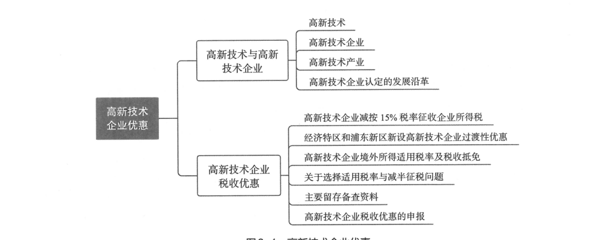
图 6-1 高新技术企业优惠

<!-- PDF 第 263 页（页眉：| 研发费用加计扣除与高新 技术企业优惠实务及案例 |；页脚：244；装饰：节标题下方有一条横线） -->
## 第一节 高新技术与高新技术企业

### 一、高新技术

高新技术是高技术的延伸。“高技术”一词，其英文为“High Technology”，简称为“High-Tech”，该词20世纪70年代起源于美国。《韦氏国际辞典》中的高技术定义为“使用或包含尖端方法或仪器用途的技术”。学术界认为，高新技术是对一类产品的技术评价术语，通常可从研究开发（R&D）经费占产品销售额的比例、科技人员占职工总数的比重、产品技术复杂程度等指标来界定，当这些指标超过一定标准时就可称为高新技术。通常，高新技术是与自然科学相对应的，社会科学一般不谈高新技术。

### 二、高新技术企业

#### （一）高新技术企业的界定

《高新技术企业认定管理办法》（国科发火〔2016〕32号）第二条规定，该办法所称高新技术企业是指在《国家重点支持的高新技术领域》规定的范围内（包括电子信息、生物与新医药、航空航天、新材料、高技术服务、新能源与节能、资源与环境、先进制造与自动化），持续进行研究开发与技术成果转化，形成企业核心自主知识产权，并以此为基础开展经营活动，在中国境内（不包括港澳台地区）注册的居民企业。

<!-- PDF 第 264 页（页眉：| 第六章 高新技术企业优惠 |；页脚：245） -->
高新技术企业是知识密集、技术密集的经济实体。对高新技术企业可从以下三方面进行理解：一是企业所从事的研究开发和生产经营活动必须符合国家重点支持的产业技术方向，属于重点支持的高新技术领域规定的范围；二是具有持续的自主研究开发能力，并拥有核心自主知识产权，这是高新技术企业的必备条件；三是企业主营业务必须与自身的研究开发与技术成果转化活动密切相关，并依托这些技术成果来开展经营活动。由此可见，那些没有开展研究开发活动、单纯从事高新技术产品生产加工的企业，不能被认定为高新技术企业。

与一般企业相比，高新技术企业具有的明显特征是：更注重技术创新、更倚重科技人员与研发团队、研究开发投入更大，不完全依赖资源投入，而是将技术突破作为主要发展手段。基于高新技术企业的本质，高新技术企业具有与传统企业不同的经营特点，这些经营特点将直接影响高新技术企业的激励机制。

高新技术企业的主要特点是：高风险、高投入、高收益、高技术、高成长。高风险，是指与传统企业相比，由于高新技术企业面临新市场、采用新技术，创新导致的不确定性使企业整体运作风险高于传统行业；高投入，是指高新技术企业的技术创新工作的资金与人力投入比传统企业更大；高收益，是指高新技术企业不断进行的技术创新将会在一段时间内带来功能、性能、质量、成本方面的巨大竞争优势，可为企业带来丰厚的利润；高技术，是高新技术企业的基本特征，从事技术创新的人员需要良好的知识基础，以脑力劳动为主；高成长，是指高新技术企业可使产品迅速占领市场并使企业迅速成长，这是高新技术企业的竞争优势。

#### （二）国家需要重点扶持的高新技术企业

根据《国务院关于经济特区和上海浦东新区新设立高新技术企业实行过渡性税收优惠的通知》（国发〔2007〕40号）的规定，国家需要重点扶持的高新技术企业，是指拥有核心自主知识产权，同时符合《企业所得税法实施条例》第九十三条规定的条件，并按照《高新技术企业认定管理办法》认定的高新技术企业。

在2016年以前，根据《高新技术企业认定管理工作指引》（国科发火〔2008〕362号）的规定，依照《高新技术企业认定管理办法》《国家重点支持的高新技术领域》，结合该指引所认定的高新技术企业即为《企业所得税法》第二十八条所称国

<!-- PDF 第 265 页（页眉：| 研发费用加计扣除与高新 技术企业优惠实务及案例 |；页脚：246） -->
家需要重点扶持的高新技术企业。

#### （三）中小高新技术企业

根据《国家税务总局关于实施创业投资企业所得税优惠问题的通知》（国税发〔2009〕87号）第二条第（三）项的规定，创业投资企业投资的中小高新技术企业，除应按照规定通过高新技术企业认定以外，还应符合职工人数不超过500人，年销售（营业）额不超过2亿元，资产总额不超过2亿元的条件。

### 三、高新技术产业

以高新技术为基础从事一种或多种高新技术及其产品研究、开发、生产和技术服务的企业集合，即为高新技术产业。这种产业所拥有的关键技术往往开发难度较大，但一旦开发成功却具有高于其他产业的经济效益和社会效益。

对高新技术产业范围的界定，是研究高新技术产业各种问题，包括政策问题的基础。目前国际上还没有统一定量界定高新技术产业的标准，较有影响的界定标准有两个。一是经济合作与发展组织（OECD）制定的标准，它是在国际标准产业分类统计的基础上，将R&D强度（即R&D经费占产值比重）作为界定高技术产业的标准。依据这一标准，R&D强度在3%以上的为高技术产业，在1%～2%之间的为中技术产业，小于1%的为低技术产业。二是美国商务部制定的标准，包括四项主要指标：（1）R&D支出占销售额的比重；（2）科学家、工程师和技术工人占全部职工的比重；（3）产品主导技术属于规定的高新技术领域；（4）产品主导技术包括高技术领域中处于技术前沿的工艺或技术突破。

高新技术产业判定标准是相对的、动态的。不同国家或地区在不同时期，由于经济发展水平不同，高新技术产业的范围也不同。经济发展到新阶段，原有高新技术在经济活动中不断扩散与渗透，逐渐发展成为新经济阶段的传统技术。此时，一些新涌现的技术成为新经济阶段的高新技术。因此，高新技术产业范围应根据经济发展进行相应调整。

<!-- PDF 第 266 页（页眉：| 第六章 高新技术企业优惠 |；页脚：247） -->
### 四、高新技术企业认定的发展沿革

我国高新技术企业认定工作是从20世纪90年代初开始的。为建立我国高新技术产业，促进高新技术企业快速发展，国务院于1991年发布《国家高新技术产业开发区高新技术企业认定条件和办法》（国发〔1991〕12号），授权国家科委组织开展国家高新技术产业开发区内高新技术企业认定工作，并配套制定财政、税收、金融贸易等一系列优惠政策。

1996年，根据形势的需要，《国家高新技术产业开发区外高新技术企业认定条件和办法》（国科发火字〔1996〕18号）将高新技术企业认定范围扩展到国家高新技术产业开发区外。

2000年，《国家高新技术产业开发区高新技术企业认定条件和办法》（国科发火〔2000〕324号）对国家高新区内高新技术企业认定标准进行了修订。

为全面贯彻落实党的十七大精神和《中共中央 国务院关于实施科技规划纲要增强自主创新能力的决定》（中发〔2006〕4号），并落实2007年3月全国人民代表大会通过的《企业所得税法》规定的有关高新技术企业的优惠政策，大力提升我国高新技术企业的自主创新能力，实现产业升级发展，在总结以往高新技术企业认定管理工作的基础上，科技部、财政部、国家税务总局共同制定了《高新技术企业认定管理办法》（国科发火〔2008〕172号），并于2008年7月8日印发配套文件《高新技术企业认定管理工作指引》（国科发火〔2008〕362号）。根据上述认定办法，三部门联合成立了高新技术企业认定管理工作领导小组，以指导各省级认定机构负责具体认定工作。认定办法与工作指引实施以来，总体运行平稳、效果良好，但随着经济、技术的不断发展也显露出一些问题，主要表现在以下三个方面：一是技术领域范围滞后，一些新兴产业特别是现代服务业在技术领域中体现不足。二是认定条件已不适应发展新要求，对中小企业支持力度不够。三是认定程序有待优化，后续监管也需要进一步加强。

科技部、财政部、国家税务总局在广泛深入调查研究的基础上，修订完善了认定办法和工作指引，经国务院批准后印发。2016年1月29日，科技部、财政部、国家税务总局修订印发《高新技术企业认定管理办法》（国科发火〔2016〕32号），

<!-- PDF 第 267 页（页眉：| 研发费用加计扣除与高新 技术企业优惠实务及案例 |；页脚：248） -->
2016年6月22日，三部门联合印发了配套文件《高新技术企业认定管理工作指引》（国科发火〔2016〕195号），原《高新技术企业认定管理办法》（国科发火〔2008〕172号）、《高新技术企业认定管理工作指引》（国科发火〔2008〕362号）、《关于高新技术企业更名和复审等有关事项的通知》（国科火字〔2011〕123号）同时废止。

根据《中共中央办公厅 国务院办公厅关于调整工业和信息化部职责机构编制的通知》（2023年9月24日）的规定，将科学技术部的组织拟订高新技术发展及产业化规划和政策，指导国家自主创新示范区、国家高新技术产业开发区等科技园区建设，指导科技服务业、技术市场、科技中介组织发展等职责划入工业和信息化部。将科学技术部的高新技术司、25名行政编制、4名司局级领导职数，成果转化与区域创新司6名行政编制、2名司局级领导职数划入工业和信息化部。调整后，工业和信息化部内设机构23个，机关行政编制725名，司局级领导职数110名。

### 五、高新技术企业资格有效期

根据《高新技术企业认定管理办法》（国科发火〔2016〕32号）第九条的规定，通过认定的高新技术企业，其资格自颁发证书之日起有效期为3年。

<!-- PDF 第 268 页（页眉：| 第六章 高新技术企业优惠 |；页脚：249；装饰：节标题下方有一条短横线） -->
## 第二节 高新技术企业税收优惠

### 一、高新技术企业减按15%税率征收企业所得税

#### （一）高新技术企业企业所得税低税率优惠

根据《企业所得税法》第二十八条的规定，国家需要重点扶持的高新技术企业，减按15%的税率征收企业所得税。

《企业所得税法》及其实施条例将2008年1月1日我国新税法实施前对高新技术企业实行的15%税率优惠政策扩大到全国，以促进全国范围内高新技术企业加快技术创新和科技进步，推动我国产业升级，实现国民经济的可持续发展。

#### （二）经认定的高新技术企业可依规申报享受优惠

依据《高新技术企业认定管理办法》《高新技术企业认定管理工作指引》认定的高新技术企业，可依照《企业所得税法》及其实施条例、《税收征收管理法》及其实施细则等有关规定，申报享受税收优惠政策。

企业获得高新技术企业资格后，自高新技术企业证书颁发之日所在年度起享受税收优惠，可依照规定申报享受高新技术企业低税率税收优惠。

#### （三）享受高新技术企业优惠的起止时间

《高新技术企业认定管理办法》第十条规定，企业获得高新技术企业资格后，自高新技术企业证书颁发之日所在年度起享受税收优惠，可依照本办法第四条的规

<!-- PDF 第 269 页（页眉：| 研发费用加计扣除与高新 技术企业优惠实务及案例 |；页脚：250） -->
定到主管税务机关办理税收优惠手续。

《高新技术企业认定管理工作指引》第四条进一步规定，自认定当年起，企业可持高新技术企业证书及其复印件，按照《企业所得税法》及其实施条例、《税收征收管理法》及其实施细则、《高新技术企业认定管理办法》和《高新技术企业认定管理工作指引》等有关规定，到主管税务机关办理相关手续，享受税收优惠。

未取得高新技术企业资格或不符合《企业所得税法》及其实施条例、《税收征收管理法》及其实施细则，以及《高新技术企业认定管理办法》等有关规定条件的企业，不得享受高新技术企业税收优惠。

高新技术企业资格期满当年内，在通过重新认定前，其企业所得税暂按15%的税率预缴，在年度汇算清缴前未取得高新技术企业资格的，应按规定补缴税款。

根据《企业所得税法》的规定，企业所得税按纳税年度计算，因此高新技术企业也是按年享受15%低税率税收优惠。而高新技术企业证书上注明的发证时间是具体日期，不一定是一个完整纳税年度，且有效期为3年。这就导致了企业享受优惠期间和高新技术企业认定证书的有效期不完全一致。为此，《国家税务总局关于实施高新技术企业所得税优惠政策有关问题的公告》（国家税务总局公告2017年第24号，适用于2017年度及以后年度企业所得税汇算清缴）第一条第（一）项规定，企业获得高新技术企业资格后，自高新技术企业证书注明的发证时间所在年度起申报享受税收优惠。

例如，A公司取得的高新技术企业证书上注明的发证时间为2024年8月25日，A公司可自2024年度1月1日起连续3年享受高新技术企业税收优惠政策，即，享受高新技术企业税收优惠政策的年度为2024年、2025年和2026年，2027年暂按15%税率预缴。

高新技术企业认定证书发放当年已开始享受税收优惠，则在期满当年应停止享受税收优惠。但鉴于其高新技术企业证书仍有可能处于有效期内，且继续取得高新技术企业资格的可能性非常大，为保障高新技术企业的利益，实现优惠政策的无缝衔接，国家税务总局公告2017年第24号第一条第（二）项规定，企业的高新技术企业资格期满当年，在通过重新认定前，其企业所得税暂按15%的税率预缴，在年底前仍未取得高新技术企业资格的，应按规定补缴相应

<!-- PDF 第 270 页（页眉：| 第六章 高新技术企业优惠 |；页脚：251） -->
期间的税款。

例如，B公司的高新技术企业证书在2024年4月20日到期，在2024年季度预缴时企业仍可按高新技术企业15%税率预缴。如果B公司在2024年底前重新获得高新技术企业证书，其2024年度可继续享受税收优惠。如未重新获得高新技术企业证书，则应按25%的税率补缴少缴的税款。

#### （四）复核后不符合认定条件已享受优惠的追缴

《高新技术企业认定管理办法》第十六条规定，对已认定的高新技术企业，有关部门在日常管理过程中发现其不符合认定条件的，应提请认定机构复核。复核后确认不符合认定条件的，由认定机构取消其高新技术企业资格，并通知税务机关追缴其不符合认定条件年度起已享受的税收优惠。

【例6-1】企业在高新技术企业资格证书有效期内不符合高新技术企业认定条件，主动在不符合条件当年不享受高新技术企业优惠，补缴企业所得税。在此种情况下，税务机关是否提请认定机构复核后取消其高新资格？

【解析】《北京市税务局企业所得税实务操作政策指引》明确，按照《国家税务总局关于实施高新技术企业所得税优惠政策有关问题的公告》（国家税务总局公告2017年第24号）第二条的规定，对取得高新技术企业资格且享受税收优惠的高新技术企业，税务部门发现其不符合高新技术企业认定条件的，应提请认定机构复核。因此，对于当年不符合高新技术企业条件，主动补缴税款未享受高新技术企业优惠的，税务机关无须再提请复核。

#### （五）被取消高新技术企业资格后税款的追缴

根据《高新技术企业认定管理办法》第十九条的规定，因严重弄虚作假、重大安全、重大质量事故、严重环境违法行为、未按期报告重大变化、累计两年未填报年度发展情况报表，被取消其高新技术企业资格的企业，由认定机构通知税务机关按《税收征收管理法》及有关规定，追缴其自发生上述行为之日所属年度起已享受的高新技术企业税收优惠。

<!-- PDF 第 271 页（页眉：| 研发费用加计扣除与高新 技术企业优惠实务及案例 |；页脚：252） -->
#### （六）日常管理中发现不符合认定条件的处理

对取得高新技术企业资格且享受税收优惠的高新技术企业，税务部门如在日常管理过程中发现其在高新技术企业认定过程中或享受优惠期间不符合《高新技术企业认定管理办法》第十一条规定的认定条件的，应提请认定机构复核。复核后确认不符合认定条件的，由认定机构取消其高新技术企业资格，并通知税务机关追缴证书有效期内自不符合认定条件年度起已享受的税收优惠。

### 二、经济特区和浦东新区新设高新技术企业过渡性优惠

《国务院关于经济特区和上海浦东新区新设立高新技术企业实行过渡性税收优惠的通知》（国发〔2007〕40号）明确，根据《企业所得税法》第五十七条的有关规定，国务院决定对法律设置的发展对外经济合作和技术交流的特定地区内，以及国务院已规定执行上述地区特殊政策的地区内新设立的国家需要重点扶持的高新技术企业，实行如下过渡性税收优惠。

（1）对经济特区和上海浦东新区内在2008年1月1日（含）之后完成登记注册的国家需要重点扶持的高新技术企业（以下简称新设高新技术企业），在经济特区和上海浦东新区内取得的所得，自取得第一笔生产经营收入所属纳税年度起，第一年至第二年免征企业所得税，第三年至第五年按照25%的法定税率减半征收企业所得税。

（2）经济特区和上海浦东新区内新设高新技术企业同时在经济特区和上海浦东新区以外的地区从事生产经营的，应当单独计算其在经济特区和上海浦东新区内取得的所得，并合理分摊企业的期间费用；没有单独计算的，不得享受企业所得税优惠。

（3）经济特区和上海浦东新区内新设高新技术企业在按照国发〔2007〕40号文件的规定享受过渡性税收优惠期间，由于重新认定或抽查不合格而不再具有高新技术企业资格的，从其不再具有高新技术企业资格年度起，停止享受过渡性税收优惠；以后再次被认定为高新技术企业的，不得继续享受或者重新享受过渡性税收优惠。

法律设置的发展对外经济合作和技术交流的特定地区，是指深圳、珠海、汕

<!-- PDF 第 272 页（页眉：| 第六章 高新技术企业优惠 |；页脚：253） -->
头、厦门和海南经济特区；国务院已规定执行上述地区特殊政策的地区，是指上海浦东新区。

### 三、高新技术企业境外所得适用税率及税收抵免

根据《财政部 国家税务总局关于高新技术企业境外所得适用税率及税收抵免问题的通知》（财税〔2011〕47号）的规定，以境内、境外全部生产经营活动有关的研究开发费用总额、总收入、销售收入总额、高新技术产品（服务）收入等指标申请并经认定的高新技术企业，其来源于境外的所得可以享受高新技术企业所得税优惠政策，即对其来源于境外所得可以按照15%的优惠税率缴纳企业所得税，在计算境外抵免限额时，可按照15%的优惠税率计算境内外应纳税总额。

上述高新技术企业境外所得税收抵免的其他事项，仍按照《财政部 国家税务总局关于企业境外所得税收抵免有关问题的通知》（财税〔2009〕125号）和《财政部 税务总局关于完善企业境外所得税收抵免政策问题的通知》（财税〔2017〕84号）的有关规定执行。

这里所称高新技术企业，是指依照《企业所得税法》及其实施条例规定，经认定机构按照《高新技术企业认定管理办法》和《高新技术企业认定管理工作指引》认定取得高新技术企业证书并且正在享受企业所得税15%税率优惠的企业。

### 四、关于选择适用税率与减半征税问题

#### （一）过渡期优惠税率的适用与减半征税

《国家税务总局关于进一步明确企业所得税过渡期优惠政策执行口径问题的通知》（国税函〔2010〕157号）第一条“关于居民企业选择适用税率及减半征税的具体界定问题”规定：

（1）居民企业被认定为高新技术企业，同时又处于《国务院关于实施企业所得税过渡优惠政策的通知》（国发〔2007〕39号）第一条第（三）项规定享受企业所得税“两免三减半”“五免五减半”等定期减免税优惠过渡期的，该居民企业的所

<!-- PDF 第 273 页（页眉：| 研发费用加计扣除与高新技术企业优惠实务及案例 |；页脚：254） -->
得税适用税率可以选择依照过渡期适用税率并适用减半征税至期满，或者选择适用高新技术企业的15%税率，但不能享受15%税率的减半征税。

（2）居民企业被认定为高新技术企业，同时又符合软件生产企业和集成电路生产企业定期减半征收企业所得税优惠条件的，该居民企业的所得税适用税率可以选择适用高新技术企业的15%税率，也可以选择依照25%的法定税率减半征税，但不能享受15%税率的减半征税。

#### （二）境外所得享受15%优惠时收入总额中境外部分收入口径问题

针对“境内高新技术企业来源于境外的所得享受15%优惠税率时，高新技术企业资格判定时收入总额中境外部分是指分支机构分回的所得吗？”这一问题，JS省《2019年度汇缴政策问题解答》问题20明确，根据《财政部 国家税务总局关于高新技术企业境外所得适用税率及税收抵免问题的通知》（财税〔2011〕47号）的规定，境内高新技术企业来源于境外的所得可享受高新技术企业15%优惠税率的，在对高新技术企业资格进行判定时，收入总额中应包含境外设立不具有独立纳税地位的分支机构取得的境外收入以及来自境外的股息红利。

#### （三）西部大开发优惠的税率适用

根据《财政部 国家税务总局关于执行企业所得税优惠政策若干问题的通知》（财税〔2009〕69号）第一条的规定，执行《国务院关于实施企业所得税过渡优惠政策的通知》（国发〔2007〕39号）规定的过渡优惠政策及西部大开发优惠政策的企业，在定期减免税的减半期内，可以按照企业适用税率计算的应纳税额减半征税。

其他各类情形的定期减免税，除另有规定外，均应按照企业所得税25%的法定税率计算的应纳税额减半征税。

### 五、主要留存备查资料

#### （一）高新技术企业低税率优惠主要留存备查资料

国家需要重点扶持的高新技术企业减按15%的税率征收企业所得税，属于预缴

<!-- PDF 第 274 页（页眉：| 第六章 高新技术企业优惠 |；页脚：255） -->
享受优惠事项。享受优惠后，需要准备的主要留存备查资料包括以下内容。

（1）高新技术企业资格证书；

（2）高新技术企业认定资料；

（3）知识产权相关材料；

（4）年度主要产品（服务）发挥核心支持作用的技术属于《国家重点支持的高新技术领域》规定范围的说明，高新技术产品（服务）及对应收入资料；

（5）年度职工和科技人员情况证明材料；

（6）当年和前两个会计年度研发费用总额及占同期销售收入比例、研发费用管理资料以及研发费用辅助账，研发费用结构明细表。

#### （二）经济特区和浦东新区新设高新技术企业定期减免留存备查资料

经济特区和上海浦东新区内，在2008年1月1日（含）之后完成登记注册的国家需要重点扶持的高新技术企业，在经济特区和上海浦东新区内取得的所得，自取得第一笔生产经营收入所属纳税年度起，第一年至第二年免征企业所得税，第三年至第五年按照25%的法定税率减半征收企业所得税。该优惠属于预缴享受优惠事项，纳税人享受优惠后，需要准备的主要留存备查资料包括以下内容。

（1）高新技术企业资格证书；

（2）高新技术企业认定资料；

（3）知识产权相关材料；

（4）年度主要产品（服务）发挥核心支持作用的技术属于《国家重点支持的高新技术领域》规定范围的说明，高新技术产品（服务）及对应收入资料；

（5）年度职工和科技人员情况证明材料；

（6）当年和前两个会计年度研发费用总额及占同期销售收入比例、研发费用管理资料以及研发费用辅助账，研发费用结构明细表；

（7）新办企业取得第一笔生产经营收入凭证（原始凭证及账务处理凭证）；

（8）区内区外所得的核算资料。

<!-- PDF 第 275 页（页眉：| 研发费用加计扣除与高新技术企业优惠实务及案例 |；页脚：256） -->
### 六、高新技术企业税收优惠的申报

#### （一）预缴申报

由于高新技术企业税收优惠适用于实行查账征收的居民企业，企业所得税实行核定征收的企业不享受高新技术企业优惠。因而，预缴申报享受高新技术企业税收优惠的企业需填报《中华人民共和国企业所得税月（季）度预缴纳税申报表（A类）》（A200000）第13行“减：减免所得税额”。

#### （二）汇缴申报

##### 1.高新技术企业税收优惠涉及的主要表单

汇算清缴享受高新技术企业税收优惠需要填报的主要表单有：《企业所得税年度纳税申报基础信息表》（A000000）“211高新技术企业申报所属期年度有效的高新技术企业证书”栏，主表A100000第26行“减免所得税”，《减免所得税优惠明细表》（A107040）第2行、第3行、第29行和第33行（如表6-1所示），以及《高新技术企业优惠情况及明细表》（A107041）。

表6-1 A107040减免所得税优惠明细表（部分）

| 行次 | 项 目 | 金额 |
| --- | --- | --- |
| 1 | 一、符合条件的小型微利企业减免企业所得税 | |
| 2 | 二、国家需要重点扶持的高新技术企业减按15%的税率征收企业所得税（填写A107041） | |
| 3 | 三、经济特区和上海浦东新区新设立的高新技术企业在区内取得的所得定期减免企业所得税（填写A107041） | |
| 4 | 四、受灾地区农村信用社免征企业所得税（4.1+4.2） | |
| 29 | 二十九、减：项目所得额按法定税率减半征收企业所得税叠加享受减免税优惠 | |
| 33 | 合计（1+2+…+26+27-28+29+30+31+32） | |

<!-- PDF 第 276 页（页眉：| 第六章 高新技术企业优惠 |；页脚：257） -->
表A107040第2行“二、国家需要重点扶持的高新技术企业减按15%的税率征收企业所得税”，国家需要重点扶持的高新技术企业享受15%税率优惠金额填报本行。同时须填报《高新技术企业优惠情况及明细表》（A107041）。

表A107040第3行“三、经济特区和上海浦东新区新设立的高新技术企业在区内取得的所得定期减免企业所得税”，填报纳税人根据《国务院关于经济特区和上海浦东新区新设立高新技术企业实行过渡性税收优惠的通知》（国发〔2007〕40号）、《财政部 国家税务总局关于贯彻落实国务院关于实施企业所得税过渡优惠政策有关问题的通知》（财税〔2008〕21号）等规定，经济特区和上海浦东新区内，在2008年1月1日（含）之后完成登记注册的国家需要重点扶持的高新技术企业，在经济特区和上海浦东新区内取得的所得，自取得第一笔生产经营收入所属纳税年度起，第一年至第二年免征企业所得税，第三年至第五年按照25%法定税率减半征收企业所得税。对于跨经济特区和上海浦东新区的高新技术企业，其区内所得优惠填写该行，区外所得优惠填写该表第2行。经济特区和上海浦东新区新设立的高新技术企业定期减免税期满后，只享受15%税率优惠的，填写该表第2行。同时须填报《高新技术企业优惠情况及明细表》（A107041）。

##### 2.高新技术企业优惠情况及明细表

持有有效期内的高新技术企业资格的纳税人均需填报《高新技术企业优惠情况及明细表》（A107041，如表6-2所示）。纳税人根据税收政策规定，填报本年发生的高新技术企业优惠情况。

表6-2 A107041高新技术企业优惠情况及明细表

| 税收优惠基本信息 | | | | |
| --- | --- | --- | --- | --- |
| 1 | 企业主要产品（服务）发挥核心支持作用的技术所属范围 | 国家重点支持的高新技术领域 | 一级领域 | |
| 2 | | | 二级领域 | |
| 3 | | | 三级领域 | |

<!-- PDF 第 277 页（页眉：| 研发费用加计扣除与高新技术企业优惠实务及案例 |；页脚：258） -->
| 税收优惠有关情况 | | | | | | |
| --- | --- | --- | --- | --- | --- | --- |
| 4 | 收入指标 | 一、本年高新技术产品（服务）收入（5+6） | | | | |
| 5 | | 其中：产品（服务）收入 | | | | |
| 6 | | 技术性收入 | | | | |
| 7 | | 二、本年企业总收入（8-9） | | | | |
| 8 | | 其中：收入总额 | | | | |
| 9 | | 不征税收入 | | | | |
| 10 | | 三、本年高新技术产品（服务）收入占企业总收入的比例（4÷7） | | | | |
| 11 | 人员指标 | 四、本年科技人员数 | | | | |
| 12 | | 五、本年职工总数 | | | | |
| 13 | | 六、本年科技人员占企业当年职工总数的比例（11÷12） | | | | |
| 14 | 研发费用指标 | 高新研发费用归集年度 | 本年度 | 前一年度 | 前二年度 | 合计 |
| | | | 1 | 2 | 3 | 4 |
| 15 | | 七、归集的高新研发费用金额（16+25） | | | | |
| 16 | | （一）内部研究开发投入（17+…+22+24） | | | | |
| 17 | | 1.人员人工费用 | | | | |
| 18 | | 2.直接投入费用 | | | | |
| 19 | | 3.折旧费用与长期待摊费用 | | | | |
| 20 | | 4.无形资产摊销费用 | | | | |
| 21 | | 5.设计费用 | | | | |
| 22 | | 6.装备调试费与实验费用 | | | | |
| 23 | | 7.其他费用 | | | | |
| 24 | | 其中：可计入研发费用的其他费用 | | | | |
| 25 | | （二）委托外部研发费用 [（26+28）×80%] | | | | |
| 26 | | 1.境内的外部研发费 | | | | |
| 27 | | 2.境外的外部研发费 | | | | |

<!-- PDF 第 278 页（页眉：| 第六章 高新技术企业优惠 |；页脚：259） -->
| 28 | | 其中：可计入研发费用的境外的外部研发费 | | | | |
| --- | --- | --- | --- | --- | --- | --- |
| 29 | | 八、销售（营业）收入 | | | | |
| 30 | | 九、三年研发费用占销售（营业）收入的比例（15行4列÷29行4列） | | | | |
| 31 | 减免税额 | 十、国家需要重点扶持的高新技术企业减征企业所得税 | | | | |
| 32 | | 十一、经济特区和上海浦东新区新设立的高新技术企业定期减免税额 | | | | |

<!-- PDF 第 279 页（页眉：无；页脚：无）（本页空白） -->

<!-- PDF 第 280 页（页眉：无；页脚：未显示；装饰：TAXING） -->
# 第七章 高新技术企业认定条件

人间行路难，踏地出赋租。

——（宋）苏轼《鱼蛮子》

<!-- PDF 第 281 页（页眉：无；页脚：未显示；装饰：正文段四周有直角装饰线） -->
国家重点扶持的高新技术企业须同时满足八个认定条件，缺一不可。本章介绍高新技术企业的认定条件，主要内容如图7-1所示。

<!-- PDF 第 282 页（页眉：| 第七章 高新技术企业认定条件 |；页脚：263） -->
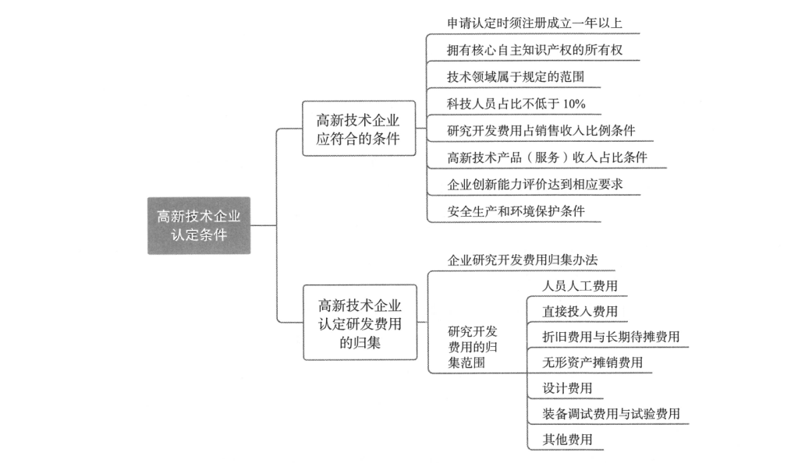
图 7-1 高新技术企业认定条件

<!-- PDF 第 283 页（页眉：| 研发费用加计扣除与高新技术企业优惠实务及案例 |；页脚：264） -->
## 第一节 高新技术企业应符合的条件

根据《企业所得税法实施条例》第九十三条的规定，国家需要重点扶持的高新技术企业，是指拥有核心自主知识产权，并同时符合下列条件的企业：

（1）产品（服务）属于《国家重点支持的高新技术领域》规定的范围。

（2）研究开发费用占销售收入不低于规定比例。

（3）高新技术产品（服务）收入占企业总收入的比例不低于规定比例。

（4）科技人员占企业职工总数的比例不低于规定比例。

（5）高新技术企业认定管理办法规定的其他条件。

自2016年1月1日起，根据《高新技术企业认定管理办法》（国科发火〔2016〕32号）第十一条的具体规定，认定为高新技术企业须同时满足以下条件：

（1）企业申请认定时须注册成立一年以上。

（2）企业通过自主研发、受让、受赠、并购等方式，获得对其主要产品（服务）在技术上发挥核心支持作用的知识产权的所有权。

（3）对企业主要产品（服务）发挥核心支持作用的技术属于《国家重点支持的高新技术领域》规定的范围。

（4）企业从事研发和相关技术创新活动的科技人员占企业当年职工总数的比例不低于10%。

（5）企业近三个会计年度（实际经营期不满三年的按实际经营时间计算，下同）的研究开发费用总额占同期销售收入总额的比例符合如下要求：最近一年销售收入小于5 000万元（含）的企业，比例不低于5%；最近一年销售收入在5 000万元至

<!-- PDF 第 284 页（页眉：| 第七章 高新技术企业认定条件 |；页脚：265） -->
2亿元（含）的企业，比例不低于4%；最近一年销售收入在2亿元以上的企业，比例不低于3%。

其中，企业在中国境内发生的研究开发费用总额占全部研究开发费用总额的比例不低于60%。

（6）近一年高新技术产品（服务）收入占企业同期总收入的比例不低于60%。

（7）企业创新能力评价应达到相应要求。

（8）企业申请认定前一年内未发生重大安全、重大质量事故或严重环境违法行为。

需要说明的是，上述八个认定条件须同时满足，缺一不可。其中第一项条件是对企业成立年限的明确要求，即企业申请认定时须注册成立一年以上。第八项条件是对企业社会责任提出的要求，申请认定前一年内不能发生重大安全、重大质量事故和严重环境违法行为。其余六个条件分别涉及核心知识产权、主要产品（服务）、科技人员、研发费用、高新技术产品（服务）收入、创新能力。高新技术企业认定的具体条件如表7-1所示。

表 7-1 高新技术企业认定条件

| 项目 | 法定条件 | 具体条件 |
| --- | --- | --- |
| 政策依据 | 《企业所得税法实施条例》第九十三条 | 《高新技术企业认定管理办法》第十一条 |
| 成立时间 | | 1.企业申请认定时须注册成立一年以上 |
| 知识产权 | 拥有核心自主知识产权 | 2.企业通过自主研发、受让、受赠、并购等方式，获得对其主要产品（服务）在技术上发挥核心支持作用的知识产权的所有权 |
| 技术领域范围 | 产品（服务）属于《国家重点支持的高新技术领域》规定的范围 | 3.对企业主要产品（服务）发挥核心支持作用的技术属于《国家重点支持的高新技术领域》规定的范围 |
| 科技人员占比 | 科技人员占企业职工总数的比例不低于规定比例 | 4.企业从事研发和相关技术创新活动的科技人员占企业当年职工总数的比例不低于10% |
| 高新技术产品收入占比 | 高新技术产品（服务）收入占企业总收入的比例不低于规定比例 | 5.近一年高新技术产品（服务）收入占企业同期总收入的比例不低于60% |

<!-- PDF 第 285 页（页眉：| 研发费用加计扣除与高新技术企业优惠实务及案例 |；页脚：266） -->
续表

| 项目 | 法定条件 | 具体条件 |
| --- | --- | --- |
| 研发费占比 | 研究开发费用占销售收入不低于规定比例 | 6.企业近三个会计年度（实际经营期不满三年的按实际经营时间计算，下同）的研究开发费用总额占同期销售收入总额的比例符合如下要求：（1）最近一年销售收入小于5 000万元（含）的企业，比例不低于5%；（2）最近一年销售收入在5 000万元至2亿元（含）的企业，比例不低于4%；（3）最近一年销售收入在2亿元以上的企业，比例不低于3%。其中，企业在中国境内发生的研究开发费用总额占全部研究开发费用总额的比例不低于60% |
| 其他条件 | 《高新技术企业认定管理办法》规定的其他条件 | 7.企业创新能力评价应达到相应要求 |
| | | 8.企业申请认定前一年内未发生重大安全、重大质量事故或严重环境违法行为 |

高新技术企业认定条件与国家重点技术领域相互联系，是一个有机整体。如图7-2所示。

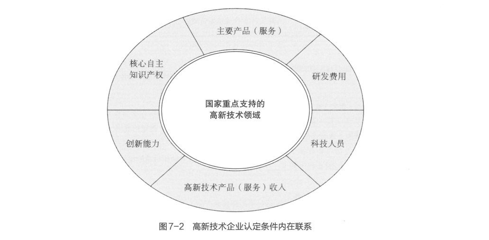
图 7-2 高新技术企业认定条件内在联系

<!-- PDF 第 286 页（页眉：| 第七章 高新技术企业认定条件 |；页脚：267） -->
### 一、申请认定时须注册成立一年以上

根据《高新技术企业认定管理办法》（国科发火〔2016〕32号）第十一条的规定，认定为高新技术企业须符合的条件之一是：企业申请认定时须注册成立一年以上。

根据2016版《高新技术企业认定管理工作指引》第三条第一款的规定，“须注册成立一年以上”是指企业须注册成立365个日历天数以上。即指企业自工商注册日起（以企业营业执照上的注册成立日期为准），满365个日历天数。

【例7-1】南京江北新区A科技公司，营业执照上注明的成立日期为2020年4月18日，2022年5月30日办理了2021年度的企业所得税汇算清缴纳税申报，2022年7月申报高新技术企业认定。

要求：分析说明A公司可否申请2022年高新技术企业认定。

【解析】江苏省高新技术企业认定管理工作协调小组办公室《关于组织申报2022年度高新技术企业的通知》（苏高企协办〔2022〕6号）明确，江苏省的高新技术企业采取常年申报受理、分批集中评审的方式，不设置申报批次，企业自当年汇算清缴完成后即可开始申报（每年仅限申报1次）。省高新技术企业认定管理工作协调小组办公室受理各市、县、国家和省级高新区科技部门报送的高新技术企业申报材料截止时间为8月31日。企业向所在地科技部门提交申报材料的截止时间以地方通知为准。

A科技公司自成立日期2020年4月18日起至2022年7月，达到了365个日历天数要求，可以在所在地科技部门规定的提交申报材料的截止时间以前申报2022年的高新技术企业认定。

### 二、拥有核心自主知识产权的所有权

#### （一）知识产权的界定

根据《民法典》第一百二十三条的规定，民事主体依法享有知识产权。知识产权是权利人依法就下列客体享有的专有的权利：（1）作品；（2）发明、实用新型、外观设计；（3）商标；（4）地理标志；（5）商业秘密；（6）集成电路布图设计；（7）植物

<!-- PDF 第 287 页（页眉：| 研发费用加计扣除与高新技术企业优惠实务及案例 |；页脚：268） -->
新品种；（8）法律规定的其他客体。

知识产权的特征主要表现在以下几个方面。

（1）独占性。知识产权独占性，即只有权利人才能享有，他人不经权利人许可不得行使其权利。

（2）知识产权对象是人的智力创造，它是指在科学、技术、文化、艺术领域从事一切智力活动而创造的精神财富依法所享有的权利。

（3）知识产权取得的利益既有经济性质的也有非经济性的。

（4）地域性。知识产权具有地域性，即除签有国际公约或双边、多边协定外，依一国法律取得的权利只能在该国境内有效，受该国法律保护。

（5）时间性。知识产权具有时间性，即各国法律对知识产权分别规定了一定期限，期满后则权利自动终止。如我国法律规定发明专利权的有效期限为20年，实用新型专利权和外观设计专利权的期限为10年，均自申请日起计算。软件著作权自软件开发完成之日起产生。自然人的软件著作权保护期为自然人终生及其死亡后50年，截止于自然人死亡后第50年的12月31日；软件是合作开发的，截止于最后死亡的自然人死亡后第50年的12月31日。法人或者其他组织的软件著作权，保护期为50年。截止于软件首次发表后第50年的12月31日。但软件自开发完成之日起50年内未发表的不再保护。也就是说，自然人的软件著作权，自软件开发完成就自动产生，期间不存在开发完成日到首次发表日这个间隔，其保护期限为作者有生之年再加50年。而法人或者其他组织的软件著作权，其保护期存在开发完成日到首次发表日这个间隔，50年的保护期是从首次发表后开始计算，其实前面开发完成到首次发表这段时间也是保护期。

#### （二）高新技术企业认定对知识产权的要求

知识产权对于企业申报高新技术企业至关重要。根据《企业所得税法实施条例》第九十三条的规定，享受15%税率优惠的国家需要重点扶持的高新技术企业必须拥有核心自主知识产权。

认定为高新技术企业须满足的条件之二是：企业通过自主研发、受让、受赠、并购等方式，获得对其主要产品（服务）在技术上发挥核心支持作用的知识产权的

<!-- PDF 第 288 页（页眉：| 第七章 高新技术企业认定条件 |；页脚：269） -->
所有权。

高新技术企业认定所指的知识产权须在中国境内授权或审批审定，并在中国法律的有效保护期内。知识产权权属人应为申请企业。不具备知识产权的企业不能认定为高新技术企业。

此外，知识产权必须与企业主要产品（服务）技术领域相一致，且应对企业产品（服务）的核心技术起到支撑作用。

高新技术企业认定条件中的知识产权，还须同时注意地域、范畴、形式、获得方式等的要求，具体如图7-3所示。

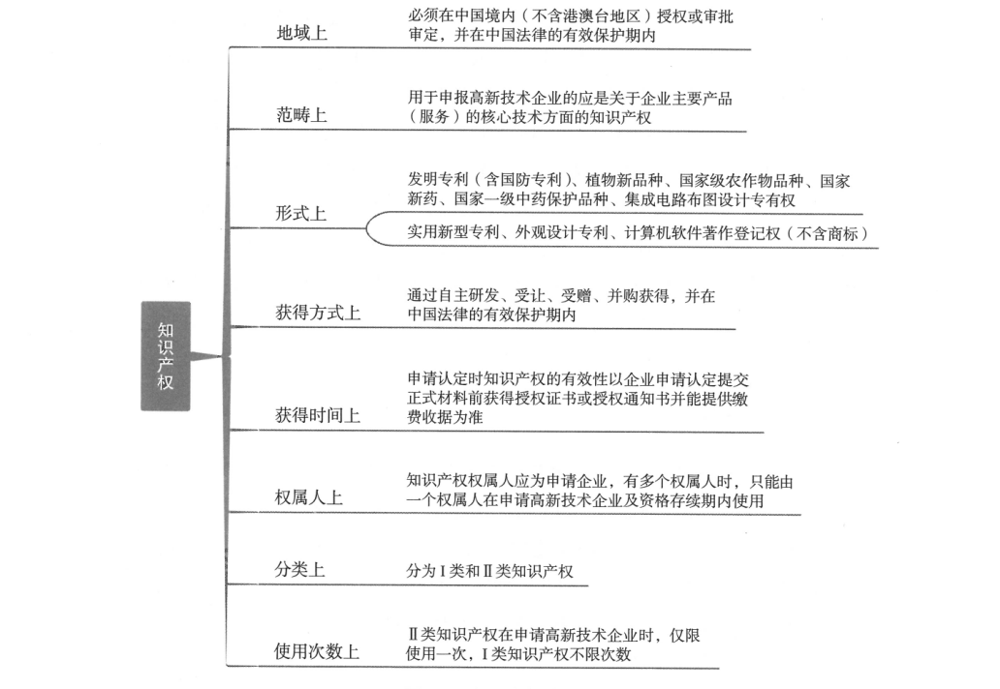
图 7-3 知识产权注意事项

<!-- PDF 第 289 页（页眉：| 研发费用加计扣除与高新技术企业优惠实务及案例 |；页脚：270） -->
#### （三）知识产权的取得方式

根据2016版《高新技术企业认定管理办法》第十一条的规定，企业通过自主研发、受让、受赠、并购等方式，获得对其主要产品（服务）在技术上发挥核心支持作用的知识产权的所有权。因而，高新技术企业认定中知识产权所有权的取得方式，包括自主研发、受让、受赠、并购等方式。其中自主研发的知识产权通过专利申请、植物新品种申请、国家级农作物新品种申请、国家新药申请、国家一级中药保护品种申请、集成电路布图设计专有权申请、计算机软件著作权申请获得相应的知识产权。

除自主研发外，企业也可以通过受让、受赠、并购等方式拥有知识产权。知识产权受让，是指知识产权出让主体与知识产权受让主体根据与知识产权转让相关的法律法规和双方签订的转让合同，将知识产权权利享有者由出让方有偿转移给受让方的法律行为。知识产权受赠，是指知识产权出让主体与知识产权受让主体根据与知识产权转让有关的法律法规和双方签订的转让合同，将知识产权权利享有者由出让方无偿转移给受让方的法律行为。知识产权并购，是指因企业合并或收购而导致知识产权权利人变更的一种方式。知识产权的受让、受赠、并购属于知识产权转让范畴，相关操作须遵循相关法律法规。企业在通过转让获取知识产权时，应注意知识产权是否已经授权，是否超过了知识产权的保护期限，是否已经转让或者许可给他人实施，是否与其他企业存在知识产权纠纷等。

#### （四）知识产权的评价

高新技术企业认定中，对企业知识产权情况采用分类评价方式，其中：发明专利（含国防专利）、植物新品种、国家级农作物品种、国家新药、国家一级中药保护品种、集成电路布图设计专有权等按Ⅰ类评价；实用新型专利、外观设计专利、软件著作权等（不含商标）按Ⅱ类评价。如图7-4所示。

按Ⅱ类评价的知识产权在申请高新技术企业时，仅限使用一次。

例如，甲科技公司于2018年7月1日获得了2项发明专利、4项实用新型专利、5项计算机软件著作权登记权。甲公司2021年申请了高新技术企业并通过认定取得高

<!-- PDF 第 290 页（页眉：| 第七章 高新技术企业认定条件 |；页脚：271） -->
新技术企业资格证书。2024年，甲公司需要重新申请高新技术企业认定。那么，甲公司的2项发明专利可继续使用，另外4项实用新型专利、5项计算机软件著作权已经不能再作为知识产权用于申请认定。

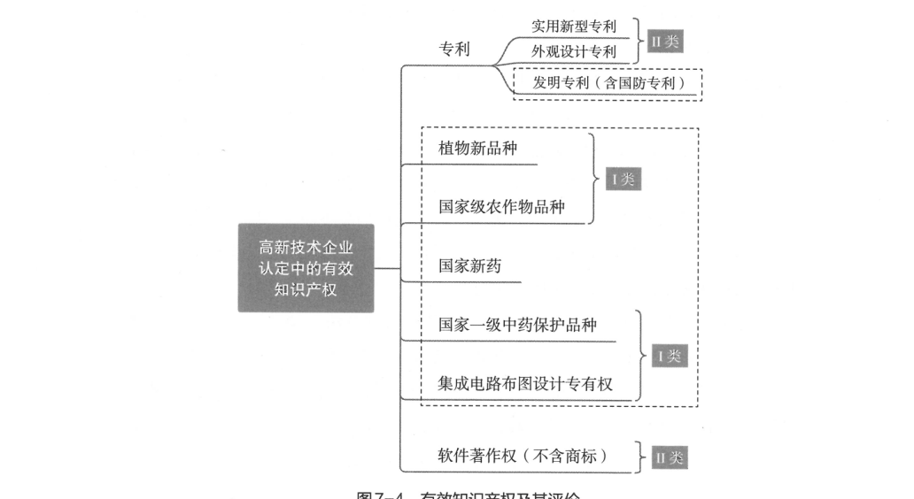
图 7-4 有效知识产权及其评价

在申请高新技术企业及高新技术企业资格存续期内，知识产权有多个权属人时，只能由一个权属人在申请时使用。

例如，某一计算机领域方面的国家发明专利，甲、乙两家公司为共同的权利所有人，甲公司2021—2023年间获批为高新技术企业，那么乙公司在2024年申报高新技术企业时，不可以使用该发明专利来申请认定。

#### （五）知识产权有效性的判定

申请认定时专利的有效性以企业申请认定前获得授权证书或授权通知书并能提供缴费收据为准。

<!-- PDF 第 291 页（页眉：| 研发费用加计扣除与高新技术企业优惠实务及案例 |；页脚：272） -->
申报时，企业应提供获得且有效的发明专利证书（含国防专利）、实用新型专利证书、外观设计专利证书、植物新品种权证书、国家新药证书、国家一级中药保护品种证书、计算机软件著作权登记证书、集成电路布图设计专有权证书等。通过受让、受赠、并购等方式获得的核心自主知识产权，应提供专利登记簿副本、变更手续合格通知书等相关证明材料。

发明、实用新型、外观设计、集成电路布图设计专有权可在国家知识产权局网站查询专利标记和专利号；国防专利须提供国家知识产权局授予的国防专利证书；植物新品种可在中国林草植物新品种保护办公室网站查询；国家级农作物品种是指农业部国家农作物品种审定委员会审定公告的农作物品种；国家新药须提供国家食品药品监督管理局签发的新药证书；国家一级中药保护品种须提供国家食品药品监督管理局签发的中药保护品种证书；软件著作权可在国家版权局中国版权保护中心网站查询软件著作权标记（亦称版权标记）。

与原办法相比，2016版《高新技术企业认定管理办法》调整了认定条件中对知识产权的要求，取消了原有“近三年内”获得知识产权的限制，同时取消了原有“5年以上独占许可”获得知识产权的方式。既鼓励了企业自主研发，也有助于避免知识产权滥用，企业仍可通过技术转让等方式获得知识产权、促进科技成果转化和产业化，有利于更好地落实修订后的《促进科技成果转化法》。

### 三、技术领域属于规定的范围

#### （一）界定依据及其主要变化

2008年之前，我国高新技术企业认定中的产品领域以《高新技术产品目录》为界定依据。但是，随着经济与科技的快速发展，以《高新技术产品目录》为导向来认定高新技术企业已不适应科技、经济的快速发展，容易造成一些地方将只具备产品生产加工能力、不从事自主研发，长期处于高新技术产业链和价值链低端的加工型企业认定为高新技术企业。《高新技术产品目录》不能及时反映新技术的发展，也缺少现代服务业方面的内容，造成大量伴随着现代服务业发展起来的从事技术开发

<!-- PDF 第 292 页（页眉：| 第七章 高新技术企业认定条件 |；页脚：273） -->
和技术服务的企业不能被纳入高新技术企业范畴。

2008版《高新技术企业认定管理办法》（国科发火〔2008〕172号）根据国家中长期科技发展规划和“十一五”发展规划结合节能减排、保护环境、促进民生的重点任务，配套编制了《国家重点支持的高新技术领域》，用来判断企业所进行的研究开发、产业化活动以及企业的产品（服务）是否具有创新性，是否符合国家重点支持方向，同时兼顾支持技术型服务业，并将成熟技术和不符合国家产业政策的领域排除在外。因此，2008年，科技部、财政部、国家税务总局颁布了《国家重点支持的高新技术领域》，我国将高新技术企业认定的技术领域以该高新技术领域为界定依据，《高新技术产品目录》同时废止。因此，可以说高新技术企业的“高新”界定主要以“技术”为依据，不再以“产品”为依据。

2016年，科技部、财政部和税务总局修订印发了《高新技术企业认定管理办法》（国科发火〔2016〕32号），作为认定办法的附件，《国家重点支持的高新技术领域》在2016年亦作了相应修订，与原技术领域相比，主要有以下三个方面的变化。

##### 1.扩充服务业支撑技术

如新增“检验检测认证技术”“现代体育服务支撑技术”“智慧城市服务支撑技术”等行业特征明显的内容，并对“研发与设计服务”“信息技术服务”“文化创意产业支撑技术”“电子商务与现代物流技术”等技术领域进行了补充。

##### 2.增加相关领域新技术，淘汰落后技术

如新增“增材制造技术”“石墨烯制备与应用技术”“重大自然灾害监测、预警和应急处置关键技术”“新能源汽车试验测试及基础设施技术”等先进技术，并排除了落后的产业技术与产品内容。

##### 3.增强内容的规范性和技术特点

突出领域的关键技术要求，尽可能去除产业类、产品化描述，加强领域间的协调，避免重复和遗漏，表述上更加准确、精炼、规范、专业。

#### （二）技术领域属于规定范围

根据《高新技术企业认定管理办法》第十一条的规定，认定为高新技术企业须

<!-- PDF 第 293 页（页眉：| 研发费用加计扣除与高新技术企业优惠实务及案例 |；页脚：274） -->
对企业主要产品（服务）发挥核心支持作用的技术属于《国家重点支持的高新技术领域》规定的范围。这是认定为高新技术企业须同时满足的条件之三。

高新技术产品（服务）的技术领域不是单纯以终端产品来确定，而是与主营产品（服务）经营活动相关技术必须在《国家重点支持的高新技术领域》规定的范围内。

高新技术企业认定过程中，涉及企业所处行业领域、对高新技术产品发挥核心支持作用的技术所属技术领域、企业研发活动所处技术领域等几个领域。这些领域的判断，可从以下几个方面把握。

（1）企业所属行业领域，可根据工商营业执照注册登记的业务范围、税务登记所属的国民经济行业领域进行判定。

（2）对主要产品发挥核心支持作用的技术所属技术领域，可根据产品所蕴含的核心技术领域、对产品发挥支撑作用的知识产权所属技术领域进行判定，且必须在《国家重点支持的高新技术领域》规定的范围内。

（3）研发活动所属技术领域，可根据研发活动的内容，所取得的知识产权成果所处技术领域进行判断，研发活动所属技术领域也应在《国家重点支持的高新技术领域》规定的范围内。

（4）申请认定企业须充分论证企业高新技术产品中所蕴含的高新技术，并与企业知识产权存在密切联系。

### 四、科技人员占比不低于10%

企业科技人员占比是企业科技人员数与职工总数的比值。

认定为高新技术企业须同时满足的条件之四是：企业从事研发和相关技术创新活动的科技人员占企业当年职工总数的比例不低于10%。这里的“当年”是指企业申报前一个会计年度。

#### （一）科技人员

企业科技人员是指直接从事研发和相关技术创新活动，以及专门从事上述活动

<!-- PDF 第 294 页（页眉：| 第七章 高新技术企业认定条件 |；页脚：275） -->
的管理和提供直接技术服务的，累计实际工作时间在183天以上的人员，包括在职、兼职和临时聘用人员。

这与《监管规则适用指引——发行类第9号：研发人员及研发投入》对研发人员的要求不同。关于研发人员聘用形式，该指引规定，研发人员原则上应为与发行人签订劳动合同的人员。劳务派遣人员原则上不能认定为研发人员。发行人将签订其他形式合同的人员认定为研发人员的，应当结合相关专业背景、工作内容、未签订劳动合同的原因等，审慎论证认定的合理性。研发人员聘用形式的计算口径，应与按照《公开发行证券的公司信息披露内容与格式准则第57号——招股说明书》第四十二条披露的员工人数口径一致。

#### （二）职工总数

企业职工总数包括企业在职、兼职和临时聘用人员。在职人员可以通过企业是否签订了劳动合同或缴纳社会保险费来鉴别；兼职、临时聘用人员全年须在企业累计工作183天以上，这可以根据相关报酬发放表、人员花名册等进行判定。

#### （三）统计方法

企业当年职工总数、科技人员数均按照全年月平均数计算。

月平均数=（月初数+月末数）÷2

全年月平均数=全年各月平均数之和÷12

年度中间开业或者终止经营活动的，以其实际经营期作为一个纳税年度确定上述相关指标。

这与小型微利企业优惠有关职工人数的计算方法规定不同，小型微利企业优惠中的职工人数，按全年季平均值确定。

考虑到目前企业研发形式日益多样，产学研合作逐步深入，研发外包、开放式众包等渐成趋势，企业越来越多地依靠外部力量开展研发活动，为更好地适应企业研发创新的发展需求，2016版《高新技术企业认定管理办法》调整“科技人员占比”指标，将原“具有大学专科以上学历的科技人员占企业当年职工总数的30%以上，其中研发人员占企业当年职工总数的10%以上”的条件，调整为“企业从事研

<!-- PDF 第 295 页（页眉：| 研发费用加计扣除与高新技术企业优惠实务及案例 |；页脚：276） -->
发和相关技术创新活动的科技人员占企业当年职工总数的比例不低于10%”。

高新技术企业认定条件对科技人员的要求如图7-5所示。

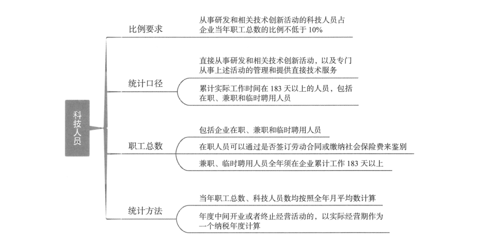
图 7-5 科技人员占比条件

### 五、研究开发费用占销售收入比例条件

企业研究开发费用占比，是指企业近三个会计年度的研究开发费用总额占同期销售收入总额的比值。

认定为高新技术企业须同时满足的条件之五是：企业近三个会计年度（实际经营期不满三年的按实际经营时间计算，下同）的研究开发费用总额占同期销售收入总额的比例符合如下要求：最近一年销售收入小于5 000万元（含）的企业，比例不低于5%；最近一年销售收入在5 000万元至2亿元（含）的企业，比例不低于4%；最近一年销售收入在2亿元以上的企业，比例不低于3%。

其中，企业在中国境内发生的研究开发费用总额占全部研究开发费用总额的比例不低于60%。

<!-- PDF 第 296 页（页眉：| 第七章 高新技术企业认定条件 |；页脚：277） -->
这里的“近三个会计年度”，是指企业申报前的连续三个会计年度（不含申报年）；“最近一年”，是指企业申报前一个会计年度。

企业在申请认定高新技术企业时，应归集“近三个会计年度”发生的研究开发费用。“近三个会计年度”的研究开发费用是指企业申请认定高新技术企业当年再往前追溯三个年度发生的研发费，不包括申请认定当年发生的研发费。

例如，B公司2024年申请高新技术企业认定，则企业应归集2021年、2022年、2023年三个年度发生的研发费用。

企业注册成立时间不足三年的，研发费用的归集按实际经营年限计算。如C公司于2022年7月登记成立，2024年申请高新技术企业认定，申请认定时成立时间不足三年，则该公司在归集研发费用时，应将2022年7月至2022年12月作为一个会计年度，归集2022年、2023年两个年度发生的研发费用。

为了更多中小企业享受到高新技术企业政策优惠，2016版《高新技术企业认定管理办法》调整了“研发费用占销售收入比例”指标，将最近一年销售收入小于5000万元（含）的企业研发费用总额占同期销售收入总额的比例由6%调整为5%，此举将使规模较小、研发投入相对较少的中小企业获益。此外，需要说明的是，研发费用占比条件是按会计年度计算的。

#### （一）企业研究开发活动的确定

根据《高新技术企业认定管理工作指引》的规定，研究开发活动是指为获得科学与技术（不包括社会科学、艺术或人文学）新知识，创造性运用科学技术新知识，或实质性改进技术、产品（服务）、工艺而持续进行的具有明确目标的活动。不包括企业对产品（服务）的常规性升级或对某项科研成果直接应用等活动（如直接采用新的材料、装置、产品、服务、工艺或知识等）。

高新技术企业所从事的研究开发活动要有价值、有目标、可持续。

有价值，主要体现在创新性方面。一是在技术、产品（服务）方面的创新取得了有价值的成果；二是对本地区（省、自治区、直辖市或计划单列市）相关行业的技术进步具有推动作用；三是企业从事的常规性升级或对某项科研成果直接应用等活动（如直接采用新的工艺、材料、装置、产品、服务或知识等）被排除在外。企

<!-- PDF 第 297 页（页眉：| 研发费用加计扣除与高新 技术企业优惠实务及案例 |；页脚：278） -->
业的研究开发相对于本地区同一行业领先的技术、工艺有所创新，就可纳入高新技术企业认定中的研究开发活动，这一标准符合企业技术创新的实际。因为企业是技术的实际应用部门，不能完全要求企业进行重大突破的、原创性的、有实质性显著进步的创新活动。这类创新活动投入很大、风险也很大，一般企业难以胜任。企业的技术创新是循序渐进的，每一点创新都是有价值的。

有目标，是指这种研究开发活动具有明确目标，即为解决生产经营中的具体技术问题而开展的研究活动。

可持续，是指这种研究开发必须是持续进行的，不是零散的。

评审专家在进行研发活动评价过程中可参考如下方法判断。

##### 1.行业标准判断法

若国家有关部门、全国（世界）性行业协会等具备相应资质的机构提供了测定科技“新知识”、“创造性运用科学技术新知识”或“具有实质性改进的技术、产品（服务）、工艺”等技术参数（标准），则优先按此参数（标准）来判断企业所进行的项目是否为研究开发活动。

##### 2.专家判断法

如果企业所在行业中没有发布公认的研发活动测度标准，则由本行业专家进行判断。获得新知识、创造性运用新知识以及技术的实质改进，应当是取得被同行业专家认可的、有价值的创新成果，对本地区相关行业的技术进步具有推动作用。

##### 3.目标或结果判定法

在采用行业标准判断法和专家判断法不易判断企业是否发生了研发活动时，以该方法作为辅助。重点了解研发活动的目的、创新性、投入资源（预算），以及是否取得了最终成果或中间成果（如专利等知识产权或其他形式的科技成果）。

研究开发和教育与培训的界限：在高等学校，研究开发和教育与培训的关系很密切，特别是在以下两个方面，应把它们加以区分。

（1）大部分教师既从事研究开发活动，也从事教学活动，许多实验室和设备也都为这两个目的服务，对其中研究开发的部分，应采用估计的办法加以区分。

（2）研究生进入学位论文阶段的工作以及这一阶段的指导教师的工作，属于研究开发活动，这种工作具有明显创新因素和新颖性，有的就是研究开发项目的组成

<!-- PDF 第 298 页（页眉：| 第七章 高新技术企业认定条件 |；页脚：279） -->
部分甚至是独立的研究开发活动。

R&D活动、R&D成果应用与工业生产之间的界限：区分上述各类活动的一个重要判据是活动的直接目的。属于科学研究的基础研究和应用研究，其目的主要是扩展科学知识；试验发展则不同，其目的主要是利用或综合已有知识创造新的应用。基础研究与应用研究的边界在于后者获得知识的过程具有特定的、具体的应用目的或目标。在工业领域中，R&D活动与R&D成果应用活动和生产活动的边界是：R&D的直接目的是技术上的创新或改进。为使已获得的技术成果转向生产或实际使用，仅仅应用已有技术知识进行适用于生产或实用的设计、试制、试验，是R&D成果应用。如果产品工艺、生产过程和处理方法已经确定，活动的直接目的是进入市场，为此制订生产前的计划并使生产过程或控制系统正常运行，则属于生产活动范畴。

根据上述原理，可以对R&D活动、R&D成果应用以及工业生产之间的界限大致划分如下。

（1）新产品的研制或对现有产品作技术上实质性的改进，或对现有产品的性能进行重大改进的设计、制造和试验是R&D活动。对引进（或购买）现成的技术成果（如专利、技术诀窍、图纸和样机等）进行复制或直接应用而形成新产品的过程不是R&D活动，而是R&D成果应用。

（2）进行具有新产品或技术上改进产品基本特点的原型的设计、制造与试验，不论是制造一个或几个，都属于研究与试验发展。经过试验，一般都要对原型进行修改和改进，当通过最终试验达到满意后，原型的研究与试验发展也就结束了。在此之后，即使由R&D人员参加，制造原型的若干复制品，都不属于R&D活动。采用国内已有的产品及技术，对其在技术上没有实质性的改进，或为开拓市场仅有一些小的调整或修改，属于仿造或模仿，其设计、制造与试验不属于R&D活动，而是R&D成果应用，制造出的样机只能算是复制品。

（3）对新工艺、新生产过程、新方法的研制或对现有工艺、生产过程在方法上和技术上作实质性的改进，是R&D活动。采用国内已有的生产工艺、生产过程或方法，而在技术上没有实质性的改进，只是对采用的生产工艺、生产过程或方法做适应性试验，不属于R&D活动，而是R&D成果应用。

（4）新产品、新工艺、新生产过程直接用于生产前，往往要进行中间试验以解

<!-- PDF 第 299 页（页眉：| 研发费用加计扣除与高新 技术企业优惠实务及案例 |；页脚：280） -->
决一系列的技术问题，这种情况比较复杂，对其是否属于R&D活动应视具体情况而定。如果进行中间试验的直接目的是从技术上进一步改进产品、工艺或生产过程或为此目的进行试验以获得经验和收集数据，那么就是R&D活动；如果是为了进行产品的定型设计，获取生产所需的技术参数，那么就不是R&D活动，而是R&D成果应用。

#### （二）委托外部研究开发费用

委托外部研究开发费用，是指企业委托境内外其他机构或个人进行研究开发活动所发生的费用（研究开发活动成果为委托方企业拥有，且与该企业的主要经营业务紧密相关）。委托外部研究开发费用的实际发生额应按照独立交易原则确定，按照实际发生额的80%计入委托方研发费用总额。

【例7-2】甲公司2024年度共进行RD01和RD02两个项目研发，其中RD01项目由公司自主研发，RD02项目委托北京某高校进行研发。按照《高新技术企业认定管理工作指引》规定的高新技术企业认定研发费用归集口径，该公司RD01项目当年的实际发生研发支出为800万元，RD02项目当年实际发生研发支出600万元。

要求：计算甲公司2024年可归集的研发费用总额。

【解析】RD01项目的研发费用支出800万元，可全额计入当年的研发费用。

RD02项目可计入研发费用的研发费用支出金额=委托研发实际研发支出总额×80%=600×80%=480（万元）。

则甲公司2024年可归集的研发费总额=RD01项目可归集的研发费用+RD01委托研发项目可归集的研发费用=800+480=1 280（万元）。

会计核算口径中，企业实际发生的委托研发支出全额在研发支出中核算。高新技术企业认定口径的委托外部研究开发费用的实际发生额应按照独立交易原则确定，按照实际发生额的80%计入委托方研发费用总额。加计扣除税收规定口径，委托外部研究开发费用的实际发生额应按照独立交易原则确定，委托境内研发费用按照实际发生额的80%加计扣除，委托境外机构研发费用不超过境内符合条件的研发费用三分之二的部分，可以按规定在企业所得税前加计扣除。

<!-- PDF 第 300 页（页眉：| 第七章 高新技术企业认定条件 |；页脚：281） -->
【例7-3】境内企业自行立项研发，研发过程中发生向境外支付咨询费，这部分向境外支付的咨询费应该计入委托研发项目，按实际发生额的80%和境内符合条件的研发费用的2/3孰低加计扣除，还是按自主研发项目计入其他相关费用，在不超过可加计扣除研发费用总额的10%部分内加计扣除？

【解析】JS省《2020年度企业所得税汇缴政策问答》问题14明确，《财政部 税务总局科技部关于企业委托境外研究开发费用税前加计扣除有关政策问题的通知》（财税〔2018〕64号）规定：“委托境外进行研发活动应签订技术开发合同，并由委托方到科技行政主管部门进行登记”，另根据《科学技术部关于印发〈技术合同认定规则〉的通知》（国科发政字〔2001〕253号）第二章、第四章和第五章相关规定，技术开发合同与技术咨询合同、技术服务合同定义、认定条件不一致。

因此，企业对外支付的咨询费，主要依据研发项目立项时是自主研发还是委托研发判定如何加计扣除。如企业是自主研发项目发生的境外咨询费，应计入其他相关费用，在不超过可加计扣除研发费用总额的10%部分内加计扣除。

【例7-4】境内企业接受境外企业委托研发某项目，境内企业运用自身技术在研发方面发生的支出能否在对其高新资格进行考核时作为高新技术企业的研发费？

【解析】《北京市税务局企业所得税实务操作政策指引》明确，对高新技术企业研发费的考核标准与对加计扣除研发费的考核标准不同。现有政策规定，享受加计扣除的研发费不包括企业受托研发的支出，作为高新技术企业考核指标的研发费未明确是否包括受托研发的支出。鉴于上述情况，为有利于促进技术和资金留在境内，鼓励境内企业承担境外的研发项目，支持境外企业将研发中心设在境内，对于境内企业接受境外企业委托研发的项目，如其符合研发活动的条件，发生的相关费用可以计入高新技术企业的研发费考核指标。

#### （三）企业在中国境内发生的研究开发费用

企业在中国境内发生的研究开发费用，是指企业内部研究开发活动实际支出的全部费用与委托境内其他机构或个人进行的研究开发活动所支出的费用之和，不包括委托境外机构或个人完成的研究开发活动所发生的费用。受托研发的境外机构是

<!-- PDF 第 301 页（页眉：| 研发费用加计扣除与高新 技术企业优惠实务及案例 |；页脚：282） -->
指依照外国和地区（含港澳台）法律成立的企业和其他取得收入的组织；受托研发的境外个人是指外籍（含港澳台）个人。

纳税人在中国境内发生的研究开发费用总额占全部研究开发费用总额的比例不低于60%，即境外发生的研究开发费用总额占全部研究开发费用总额的比例不超过40%。

#### （四）销售收入

销售收入为主营业务收入与其他业务收入之和。

主营业务收入与其他业务收入按照企业所得税年度纳税申报表的口径计算。根据《企业所得税年度纳税申报表（A类，2017年版）》填报说明的规定，《一般企业收入明细表》（A101010）第1行“营业收入”根据主营业务收入、其他业务收入的数额计算填报。因而，该行可根据表A101010第1行金额填写。也就是说，当专项审计、鉴证报告及年度审计报告与企业所得税纳税申报表不一致时，以纳税申报表为准。

#### （五）研发费用的分摊

##### 1.人员人工费用

若科技人员（研发人员）同时参与两个或两个以上的研发项目，其发生的人员人工费用支出应按统计的工作量进行分摊，无工作量统计的，可选择当期各项目直接投入占总投入比例进行分摊。

若科技人员（研发人员）在从事研发项目的同时还从事非研发活动，其发生的人工支出也应按统计的工作量进行分摊，确定能够计入研发项目的人员人工费用。

【例7-5】2024年，甲公司董事会会议决议决定开展A和B两个项目的研发，研发成员主要有张某、李某两人（均与企业签订劳动合同），其中张某为技术人员，负责A、B项目关键资料的收集整理工作，同时，还参与日常的生产经营活动。李某为核心研发人员，同时参与了两个项目的研发工作。张某、李某两名员工当年的人员人工费用分别为200 000元、300 000元，其在研发项目之间及研发与非研发活动之间的工作时间统计，如表 7-2 所示。

<!-- PDF 第 302 页（页眉：| 第七章 高新技术企业认定条件 |；页脚：283） -->
表 7-2 研发与非研发活动工时统计表

| 项 目 | 人 员 | |
| --- | --- | --- |
| | 张 某 | 李 某 |
| 研发项目A | 400 | 600 |
| 研发项目B | 600 | 1 000 |
| 生产经营活动 | 800 | — |

要求：计算各研发项目和生产经营活动可以分摊的人员人工费用。

【解析】研发项目A、B和非研发活动应分摊张某的人员人工支出如下。

第一步，将张某的工资在研发项目与非研发项目之间进行分摊：

研发活动应分摊的人员人工费用=人工费用总额×从事研发活动工时÷总工时=200 000×（400+600）÷（400+600+800）=111 111.11（元）；

非研发活动应分摊的人工费用=人工费用总额×从事生产经营活动工时÷总工时=200 000×800÷（400＋600+800）=88 888.88（元）。

第二步，将张某应分摊计入研发项目的人工费用在A、B两项目之间进行分摊：

A项目应分摊的人工费用=研发活动应分摊的总人工费用×从事A项目的工时÷从事研发项目工时=111 111.11×400÷（400+600）=44 444.44（元）；

B项目应分摊的人工费用=研发活动应分摊的总人工费用×从事B项目的工时÷从事研发项目总工时=111 111.11×600÷（400+600）=66 666.66（元）。

李某的工资应在A、B两项目之间进行分摊（方法同上）：

A项目应分摊李某的工资=人工费用总额×从事B项目的工时÷从事研发项目总工时=300 000×600÷（600+1 000）=112 500（元）；

B项目应分摊李某的工资=人工费用总额×从事B项目的工时÷从事研发项目总工时=300 000×1 000÷（600+1 000）=187 500（元）。

##### 2.直接投入费用

企业研发活动发生的直接投入费用，一般直接计入研发支出，但对动力费用、共同使用的模具、样品、样机及一般测试手段的购置费，以经营租赁方式租入的研发用固定资产的租赁费等，按各研发项目使用的工作量等合理方法计算分摊后计入各研发项目的研发费用。

<!-- PDF 第 303 页（页眉：| 研发费用加计扣除与高新 技术企业优惠实务及案例 |；页脚：284） -->
##### 3.折旧费用与长期待摊费用

对完全用于生产经营活动的仪器、设备、建筑物等固定资产的折旧费用和长期待摊费用，不能归集计入研发费用。对为研究开发活动而购置的仪器和设备，既用于研发活动又用于生产经营活动或同时用于多个研发项目的机器、设备和设施，应按工时或工作量等合理方法分摊计入各研发项目的研发费用。对在用建筑物，可采用研发活动所占用的建筑面积占总建筑面积的比例分摊其折旧费用，再按工作量等合理方法在各项目之间进行分摊。

##### 4.无形资产摊销

对用于多个研发项目的，企业可按各研发项目的工作量等合理方法计算分摊研发费用。值得说明的是，《高新技术企业认定管理工作指引》规定，“无形资产摊销费用是指用于研究开发活动的软件、知识产权、非专利技术（专有技术、许可证、设计和计算方法等）的摊销费用”。

##### 5.其他费用

其他费用是指为研究开发活动所发生的其他费用，此项费用一般不得超过研究开发总费用的20%，另有规定的除外。企业应按全部研发项目汇总计算其他费用限额，企业同时开展多个项目研发的，可按各项目直接投入占总投入比例等合理方法，分摊其他费用支出。

### 六、高新技术产品（服务）收入占比条件

高新技术产品（服务）收入占比，是指高新技术产品（服务）收入与同期总收入的比值。

认定为高新技术企业须同时满足的条件之六是：近一年高新技术产品（服务）收入占企业同期总收入的比例不低于60%。这里的“近一年”是指企业申报前一个会计年度。

#### （一）高新技术产品（服务）与主要产品（服务）

##### 1.高新技术产品（服务）

高新技术产品（服务），是指对其发挥核心支持作用的技术属于《国家重点支

<!-- PDF 第 304 页（页眉：| 第七章 高新技术企业认定条件 |；页脚：285） -->
持的高新技术领域》规定范围的产品（服务）。

从上述有关高新技术产品（服务）的定义可以看出，必须满足以下条件。

（1）企业的高新技术产品（服务）一定是自产或委托加工的，不可以是外购的。

（2）高新技术产品（服务）的内在技术一定在《国家重点支持的高新技术领域》范围内。

（3）企业的高新技术产品（服务）不一定全部要有知识产权作为支撑。

##### 2.主要产品（服务）

主要产品（服务），是指高新技术产品（服务）中，拥有在技术上发挥核心支持作用的知识产权的所有权，且收入之和在企业同期高新技术产品（服务）收入中超过50%的产品（服务）。在理解企业的主要产品（服务）时，需要把握如下几点。

（1）主要产品（服务）必须也属于高新技术产品（服务）。

（2）主要产品（服务）一定要有知识产权作为支撑。

（3）主要产品（服务）的收入之和一定要占高新技术产品（服务）收入之和的50%以上。

（4）主要产品的技术领域应与企业主营业务的技术领域、知识产权技术领域、企业收入的技术领域相关联。

此外，作为高新技术企业的主要产品（服务）还应做到：知识产权明晰、技术成熟、市场潜力大，有较好的经济效益、社会效益和环境效益，符合可持续发展的要求；产品及其生产过程符合国家产业政策、安全和环境保护的要求；与市场上的同类产品（服务）相比有独特的技术优势。

#### （二）高新技术产品（服务）收入

高新技术产品（服务）收入，是指企业通过研发和相关技术创新活动，取得的产品（服务）收入与技术性收入的总和。

企业取得上述收入发挥核心支持作用的技术应属于《国家重点支持的高新技术领域》规定的范围。

其中，技术性收入包括以下内容。

<!-- PDF 第 305 页（页眉：| 研发费用加计扣除与高新 技术企业优惠实务及案例 |；页脚：286） -->
（1）技术转让收入。指企业技术创新成果通过技术贸易、技术转让所获得的收入。

（2）技术服务收入。指企业利用自己的人力、物力和数据系统等为社会和本企业外的用户提供技术资料、技术咨询与市场评估、工程技术项目设计、数据处理、测试分析及其他类型的服务所获得的收入。

（3）接受委托研究开发收入。指企业承担社会各方面委托研究开发、中间试验及新产品开发所获得的收入。

企业提供的技术服务，必须是利用自己的人力、物力和技术创新成果对外提供的服务，此外，企业提供的技术服务应当属于国家重点支持的高新技术领域内，提供的技术服务必须与企业研究开发项目、核心自主知识产权相关联，即企业提供技术服务所依赖的技术，企业应当拥有核心知识产权。只有满足以上条件，才能被视为高新技术服务，其对应的收入才能被认定为高新技术服务收入。

企业应正确计算高新技术产品（服务）收入，由具有资质并符合相关规定条件的中介机构进行专项审计或验证。

可见，高新技术产品（服务）收入的来源，不仅包括企业运用其研发成果制造出来的、可在市场上销售的货物，也包括企业运用技术为他人提供服务和转让技术创新成果获得的收入。高新技术产品不包括外购的高新技术产品。

#### （三）总收入与收入总额

##### 1.总收入

总收入是指收入总额减去不征税收入。

收入总额与不征税收入按照《企业所得税法》及其实施条例的规定计算。

##### 2.收入总额

根据《企业所得税法》第六条的规定，企业以货币形式和非货币形式从各种来源取得的收入，为收入总额。包括：①销售货物收入；②提供劳务收入；③转让财产收入；④股息、红利等权益性投资收益；⑤利息收入；⑥租金收入；⑦特许权使用费收入；⑧接受捐赠收入；⑨其他收入。

<!-- PDF 第 306 页（页眉：| 第七章 高新技术企业认定条件 |；页脚：287） -->
##### 3.不征税收入

根据《企业所得税法》第七条的规定，收入总额中的下列收入为不征税收入：①财政拨款；②依法收取并纳入财政管理的行政事业性收费、政府性基金；③国务院规定的其他不征税收入。

根据《财政部 国家税务总局关于专项用途财政性资金企业所得税处理问题的通知》（财税〔2011〕70号）的规定，企业从县级以上各级人民政府财政部门及其他部门取得的应计入收入总额的财政性资金，凡同时符合以下条件的，可以作为不征税收入，在计算应纳税所得额时从收入总额中减除：

（1）企业能够提供规定资金专项用途的资金拨付文件；

（2）财政部门或其他拨付资金的政府部门对该资金有专门的资金管理办法或具体管理要求；

（3）企业对该资金以及以该资金发生的支出单独进行核算。

此外，高新技术企业认定中，销售收入总额是指企业的主营业务收入与其他业务收入之和。

案例

高澜股份公司因投资收益，高新技术收入占比未达60%，不能适用15%优惠税率，企业所得税增加1 521万元。

##### 1.基本情况

广州高澜节能技术股份有限公司（以下简称“公司”）于2020年12月9日获得经广东省科学技术厅、广东省财政厅、国家税务总局广东省税务局联合颁发的《高新技术企业证书》，证书编号为GR202044009163，有效期为三年。根据国家有关规定，公司自该次通过高新技术企业重新认定起连续三年内（2020年至2022年）可继续享受国家关于高新技术企业的相关优惠政策，即按15%的税率缴纳企业所得税。公司2020年度及2021年度均按15%缴纳企业所得税，公司2022年度已按适用税收优惠政策的企业所得税税率进行预缴，并在《2022年年度报告》中披露了2022年度

<!-- PDF 第 307 页（页眉：| 研发费用加计扣除与高新 技术企业优惠实务及案例 |；页脚：288） -->
适用的企业所得税税率、所得税费用以及应缴所得税税额。

近日，公司在税务系统进行2022年度企业所得税汇算清缴申报时，因税务部门认定的2022年度公司高新技术产品收入占同期总收入的比例未达60%，国家税务总局广州市黄埔区税务局将公司2022年企业所得税适用税率调整为25%，由此计算的2022年应缴企业所得税金额为43 243 587.57元，较公司《2022年年度报告》中应缴企业所得税金额增加15 218 214.65元。截至目前，公司已完成2022年度所得税汇算清缴，全额缴纳企业所得税43 243 587.57元。

##### 2.公司说明及对公司影响

（1）公司根据已取得且在有效期内的《高新技术企业证书》，按适用的所得税优惠税率15%对2022年度企业所得税进行申报和预缴。截至目前，公司未收到任何高新技术企业认定部门取消公司高新技术企业资格的通知或文件。

（2）2022年公司将持有的原控股子公司东莞市硅翔绝缘材料有限公司31%的股权进行转让导致公司产生投资收益30 221.73万元，据此，税务部门在2022年度汇算清缴过程中认定公司高新技术产品收入占同期总收入的比例未达60%，将公司企业所得税适用税率调整为25%，并重新计算公司2022年度应缴企业所得税税额，与《2022年年度报告》已披露相关内容形成差异。公司对此事项尚存在异议，目前仍在就该事项与主管税务机关进行沟通、协商。

（3）本次因适用税收优惠政策不被税务部门认可导致2022年度适用的企业所得税税率调整，增加支付的2022年度企业所得税不属于公司主观造成的少缴企业所得税情形。经与年审会计师初步沟通确认，根据《企业会计准则第28号——会计政策、会计估计变更和差错更正》的规定，上述事项不属于前期会计差错，不涉及对2022年度财务数据的追溯调整，增加支付的所得税税款计入当期损益。上述事项的会计处理及对公司损益的最终影响以年度审计机构出具的专项意见为准。

因上述事项以及公司《高新技术企业证书》将于2023年12月9日到期，特别提醒投资者关注公司《高新技术企业证书》在有效期内被取消或到期后无法通过重新认定带来的所得税适用优惠税率调整的风险。

公司将根据上述事项的进展，及时履行信息披露义务。由于该事项尚存在一定

<!-- PDF 第 308 页（页眉：| 第七章 高新技术企业认定条件 |；页脚：289） -->
不确定性，敬请投资者关注公司后续公告并注意投资风险。

特此公告。

广州高澜节能技术股份有限公司董事会

2023年6月5日

#### （四）高新技术企业取得的政策性搬迁收入是否计入企业总收入问题

高新技术企业取得的政策性搬迁收入是否计入企业总收入？如何计算企业高新技术产品（服务）收入占企业同期总收入的比例？

针对上述问题，JS省《2019年度汇缴政策问题解答》第17点明确：根据《企业政策性搬迁所得税管理办法》（国家税务总局公告2012年第40号）第十五条，企业在搬迁期间发生的搬迁收入和搬迁支出，可以暂不计入当期应纳税所得额，而在完成搬迁的年度，对搬迁收入和支出进行汇总清算。

因此，对于高新技术企业取得的政策性搬迁收入，在审核企业享受税收优惠政策有关主营业务收入占总收入比例条件时，暂不计入企业的总收入。

#### （五）研发费用资本化部分计算研发费用占比问题

高新技术企业在认定和享受优惠过程中，研发费用资本化部分是计入当年高新技术企业研发费用支出，还是以后摊销时按每年摊销额计入当年研发费用计算研发费用占比？

针对上述问题，JS省《2020年度企业所得税汇缴政策问答》问题13明确：高新技术企业在认定和享受优惠过程中发生的研发费用会计处理作资本化的部分，可以计入当年研发费用据以计算研发费用占比。

### 七、企业创新能力评价达到相应要求

认定为高新技术企业须同时满足的条件之七是：企业创新能力评价应达到相应

<!-- PDF 第 309 页（页眉：| 研发费用加计扣除与高新 技术企业优惠实务及案例 |；页脚：290） -->
要求。企业创新能力主要从知识产权、科技成果转化能力、研究开发组织管理水平、企业成长性等四项指标进行评价。各类指标均按整数打分，满分为100分，综合得分达到70分以上（不含70分）为符合认定要求。

企业创新能力评价是高新技术企业认定工作中最重要的部分。采用百分制评分，综合得分达到71分及以上为符合认定要求。高新技术企业认定评审，评审专家都依据申报材料进行。企业对申报材料的真实性、完整性负责。

四项指标分值结构详见表7-3。

表 7-3 指标分值结构表

| 序 号 | 指 标 | 分 值 |
| --- | --- | --- |
| 1 | 知识产权 | ≤30 |
| 2 | 科技成果转化能力 | ≤30 |
| 3 | 研究开发组织管理水平 | ≤20 |
| 4 | 企业成长性 | ≤20 |

#### （一）知识产权

知识产权是高新技术企业认定的一项核心指标，是指申报企业作为权利人在中国境内（不含港澳台地区）注册的，近年内通过自主研发、受让、受赠、并购等方式获得，对企业主要产品（服务）的核心技术发挥核心支持作用的知识产权。

知识产权（≤30分），由技术专家对企业申报的知识产权是否符合《高新技术企业认定管理办法》和《高新技术企业认定管理工作指引》要求，进行定性与定量结合的评价。该评价指标从技术的先进程度、对主要产品（服务）在技术上发挥核心支持作用、知识产权数量、知识产权获得方式和加分项目五个方面进行评价。各方面的分值见表7-4。

表 7-4 知识产权相关评价指标

| 序 号 | 知识产权相关评价指标 | 分 值 |
| --- | --- | --- |
| 1 | 技术的先进程度 | ≤8 |
| 2 | 对主要产品（服务）在技术上发挥核心支持作用 | ≤8 |

<!-- PDF 第 310 页（页眉：| 第七章 高新技术企业认定条件 |；页脚：291） -->
续表

| 序 号 | 知识产权相关评价指标 | 分 值 |
| --- | --- | --- |
| 3 | 知识产权数量 | ≤8 |
| 4 | 知识产权获得方式 | ≤6 |
| 5 | （作为参考条件，最多加2分）企业参与编制国家标准、行业标准、检测方法、技术规范的情况 | ≤2 |

##### 1.技术的先进程度

技术的先进程度，共分五个等级，由技术专家依据申报材料，在相关等级内评分。

A.高（7～8分）
B.较高（5～6分）
C.一般（3～4分）
D.较低（1～2分）
E.无（0分）

##### 2.对主要产品（服务）在技术上发挥核心支持作用

也分五个等级，由技术专家依据企业的申报材料，在相关等级内评分。

A.强（7～8分）
B.较强（5～6分）
C.一般（3～4分）
D.较弱（1～2分）
E.无（0分）

##### 3.知识产权数量

由技术专家依据申报材料，在如下五个等级内评分。

A.1项及以上（Ⅰ类）（7～8分）
B.5项及以上（Ⅱ类）（5～6分）
C.3～4项（Ⅱ类）（3～4分）
D.1～2项（Ⅱ类）（1～2分）
E.0项（0分）

##### 4.知识产权获得方式

分两个等级，由技术专家依据申报材料进行相应评价打分。

A.有自主研发（1～6分）
B.仅有受让、受赠和并购等（1～3分）

##### 5.企业参与编制国家标准、行业标准、检测方法、技术规范的情况

此项为加分项，加分后“知识产权”总分不超过30分。相关标准、方法和规范须经国家有关部门认证认可。

<!-- PDF 第 311 页（页眉：| 研发费用加计扣除与高新 技术企业优惠实务及案例 |；页脚：292） -->
A.是（1～2分）
B.否（0分）

由此可见，对企业申报的知识产权进行定性与定量结合的评价包括技术的先进程度，对主要产品（服务）在技术上发挥核心支持作用，知识产权数量，知识产权获得方式，企业参与编制国家标准、行业标准、检测方法、技术规范的情况。定性评价包括技术的先进程度和对主要产品（服务）在技术上发挥核心支持作用情况。强调发挥核心支持作用的知识产权，应该与主要产品在技术上、领域上具有相关性。相关性越强，对主要产品（服务）在技术上发挥的核心支持作用就越强。

定量评价包括数量和获得方式。知识产权数量：1项及以上发明专利等Ⅰ类知识产权最高分为8分，如无Ⅰ类知识产权而只有5项及以上Ⅱ类知识产权最高分只有6分。所以，没有发明专利等Ⅰ类知识产权，该项得不到满分。知识产权获得方式：知识产权获得方式不同，得分也不同。有自主研发的知识产权最高可得6分，无自主研发获得的知识产权最高只能得3分。知识产权增加了最高2分的加分项，但总分仍不能超过30分。

判断企业知识产权是否发挥了核心支持作用的方法主要包括以下几点。一看是否进行了实质研发活动。重点看企业有无科技研发部门、有无科技人员团队、有无开展科技研发的条件，有无实质R&D项目的立项和管理，有无研发费用归集，R&D立项项目和获得的知识产权有无内在逻辑联系。二看知识产权与主要产品（服务）是否有核心技术支撑关系。把专项审计报告中高新技术产品或服务收入明细名称与提供的知识产权进行对照，看是否有直接支撑关系，还是间接支撑或者基本没有支撑关系。对产品或服务无支撑关系的知识产权，专家将不予认可。

知识产权的主要佐证材料是各种知识产权证书、转让凭证、专利年费交纳证明、登记簿副本等材料。

#### （二）科技成果转化能力

##### 1.科技成果

依照《促进科技成果转化法》的规定，科技成果是指通过科学研究与技术开发所产生的具有实用价值的成果（专利、版权、集成电路布图设计等）。科技成果转化是指为提高生产力水平而对科技成果进行的后续试验、开发、应用、推广直至形

<!-- PDF 第 312 页（页眉：| 第七章 高新技术企业认定条件 |；页脚：293） -->
成新产品、新工艺、新材料，发展新产业等活动。也即科技成果由知识性商品转化为供市场销售的物质性商品的全过程，是一种带有科技性质的经济行为，有其特定的性质和规律。在市场环境日益多变、科学技术迅猛发展的背景下，高新技术产品更新换代越来越快，高新技术企业的新产品研发投入和技术标准等已成为影响科技成果转化能力的显著因素。

科技成果转化能力中所称“科技成果”，在形式上包括以下内容：

（1）专利（发明专利、实用新型专利、外观设计专利）；

（2）版权（计算机软件著作权登记权）；

（3）集成电路布图设计权；

（4）植物新品种；

（5）国家级农作物品种；

（6）国家新药；

（7）国家一级中药保护品种。

科技成果转化能力中所称“转化能力”，是指企业将上述科技成果转化为产品、服务、样品和样机等，并进行产业化的能力。它是反映企业自主创新的一项重要指标。

##### 2.科技成果转化形式及其评价

《促进科技成果转化法》第十六条规定：“科技成果持有者可以采用下列方式进行科技成果转化：（一）自行投资实施转化；（二）向他人转让该科技成果；（三）许可他人使用该科技成果；（四）以该科技成果作为合作条件，与他人共同实施转化；（五）以该科技成果作价投资，折算股份或者出资比例；（六）其他协商确定的方式。”

科技成果转化形式包括：自行投资实施转化；向他人转让该技术成果；许可他人使用该科技成果；以该科技成果作为合作条件，与他人共同实施转化；以该科技成果作价投资、折算股份或者出资比例；以及其他协商确定的方式。

由技术专家根据企业科技成果转化总体情况和近三年内科技成果转化的年平均数进行综合评价。同一科技成果分别在国内外转化的，或转化为多个产品、服务、工艺、样品、样机等的，只计为一项。具体如表7-5所示。

<!-- PDF 第 313 页（页眉：研发费用加计扣除与高新技术企业优惠实务及案例 |；页脚：294） -->
表7-5 科技成果转化能力评分表

| 当 次 | 能力衡量 | 科技成果转化年平均数 | 评 分 |
| --- | --- | --- | --- |
| A | 转化能力强 | ≥5项 | 25～30分 |
| B | 转化能力较强 | ≥4项 | 19～24分 |
| C | 转化能力一般 | ≥3项 | 13～18分 |
| D | 转化能力较弱 | ≥2项 | 7～12分 |
| E | 转化能力弱 | ≥1项 | 1～6分 |
| F | 无转化能力 | 0项 | 0分 |

科技成果转化能力（≤30分），根据企业科技成果转化总体情况和近三年内（如2022年、2023年、2024年）科技成果转化的年平均数进行综合评价。高新技术企业认定中的科技成果包括：①有效期内的Ⅰ类、Ⅱ类知识产权；②国家、行业、地方标准和国家备案的检测方法、技术规范；③各级政府部门、国家级行业协会评出的各类成果项目奖项，如科技进步奖等；④已验收的各级政府部门立项的科研类项目并完成科技成果登记；⑤第三方机构出具的科技成果评价报告并完成科技成果登记；⑥经登记的技术合同；⑦经政府科技计划立项支持的科技成果转化项目；⑧其他已完成的，具有合法合理证明材料的其他成果。内容完全相同的不同形式的科技成果转化，只视作一次转化。

需要说明的是，论文、专著、技术诀窍不能作为高新技术企业认定的科技成果。检测报告、查新报告、销售合同、销售发票、R&D项目、PS产品亦不能作为高新技术企业认定的成果，可作为成果转化的证明材料。研发项目（R&D）不是成果，是产生成果的来源，是企业创新能力的表现；产品或服务（PS）不是成果，是成果转化的结果，是企业转化能力的表现形式；检测报告不是成果，是成果转化成样机、产品最直接的证据；销售合同和发票，也不是成果，是成果转化为产品或服务，实现了销售的最直接的转化证据，也是对收入性质（是产品还是服务）的补充证明；查新报告也不是成果，它是企业研发项目（R&D）新颖性的证明。在资料归类中，查新报告应当归入企业科研立项与研发项目绩效说明部分。

科技成果转化能力的A类标准为转化能力强，平均每年五项及以上。科技成果分别在国内外转化的，或转化为多个产品、服务、工艺、样品、样机等，只算一个

<!-- PDF 第 314 页（页眉：| 第七章 高新技术企业认定条件 |；页脚：295） -->
成果转化；一个研发项目完成后往往包含有多个成果，可形成一个产业链，有多个成果共同转化成一个产品或服务，算多个转化。以2024年申报为例，由于科技成果转化强调近三年内（2021年、2022年、2023年），申报年度授权的知识产权（2024年）不能参与当年高新技术企业申报。

“先有成果，后有转化”；“没有成果，就没有转化”。需要先列出具体的成果名称，再列出转化的产品（服务）名称，提供相关转化的证明材料。成果获得时间以有关部门或授权部门发证时间为准，包括但不限于近三年获得的成果。

该项评价要取得理想效果，证明成果转化的材料如产品检测报告、样品、样机、销售合同和销售（服务）发票等，要求在近三年内（如2024年申报高新技术企业认定的，为2021年1月1日至2023年12月31日期间）。因此，在成果转化能力评价中，知识产权授权、知识产权许可备案、技术合同备案等都要求在2023年12月31日前完成。

技术合同完成登记后可作为成果。登记时间为成果取得时间。成果转化能力评价中的技术合同登记问题需要关注以下方面：技术合同认定登记按地域、卖方申请、一次性登记（同一合同只能登记一次）。技术开发合同中委托开发合同，由受委托方（卖方）进行登记，成果所有权为委托方（买方），受委托方（卖方）只可作为技术服务收入，不能作为成果转化；委托方（买方）可作为委外研发，取得成果所有权并进行转化后，可作为成果转化。技术开发合同中共同开发合同，如约定获得的成果所有权为双方共有，其中一方进行登记，双方均可作为RD研发活动，双方均可作为成果转化。

技术转让（专利权）合同，是指一方当事人（让与方）将其发明创造专利权转让受让方，受让方支付相应价款而订立的合同，在高新技术企业申报中，让与方通过专利所有权转让，获得技术服务收入，可作为外部成果转化；受让方获得专利所有权，转化成产品或服务后可作为内部成果转化。

技术转让（技术秘密）合同，是指一方当事人（让与方）将其拥有的技术秘密提供给受让方，明确相互之间技术秘密使用权和转让权、受让方支付相应使用费而订立的合同。在高新技术企业申报中，如只转让使用权，让与方获得技术服务收入，可作为外部成果转化；受让方无成果所有权，不构成成果转化。如所有权转让，让

<!-- PDF 第 315 页（页眉：研发费用加计扣除与高新技术企业优惠实务及案例 |；页脚：296） -->
与方获得技术服务收入，可作为外部成果转化；受让方获得成果所有权，经转化成产品或服务后可作为内部成果转化。

技术转让（专利申请权）合同，是指一方当事人（让与方）将其特定的发明创造申请专利的权利转让受让方，受让方支付相应价款而订立的合同。在高新技术企业申报中，让与方未形成正式成果，不构成成果转化，受让方取得专利所有权，转化成产品或服务后可作为成果转化。

技术转让（专利实施许可）合同，是指当事人一方（让与方、专利权人或者其授权人）许可受让方在约定范围内实施专利，受让方支付相应的使用费而订立的合同。在高新技术企业申报中，让与方仍持有专利所有权，转让实施许可获得技术性收入，可作为外部成果转化；受让方只获得使用许可，并没有获得专利所有权，没有成果，不能作为成果转化。

技术咨询合同，是当事人一方为另一方就特定技术项目提供可行性论证、技术预测、专题技术调查、分析评价报告所订立的合同。在高新技术企业申报中，因未明确具体成果支撑，双方均不可作为成果转化。

技术服务合同，是一方当事人（受托方）以技术知识为另一方（委托方）解决特定技术问题所订立的合同（包括技术中介、技术培训合同）。在高新技术企业申报中，受托方如有明确的技术成果作为技术服务支撑，则可作为外部成果转化，若无明确技术成果作为技术服务支撑，则不能作为成果转化；委托方不能作为成果转化。

此外，还需要说明的是，在科技成果转化的时间上，成果可以不是近三年取得的，但转化一定要发生在近三年内；一项成果、一项转化，即同一项科技成果，可以进行多次转化，但只算其中的一次。如某一项专利权，可以形成多个不同用途的产品，但可计入科技成果转化数只是一次；多项成果、一项转化，即在一项产品中同时使用了多项科技成果，可计为多次科技成果转化数。

##### 3.科技成果转化的判断依据

高新技术企业认定的科技成果转化能力主要判断依是服务、产品、样品、样机。成果形成服务可提供的材料有：销售合同、发票、用户意见、收入证明等。成果形成产品可提供的材料有：新产品证书、新产品检测报告、新产品新技术鉴定验

<!-- PDF 第 316 页（页眉：| 第七章 高新技术企业认定条件 |；页脚：297） -->
收证书、新产品查新报告、新产品销售证明、生产登记批准书等。成果形成样品、样机可提供的材料有：检测报告、实物照片、国家科技奖励证书、相关部门认定的科技成果转化证书等。

（1）服务：为客户提供技术开发、技术转让、技术咨询、技术服务等四技合同的，开具服务业发票，也是科技成果转化。但是，同一技术服务的多项合同，只能算作一项科技成果转化。

（2）产品：指公司经过自主研发的，自己生产或者委托加计的产品，只要是自已拥有知识产权的产品都可以算作科技成果转化。但是，同一种产品销售多次，只能算作一项科技成果转化。

（3）样品：样品只是一个单一的，不能分解的物品。如计算机里的硬盘、打印机里的墨盒等，都属于样品。

（4）样机：是指有很多物品组成的机器类的设备。如计算机、医疗器械等都属于样机。

正常的生产企业，流水线上每到一个阶段都会有样品成果出现，这时候就需要对成果进行查新、检测或者检验，相关佐证材料有第三方检测、检验报告、查新报告、样品样机的立体照片等。

#### （三）研究开发组织管理水平

研究开发组织管理水平，主要反映企业通过利用人力、资金和技术等科技资源，持续进行研究开发、科技成果转化和产学研活动的能力，以及在一定时间内实施科技项目计划的完成程度。

研究开发组织管理水平（≤20分），由技术专家根据企业研究开发与技术创新组织管理的总体情况，结合以下几项评价，进行综合打分。申请认定企业需提供制度及制度实施证明。

##### 1.制定了企业研究开发的组织管理制度，建立了研发投入核算体系，编制了研发费用辅助账（≤6分）

要求提供科研项目管理制度、研发费核算管理制度、研发费辅助账。

（1）研究开发项目立项报告。

<!-- PDF 第 317 页（页眉：研发费用加计扣除与高新技术企业优惠实务及案例 |；页脚：298） -->
企业研发项目的立项通常有：上级部门委托或领导指派；研发人员主动调研后，请示领导批准研发；客户指派研发某个领域的课题等。不论是那个形式的立项，都会经过市场调研，对市场的分析，同类技术的对比分析，人力、物力、财力的预算等。这都需要在立项报告里体现。研究开发立项报告可以是国家级、省部级、厅局级等的委托合同，也可以是企业自身为解决技术难题而开展的项目研究立项报告，有效的佐证材料包括企业决定进行研发的董事会决议、经理层的执行情况的报告、相关立项批文、立项报告、研发项目立项合同等。

（2）研发投入核算体系。

有了研发项目立项报告，还需要用财务等一系列和研发有关系的制度来监督研发项目的进展，研发资金投入安排需要一套科学系统的管理方法。研发投入核算体系主要考察企业对研究开发项目经费的管理是否规范，相关的佐证材料包括研究开发项目的经费预算书，研发过程中各项材料、设备、人工的支出情况，项目决算书等。

##### 2.设立了内部科学技术研究开发机构并具备相应的科研条件，与国内外研究开发机构开展多种形式产学研合作（≤6分）

要求提供研发机构成立批文，研发设备清单和图片，产学、产研等合作协议书。

（1）产学研合作的研发活动。

这主要考察企业与专业科研机构、高等院校的合作开发与委托开发的情况。产是指企业，学是指大专院校，研是指科研机构等。国家政策大力鼓励企业与学校、科研院所建立合作。相关的佐证材料有生产企业、科研机构、高等院校合作的框架书、产学研协议书等。相关产学研合作内容可以是科学研究与科技开发、人才培养及培训、技术推广及开发应用、生产与销售等业务分工，从而达到发挥各自的优势、推动科技与经济的结合，发展生产、发展科技的目的。

（2）研发机构以及相应的设施和设备。

申报企业应高度重视研发机构设立及其建设情况，要单独设立相应的研发部门。在企业能力许可的情况下，可以申请建设国家或者地方的研发中心，同时应为研发部门配备先进的设备、设施。相关的佐证材料有设备的购置证明、设备维护使用情况备案等。

<!-- PDF 第 318 页（页眉：| 第七章 高新技术企业认定条件 |；页脚：299） -->
##### 3.建立了科技成果转化的组织实施与激励奖励制度，建立开放式的创新创业平台（≤4分）

需提供科技成果转化的制度，建立工程技术（研究）中心、企业技术中心、双创平台、高校实践基地等批文。

##### 4.建立了科技人员的培养进修、职工技能培训、优秀人才引进，以及人才绩效评价奖励制度（≤4分）

关于研发人员的绩效考核奖励制度，申报企业对研发团队进行更好的激励制度，鼓励研发人员更好地为技术进步做贡献，为企业研发更多科技成果。相关的佐证材料有研发人员的劳动合同、含绩效考核制度员工手册，绩效考核执行情况报告等。

由此可见，衡量企业“研究开发组织管理水平”的全部是定性指标，没有数字量化的硬性条件，因此，如何组织材料进行展示非常重要。因而，需提供四个方面的制度和应用证明。

#### （四）企业成长性

企业成长性（≤20分），由财务专家选取企业净资产增长率、销售收入增长率等指标对企业成长性进行评价。企业实际经营期不满三年的按实际经营时间计算。计算方法如下。

##### 1.净资产增长率

净资产增长率=1/2×（第二年末净资产÷第一年末净资产+第三年末净资产÷第二年末净资产）-1

净资产=资产总额–负债总额

资产总额、负债总额应以具有资质的中介机构鉴证的企业会计报表期末数为准。

##### 2.销售收入增长率

销售收入增长率=1/2×（第二年销售收入÷第一年销售收入+第三年销售收入÷第二年销售收入）-1

企业净资产增长率或销售收入增长率为负的，按0分计算。第一年末净资产或销售收入为0的，按后两年计算；第二年末净资产或销售收入为0的，按0分计算。

以上两个指标分别对照企业成长性指标评价表（见表7-6）的档次A、B、C、D、E、

<!-- PDF 第 319 页（页眉：研发费用加计扣除与高新技术企业优惠实务及案例 |；页脚：300） -->
F得出分值，两项得分相加计算出企业成长性指标综合得分。

表7-6 企业成长性指标评价表

| 成长性得分 | 指标赋值 | 分 数 | | | | | |
| --- | --- | --- | --- | --- | --- | --- | --- |
| | | ≥35% | ≥25% | ≥15% | ≥5% | >0 | ≤0 |
| ≤20分 | 净资产增长率赋值≤10分 | A 9～10分 | B 7～8分 | C 5～6分 | D 3～4分 | E 1～2分 | F 0分 |
| | 销售收入增长率赋值≤10分 | | | | | | |

这里需要说明的是，企业净资产增长率或销售收入增长率为负的，按0分计算。净资产为负数的，按0计算。成立只有2年的，不除以2，要减1。

这里的近三年是按年份从小到大的顺序。例如2024年申报高新技术企业，第一年指的是2021年，第二年指的是2022年，第三年指的是2023年。

第一年（2021年）末净资产或销售收入为0的，按后两年计算（要除以2）；

第二年（2022年）末净资产或销售收入为0的，按0分计算；

第三年（2023年）销售收入为0的，不能申报。

企业成立当年，有少量收入和收入为0的情况计算增长率时差别很大。同时，净资产一定不能是负数或0。例子见表7-7。

表7-7 净资产增长率计算表

| 企 业 | 2021年 | 2022年 | 2023年 | 增长率（%） |
| --- | --- | --- | --- | --- |
| 甲公司 | 0 | 100 | 150 | -25 |
| 乙公司 | 50 | 100 | 150 | 75 |
| 丙公司 | 50 | 100 | 50 | 25 |

企业当年12月1日前成立的，不论当年有无实际经营，都要计为一个会计年度；当年12月1日后成立的，如无实际经营，由企业自己决定当年是否算一个会计年度。有数据，出审计报告；无数据，由事务所出证明。

<!-- PDF 第 320 页（页眉：| 第七章 高新技术企业认定条件 |；页脚：301） -->
### 八、安全生产和环境保护条件

认定为高新技术企业须同时满足的条件之八是企业申请认定前一年内未发生重大安全、重大质量事故或严重环境违法行为。这里“申请认定前一年内”是指申请前（申报日前）的365天之内（含申报年）。

针对是否发生过“重大安全、重大质量事故或有严重环境违法行为”，依据有关部门根据相关法律法规出具的意见进行判定。企业申报前应该核实本企业是否发生过上述重大安全、重大质量事故或严重环境违法行为。如未发生，则企业自行做出承诺，并对承诺负责。建议企业通过相关网络平台或部门进行查询。

重大安全事故的认定依据是《生产安全事故报告和调查处理条例》（国务院令第493号）。该条例第三条规定，根据生产安全事故（以下简称事故）造成的人员伤亡或者直接经济损失，事故一般分为以下等级：

（1）特别重大事故，是指造成30人以上死亡，或者100人以上重伤（包括急性工业中毒，下同），或者1亿元以上直接经济损失的事故；

（2）重大事故，是指造成10人以上30人以下死亡，或者50人以上100人以下重伤，或者5 000万元以上1亿元以下直接经济损失的事故；

（3）较大事故，是指造成3人以上10人以下死亡，或者10人以上50人以下重伤，或者1 000万元以上5 000万元以下直接经济损失的事故；

（4）一般事故，是指造成3人以下死亡，或者10人以下重伤，或者1 000万元以下直接经济损失的事故。

国务院安全生产监督管理部门可以会同国务院有关部门，制定事故等级划分的补充性规定。

该条第一款所称“以上”包括本数，所称“以下”不包括本数。

需要说明的是，高新技术企业的“认定条件”是较为宽泛的概念，既包括高新技术企业认定时的条件，也包括享受税收优惠期间的条件。

<!-- PDF 第 321 页（页眉：| 研发费用加计扣除与高新技术企业优惠实务及案例 |；页脚：302） -->
## 第二节 高新技术企业认定研发费用的归集

### 一、企业研究开发费用归集办法

企业应正确归集研发费用，由具有资质并符合相关规定条件的中介机构进行专项审计或验证。

企业的研究开发费用是以单个研发活动（项目）为基本单位分别进行测度并加总计算的。企业应对包括直接研究开发活动和可以计入的间接研究开发活动所发生的研发费用进行归集，并填写《高新技术企业认定申请书》中的“企业年度研究开发费用结构明细表”（如表7-8所示）。

企业应按照《企业年度研究开发费用结构明细表》设置高新技术企业认定专用研究开发费用辅助核算账目，提供相关凭证及明细表，并按要求进行核算。

表 7-8 企业年度研究开发费用结构明细表（按近三年每年分别填报）

年度 单位：万元

| 科 目 | 研发项目编号 | | | | | 合 计 |
|---|---|---|---|---|---|---|
| | RD01 | RD02 | RD03 | … | RD… | |
| 内部研究开发费用 | | | | | | |
| 其中：人员人工费用 | | | | | | |
| 直接投入费用 | | | | | | |
| 折旧费用与长期待摊费用 | | | | | | |
| 无形资产摊销费用 | | | | | | |
| 设计费用 | | | | | | |

<!-- PDF 第 322 页（页眉：| 第七章 高新技术企业认定条件 |；页脚：303） -->
续表

| 科 目 | 研发项目编号 | | | | | 合 计 |
|---|---|---|---|---|---|---|
| | RD01 | RD02 | RD03 | … | RD… | |
| 装备调试费用与试验费用 | | | | | | |
| 其他费用 | | | | | | |
| 委托外部研究开发费用 | | | | | | |
| 其中：境内的外部研发费用 | | | | | | |
| 研究开发费用（内、外部）小计 | | | | | | |

企业填报人签字： 日期：

### 二、研究开发费用的归集范围

高新技术企业认定中，研究开发费用分为人员人工费用、直接投入费用、折旧费用与长期待摊费用、无形资产摊销费用、设计费用、装备调试费用与试验费用和其他相关费用七类，其归集范围如下。

#### （一）人员人工费用

人员人工费用，包括企业科技人员的工资薪金、基本养老保险费、基本医疗保险费、失业保险费、工伤保险费、生育保险费和住房公积金，以及外聘科技人员的劳务费用。

在财务处理与高新技术企业认定及研发费用加计扣除时，研究开发费用中的人员人工费用的归集范围有所不同，如表7-9所示。

表7-9 人员人工费用归集范围比较

| 项目 | 财务处理 | 高新技术企业认定 | 加计扣除 | 说明 |
|---|---|---|---|---|
| 人员人工费用 | 企业在职研发人员的工资、奖金、津贴、补贴、社会保险费、住房公积金等人工费用，以及外聘研发人员的劳务费用 | 包括企业科技人员的工资薪金、基本养老保险费、基本医疗保险费、失业保险费、工伤保险费、生育保险费和住房公积金，以及外聘科技人员的劳务费用 | 直接从事研发活动人员的工资薪金、基本养老保险费、基本医疗保险费、失业保险费、工伤保险费、生育保险费和住房公积金，以及外聘研发人员的劳务费用 | 都不含补充保险支出 |

<!-- PDF 第 323 页（页眉：| 研发费用加计扣除与高新技术企业优惠实务及案例 |；页脚：304） -->
人员人工费用项目，其会计核算口径大于加计扣除税收规定归集口径。加计扣除税收规定口径中可加计扣除的人员人工费用归集对象是直接从事研发活动人员，分为研究人员、技术人员和辅助人员三类。研究开发人员既可以是本企业的员工，也可以是外聘研发人员。外聘研发人员，是指与本企业或劳务派遣企业签订劳务用工协议（合同）和临时聘用的研究人员、技术人员、辅助人员。而高新技术企业认定研发费用归集范围口径中的人员人工费用归集对象是直接从事研发和相关技术创新活动，以及专门从事上述活动的管理和提供直接技术服务的科技人员，并且在企业累计实际工作时间在183天以上，包括在职、兼职和临时聘用人员。

例如，高新技术企业存在累计工作时间未达到183天的直接从事研发活动的科技人员，则其发生的工资薪金等费用，不计入高新技术企业研发费归集范围，但该部分人员直接从事研发工作所发生的工资薪金等费用可以享受加计扣除税收优惠，企业应注意将该部分人员费用按照会计核算受益原则计入研发费用。

#### （二）直接投入费用

直接投入费用，是指企业为实施研究开发活动而实际发生的相关支出。包括：①直接消耗的材料、燃料和动力费用；②用于中间试验和产品试制的模具、工艺装备开发及制造费，不构成固定资产的样品、样机及一般测试手段购置费，试制产品的检验费；③用于研究开发活动的仪器、设备的运行维护、调整、检验、检测、维修等费用，以及通过经营租赁方式租入的用于研发活动的固定资产租赁费。

在财务处理与高新技术企业认定及研发费用加计扣除时，直接投入费用的归集范围有所不同，如表7-10所示。

表7-10 直接投入费用归集范围比较

| 财务处理 | 高新技术企业认定 | 研发费用加计扣除 | 差异分析 |
|---|---|---|---|
| （1）研发活动直接消耗的材料、燃料和动力费用 | （1）研发活动直接消耗的材料、燃料和动力费用 | （1）研发活动直接消耗的材料、燃料和动力费用 | |

<!-- PDF 第 324 页（页眉：| 第七章 高新技术企业认定条件 |；页脚：305） -->
续表

| 财务处理 | 高新技术企业认定 | 研发费用加计扣除 | 差异分析 |
|---|---|---|---|
| （2）用于中间试验和产品试制的模具、工艺装备开发及制造费，样品、样机及一般测试手段购置费，试制产品的检验费等 | （2）用于中间试验和产品试制的模具、工艺装备开发及制造费，不构成固定资产的样品、样机及一般测试手段购置费，试制产品的检验费 | （2）用于中间试验和产品试制的模具、工艺装备开发及制造费，不构成固定资产的样品、样机及一般测试手段购置费，试制产品的检验费 | |
| （3）用于研发活动的仪器、设备、房屋等固定资产的租赁费，设备调整及检验费，以及相关固定资产的运行维护、维修等费用 | （3）用于研发活动的仪器、设备的运行维护、调整、检验、检测、维修等费用，以及通过经营租赁方式租入的用于研发活动的固定资产租赁费 | （3）用于研发活动的仪器、设备的运行维护、调整、检验、检测、维修等费用，以及通过经营租赁方式租入的用于研发活动的仪器、设备租赁费 | 房屋租赁费不计入加计扣除范围 |

直接投入费用项目，不同归集口径的主要差异在于房屋的租赁费、运行维护、维修等费用是否归集。会计核算归集口径中，用于研发活动的固定资产（包括房屋）的租赁费、运行维护、维修等费用可以计入会计核算研发费用；对高新技术企业认定口径，房屋等固定资产的运行维护、维修等费用不计入，通过经营租赁租入的用于研发活动的固定资产租赁费计入高新技术企业认定研发费口径；房屋等仪器、设备以外的固定资产的租赁费、运行维护、调整、检验、维修等费用不计入加计扣除税收规定口径。

例如，企业以经营租赁方式租入的研发用办公场所、实验室、试制车间等的租赁费用，能在研发项目与非研发项目间合理分摊的，其租金可计入高新技术企业认定口径的研发费用范畴，但不可享受加计扣除优惠政策。

针对 “高新技术企业申请认定时，研发费用归集是否需要剔除材料费用和特殊收入？” 问题，JS省《2020年度企业所得税汇缴政策问答》问题15明确，在国家税务总局没有另行明确规定前，在高新技术企业认定时，研发费用的归集无须剔除材料费用和特殊收入。

<!-- PDF 第 325 页（页眉：| 研发费用加计扣除与高新技术企业优惠实务及案例 |；页脚：306） -->
#### （三）折旧费用与长期待摊费用

高新技术企业认定中的折旧费用，是指用于研究开发活动的仪器、设备和在用建筑物的折旧费。

长期待摊费用，是指研发设施的改建、改装、装修和修理过程中发生的长期待摊费用。

在财务处理与高新技术企业认定及研发费用加计扣除时，研究开发费用中的折旧费用与长期待摊费用的归集范围有所不同，如表7-11所示。

表7-11 折旧费用与长期待摊费用归集范围比较

| 项目 | | 财务处理 | 高新技术企业认定 | 研发费用加计扣除 | 差异分析 |
|---|---|---|---|---|---|
| 折旧费用与长期待摊费用 | 折旧费用 | 用于研发活动的仪器、设备、房屋等固定资产的折旧费 | 折旧费用是指用于研究开发活动的仪器、设备和在用建筑物的折旧费 | 用于研发活动的仪器、设备的折旧费 | 建筑物折旧用于高新技术企业认定时，限于在用建筑物 |
| | 长期待摊费用 | ** | 长期待摊费用是指研发设施的改建、改装、装修和修理过程中发生的长期待摊费用 | | 高新技术企业认定增加长期待摊费用子项目 |

折旧费用与长期待摊费用项目不同归集口径的差异主要表现在，会计核算归集口径中，研发使用的房屋折旧费计入研发支出，但房屋折旧费不计入加计扣除税收归集规定口径。此外，在用建筑物的折旧费，研发设施的改建、改装、装修和修理过程中发生的长期待摊费用等可计入高新技术企业认定口径，但不计入加计扣除税收规定口径。

#### （四）无形资产摊销费用

高新技术企业认定中的无形资产摊销费用，是指用于研究开发活动的软件、知识产权、非专利技术（专有技术、许可证、设计和计算方法等）的摊销费用。

在财务处理与高新技术企业认定及研发费用加计扣除时，研究开发费用中的无

<!-- PDF 第 326 页（页眉：| 第七章 高新技术企业认定条件 |；页脚：307） -->
形资产摊销费用的归集范围有所不同，如表7-12所示。

表7-12 无形资产摊销费用归集范围比较

| 项目 | 财务处理 | 高新技术企业认定 | 研发费用加计扣除 | 差异分析 |
|---|---|---|---|---|
| 无形资产摊销 | 用于研发活动的软件、专利权、非专利技术等无形资产的摊销费用 | 无形资产摊销费用，是指用于研究开发活动的软件、知识产权、非专利技术（专有技术、许可证、设计和计算方法等）的摊销费用 | 用于研发活动的软件、专利权、非专利技术（包括许可证、专有技术、设计和计算方法等）的摊销费用 | 财务上讲的是专利权，而高新技术企业认定称知识产权 |

由此可见，会计核算口径和加计扣除税收规定口径的研发费用包含“专利权”摊销，而高新技术企业认定归集口径的研发费用包含“知识产权”摊销，二者可能存在一定差异。

#### （五）设计费用

高新技术企业认定中的设计费用，是指为新产品和新工艺进行构思、开发和制造，进行工序、技术规范、规程制定、操作特性方面的设计等发生的费用。包括为获得创新性、创意性、突破性产品进行的创意设计活动发生的相关费用。

在财务处理与高新技术企业认定及研发费用加计扣除时，研究开发费用中的设计费用的归集范围有所不同，如表7-13所示。

表7-13 设计费用归集范围比较

| 项目 | 财务处理 | 高新技术企业认定 | 研发费用加计扣除 | 差异分析 |
|---|---|---|---|---|
| 设计费用 | 没有相关表述 | 是指为新产品和新工艺进行构思、开发和制造，进行工序、技术规范、规程制定、操作特性方面的设计等发生的费用。包括为获得创新性、创意性、突破性产品进行的创意设计活动发生的相关费用 | 新产品设计费、新工艺规程制定费、新药研制的临床试验费、勘探开发技术的现场试验费 | 计入高新技术企业认定范围，可加计扣除，财务处理上没有明确规定 |

<!-- PDF 第 327 页（页眉：| 研发费用加计扣除与高新技术企业优惠实务及案例 |；页脚：308） -->
#### （六）装备调试费用与试验费用

高新技术企业认定中的装备调试费用，是指工装准备过程中研究开发活动所发生的费用，包括研制特殊、专用的生产机器，改变生产和质量控制程序，或制定新方法及标准等活动所发生的费用。

为大规模批量化和商业化生产所进行的常规性工装准备和工业工程发生的费用不能计入归集范围。

试验费用包括新药研制的临床试验费、勘探开发技术的现场试验费、田间试验费等。

设计试验等费用项目不同归集口径的差异主要表现在：会计核算口径中，根据会计核算的相关性原则，研发活动发生的相关支出在研发支出科目核算。高新技术企业认定口径的研发费用包含装备调试费用和田间试验费，而研发费用加计扣除税收规定口径的研发费用范围限于正列举范围。

#### （七）其他费用

高新技术企业认定中的其他费用是指上述费用之外与研究开发活动直接相关的其他费用，包括技术图书资料费，资料翻译费，专家咨询费，高新科技研发保险费，研发成果的检索、论证、评审、鉴定、验收费用，知识产权的申请费、注册费、代理费，会议费，差旅费，通信费等。此项费用一般不得超过研究开发总费用的20%，另有规定的除外。

【例7-6】A公司2024年度开展一个自主研发项目RD01，该研发项目当年归集的各项符合条件的研发费用明细情况如表7-14所示。

表7-14 研发费用归集情况

单位：万元

| 项目 | 人员人工 | 直接投入 | 折旧费用 | 设计费用 | 装备调试费 | 其他费用 | 小计 |
|---|---|---|---|---|---|---|---|
| 金额 | 220 | 280 | 100 | 80 | 20 | 420 | 1 120 |

<!-- PDF 第 328 页（页眉：| 第七章 高新技术企业认定条件 |；页脚：309） -->
要求：计算该公司按高新技术企业认定口径归集的研发费用金额。

【解析】RD01研发项目不含其他费用的研发费用金额=1 120-420=700（万元）；可归集计入研发费用总额的其他费用限额=700/（1-20%）×20%=175（万元）；175万元小于其他费用实际发生额420万元，应按限额计入研发费用。

RD01项目可归集的研发费用总额=700+175=875（万元）。

在财务处理与高新技术企业认定以及研发费用加计扣除时，研究开发费用中的其他相关费用归集范围有所不同，如表7-15所示。

表7-15 其他相关费用归集范围比较

| 项目 | 财务处理 | 高新技术企业认定 | 研发费用加计扣除 | 差异分析 |
|---|---|---|---|---|
| 其他相关费用 | 研发成果的论证、评审、验收、评估以及知识产权的申请费、注册费、代理费等费用 | 其他费用是指上述费用之外与研究开发活动直接相关的其他费用，包括技术图书资料费，资料翻译费，专家咨询费，高新科技研发保险费，研发成果的检索、论证、评审、鉴定、验收费用，知识产权的申请费、注册费、代理费，会议费，差旅费，通信费等。此项费用一般不得超过研究开发总费用的20%，另有规定的除外 | 其他相关费用指与研发活动直接相关的其他费用，如技术图书资料费，资料翻译费，专家咨询费，高新科技研发保险费，研发成果的检索、分析、评议、论证、鉴定、评审、评估、验收费用，知识产权的申请费、注册费、代理费，差旅费，会议费，职工福利费，补充养老保险费，补充医疗保险费。此项费用总额不得超过可加计扣除研发费用总额的10% | 1.高新技术企业认定增加限额20%控制。而加计扣除实行限额10%控制。2.研发费用加计扣除增加职工福利费、补充养老保险费、补充医疗保险费 |
| | 与研发活动直接相关的其他费用，包括技术图书资料费、资料翻译费、会议费、差旅费、办公费、外事费、研发人员培训费、培养费、专家咨询费、高新科技研发保险费用等 | | | |

其他相关费用不同归集范围的口径差异主要表现在：会计核算中，其他相关费用包括办公费、外事费、研发人员培训费、培养费等，且对其他相关费用总额无比例限制。高新技术企业认定口径中对其他相关费用总额的限制比例为20%。加计扣除税收规定口径中对其他相关费用总额的限制比例为10%，并且研发费用加计扣除

<!-- PDF 第 329 页（页眉：| 研发费用加计扣除与高新技术企业优惠实务及案例 |；页脚：310） -->
归集范围限于正列举范围。

### 三、会计、高新技术企业认定和研发费用加计扣除归集口径比较

#### （一）研发费用不同归集口径存在差异的原因

研发费用归集有三个口径，一是会计核算口径，由《财政部关于企业加强研发费用财务管理的若干意见》（财企〔2007〕194号）规范；二是高新技术企业认定口径，由《科技部 财政部 国家税务总局关于修订印发〈高新技术企业认定管理工作指引〉的通知》（国科发火〔2016〕195号）规范；三是加计扣除税收规定口径，由《财政部 国家税务总局 科技部关于完善研究开发费用税前加计扣除政策的通知》（财税〔2015〕119号）、《国家税务总局关于企业研究开发费用税前加计扣除政策有关问题的公告》（国家税务总局公告2015年第97号）、《国家税务总局关于研发费用税前加计扣除归集范围有关问题的公告》（国家税务总局公告2017年第40号）和《国家税务总局关于进一步落实研发费用加计扣除政策有关问题的公告》（国家税务总局公告2021年第28号）等规范。不同研发费用归集口径存在一定差异。

会计口径的研发费用，其主要目的是准确核算研发活动支出，而企业研发活动是企业根据自身生产经营情况自行判断的，除该项活动应属于研发活动外，并无过多限制条件，企业在产品、技术、材料、工艺、标准的研发过程中发生的各项费用均可计入会计核算上的研发费用。

高新技术企业认定口径的研发费用，其主要目的是测度企业研发投入强度、科技实力是否达到高新技术企业标准。为了保证口径统一，高新技术企业认定对研发费用归集有明确的范围，且对其他相关费用等部分费用有一定的限制。

加计扣除政策口径的研发费用，其主要目的是细化哪些研发费用可以享受加计扣除政策，引导企业加大核心研发投入，因此政策口径最小。可加计扣除范围针对企业直接的、核心的研发投入，主要包括研发直接投入和相关性较高的费用，对其他相关费用有一定的比例限制。需要注意的是，允许加计扣除的研发费用范围采取正列举方式，即政策规定中没有列举的项目，不可以享受加计扣除优惠。

<!-- PDF 第 330 页（页眉：| 第七章 高新技术企业认定条件 |；页脚：311） -->
【例7-7】D公司主营计算机产品的研发和生产制造，属于国家重点扶持的高新技术企业。企业在归集研发费用时，将研发费用加计扣除和会计核算口径、高新技术企业认定研发费用归集口径相混淆，将办公费、通信费、研发人员培训费、培养费等归集到其他相关费用加计扣除，导致未能准确计算可加计扣除的研发费用。

【解析】研发费用的归集口径有多种，通常有会计核算口径、高新技术企业认定口径和加计扣除税收规定口径，不同的口径存在一定差异（详见表7-16，研发费用归集口径比较）。加计扣除税收规定口径对允许扣除的研发费用的范围采取的是正列举方式，对没有列举的项目，不可以享受加计扣除优惠。

#### （二）研发费用不同归集口径差异比较

研发费用不同归集口径差异的比较，如表7-16所示。

表7-16 研发费用归集口径比较

| 费用项目 | 研发费用加计扣除 | 高新技术企业认定 | 会计规定 | 备 注 |
| --- | --- | --- | --- | --- |
| 人员人工费用 | 直接从事研发活动人员的工资薪金、五险一金，以及外聘研发人员的劳务费用 | 企业科技人员的工资薪金、五险一金，以及外聘科技人员的劳务费用 | 企业在职研发人员的工资、奖金、津贴、补贴、社会保险费、住房公积金等人工费用以及外聘研发人员的劳务费用 | 会计核算范围大于税收范围。高新技术企业人员人工费用归集对象是科技人员 |
| 直接投入费用 | （1）研发活动直接消耗的材料、燃料和动力费用 | （1）直接消耗的材料、燃料和动力费用 | （1）研发活动直接消耗的材料、燃料和动力费用 | |
| | （2）用于中间试验和产品试制的模具、工艺装备开发及制造费，不构成固定资产的样品、样机及一般测试手段购置费，试制产品的检验费 | （2）用于中间试验和产品试制的模具、工艺装备开发及制造费，不构成固定资产的样品、样机及一般测试手段购置费，试制产品的检验费 | （2）用于中间试验和产品试制的模具、工艺装备开发及制造费、样机及一般测试手段购置费，试制产品的检验费等 | |
| | （3）用于研发活动的仪器、设备的运行维护、调整、检验、维修等费用，以及通过经营租赁方式租入的用于研发活动的仪器、设备租赁费 | （3）用于研究开发活动的仪器、设备的运行维护、调整、检验、检测、维修等费用，以及通过经营租赁方式租入的用于研发活动的固定资产租赁费 | （3）用于研发活动的仪器、设备、房屋等固定资产的租赁费，设备调整及检验费，以及相关固定资产的运行维护、维修等费用 | 房屋租赁费不属于加计扣除归集范围 |

<!-- PDF 第 331 页（页眉：| 研发费用加计扣除与高新技术企业优惠实务及案例 |；页脚：312） -->
续表

| 费用项目 | 研发费用加计扣除 | 高新技术企业认定 | 会计规定 | 备 注 |
| --- | --- | --- | --- | --- |
| 折旧费用与长期待摊费用 | 用于研发活动的仪器、设备的折旧费 | 用于研究开发活动的仪器、设备和在用建筑物的折旧费。研发设施的改建、改装、装修和修理过程中发生的长期待摊费用 | 用于研发活动的仪器、设备、房屋等固定资产的折旧费 | 房屋折旧费，研发设施的改建、改装、装修和修理过程中发生的长期待摊费用不计入加计扣除范围 |
| 无形资产摊销 | 用于研发活动的软件、专利权、非专利技术（包括许可证、专有技术、设计和计算方法等）的摊销费用 | 用于研究开发活动的软件、知识产权、非专利技术（专有技术、许可证、设计和计算方法等）的摊销费用 | 用于研发活动的软件、专利权、非专利技术等无形资产的摊销费用 | 高新技术企业认定口径的研发费用包含“知识产权”摊销，而加计扣除口径的研发费用包含“专利权”摊销，二者存在一定差异 |
| 设计试验等费用 | 新产品设计费、新工艺规程制定费、新药研制的临床试验费、勘探开发技术的现场试验费 | 符合条件的设计费用、装备调试费用、试验费用（包括新药研制的临床试验费、勘探开发技术的现场试验费、田间试验费等） | | 高新技术企业认定口径将装备调试费用、田间试验费用纳入范围；会计虽未对设计试验等费用进行列举，但规定研究、开发过程中发生的相关费用均可计入研发费用 |
| 其他相关费用 | 与研发活动直接相关的其他费用，如技术图书资料费、资料翻译费、专家咨询费、高新科技研发保险费，研发成果的检索、分析、评议、论证、鉴定、评审、评估、验收费用，知识产权的申请费、注册费、代理费，差旅费，会议费，职工福利费，补充养老保险费，补充医疗保险费。此项费用总额不得超过可加计扣除研发费用总额的10% | 与研究开发活动直接相关的其他费用，包括技术图书资料费、资料翻译费、专家咨询费、高新科技研发保险费，研发成果的检索、论证、评审、鉴定、验收费用，知识产权的申请费、注册费、代理费，会议费、差旅费、通信费等。此项费用一般不得超过研究开发总费用的20%，另有规定的除外 | 与研发活动直接相关的其他费用，包括技术图书资料费、资料翻译费、会议费、差旅费、办公费、外事费、研发人员培训费、培养费、专家咨询费、高新科技研发保险费用等。研发成果的论证、评审、验收、评估以及知识产权的申请费、注册费、代理费等费用 | 加计扣除政策及高新技术企业研发费用范围中对其他相关费用总额有比例限制 |

<!-- PDF 第 332 页（页眉：无；页脚：未显示；装饰：TAXING） -->
# 第八章 监督管理与税收风险管理

税收上的任何特权都是不公平的。

——〔法〕伏尔泰

<!-- PDF 第 333 页（页眉：无；页脚：未显示；装饰：正文段左上、右下有直角装饰线） -->
本章介绍高新技术企业认定的监督管理与税收风险管理，主要内容如图8-1所示。

<!-- PDF 第 334 页（页眉：| 第八章 监督管理与税收风险管理 |；页脚：315） -->
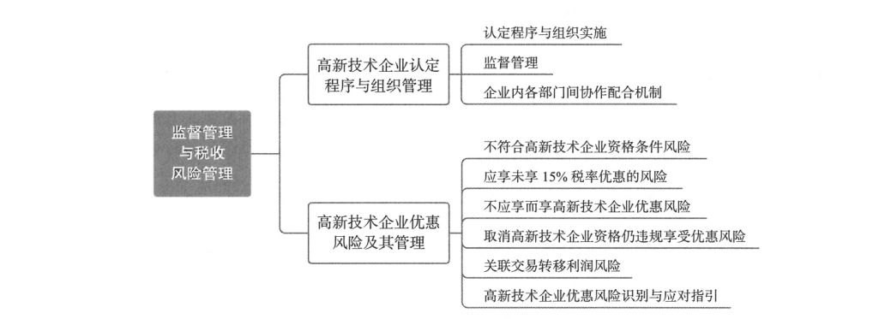
图 8-1 监督管理与税收风险管理

<!-- PDF 第 335 页（页眉：| 研发费用加计扣除与高新技术企业优惠实务及案例 |；页脚：316） -->
## 第一节 高新技术企业认定程序与组织管理

### 一、认定程序与组织实施

高新技术企业认定管理工作应遵循突出企业主体、鼓励技术创新、实施动态管理、坚持公平公正的原则。高新技术企业认定程序包括企业申请、专家评审和审查认定。

#### （一）企业申请

企业对照《高新技术企业认定管理办法》进行自我评价。认为符合认定条件的在“高新技术企业认定管理工作网”注册登记，向认定机构提出认定申请。

企业申请可以进一步细分为自我评价、注册登记和提交材料。

##### 1.自我评价

企业应对照《高新技术企业认定管理办法》和《高新技术企业认定管理工作指引》进行自我评价。认为符合条件的，按照《高新技术企业认定管理办法》《高新技术企业认定管理工作指引》等有关规定准备企业申请材料以及参与本企业认定审计或鉴证工作的中介机构的资质条件证明材料。

##### 2.注册登记

企业登录“高新技术企业认定管理工作网”（http://www.innocom.gov.cn）或者科学技术部政务服务平台（https://fuwu.most.gov.cn），按要求填写《企业注册登记表》，并通过网络系统提交至认定机构。认定机构核对企业注册信息，在网络系统

<!-- PDF 第 336 页（页眉：| 第八章 监督管理与税收风险管理 |；页脚：317） -->
上确认激活后，即可开展后续申报工作。

##### 3.提交材料

企业登录“高新技术企业认定管理工作网”，按要求填写《高新技术企业认定申请书》，通过网络系统提交至认定机构，并向认定机构提交下列书面材料：

（1）《高新技术企业认定申请书》（在线打印并签名、加盖企业公章）。

（2）证明企业依法成立的《营业执照》等相关注册登记证件的复印件。

（3）知识产权相关材料（知识产权证书及反映技术水平的证明材料、参与制定标准情况等）、科研项目立项证明（已验收或结题项目需附验收或结题报告）、科技成果转化（总体情况与转化形式、应用成效的逐项说明）、研究开发组织管理（总体情况与四项指标符合情况的具体说明）等相关材料。

（4）企业高新技术产品（服务）的关键技术和技术指标的具体说明，相关的生产批文、认证认可和资质证书、产品质量检验报告等材料。

（5）企业职工和科技人员情况说明材料，包括在职、兼职和临时聘用人员人数、人员学历结构、科技人员名单及其工作岗位等。

（6）经具有资质并符合《高新技术企业认定管理工作指引》相关条件的中介机构出具的企业近三个会计年度（实际年限不足三年的按实际经营年限，下同）研究开发费用、近一个会计年度高新技术产品（服务）收入专项审计或鉴证报告，并附研究开发活动说明材料。

（7）经具有资质的中介机构鉴证的企业近三个会计年度的财务会计报告（包括会计报表、会计报表附注和财务情况说明书）。

（8）近三个会计年度企业所得税年度纳税申报表（包括主表及附表）。

对涉密企业，须将申请认定高新技术企业的申报材料做脱密处理，以确保涉密信息安全。

#### （二）专家评审

认定机构应在符合评审要求的专家中，随机抽取组成专家组。专家组对企业申报材料进行评审，提出评审意见。

认定机构收到企业申请材料后，根据企业主营产品（服务）的核心技术所属技

<!-- PDF 第 337 页（页眉：研发费用加计扣除与高新技术企业优惠实务及案例 |；页脚：318） -->
术领域，在符合评审要求的专家中随机抽取专家组成专家组，对每个企业的评审专家不少于5人（其中技术专家不少于60%，并至少有1名财务专家）。每名技术专家单独填写《高新技术企业认定技术专家评价表》，每名财务专家单独填写《高新技术企业认定财务专家评价表》，专家组组长汇总各位专家分数，按分数平均值填写《高新技术企业认定专家组综合评价表》。具备条件的地区可进行网络评审。

#### （三）审查认定

认定机构结合专家组评审意见，对申请企业进行综合审查，提出认定意见并报领导小组办公室。认定企业由领导小组办公室在“高新技术企业认定管理工作网”公示10个工作日，无异议的，予以备案，并在“高新技术企业认定管理工作网”公告，由认定机构向企业颁发统一印制的“高新技术企业证书”（加盖××工业和信息化厅、××省财政厅、国家税务总局××省税务局印章）；有异议的，由认定机构进行核实处理。有异议且提供说明材料不被领导小组办公室认可的，不予备案。

审查认定具体可细分为认定报备和公示公告。

##### 1.认定报备

认定机构结合专家组评审意见，对申请企业申报材料进行综合审查（可视情况对部分企业进行实地核查），提出认定意见，确定认定高新技术企业名单，报领导小组办公室备案，报送时间不得晚于每年11月底。

##### 2.公示公告

经认定报备的企业名单，由领导小组办公室在“高新技术企业认定管理工作网”公示10个工作日。无异议的，予以备案，认定时间以公示时间为准，核发证书编号，并在“高新技术企业认定管理工作网”上公告企业名单，由认定机构向企业颁发统一印制的“高新技术企业证书”（加盖认定机构经信、财政、税务部门公章）；有异议的，须以书面形式实名向领导小组办公室提出，由认定机构核实处理。

领导小组办公室对报备企业可进行随机抽查，对存在问题的企业交由认定机构核实情况并提出处理建议。

<!-- PDF 第 338 页（页眉：| 第八章 监督管理与税收风险管理 |；页脚：319） -->
#### （四）认定组织与实施

工业和信息化部、财政部、税务总局负责全国高新技术企业认定工作的指导、管理和监督。

##### 1.领导小组

工业和信息化部、财政部、税务总局组成全国高新技术企业认定管理工作领导小组（以下称“领导小组”），其主要职责包括：

（1）确定全国高新技术企业认定管理工作方向，审议高新技术企业认定管理工作报告。

（2）协调、解决认定管理及相关政策落实中的重大问题。

（3）裁决高新技术企业认定管理事项中的重大争议，监督、检查各地区认定管理工作，对发现的问题指导整改。

##### 2.领导小组办公室

领导小组下设办公室，由工业和信息化部、财政部、税务总局相关人员组成，办公室设在工业和信息化部火炬高技术产业开发中心，其主要职责包括：

（1）提交高新技术企业认定管理工作报告，研究提出政策完善建议。

（2）指导各地区高新技术企业认定管理工作，组织开展对高新技术企业认定管理工作的监督检查，对发现的问题提出整改处理建议。

（3）负责各地区高新技术企业认定工作的备案管理，公布认定的高新技术企业名单，核发高新技术企业证书编号。

（4）建设并管理“高新技术企业认定管理工作网”（http://www.innocom.gov.cn/）。

（5）完成领导小组交办的其他工作。

全国高新技术企业认定管理工作领导小组办公室设在工业和信息化部，由工业和信息化部、财政部、税务总局相关人员组成，负责处理日常工作。

##### 3.认定机构

各省、自治区、直辖市、计划单列市工业和信息化部门同本级财政、税务部门组成本地区高新技术企业认定管理机构（以下称“认定机构”）。认定机构下设办公室，由省级、计划单列市工信、财政、税务部门相关人员组成，办公室设在省级、

<!-- PDF 第 339 页（页眉：研发费用加计扣除与高新技术企业优惠实务及案例 |；页脚：320） -->
计划单列市工信主管部门。认定机构组成部门应协同配合、认真负责地开展高新技术企业认定管理工作。

认定机构主要职责包括：

（1）负责本行政区域内的高新技术企业认定工作，每年向领导小组办公室提交本地区高新技术企业认定管理工作报告。

（2）负责将认定后的高新技术企业按要求报领导小组办公室备案，对通过备案的企业颁发高新技术企业证书。

（3）负责遴选参与认定工作的评审专家（包括技术专家和财务专家），并加强监督管理。

（4）负责对已认定企业进行监督检查，受理、核实并处理复核申请及有关举报等事项，落实领导小组及其办公室提出的整改建议。

（5）完成领导小组办公室交办的其他工作。

##### 4.中介机构

专项审计报告或鉴证报告（以下统称“专项报告”）应由符合条件的中介机构出具。企业可自行选择符合条件的中介机构。中介机构应符合的条件包括：

（1）具备独立执业资格，成立三年以上，近三年内无不良记录。

（2）承担认定工作当年的注册会计师或税务师人数占职工全年月平均人数的比例不低于30%，全年月平均在职职工人数在20人以上。

（3）相关人员应具有良好的职业道德，了解国家科技、经济及产业政策，熟悉高新技术企业认定工作有关要求。

中介机构接受企业委托后，应委派具备资格的相关人员，依据《高新技术企业认定管理办法》和《高新技术企业认定管理工作指引》客观公正地对企业的研究开发费用和高新技术产品（服务）收入进行专项审计或鉴证，出具专项报告。

中介机构及相关人员应坚持原则，办事公正，据实出具专项报告，对工作中出现严重失误或弄虚作假等行为的，由认定机构在“高新技术企业认定管理工作网”上公告，自公告之日起三年内不得参与高新技术企业认定相关工作。

##### 5.专家

专家应具备如下条件：

<!-- PDF 第 340 页（页眉：| 第八章 监督管理与税收风险管理 |；页脚：321） -->
（1）具有中华人民共和国公民资格，并在中国大陆境内居住和工作。

（2）技术专家应具有高级技术职称，并具有相关技术领域内的专业背景和实践经验，对该技术领域的发展及市场状况有较全面的了解。财务专家应具有相关高级技术职称，或具有注册会计师或税务师资格且从事财税工作10年以上。

（3）具有良好的职业道德，坚持原则，办事公正。

（4）了解国家科技、经济及产业政策，熟悉高新技术企业认定工作有关要求。

专家库及专家选取办法是：

（1）认定机构应建立专家库（包括技术专家和财务专家），实行专家聘任制和动态管理，备选专家应不少于评审专家的3倍。

（2）认定机构根据企业主营产品（服务）的核心技术所属技术领域随机抽取专家，组成专家组，并指定1名技术专家担任专家组组长，开展认定评审工作。

专家的职责包括：

（1）审查企业的研究开发活动（项目）、年度财务会计报告和专项报告等是否符合《高新技术企业认定管理办法》及《高新技术企业认定管理工作指引》的要求。

（2）按照《高新技术企业认定管理办法》及《高新技术企业认定管理工作指引》的规定，对企业申报信息进行独立评价。技术专家应主要侧重对企业知识产权、研究开发活动、主营业务、成果转化及高新技术产品（服务）等情况进行评价打分；财务专家应参照中介机构提交的专项报告、企业的财务会计报告和纳税申报表等进行评价打分。

（3）在各评审专家独立评价的基础上，由专家组进行综合评价。

专家的纪律为：

（1）应按照规定，独立、客观、公正地对企业进行评价，并签订承诺书。

（2）评审与其有利益关系的企业时，应主动申明并回避。

（3）不得披露、使用申请企业的技术经济信息和商业秘密，不得复制保留或向他人扩散评审材料，不得泄露评审结果。

（4）不得利用其特殊身份和影响，采取非正常手段为申请企业认定提供便利。

（5）认定评审期间，未经认定机构许可不得擅自与企业联系或进入企业调查。

<!-- PDF 第 341 页（页眉：研发费用加计扣除与高新技术企业优惠实务及案例 |；页脚：322） -->
（6）不得收受申请企业给予的好处和利益。

一经发现违反上述规定，由认定机构取消其参与高新技术企业认定工作的资格。

### 二、监督管理

#### （一）随机抽查和重点检查

##### 1.随机抽查和重点检查机制

工业和信息化部、财政部、税务总局建立随机抽查和重点检查机制，加强对各地高新技术企业认定管理工作的监督检查。对存在问题的认定机构提出整改意见并限期改正，对问题严重的给予通报批评，对逾期不改的暂停其认定管理工作。

##### 2.重点检查

根据认定管理工作需要，工业和信息化部、财政部、税务总局可组织专家对各地高新技术企业认定管理工作进行重点检查，对存在问题的视情况给予相应处理。

#### （二）企业年报

##### 1.企业应按年报告年度发展情况

《高新技术企业认定管理办法》（国科发火〔2016〕32号）第十三条规定，企业获得高新技术企业资格后，应每年5月底前在“高新技术企业认定管理工作网”填报上一年度知识产权、科技人员、研发费用、经营收入等年度发展情况报表。

##### 2.未按规定报送年报的处理

根据《高新技术企业认定管理工作指引》第五条第（二）项的规定，企业获得高新技术企业资格后，在其资格有效期内应每年5月底前通过“高新技术企业认定管理工作网”报送上一年度知识产权、科技人员、研发费用、经营收入等年度发展情况报表；在同一高新技术企业资格有效期内，企业累计两年未按规定时限报送年度发展情况报表的，由认定机构取消其高新技术企业资格，并在“高新技术企业认定管理工作网”上公告。

<!-- PDF 第 342 页（页眉：| 第八章 监督管理与税收风险管理 |；页脚：323） -->
认定机构应提醒、督促企业及时填报年度发展情况报表，并协助企业处理填报过程中的相关问题。

#### （三）更名与重大变化

##### 1.更名与重大变化的报告

《高新技术企业认定管理办法》第十七条规定，高新技术企业发生更名或与认定条件有关的重大变化（如分立、合并、重组以及经营业务发生变化等）应在三个月内向认定机构报告。经认定机构审核符合认定条件的，其高新技术企业资格不变，对于企业更名的，重新核发认定证书，编号与有效期不变；不符合认定条件的，自更名或条件变化年度起取消其高新技术企业资格。

根据《高新技术企业认定管理工作指引》第五条第（四）项的规定，高新技术企业发生名称变更或与认定条件有关的重大变化（如分立、合并、重组以及经营业务发生变化等），应在发生之日起三个月内向认定机构报告，在“高新技术企业认定管理工作网”上提交《高新技术企业名称变更申请表》，并将打印出的《高新技术企业名称变更申请表》与相关证明材料报认定机构，由认定机构负责审核企业是否仍符合高新技术企业条件。

企业仅发生名称变更，不涉及重大变化，符合高新技术企业认定条件的，由认定机构在本地区公示10个工作日，无异议的，由认定机构重新核发认定证书，编号与有效期不变，并在“高新技术企业认定管理工作网”上公告；有异议的或有重大变化的（无论名称变更与否），由认定机构按《高新技术企业认定管理办法》第十一条进行核实处理，不符合认定条件的，自更名或条件变化年度起取消其高新技术企业资格，并在“高新技术企业认定管理工作网”上公告。

##### 2.更名后重新认定应提交的申报材料

高新技术企业发生更名情况后，应提交下述申报材料：

（1）高新技术企业名称变更申请书（系统打印、法人签字、企业盖公章）。

（2）工商管理部门出具的核准变更通知书及其他名称变更证明文件。

（3）企业更名前后的营业执照副本复印件。

（4）原高新技术企业证书复印件。

<!-- PDF 第 343 页（页眉：研发费用加计扣除与高新技术企业优惠实务及案例 |；页脚：324） -->
（5）企业名称变更当年的企业职工和科技人员情况说明（包括名称变更前后企业职工总数、科技人员数及其所占比例）。

（6）企业拥有的核心自主知识产权（包括申报高新技术企业时所列知识产权及其他知识产权）情况的证明材料。

（7）企业名称变更当年的年度研发项目情况表和高新技术产品（服务）情况表。

（8）经具有资质中介机构审计的企业名称变更当年的年度财务审计报表（含会计报表、会计报表附注、财务情况说明书）。

（9）经具有资质中介机构审计的企业名称变更当年年度研究开发费用和高新技术产品（服务）收入专项审计报告。

（10）企业名称变更当年企业所得税年度纳税申报表，包括主表及附表。

##### 3.未按规定报告的处理

根据《高新技术企业认定管理办法》第十九条的规定，未按期报告与认定条件有关重大变化情况，或累计两年未填报年度发展情况报表的，由认定机构取消其高新技术企业资格。

#### （四）异地迁移或搬迁

《高新技术企业认定管理办法》第十八条规定，跨认定机构管理区域整体迁移的高新技术企业，在其高新技术企业资格有效期内完成迁移的，其资格继续有效；跨认定机构管理区域部分搬迁的，由迁入地认定机构按照该办法重新认定。

根据《高新技术企业认定管理工作指引》第五条第（五）项的规定，整体迁移，是指符合《公司登记管理条例》（自2022年3月1日起被《市场主体登记管理条例》废止）第二十九条（即公司变更住所的，应当在迁入新住所前申请变更登记，并提交新住所使用证明。公司变更住所跨公司登记机关辖区的，应当在迁入新住所前向迁入地公司登记机关申请变更登记；迁入地公司登记机关受理的，由原公司登记机关将公司登记档案移送迁入地公司登记机关）所述情况。

《市场主体登记管理条例》第二十七条规定，市场主体变更住所或者主要经营场所跨登记机关辖区的，应当在迁入新的住所或者主要经营场所前，向迁入地登记机关申请变更登记。迁出地登记机关无正当理由不得拒绝移交市场主体档案等

<!-- PDF 第 344 页（页眉：| 第八章 监督管理与税收风险管理 |；页脚：325） -->
相关材料。

跨认定机构管理区域整体迁移的高新技术企业须向迁入地认定机构提交有效期内的《高新技术企业证书》及迁入地工商等登记管理机关核发的完成迁入的相关证明材料。

完成整体迁移的，其高新技术企业资格和《高新技术企业证书》继续有效，编号与有效期不变。由迁入地认定机构给企业出具证明材料，并在“高新技术企业认定管理工作网”上公告。

#### （五）复核、核实与审核

##### 1.复核申请与处理

《高新技术企业认定管理办法》第十六条规定，对已认定的高新技术企业，有关部门在日常管理过程中发现其不符合认定条件的，应提请认定机构复核。复核后确认不符合认定条件的，由认定机构取消其高新技术企业资格，并通知税务机关追缴其不符合认定条件年度起已享受的税收优惠。

根据《高新技术企业认定管理工作指引》第五条第（三）项的规定，对已认定的高新技术企业，有关部门在日常管理过程中发现其不符合认定条件的，应以书面形式提请认定机构复核。复核后确认不符合认定条件的，由认定机构取消其高新技术企业资格，并通知税务机关追缴其不符合认定条件年度起已享受的税收优惠。

属于对是否符合《高新技术企业认定管理办法》第十一条 [ 认定条件，第（五）项研发费用占比条件除外 ] 、第十七条（更名或重大变化）、第十八条（整体迁移或部分搬迁）和第十九条（取消高新技术企业资格）情况的企业，按《高新技术企业认定管理办法》规定办理；属于对是否符合第十一条第（五）项（研发费用占比）条件产生异议的，应以问题所属年度和前两个会计年度（实际经营不满三年的按实际经营时间计算）的研究开发费用总额与同期销售收入总额之比是否符合该办法第十一条第（五）项规定进行复核。

##### 2.公示有异议的核实处理

《高新技术企业认定管理办法》第十二条规定，认定机构结合专家组评审意见，

<!-- PDF 第 345 页（页眉：| 研发费用加计扣除与高新 技术企业优惠实务及案例 |；页脚：326） -->
对申请企业进行综合审查，提出认定意见并报领导小组办公室。认定企业由领导小组办公室在“高新技术企业认定管理工作网”公示10个工作日，无异议的，予以备案，并在“高新技术企业认定管理工作网”公告，由认定机构向企业颁发统一印制的“高新技术企业证书”；有异议的，由认定机构进行核实处理。

##### 3.发生重大变化后的审核处理

《高新技术企业认定管理办法》第十七条规定，高新技术企业发生更名或与认定条件有关的重大变化（如分立、合并、重组以及经营业务发生变化等）应在三个月内向认定机构报告。经认定机构审核符合认定条件的，其高新技术企业资格不变，对于企业更名的，重新核发认定证书，编号与有效期不变；不符合认定条件的，自更名或条件变化年度起取消其高新技术企业资格。

#### （六）高新技术企业资格的取消

##### 1.应取消高新技术企业资格的情形

自2016年1月1日起，根据《高新技术企业认定管理办法》第十九条的规定，已认定的高新技术企业有下列行为之一的，由认定机构取消其高新技术企业资格：

（1）在申请认定过程中存在严重弄虚作假行为的；

（2）发生重大安全、重大质量事故或有严重环境违法行为的；

（3）未按期报告与认定条件有关重大变化情况，或累计两年未填报年度发展情况报表的。

对被取消高新技术企业资格的企业，由认定机构通知税务机关按《税收征收管理法》及有关规定，追缴其自发生上述行为之日所属年度起已享受的高新技术企业税收优惠。

《高新技术企业认定管理工作指引》第五条第（六）项明确：

（1）有《高新技术企业认定管理办法》第十九条所列三种行为之一的企业，自行为发生之日所属年度起取消其高新技术企业资格，并在“高新技术企业认定管理工作网”上公告。

（2）认定机构应依据有关部门根据相关法律法规出具的意见对“重大安全、重大质量事故或有严重环境违法行为”进行判定处理。

<!-- PDF 第 346 页（页眉：| 第八章 监督管理与税收风险管理 |；页脚：327） -->
（3）认定的高新技术企业，无论何种原因被取消高新技术企业资格的，当年不得再次申请高新技术企业认定。

新老政策关于取消高新技术企业资格的情形规定有所不同，如表8-1所示。

表 8-1 应取消高新技术企业资格的情形

| 自2016年起，国科发火〔2016〕32号 | 2016年以前，国科发火〔2008〕172号 | 修改内容 |
| --- | --- | --- |
| 第十九条已认定的高新技术企业有下列行为之一的，由认定机构取消其高新技术企业资格 | 第十五条 已认定的高新技术企业有下述情况之一的，应取消其资格 | |
| （一）在申请认定过程中存在严重弄虚作假行为的 | （一）在申请认定过程中提供虚假信息的 | |
| | （二）有偷、骗税等行为的 | 删除“有偷、骗税等行为的”取消资格规定 |
| （二）发生重大安全、重大质量事故或有严重环境违法行为的 | （三）发生重大安全、质量事故的 | |
| | （四）有环境等违法、违规行为，受到有关部门处罚的 | |
| （三）未按期报告与认定条件有关重大变化情况，或累计两年未填报年度发展情况报表的 | | 增加将被取消资格的报告和填报要求 |
| 对被取消高新技术企业资格的企业，由认定机构通知税务机关按《税收征收管理法》及有关规定，追缴其自发生上述行为之日所属年度起已享受的高新技术企业税收优惠 | 被取消高新技术企业资格的企业，认定机构在5年内不再受理该企业的认定申请 | 修改被取消高企资格的后果 |

##### 2.重大变化审核后取消高新技术企业资格

根据《高新技术企业认定管理办法》第十七条的规定，高新技术企业发生与认定条件有关的重大变化（如分立、合并、重组以及经营业务发生变化等）应在三个月内向认定机构报告。经认定机构审核符合认定条件的，其高新技术企业资格不变；不符合认定条件的，自条件变化年度起取消其高新技术企业资格。

<!-- PDF 第 347 页（页眉：| 研发费用加计扣除与高新 技术企业优惠实务及案例 |；页脚：328） -->
##### 3.经复核确认不符合条件而取消资格

《高新技术企业认定管理办法》第十六条规定，对已认定的高新技术企业，有关部门在日常管理过程中发现其不符合认定条件的，应提请认定机构复核。复核后确认不符合认定条件的，由认定机构取消其高新技术企业资格，并通知税务机关追缴其不符合认定条件年度起已享受的税收优惠。

#### （七）税务机关的日常管理

根据《国家税务总局关于实施高新技术企业所得税优惠政策有关问题的公告》（国家税务总局公告2017年第24号）第二条的规定，对取得高新技术企业资格且享受税收优惠的高新技术企业，税务部门如在日常管理过程中发现其在高新技术企业认定过程中或享受优惠期间不符合《高新技术企业认定管理办法》第十一条规定的认定条件，应提请认定机构复核。复核后确认不符合认定条件的，由认定机构取消其高新技术企业资格，并通知税务机关追缴其证书有效期内自不符合认定条件年度起已享受的税收优惠。

##### 1.后续管理范围

2016版《高新技术企业认定管理办法》出台以后，税务机关和纳税人对高新技术企业在享受优惠期间是否需要符合认定条件存在较大的争议。《高新技术企业认定管理办法》第十六条中所称“认定条件”是较为宽泛的概念，既包括高新技术企业认定时的条件，也包括享受税收优惠期间的条件。因此，国家税务总局公告2017年第24号将税务机关后续管理的范围明确为高新技术企业认定过程中和享受优惠期间，统一了管理范围，明确了工作职责。

##### 2.后续管理程序

2016年以前，按照《国家税务总局关于实施高新技术企业所得税优惠有关问题的通知》（国税函〔2009〕203号）的规定，税务部门发现高新技术企业不符合优惠条件的，可以追缴高新技术企业已减免的企业所得税税款，但不取消其高新技术企业资格。按照2016版《高新技术企业认定管理办法》第十六条的规定，国家税务总局公告2017年第24号对国税函〔2009〕203号文件的后续管理程序进行了调整，即税务机关如发现高新技术企业不符合认定条件的，应提请认定机构复核。复核后确

<!-- PDF 第 348 页（页眉：| 第八章 监督管理与税收风险管理 |；页脚：329） -->
认不符合认定条件的，由认定机构取消其高新技术企业资格后，通知税务机关追缴税款。

##### 3.追缴税款期限

为统一政策执行口径，国家税务总局公告2017年第24号将《高新技术企业认定管理办法》第十六条中的追缴期限“不符合认定条件年度起”明确为“证书有效期内自不符合认定条件年度起”，避免因为理解偏差导致扩大追缴期限，切实保障纳税人的合法权益。

### 三、企业内各部门间协作配合机制

企业应确定一名分管经理牵头，总体协调研发部门、财务部门、人事行政部门、市场销售部门、物资管理部门等，相互配合，共同推进。

研发部：根据企业业务需要，及时编写研发项目（R&D）立项书并实施；做好科技成果的登记、监测和转化，确保平均每年成果转化5个以上；根据研发项目取得成果情况，及时申报专利，每年申请专利2个以上，授权专利2个以上，做好国家/行业标准、规范及时备案，做好技术合同登记、成果鉴定、项目验收等工作；做好新产品/服务的报告检测、销售/服务合同签订、产品说明书发布，收集好用户使用反馈；按要求编写研发项目绩效说明，根据项目完成情况形成知识产权。

财务部：应建立《科研项目会计联络单》，牵头建立研发费支出辅助账。按季度、年度监测企业研发费占比，确保三年研发费投入总和占三年销售收入总和的比例达标；配合人事部门监控科技人员占比，按年度统计监测，确保科技人员占职工总数比例达10%以上；配合市场部监控高新技术产品/服务收入占比，按季度统计监测，确保最近一年高新技术产品/服务收入占最近一年总收入的60%以上。

人事部：做好科技人员（包括工作达到183天以上的兼职人员）的考勤工作，配合财务部监控科技人员占比，科技人员按季度、年度监测统计，同步统计好企业职工总数清单，确保科技人员占职工总数的10%以上。

库管：分项目建立耗材领用单，耗材费用单据符合财务要求。

市场部：配合财务部监控高新技术产品/服务收入。按季统计确保最近一年高

<!-- PDF 第 349 页（页眉：| 研发费用加计扣除与高新 技术企业优惠实务及案例 |；页脚：330） -->
新技术产品/服务收入占总收入的60%以上；配合研发部做好技术合同登记、成果鉴定、项目验收等工作，建议每年登记的技术合同、成果鉴定、项目验收等达到5项以上。

每年都要进行财务年度审计报告（包括附注、财务情况说明书）和研发费专项审计报告，科技人员统计（注意占比）；并满足高新技术企业的指标要求。

企业所得税年度纳税申报表（特别注意主表、期间费用表、高新技术企业优惠情况及明细表、研发费用加计扣除优惠明细表的填报）。

<!-- PDF 第 350 页（页眉：| 第八章 监督管理与税收风险管理 |；页脚：331；装饰：节标题下有一条横线） -->
## 第二节 高新技术企业优惠风险及其管理

高新技术企业所得税优惠政策导向性强、优惠力度大，既是最重要的企业所得税优惠政策之一，也是内外部监督的关注重点。对高新技术企业所得税优惠管理，首要的是严格高新技术企业资格认定，在此基础上，充分利用信息化手段和部门共治等方式加强管理。常见风险点包括以下几方面。

### 一、不符合高新技术企业资格条件风险

#### （一）风险特征

申报认定高新技术企业资格年度，企业频繁更正近三年的年度企业所得税纳税申报表中的研发费用，存在利用虚假申报骗取高新技术企业资格和税收优惠的风险。

#### （二）风险识别

查看企业是否频繁更正近三年企业所得税年度纳税申报表附表《研发费用加计扣除优惠明细表》，特别是“年度研发费用”金额是否从无到有、异常增加。

### 二、应享未享15%税率优惠的风险

#### （一）风险特征

高新技术企业资格有效期内，符合条件但未享受15%税率优惠，存在应享未享

<!-- PDF 第 351 页（页眉：| 研发费用加计扣除与高新 技术企业优惠实务及案例 |；页脚：332） -->
税收优惠的风险。

#### （二）风险识别

查看企业所得税年度纳税申报表中的《企业所得税年度纳税申报基础信息表》“高新技术企业申报所属期年度有效的高新技术企业证书”信息，判断是否在有效期内；查看企业年度申报的《高新技术企业优惠情况及明细表》中“本年高新技术产品（服务）收入占企业总收入的比例”“本年科技人员占企业当年职工总数的比例”“三年研发费用占销售（营业）收入的比例”填报数据，判断是否符合享受优惠条件；查看企业年度申报是否享受了小型微利企业、西部大开发等同等力度或更大力度的优惠政策。

### 三、不应享而享高新技术企业优惠风险

#### （一）风险特征

企业申报的高新技术产品（服务）收入占比、科技人员占比、研发费用占比未达到规定标准，但享受了高新技术企业优惠，存在违规享受税收优惠的风险。

#### （二）风险识别

对申报享受高新技术企业优惠的纳税人，查看《高新技术企业优惠情况及明细表》中“本年高新技术产品（服务）收入占企业总收入的比例”“本年科技人员占企业当年职工总数的比例”“三年研发费用占销售（营业）收入的比例”填报数据，判断是否达到规定标准。查看合同和发票信息，核实是否存在人为调整高新产品收入占比的情形。

### 四、取消高新技术企业资格仍违规享受优惠风险

#### （一）风险特征

企业被取消高新技术企业资格后，仍继续享受高新技术企业优惠，存在违规享

<!-- PDF 第 352 页（页眉：| 第八章 监督管理与税收风险管理 |；页脚：333） -->
受优惠的风险。

#### （二）风险识别

根据本地区高新技术企业认定管理机构提供的取消高新技术企业资格名单，与企业所得税年度纳税申报表进行比对，查看是否被取消资格后仍继续享受高新技术企业优惠、是否追缴税款。税务机关应自高新技术企业被取消资格之日起30个工作日内追缴税款。

### 五、关联交易转移利润风险

#### （一）风险特征

高新技术企业与非高新技术企业间通过关联交易转移利润，存在少缴企业所得税的风险。

#### （二）风险识别

筛查高新技术企业开具或取得发票金额占比偏高（如50%以上）的上下游企业名单，与企业报送的《关联业务往来报告表》进行比对，如果上下游企业属于关联企业，并且高新技术企业利润率较行业平均利润率偏高（如50%以上），则可能存在转移利润、利用低税率少缴企业所得税的风险。

### 六、高新技术企业优惠风险识别与应对指引

#### （一）识别指标与风险描述

（1）本年（2023年）研究费用=0（在2023年度“期间费用明细表”研究费用为空值的时候，取本年度归集的高新研发费用金额=0），且2022年度研究费用=0，2021年度研究费用=0，高新技术企业证书发证时间1（或者发证时间2）中的年份数+3大于2023。

<!-- PDF 第 353 页（页眉：| 研发费用加计扣除与高新技术企业优惠实务及案例 |；页脚：334） -->
（2）本年高新技术产品（服务）收入/（营业收入+投资收益+营业外收入+收入类调整项目调增金额-收入类调整项目不征税收入调减金额）（总收入=收入总额-不征税收入）<60%。

（3）研发费用占比=归集的近三年高新研发费用金额合计/[本年销售（营业）收入+前一年度营业收入+前二年度营业收入]<预警值（5%、4%、3%）。

（4）表A107041第25行“委托外部研发费用”/表A107041第26行+第28行>预警值80%。

#### （二）风险应对指引

##### 1.案头审核

（1）核实企业金三系统中企业所得税年度纳税申报表、财务报表是否填报完整。

（2）核实企业金三系统申报数据是否与风险识别信息一致。

（3）核实企业的高新技术企业资格是否有效，是否享受高新技术企业所得税优惠。

##### 2.询问约谈资料要求（报送资料）

（1）高新技术企业资格证书。

（2）高新技术企业认定资料。

（3）知识产权相关材料。

（4）对主要产品（服务）发挥核心支持作用的技术属于《国家重点支持的高新技术领域》规定范围的说明，高新技术产品（服务）及对应收入资料。

（5）年度职工和科技人员情况证明材料。

（6）当年和前两个会计年度研发费用总额及占同期销售收入比例、研发费用管理资料以及研发费用辅助账，研发费用结构明细表。

##### 3.核查内容

（1）核查企业高新技术企业认定和享受税收优惠期间，其各项认定条件是否符合相关规定，比如科技人员、高新技术产品（服务）收入、研发费用占比、总收入的确认和归集是否符合要求。

（2）核查企业研发活动中直接投入费用的认定和分配是否有可靠依据，是否存在虚增高新研发费用风险。

<!-- PDF 第 354 页（页眉：| 第八章 监督管理与税收风险管理 |；页脚：335） -->
（3）核查企业既用于生产经营，又用于研究开发活动的固定资产或无形资产的折旧或摊销额的分摊是否合理。

（4）核查企业委托开发合同或合作协议，分析合同或协议的实质性内容，判断是否真的是委托外部研发，项目成果是否为企业拥有，且与企业的主要经营业务紧密相关。

（5）核查企业“其他费用”明细，判断是否存在将业务招待费等费用也纳入核算，或者会议费、差旅费金额巨大且缺少相关佐证材料，无法确认是否为研发活动发生的情况。

（6）核查企业各研究开发项目的有关立项批复、实施方案、阶段性报告或工作总结、验收报告或政府有关主管部门的批复等，取得知识产权证书、生产批文、新产品或新技术证明、产品质量检验报告以及其他相关证明材料。

（7）对取得高新技术企业资格且享受税收优惠的高新技术企业，税务部门如在日常管理过程中发现其在高新技术企业认定过程中或享受优惠期间不符合《高新技术企业认定管理办法》第十一条规定的，应提请认定机构复核。复核后确认不符合认定条件的，由认定机构取消其高新技术企业资格，并通知税务机关追缴其证书有效期内自不符合认定条件年度起已享受的税收优惠。

### 七、高新技术企业优惠管理

高新技术企业优惠管理的具体做法如表8-2所示。

表 8-2 高新技术企业优惠管理

| 事项 | 阶段 | 省级税务机关 | 市级税务机关 | 县级税务机关 |
| --- | --- | --- | --- | --- |
| 高新技术企业优惠管理 | 事前 | 1.参与高新技术企业资格认定。2.进行高新技术企业名单动态管理。3.组织开展高新技术企业政策宣传辅导 | 组织开展本辖区高新技术企业政策宣传辅导 | 开展高新技术企业政策宣传及精准辅导 |

<!-- PDF 第 355 页（页眉：| 研发费用加计扣除与高新技术企业优惠实务及案例 |；页脚：336） -->
续表

| 事项 | 阶段 | 省级税务机关 | 市级税务机关 | 县级税务机关 |
| --- | --- | --- | --- | --- |
| 高新技术企业优惠管理 | 事中 | 1.对已申报企业，运用风险指标模型，比对分析企业所得税申报表、财务报表、关联报告表等，筛查并下发高新技术企业名单及主要风险点，组织开展事中风险管理，督促各地做好留痕管理。2.将高新技术企业优惠纳入年度抽核重点 | 1.组织开展高新技术企业事中风险管理，督促各地做好留痕管理。2.组织开展高新技术企业留存备查资料抽核工作 | 1.通过案头分析、约谈辅导、实地核查等方式，开展高新技术企业事中风险管理，重点核实不符合资格条件、应享未享、不应享而享、亏损结转有误、利用税负差转移利润等问题。2.对存在上述风险的，提示提醒企业更正申报。汇算清缴期结束后，仍未更正申报的转事后风险管理。3.按上级要求开展留存备查资料抽核工作。4.收集宣传辅导、放弃享受优惠书面声明等佐证材料 |
| | 事后 | 1.在事中风险管理的基础上，进一步扫描高新技术企业风险指标模型，开展风险分析，发起风险任务。2.组织开展高新技术企业风险应对，必要时提级管理，涉及高风险的，移交稽查。3.开展高新技术企业风险任务应对抽查复核工作，原则上不少于下发风险任务数量的3%。4.收集典型案例，完善风险指标模型。5.对不符合高新技术企业认定条件的，按规定提请认定机构复核。取消资格的，督促各地追缴税款 | 1.自行发起本级风险任务。2.督促指导县局开展风险应对，必要时提级管理，涉及高风险的，移交稽查。3.开展高新技术企业风险任务应对抽查复核工作，原则上不少于下发风险任务数量的5%。4.收集典型案例及风险指标完善建议并上报。5.对不符合高新技术企业认定条件的，收集佐证材料后上报；取消资格的，督促各地追缴税款 | 1.实施高新技术企业风险应对，重点核实内容同事中风险管理，并督促辅导企业更正申报；涉及高风险的，移交稽查。2.发现企业不符合高新技术企业认定条件的，收集佐证材料后逐级上报，取消资格的，30个工作日内追缴税款。3.完成宣传辅导、放弃享受优惠书面声明等佐证材料的收集 |

<!-- PDF 第 356 页（页眉：无；页脚：未显示；装饰：TAXING） -->
# 附  录 主要政策依据

<!-- PDF 第 357 页（页眉：无；页脚：无）（本页空白） -->

<!-- PDF 第 358 页（页眉：| 附  录 主要政策依据 |；页脚：339） -->
## 附录1 研发费用加计扣除政策

### 财政部 国家税务总局 科技部关于完善研究开发费用税前加计扣除政策的通知

（财税〔2015〕119号）

各省、自治区、直辖市、计划单列市财政厅（局）、国家税务局、地方税务局、科技厅（局），新疆生产建设兵团财务局、科技局：

根据《中华人民共和国企业所得税法》及其实施条例有关规定，为进一步贯彻落实《中共中央 国务院关于深化体制机制改革加快实施创新驱动发展战略的若干意见》精神，更好地鼓励企业开展研究开发活动（以下简称研发活动）和规范企业研究开发费用（以下简称研发费用）加计扣除优惠政策执行，现就企业研发费用税前加计扣除有关问题通知如下：

### 一、研发活动及研发费用归集范围

本通知所称研发活动，是指企业为获得科学与技术新知识，创造性运用科学技术新知识，或实质性改进技术、产品（服务）、工艺而持续进行的具有明确目标的系统性活动。

#### （一）允许加计扣除的研发费用

企业开展研发活动中实际发生的研发费用，未形成无形资产计入当期损益的，在按规定据实扣除的基础上，按照本年度实际发生额的50%，从本年度应纳税所得

<!-- PDF 第 359 页（页眉：| 研发费用加计扣除与高新技术企业优惠实务及案例 |；页脚：340） -->
额中扣除；形成无形资产的，按照无形资产成本的150%在税前摊销。研发费用的具体范围包括：

1.人员人工费用。

直接从事研发活动人员的工资薪金、基本养老保险费、基本医疗保险费、失业保险费、工伤保险费、生育保险费和住房公积金，以及外聘研发人员的劳务费用。

2.直接投入费用。

（1）研发活动直接消耗的材料、燃料和动力费用。

（2）用于中间试验和产品试制的模具、工艺装备开发及制造费，不构成固定资产的样品、样机及一般测试手段购置费，试制产品的检验费。

（3）用于研发活动的仪器、设备的运行维护、调整、检验、维修等费用，以及通过经营租赁方式租入的用于研发活动的仪器、设备租赁费。

3.折旧费用。

用于研发活动的仪器、设备的折旧费。

4.无形资产摊销。

用于研发活动的软件、专利权、非专利技术（包括许可证、专有技术、设计和计算方法等）的摊销费用。

5.新产品设计费、新工艺规程制定费、新药研制的临床试验费、勘探开发技术的现场试验费。

6.其他相关费用。

与研发活动直接相关的其他费用，如技术图书资料费、资料翻译费、专家咨询费、高新科技研发保险费，研发成果的检索、分析、评议、论证、鉴定、评审、评估、验收费用，知识产权的申请费、注册费、代理费，差旅费、会议费等。此项费用总额不得超过可加计扣除研发费用总额的10%。

7.财政部和国家税务总局规定的其他费用。

#### （二）下列活动不适用税前加计扣除政策

1.企业产品（服务）的常规性升级。

2.对某项科研成果的直接应用，如直接采用公开的新工艺、材料、装置、产品、服务或知识等。

<!-- PDF 第 360 页（页眉：| 附  录 主要政策依据 |；页脚：341） -->
3.企业在商品化后为顾客提供的技术支持活动。

4.对现存产品、服务、技术、材料或工艺流程进行的重复或简单改变。

5.市场调查研究、效率调查或管理研究。

6.作为工业（服务）流程环节或常规的质量控制、测试分析、维修维护。

7.社会科学、艺术或人文学方面的研究。

### 二、特别事项的处理

1.企业委托外部机构或个人进行研发活动所发生的费用，按照费用实际发生额的80%计入委托方研发费用并计算加计扣除，受托方不得再进行加计扣除。委托外部研究开发费用实际发生额应按照独立交易原则确定。

委托方与受托方存在关联关系的，受托方应向委托方提供研发项目费用支出明细情况。

企业委托境外机构或个人进行研发活动所发生的费用，不得加计扣除。

2.企业共同合作开发的项目，由合作各方就自身实际承担的研发费用分别计算加计扣除。

3.企业集团根据生产经营和科技开发的实际情况，对技术要求高、投资数额大，需要集中研发的项目，其实际发生的研发费用，可以按照权利和义务相一致、费用支出和收益分享相配比的原则，合理确定研发费用的分摊方法，在受益成员企业间进行分摊，由相关成员企业分别计算加计扣除。

4.企业为获得创新性、创意性、突破性的产品进行创意设计活动而发生的相关费用，可按照本通知规定进行税前加计扣除。

创意设计活动是指多媒体软件、动漫游戏软件开发，数字动漫、游戏设计制作；房屋建筑工程设计（绿色建筑评价标准为三星）、风景园林工程专项设计；工业设计、多媒体设计、动漫及衍生产品设计、模型设计等。

### 三、会计核算与管理

1.企业应按照国家财务会计制度要求，对研发支出进行会计处理；同时，对享

<!-- PDF 第 361 页（页眉：研发费用加计扣除与高新技术企业优惠实务及案例；页脚：342） -->
受加计扣除的研发费用按研发项目设置辅助账，准确归集核算当年可加计扣除的各项研发费用实际发生额。企业在一个纳税年度内进行多项研发活动的，应按照不同研发项目分别归集可加计扣除的研发费用。

2.企业应对研发费用和生产费用分别核算，准确、合理归集各项费用支出，对划分不清的，不得实行加计扣除。

#### 四、不适用税前加计扣除政策的行业

1.烟草制造业。

2.住宿和餐饮业。

3.批发和零售业。

4.房地产业。

5.租赁和商务服务业。

6.娱乐业。

7.财政部和国家税务总局规定的其他行业。

上述行业以《国民经济行业分类与代码（GB/4754—2011）》为准，并随之更新。

#### 五、管理事项及征管要求

1.本通知适用于会计核算健全、实行查账征收并能够准确归集研发费用的居民企业。

2.企业研发费用各项目的实际发生额归集不准确、汇总额计算不准确的，税务机关有权对其税前扣除额或加计扣除额进行合理调整。

3.税务机关对企业享受加计扣除优惠的研发项目有异议的，可以转请地市级（含）以上科技行政主管部门出具鉴定意见，科技部门应及时回复意见。企业承担省部级（含）以上科研项目的，以及以前年度已鉴定的跨年度研发项目，不再需要鉴定。

4.企业符合本通知规定的研发费用加计扣除条件而在2016年1月1日以后未及时享受该项税收优惠的，可以追溯享受并履行备案手续，追溯期限最长为3年。

<!-- PDF 第 362 页（页眉：| 附 录 主要政策依据 |；页脚：343） -->
5.税务部门应加强研发费用加计扣除优惠政策的后续管理，定期开展核查，年度核查面不得低于20%。

#### 六、执行时间

本通知自2016年1月1日起执行。《国家税务总局关于印发〈企业研究开发费用税前扣除管理办法（试行）〉的通知》（国税发〔2008〕116号）和《财政部 国家税务总局关于研究开发费用税前加计扣除有关政策问题的通知》（财税〔2013〕70号）同时废止。

财政部 国家税务总局 科技部

2015年11月2日

### 国家税务总局关于研发费用税前加计扣除归集范围有关问题的公告

（国家税务总局公告2017年第40号）

为进一步做好研发费用税前加计扣除优惠政策的贯彻落实工作，切实解决政策落实过程中存在的问题，根据《财政部 国家税务总局 科技部关于完善研究开发费用税前加计扣除政策的通知》（财税〔2015〕119号）及《国家税务总局关于企业研究开发费用税前加计扣除政策有关问题的公告》（国家税务总局公告2015年第97号）等文件的规定，现就研发费用税前加计扣除归集范围有关问题公告如下：

#### 一、人员人工费用

指直接从事研发活动人员的工资薪金、基本养老保险费、基本医疗保险费、失业保险费、工伤保险费、生育保险费和住房公积金，以及外聘研发人员的劳务

<!-- PDF 第 363 页（页眉：研发费用加计扣除与高新技术企业优惠实务及案例；页脚：344） -->
费用。

（一）直接从事研发活动人员包括研究人员、技术人员、辅助人员。研究人员是指主要从事研究开发项目的专业人员；技术人员是指具有工程技术、自然科学和生命科学中一个或一个以上领域的技术知识和经验，在研究人员指导下参与研发工作的人员；辅助人员是指参与研究开发活动的技工。外聘研发人员是指与本企业或劳务派遣企业签订劳务用工协议（合同）和临时聘用的研究人员、技术人员、辅助人员。

接受劳务派遣的企业按照协议（合同）约定支付给劳务派遣企业，且由劳务派遣企业实际支付给外聘研发人员的工资薪金等费用，属于外聘研发人员的劳务费用。

（二）工资薪金包括按规定可以在税前扣除的对研发人员股权激励的支出。

（三）直接从事研发活动的人员、外聘研发人员同时从事非研发活动的，企业应对其人员活动情况做必要记录，并将其实际发生的相关费用按实际工时占比等合理方法在研发费用和生产经营费用间分配，未分配的不得加计扣除。

#### 二、直接投入费用

指研发活动直接消耗的材料、燃料和动力费用；用于中间试验和产品试制的模具、工艺装备开发及制造费，不构成固定资产的样品、样机及一般测试手段购置费，试制产品的检验费；用于研发活动的仪器、设备的运行维护、调整、检验、维修等费用，以及通过经营租赁方式租入的用于研发活动的仪器、设备租赁费。

（一）以经营租赁方式租入的用于研发活动的仪器、设备，同时用于非研发活动的，企业应对其仪器设备使用情况做必要记录，并将其实际发生的租赁费按实际工时占比等合理方法在研发费用和生产经营费用间分配，未分配的不得加计扣除。

（二）企业研发活动直接形成产品或作为组成部分形成的产品对外销售的，研发费用中对应的材料费用不得加计扣除。

产品销售与对应的材料费用发生在不同纳税年度且材料费用已计入研发费用

<!-- PDF 第 364 页（页眉：| 附 录 主要政策依据 |；页脚：345） -->
的，可在销售当年以对应的材料费用发生额直接冲减当年的研发费用，不足冲减的，结转以后年度继续冲减。

#### 三、折旧费用

指用于研发活动的仪器、设备的折旧费。

（一）用于研发活动的仪器、设备，同时用于非研发活动的，企业应对其仪器设备使用情况做必要记录，并将其实际发生的折旧费按实际工时占比等合理方法在研发费用和生产经营费用间分配，未分配的不得加计扣除。

（二）企业用于研发活动的仪器、设备，符合税法规定且选择加速折旧优惠政策的，在享受研发费用税前加计扣除政策时，就税前扣除的折旧部分计算加计扣除。

#### 四、无形资产摊销费用

指用于研发活动的软件、专利权、非专利技术（包括许可证、专有技术、设计和计算方法等）的摊销费用。

（一）用于研发活动的无形资产，同时用于非研发活动的，企业应对其无形资产使用情况做必要记录，并将其实际发生的摊销费按实际工时占比等合理方法在研发费用和生产经营费用间分配，未分配的不得加计扣除。

（二）用于研发活动的无形资产，符合税法规定且选择缩短摊销年限的，在享受研发费用税前加计扣除政策时，就税前扣除的摊销部分计算加计扣除。

#### 五、新产品设计费、新工艺规程制定费、新药研制的临床试验费、勘探开发技术的现场试验费

指企业在新产品设计、新工艺规程制定、新药研制的临床试验、勘探开发技术的现场试验过程中发生的与开展该项活动有关的各类费用。

<!-- PDF 第 365 页（页眉：研发费用加计扣除与高新技术企业优惠实务及案例；页脚：346） -->
#### 六、其他相关费用

指与研发活动直接相关的其他费用，如技术图书资料费、资料翻译费、专家咨询费、高新科技研发保险费，研发成果的检索、分析、评议、论证、鉴定、评审、评估、验收费用，知识产权的申请费、注册费、代理费，差旅费、会议费，职工福利费、补充养老保险费、补充医疗保险费。

此类费用总额不得超过可加计扣除研发费用总额的10%。

#### 七、其他事项

（一）企业取得的政府补助，会计处理时采用直接冲减研发费用方法且税务处理时未将其确认为应税收入的，应按冲减后的余额计算加计扣除金额。

（二）企业取得研发过程中形成的下脚料、残次品、中间试制品等特殊收入，在计算确认收入当年的加计扣除研发费用时，应从已归集研发费用中扣减该特殊收入，不足扣减的，加计扣除研发费用按零计算。

（三）企业开展研发活动中实际发生的研发费用形成无形资产的，其资本化的时点与会计处理保持一致。

（四）失败的研发活动所发生的研发费用可享受税前加计扣除政策。

（五）国家税务总局公告2015年第97号第三条所称“研发活动发生费用”是指委托方实际支付给受托方的费用。无论委托方是否享受研发费用税前加计扣除政策，受托方均不得加计扣除。

委托方委托关联方开展研发活动的，受托方需向委托方提供研发过程中实际发生的研发项目费用支出明细情况。

#### 八、执行时间和适用对象

本公告适用于2017年度及以后年度汇算清缴。以前年度已经进行税务处理的不再调整。涉及追溯享受优惠政策情形的，按照本公告的规定执行。科技型中小企业

<!-- PDF 第 366 页（页眉：| 附 录 主要政策依据 |；页脚：347） -->
研发费用加计扣除事项按照本公告执行。

国家税务总局公告2015年第97号第一条、第二条第（一）项、第二条第（二）项、第二条第（四）项同时废止。

国家税务总局

2017年11月8日

### 财政部 税务总局 科技部关于企业委托境外研究开发费用税前加计扣除有关政策问题的通知

（财税〔2018〕64号）

各省、自治区、直辖市、计划单列市财政厅（局）、科技厅（局），国家税务总局各省、自治区、直辖市、计划单列市税务局，新疆生产建设兵团财政局、科技局：

为进一步激励企业加大研发投入，加强创新能力开放合作，现就企业委托境外进行研发活动发生的研究开发费用（以下简称研发费用）企业所得税前加计扣除有关政策问题通知如下：

一、委托境外进行研发活动所发生的费用，按照费用实际发生额的80%计入委托方的委托境外研发费用。委托境外研发费用不超过境内符合条件的研发费用三分之二的部分，可以按规定在企业所得税前加计扣除。

上述费用实际发生额应按照独立交易原则确定。委托方与受托方存在关联关系的，受托方应向委托方提供研发项目费用支出明细情况。

二、委托境外进行研发活动应签订技术开发合同，并由委托方到科技行政主管部门进行登记。相关事项按技术合同认定登记管理办法及技术合同认定规则执行。

三、企业应在年度申报享受优惠时，按照《国家税务总局关于发布修订后的〈企业所得税优惠政策事项办理办法〉的公告》（国家税务总局公告2018年第23号）的规定办理有关手续，并留存备查以下资料：

（一）企业委托研发项目计划书和企业有权部门立项的决议文件；

<!-- PDF 第 367 页（页眉：研发费用加计扣除与高新技术企业优惠实务及案例；页脚：348） -->
（二）委托研究开发专门机构或项目组的编制情况和研发人员名单；

（三）经科技行政主管部门登记的委托境外研发合同；

（四）“研发支出”辅助账及汇总表；

（五）委托境外研发银行支付凭证和受托方开具的收款凭据；

（六）当年委托研发项目的进展情况等资料。

企业如果已取得地市级（含）以上科技行政主管部门出具的鉴定意见，应作为资料留存备查。

四、企业对委托境外研发费用以及留存备查资料的真实性、合法性承担法律责任。

五、委托境外研发费用加计扣除其他政策口径和管理要求按照《财政部 国家税务总局 科技部关于完善研究开发费用税前加计扣除政策的通知》（财税〔2015〕119号）、《财政部 国家税务总局 科技部关于提高科技型中小企业研究开发费用税前加计扣除比例的通知》（财税〔2017〕34号）、《国家税务总局关于企业研究开发费用税前加计扣除政策有关问题的公告》（国家税务总局公告2015年第97号）等文件规定执行。

六、本通知所称委托境外进行研发活动不包括委托境外个人进行的研发活动。

七、本通知自2018年1月1日起执行。财税〔2015〕119号文件第二条中“企业委托境外机构或个人进行研发活动所发生的费用，不得加计扣除”的规定同时废止。

财政部 税务总局 科技部

2018年6月25日

### 财政部 税务总局关于企业投入基础研究税收优惠政策的公告

（财政部 税务总局公告2022年第32号）

为鼓励企业加大创新投入，支持我国基础研究发展，现就企业投入基础研究相关税收政策公告如下：

一、对企业出资给非营利性科学技术研究开发机构（科学技术研究开发机构以

<!-- PDF 第 368 页（页眉：| 附 录 主要政策依据 |；页脚：349） -->
下简称科研机构）、高等学校和政府性自然科学基金用于基础研究的支出，在计算应纳税所得额时可按实际发生额在税前扣除，并可按100%在税前加计扣除。

对非营利性科研机构、高等学校接收企业、个人和其他组织机构基础研究资金收入，免征企业所得税。

二、第一条所称非营利性科研机构、高等学校包括国家设立的科研机构和高等学校、民办非营利性科研机构和高等学校，具体按以下条件确定：

（一）国家设立的科研机构和高等学校是指利用财政性资金设立的、取得《事业单位法人证书》的科研机构和公办高等学校，包括中央和地方所属科研机构和高等学校。

（二）民办非营利性科研机构和高等学校，是指同时满足以下条件的科研机构和高等学校：

1.根据《民办非企业单位登记管理暂行条例》在民政部门登记，并取得《民办非企业单位（法人）登记证书》。

2.对于民办非营利性科研机构，其《民办非企业单位（法人）登记证书》记载的业务范围应属于科学研究与技术开发、成果转让、科技咨询与服务、科技成果评估范围。对业务范围存在争议的，由税务机关转请县级（含）以上科技行政主管部门确认。

对于民办非营利性高等学校，应取得教育主管部门颁发的《民办学校办学许可证》，记载学校类型为“高等学校”。

3.经认定取得企业所得税非营利组织免税资格。

三、第一条所称政府性自然科学基金是指国家和地方政府设立的自然科学基金委员会管理的自然科学基金。

四、第一条所称基础研究是指通过对事物的特性、结构和相互关系进行分析，从而阐述和检验各种假设、原理和定律的活动。具体依据以下内容判断：

（一）基础研究不预设某一特定的应用或使用目的，主要是为获得关于现象和可观察事实的基本原理的新知识，可针对已知或具有前沿性的科学问题，或者针对人们普遍感兴趣的某些广泛领域，以未来广泛应用为目标。

（二）基础研究可细分为两种类型，一是自由探索性基础研究，即为了增进知识，不追求经济或社会效益，也不积极谋求将其应用于实际问题或把成果转移到负

<!-- PDF 第 369 页（页眉：研发费用加计扣除与高新 技术企业优惠实务及案例 |；页脚：350） -->
责应用的部门。二是目标导向（定向）基础研究，旨在获取某方面知识、期望为探索解决当前已知或未来可能发现的问题奠定基础。

（三）基础研究成果通常表现为新原理、新理论、新规律或新知识，并以论文、著作、研究报告等形式为主。同时，由于基础研究具有较强的探索性、存在失败的风险，论文、著作、研究报告等也可以体现为试错或证伪等成果。

上述基础研究不包括在境外开展的研究，也不包括社会科学、艺术或人文学方面的研究。

五、企业出资基础研究应签订相关协议或合同，协议或合同中需明确资金用于基础研究领域。

六、企业和非营利性科研机构、高等学校和政府性自然科学基金管理单位应将相关资料留存备查，包括企业出资协议、出资合同、相关票据等，出资协议、出资合同和出资票据应包含出资方、接收方、出资用途（注明用于基础研究）、出资金额等信息。

七、非营利性科研机构、高等学校和政府性自然科学基金管理单位应做好企业投入基础研究的资金管理，建立健全监督机制，确保资金用于基础研究，提高资金使用效率。

八、本公告自2022年1月1日起执行。

特此公告。

财政部 税务总局

2022年9月30日

### 财政部 税务总局 关于进一步完善研发费用税前加计扣除政策的公告

（财政部 税务总局公告2023年第7号）

为进一步激励企业加大研发投入，更好地支持科技创新，现就企业研发费用税

<!-- PDF 第 370 页（页眉：| 附 录 主要政策依据 |；页脚：351） -->
前加计扣除政策有关问题公告如下：

一、企业开展研发活动中实际发生的研发费用，未形成无形资产计入当期损益的，在按规定据实扣除的基础上，自2023年1月1日起，再按照实际发生额的100%在税前加计扣除；形成无形资产的，自2023年1月1日起，按照无形资产成本的200%在税前摊销。

二、企业享受研发费用加计扣除政策的其他政策口径和管理要求，按照《财政部 国家税务总局 科技部关于完善研究开发费用税前加计扣除政策的通知》（财税〔2015〕119号）、《财政部 税务总局 科技部关于企业委托境外研究开发费用税前加计扣除有关政策问题的通知》（财税〔2018〕64号）等文件相关规定执行。

三、本公告自2023年1月1日起执行，《财政部 税务总局关于进一步完善研发费用税前加计扣除政策的公告》（财政部 税务总局公告2021年第13号）、《财政部 税务总局 科技部关于进一步提高科技型中小企业研发费用税前加计扣除比例的公告》（财政部 税务总局 科技部公告2022年第16号）、《财政部 税务总局 科技部关于加大支持科技创新税前扣除力度的公告》（财政部 税务总局 科技部公告2022年第28号）同时废止。

特此公告。

财政部 税务总局

2023年3月26日

<!-- PDF 第 371 页（页眉：研发费用加计扣除与高新 技术企业优惠实务及案例 |；页脚：352；装饰：附录标题下有一条横线） -->
## 附录 2 高新技术企业政策依据

### 高新技术企业认定管理办法

（国科发火〔2016〕32号）

#### 第一章 总 则

第一条 为扶持和鼓励高新技术企业发展，根据《中华人民共和国企业所得税法》（以下称《企业所得税法》）、《中华人民共和国企业所得税法实施条例》（以下称《实施条例》）有关规定，特制定本办法。

第二条 本办法所称的高新技术企业是指：在《国家重点支持的高新技术领域》内，持续进行研究开发与技术成果转化，形成企业核心自主知识产权，并以此为基础开展经营活动，在中国境内（不包括港澳台地区）注册的居民企业。

第三条 高新技术企业认定管理工作应遵循突出企业主体、鼓励技术创新、实施动态管理、坚持公平公正的原则。

第四条 依据本办法认定的高新技术企业，可依照《企业所得税法》及其《实施条例》、《中华人民共和国税收征收管理法》（以下称《税收征管法》）及《中华人民共和国税收征收管理法实施细则》（以下称《实施细则》）等有关规定，申报享受税收优惠政策。

第五条 科技部、财政部、税务总局负责全国高新技术企业认定工作的指导、管理和监督。

<!-- PDF 第 372 页（页眉：| 附 录 主要政策依据 |；页脚：353） -->
#### 第二章 组织与实施

第六条 科技部、财政部、税务总局组成全国高新技术企业认定管理工作领导小组（以下称“领导小组”），其主要职责为：

（一）确定全国高新技术企业认定管理工作方向，审议高新技术企业认定管理工作报告；

（二）协调、解决认定管理及相关政策落实中的重大问题；

（三）裁决高新技术企业认定管理事项中的重大争议，监督、检查各地区认定管理工作，对发现的问题指导整改。

第七条 领导小组下设办公室，由科技部、财政部、税务总局相关人员组成，办公室设在科技部，其主要职责为：

（一）提交高新技术企业认定管理工作报告，研究提出政策完善建议；

（二）指导各地区高新技术企业认定管理工作，组织开展对高新技术企业认定管理工作的监督检查，对发现的问题提出整改处理建议；

（三）负责各地区高新技术企业认定工作的备案管理，公布认定的高新技术企业名单，核发高新技术企业证书编号；

（四）建设并管理“高新技术企业认定管理工作网”；

（五）完成领导小组交办的其他工作。

第八条 各省、自治区、直辖市、计划单列市科技行政管理部门同本级财政、税务部门组成本地区高新技术企业认定管理机构（以下称“认定机构”）。认定机构下设办公室，由省级、计划单列市科技、财政、税务部门相关人员组成，办公室设在省级、计划单列市科技行政主管部门。认定机构主要职责为：

（一）负责本行政区域内的高新技术企业认定工作，每年向领导小组办公室提交本地区高新技术企业认定管理工作报告；

（二）负责将认定后的高新技术企业按要求报领导小组办公室备案，对通过备案的企业颁发高新技术企业证书；

（三）负责遴选参与认定工作的评审专家（包括技术专家和财务专家），并加强监督管理；

<!-- PDF 第 373 页（页眉：研发费用加计扣除与高新 技术企业优惠实务及案例 |；页脚：354） -->
（四）负责对已认定企业进行监督检查，受理、核实并处理复核申请及有关举报等事项，落实领导小组及其办公室提出的整改建议；

（五）完成领导小组办公室交办的其他工作。

第九条 通过认定的高新技术企业，其资格自颁发证书之日起有效期为三年。

第十条 企业获得高新技术企业资格后，自高新技术企业证书颁发之日所在年度起享受税收优惠，可依照本办法第四条的规定到主管税务机关办理税收优惠手续。

#### 第三章 认定条件与程序

第十一条 认定为高新技术企业须同时满足以下条件：

（一）企业申请认定时须注册成立一年以上。

（二）企业通过自主研发、受让、受赠、并购等方式，获得对其主要产品（服务）在技术上发挥核心支持作用的知识产权的所有权。

（三）对企业主要产品（服务）发挥核心支持作用的技术属于《国家重点支持的高新技术领域》规定的范围。

（四）企业从事研发和相关技术创新活动的科技人员占企业当年职工总数的比例不低于10%。

（五）企业近三个会计年度（实际经营期不满三年的按实际经营时间计算，下同）的研究开发费用总额占同期销售收入总额的比例符合如下要求：

1.最近一年销售收入小于5 000万元（含）的企业，比例不低于5%；

2.最近一年销售收入在5 000万元至2亿元（含）的企业，比例不低于4%；

3.最近一年销售收入在2亿元以上的企业，比例不低于3%。

其中，企业在中国境内发生的研究开发费用总额占全部研究开发费用总额的比例不低于60%。

（六）近一年高新技术产品（服务）收入占企业同期总收入的比例不低于60%。

（七）企业创新能力评价应达到相应要求。

（八）企业申请认定前一年内未发生重大安全、重大质量事故或严重环境违法行为。

第十二条 高新技术企业认定程序如下：

<!-- PDF 第 374 页（页眉：| 附 录 主要政策依据 |；页脚：355） -->
（一）企业申请。

企业对照本办法进行自我评价。认为符合认定条件的在“高新技术企业认定管理工作网”注册登记，向认定机构提出认定申请。申请时提交下列材料：

1.高新技术企业认定申请书；

2.证明企业依法成立的相关注册登记证件；

3.知识产权相关材料、科研项目立项证明、科技成果转化、研究开发的组织管理等相关材料；

4.企业高新技术产品（服务）的关键技术和技术指标、生产批文、认证认可和相关资质证书、产品质量检验报告等相关材料；

5.企业职工和科技人员情况说明材料；

6.经具有资质的中介机构出具的企业近三个会计年度研究开发费用和近一个会计年度高新技术产品（服务）收入专项审计或鉴证报告，并附研究开发活动说明材料；

7.经具有资质的中介机构鉴证的企业近三个会计年度的财务会计报告（包括会计报表、会计报表附注和财务情况说明书）；

8.近三个会计年度企业所得税年度纳税申报表。

（二）专家评审。

认定机构应在符合评审要求的专家中，随机抽取组成专家组。专家组对企业申报材料进行评审，提出评审意见。

（三）审查认定。

认定机构结合专家组评审意见，对申请企业进行综合审查，提出认定意见并报领导小组办公室。认定企业由领导小组办公室在“高新技术企业认定管理工作网”公示10个工作日，无异议的，予以备案，并在“高新技术企业认定管理工作网”公告，由认定机构向企业颁发统一印制的“高新技术企业证书”；有异议的，由认定机构进行核实处理。

第十三条 企业获得高新技术企业资格后，应每年5月底前在“高新技术企业认定管理工作网”填报上一年度知识产权、科技人员、研发费用、经营收入等年度发展情况报表。

第十四条 对于涉密企业，按照国家有关保密工作规定，在确保涉密信息安全

<!-- PDF 第 375 页（页眉：研发费用加计扣除与高新 技术企业优惠实务及案例 |；页脚：356） -->
的前提下，按认定工作程序组织认定。

#### 第四章 监督管理

第十五条 科技部、财政部、税务总局建立随机抽查和重点检查机制，加强对各地高新技术企业认定管理工作的监督检查。对存在问题的认定机构提出整改意见并限期改正，问题严重的给予通报批评，逾期不改的暂停其认定管理工作。

第十六条 对已认定的高新技术企业，有关部门在日常管理过程中发现其不符合认定条件的，应提请认定机构复核。复核后确认不符合认定条件的，由认定机构取消其高新技术企业资格，并通知税务机关追缴其不符合认定条件年度起已享受的税收优惠。

第十七条 高新技术企业发生更名或与认定条件有关的重大变化（如分立、合并、重组以及经营业务发生变化等）应在三个月内向认定机构报告。经认定机构审核符合认定条件的，其高新技术企业资格不变，对于企业更名的，重新核发认定证书，编号与有效期不变；不符合认定条件的，自更名或条件变化年度起取消其高新技术企业资格。

第十八条 跨认定机构管理区域整体迁移的高新技术企业，在其高新技术企业资格有效期内完成迁移的，其资格继续有效；跨认定机构管理区域部分搬迁的，由迁入地认定机构按照本办法重新认定。

第十九条 已认定的高新技术企业有下列行为之一的，由认定机构取消其高新技术企业资格：

（一）在申请认定过程中存在严重弄虚作假行为的。

（二）发生重大安全、重大质量事故或有严重环境违法行为的。

（三）未按期报告与认定条件有关重大变化情况，或累计两年未填报年度发展情况报表的。

对被取消高新技术企业资格的企业，由认定机构通知税务机关按《税收征管法》及有关规定，追缴其自发生上述行为之日所属年度起已享受的高新技术企业税收优惠。

第二十条 参与高新技术企业认定工作的各类机构和人员对所承担的有关工作

<!-- PDF 第 376 页（页眉：| 附 录 主要政策依据 |；页脚：357） -->
负有诚信、合规、保密义务。违反高新技术企业认定工作相关要求和纪律的，给予相应处理。

#### 第五章 附 则

第二十一条 科技部、财政部、税务总局根据本办法另行制定《高新技术企业认定管理工作指引》。

第二十二条 本办法由科技部、财政部、税务总局负责解释。

第二十三条 本办法自2016年1月1日起实施。原《高新技术企业认定管理办法》（国科发火〔2008〕172号）同时废止。

### 高新技术企业认定管理工作指引

（国科发火〔2016〕195号）

根据《高新技术企业认定管理办法》（国科发火〔2016〕32号，以下称《认定办法》）的规定，制定本工作指引。

#### 一、组织与实施

##### （一）领导小组办公室

全国高新技术企业认定管理工作领导小组办公室设在科技部火炬高技术产业开发中心，由科技部、财政部、税务总局相关人员组成，负责处理日常工作。

##### （二）认定机构

各省、自治区、直辖市、计划单列市科技行政管理部门同本级财政、税务部门组成本地区高新技术企业认定管理机构（以下称“认定机构”）。认定机构下设办公室，办公室设在省级、计划单列市科技行政主管部门，由省级、计划单列市科技、财政、税务部门相关人员组成。

认定机构组成部门应协同配合、认真负责地开展高新技术企业认定管理工作。

<!-- PDF 第 377 页（页眉：| 研发费用加计扣除与高新技术企业优惠实务及案例 |；页脚：358） -->
##### （三）中介机构

专项审计报告或鉴证报告（以下统称“专项报告”）应由符合以下条件的中介机构出具。企业可自行选择符合以下条件的中介机构。

1.中介机构条件。

（1）具备独立执业资格，成立三年以上，近三年内无不良记录。

（2）承担认定工作当年的注册会计师或税务师人数占职工全年月平均人数的比例不低于30%，全年月平均在职职工人数在20人以上。

（3）相关人员应具有良好的职业道德，了解国家科技、经济及产业政策，熟悉高新技术企业认定工作有关要求。

2.中介机构职责。

接受企业委托，委派具备资格的相关人员，依据《认定办法》和《工作指引》客观公正地对企业的研究开发费用和高新技术产品（服务）收入进行专项审计或鉴证，出具专项报告。

3.中介机构纪律。

中介机构及相关人员应坚持原则，办事公正，据实出具专项报告，对工作中出现严重失误或弄虚作假等行为的，由认定机构在“高新技术企业认定管理工作网”上公告，自公告之日起3年内不得参与高新技术企业认定相关工作。

##### （四）专家

1.专家条件。

（1）具有中华人民共和国公民资格，并在中国大陆境内居住和工作。

（2）技术专家应具有高级技术职称，并具有《技术领域》内相关专业背景和实践经验，对该技术领域的发展及市场状况有较全面的了解。财务专家应具有相关高级技术职称，或具有注册会计师或税务师资格且从事财税工作10年以上。

（3）具有良好的职业道德，坚持原则，办事公正。

（4）了解国家科技、经济及产业政策，熟悉高新技术企业认定工作有关要求。

2.专家库及专家选取办法。

（1）认定机构应建立专家库（包括技术专家和财务专家），实行专家聘任制和动态管理，备选专家应不少于评审专家的3倍。

<!-- PDF 第 378 页（页眉：| 附 录 主要政策依据 |；页脚：359） -->
（2）认定机构根据企业主营产品（服务）的核心技术所属技术领域随机抽取专家，组成专家组，并指定1名技术专家担任专家组组长，开展认定评审工作。

3.专家职责。

（1）审查企业的研究开发活动（项目）、年度财务会计报告和专项报告等是否符合《认定办法》及《工作指引》的要求。

（2）按照《认定办法》及《工作指引》的规定，评审专家对企业申报信息进行独立评价。技术专家应主要侧重对企业知识产权、研究开发活动、主营业务、成果转化及高新技术产品（服务）等情况进行评价打分；财务专家应参照中介机构提交的专项报告、企业的财务会计报告和纳税申报表等进行评价打分。

（3）在各评审专家独立评价的基础上，由专家组进行综合评价。

4.专家纪律。

（1）应按照《认定办法》《工作指引》的要求，独立、客观、公正地对企业进行评价，并签订承诺书。

（2）评审与其有利益关系的企业时，应主动申明并回避。

（3）不得披露、使用申请企业的技术经济信息和商业秘密，不得复制保留或向他人扩散评审材料，不得泄露评审结果。

（4）不得利用其特殊身份和影响，采取非正常手段为申请企业认定提供便利。

（5）认定评审期间，未经认定机构许可不得擅自与企业联系或进入企业调查。

（6）不得收受申请企业给予的好处和利益。

一经发现违反上述规定，由认定机构取消其参与高新技术企业认定工作的资格。

#### 二、认定程序

##### （一）自我评价

企业应对照《认定办法》和本《工作指引》进行自我评价。

##### （二）注册登记

企业登录“高新技术企业认定管理工作网”（http://www.innocom.gov.cn），按要求填写《企业注册登记表》（附件1），并通过网络系统提交至认定机构。认定机构

<!-- PDF 第 379 页（页眉：| 研发费用加计扣除与高新技术企业优惠实务及案例 |；页脚：360） -->
核对企业注册信息，在网络系统上确认激活后，企业可以开展后续申报工作。

##### （三）提交材料

企业登录“高新技术企业认定管理工作网”，按要求填写《高新技术企业认定申请书》（附件2），通过网络系统提交至认定机构，并向认定机构提交下列书面材料：

1.《高新技术企业认定申请书》（在线打印并签名、加盖企业公章）；

2.证明企业依法成立的《营业执照》等相关注册登记证件的复印件；

3.知识产权相关材料（知识产权证书及反映技术水平的证明材料、参与制定标准情况等）、科研项目立项证明（已验收或结题项目需附验收或结题报告）、科技成果转化（总体情况与转化形式、应用成效的逐项说明）、研究开发组织管理（总体情况与四项指标符合情况的具体说明）等相关材料；

4.企业高新技术产品（服务）的关键技术和技术指标的具体说明，相关的生产批文、认证认可和资质证书、产品质量检验报告等材料；

5.企业职工和科技人员情况说明材料，包括在职、兼职和临时聘用人员人数、人员学历结构、科技人员名单及其工作岗位等；

6.经具有资质并符合本《工作指引》相关条件的中介机构出具的企业近三个会计年度（实际年限不足三年的按实际经营年限，下同）研究开发费用、近一个会计年度高新技术产品（服务）收入专项审计或鉴证报告，并附研究开发活动说明材料；

7.经具有资质的中介机构鉴证的企业近三个会计年度的财务会计报告（包括会计报表、会计报表附注和财务情况说明书）；

8.近三个会计年度企业所得税年度纳税申报表（包括主表及附表）。

对涉密企业，须将申请认定高新技术企业的申报材料做脱密处理，确保涉密信息安全。

##### （四）专家评审

认定机构收到企业申请材料后，根据企业主营产品（服务）的核心技术所属技术领域在符合评审要求的专家中，随机抽取专家组成专家组，对每个企业的评审专家不少于5人（其中技术专家不少于60%，并至少有1名财务专家）。每名技术专家单独填写《高新技术企业认定技术专家评价表》（附件3），每名财务专家单独填写《高新技术企业认定财务专家评价表》（附件4），专家组组长汇总各位专家分数，按分数平均值填写《高新技术企业认定专家组综合评价表》（附件5）。具备条件的地区可进行网络评审。

<!-- PDF 第 380 页（页眉：| 附 录 主要政策依据 |；页脚：361） -->
##### （五）认定报备

认定机构结合专家组评审意见，对申请企业申报材料进行综合审查（可视情况对部分企业进行实地核查），提出认定意见，确定认定高新技术企业名单，报领导小组办公室备案，报送时间不得晚于每年11月底。

##### （六）公示公告

经认定报备的企业名单，由领导小组办公室在“高新技术企业认定管理工作网”公示10个工作日。无异议的，予以备案，认定时间以公示时间为准，核发证书编号，并在“高新技术企业认定管理工作网”上公告企业名单，由认定机构向企业颁发统一印制的“高新技术企业证书”（加盖认定机构科技、财政、税务部门公章）；有异议的，须以书面形式实名向领导小组办公室提出，由认定机构核实处理。

领导小组办公室对报备企业可进行随机抽查，对存在问题的企业交由认定机构核实情况并提出处理建议。

认定流程如下图所示：

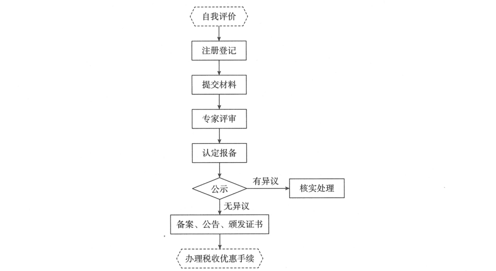

<!-- PDF 第 381 页（页眉：| 研发费用加计扣除与高新技术企业优惠实务及案例 |；页脚：362） -->
#### 三、认定条件

##### （一）年限

《认定办法》第十一条“须注册成立一年以上”是指企业须注册成立365个日历天数以上；“当年”、“最近一年”和“近一年”都是指企业申报前1个会计年度；“近三个会计年度”是指企业申报前的连续3个会计年度（不含申报年）；“申请认定前一年内”是指申请前的365天之内（含申报年）。

##### （二）知识产权

1.高新技术企业认定所指的知识产权须在中国境内授权或审批审定，并在中国法律的有效保护期内。知识产权权属人应为申请企业。

2.不具备知识产权的企业不能认定为高新技术企业。

3.高新技术企业认定中，对企业知识产权情况采用分类评价方式，其中：发明专利（含国防专利）、植物新品种、国家级农作物品种、国家新药、国家一级中药保护品种、集成电路布图设计专有权等按Ⅰ类评价；实用新型专利、外观设计专利、软件著作权等（不含商标）按Ⅱ类评价。

4.按Ⅱ类评价的知识产权在申请高新技术企业时，仅限使用一次。

5.在申请高新技术企业及高新技术企业资格存续期内，知识产权有多个权属人时，只能由一个权属人在申请时使用。

6.申请认定时专利的有效性以企业申请认定前获得授权证书或授权通知书并能提供缴费收据为准。

7.发明、实用新型、外观设计、集成电路布图设计专有权可在国家知识产权局网站查询专利标记和专利号；国防专利须提供国家知识产权局授予的国防专利证书；植物新品种可在农业部植物新品种保护办公室网站和国家林业局植物新品种保护办公室网站查询；国家级农作物品种是指农业部国家农作物品种审定委员会审定公告的农作物品种；国家新药须提供国家食品药品监督管理局签发的新药证书；国家一级中药保护品种须提供国家食品药品监督管理局签发的中药保护品种证书；软件著作权可在国家版权局中国版权保护中心网站查询软件著作权标记（亦称版权标记）。

<!-- PDF 第 382 页（页眉：| 附 录 主要政策依据 |；页脚：363） -->
##### （三）高新技术产品（服务）与主要产品（服务）

高新技术产品（服务）是指对其发挥核心支持作用的技术属于《国家重点支持的高新技术领域》规定范围的产品（服务）。

主要产品（服务）是指高新技术产品（服务）中，拥有在技术上发挥核心支持作用的知识产权的所有权，且收入之和在企业同期高新技术产品（服务）收入中超过50%的产品（服务）。

##### （四）高新技术产品（服务）收入占比

高新技术产品（服务）收入占比是指高新技术产品（服务）收入与同期总收入的比值。

1.高新技术产品（服务）收入。

高新技术产品（服务）收入是指企业通过研发和相关技术创新活动，取得的产品（服务）收入与技术性收入的总和。对企业取得上述收入发挥核心支持作用的技术应属于《技术领域》规定的范围。其中，技术性收入包括：

（1）技术转让收入：指企业技术创新成果通过技术贸易、技术转让所获得的收入；

（2）技术服务收入：指企业利用自己的人力、物力和数据系统等为社会和本企业外的用户提供技术资料、技术咨询与市场评估、工程技术项目设计、数据处理、测试分析及其他类型的服务所获得的收入；

（3）接受委托研究开发收入：指企业承担社会各方面委托研究开发、中间试验及新产品开发所获得的收入。

企业应正确计算高新技术产品（服务）收入，由具有资质并符合本《工作指引》相关条件的中介机构进行专项审计或鉴证。

2.总收入。

总收入是指收入总额减去不征税收入。

收入总额与不征税收入按照《中华人民共和国企业所得税法》（以下称《企业所得税法》）及《中华人民共和国企业所得税法实施条例》（以下称《实施条例》）的规定计算。

##### （五）企业科技人员占比

企业科技人员占比是企业科技人员数与职工总数的比值。

<!-- PDF 第 383 页（页眉：| 研发费用加计扣除与高新技术企业优惠实务及案例 |；页脚：364） -->
1.科技人员。

企业科技人员是指直接从事研发和相关技术创新活动，以及专门从事上述活动的管理和提供直接技术服务的，累计实际工作时间在183天以上的人员，包括在职、兼职和临时聘用人员。

2.职工总数。

企业职工总数包括企业在职、兼职和临时聘用人员。在职人员可以通过企业是否签订了劳动合同或缴纳社会保险费来鉴别；兼职、临时聘用人员全年须在企业累计工作183天以上。

3.统计方法。

企业当年职工总数、科技人员数均按照全年月平均数计算。

月平均数=（月初数+月末数）÷2

全年月平均数=全年各月平均数之和 ÷12

年度中间开业或者终止经营活动的，以其实际经营期作为一个纳税年度确定上述相关指标。

##### （六）企业研究开发费用占比

企业研究开发费用占比是企业近三个会计年度的研究开发费用总额占同期销售收入总额的比值。

1.企业研究开发活动确定。

研究开发活动，是指为获得科学与技术（不包括社会科学、艺术或人文学）新知识，创造性运用科学技术新知识，或实质性改进技术、产品（服务）、工艺而持续进行的具有明确目标的活动。不包括企业对产品（服务）的常规性升级或对某项科研成果直接应用等活动（如直接采用新的材料、装置、产品、服务、工艺或知识等）。

企业应按照研究开发活动的定义填写附件2《高新技术企业认定申请书》中的“四、企业研究开发活动情况表”。

专家评价过程中可参考如下方法判断：

——行业标准判断法。若国家有关部门、全国（世界）性行业协会等具备相应资质的机构提供了测定科技“新知识”、“创造性运用科学技术新知识”或“具有实

<!-- PDF 第 384 页（页眉：| 附 录 主要政策依据 |；页脚：365） -->
质性改进的技术、产品（服务）、工艺”等技术参数（标准），则优先按此参数（标准）来判断企业所进行项目是否为研究开发活动。

——专家判断法。如果企业所在行业中没有发布公认的研发活动测度标准，则通过本行业专家进行判断。获得新知识、创造性运用新知识以及技术的实质改进，应当是取得被同行业专家认可的、有价值的创新成果，对本地区相关行业的技术进步具有推动作用。

——目标或结果判定法。在采用行业标准判断法和专家判断法不易判断企业是否发生了研发活动时，以本方法作为辅助。重点了解研发活动的目的、创新性、投入资源（预算），以及是否取得了最终成果或中间成果（如专利等知识产权或其他形式的科技成果）。

2.研究开发费用的归集范围。

（1）人员人工费用。

包括企业科技人员的工资薪金、基本养老保险费、基本医疗保险费、失业保险费、工伤保险费、生育保险费和住房公积金，以及外聘科技人员的劳务费用。

（2）直接投入费用。

直接投入费用是指企业为实施研究开发活动而实际发生的相关支出。包括：

——直接消耗的材料、燃料和动力费用；

——用于中间试验和产品试制的模具、工艺装备开发及制造费，不构成固定资产的样品、样机及一般测试手段购置费，试制产品的检验费；

——用于研究开发活动的仪器、设备的运行维护、调整、检验、检测、维修等费用，以及通过经营租赁方式租入的用于研发活动的固定资产租赁费。

（3）折旧费用与长期待摊费用。

折旧费用是指用于研究开发活动的仪器、设备和在用建筑物的折旧费。

长期待摊费用是指研发设施的改建、改装、装修和修理过程中发生的长期待摊费用。

（4）无形资产摊销费用。

无形资产摊销费用是指用于研究开发活动的软件、知识产权、非专利技术（专有技术、许可证、设计和计算方法等）的摊销费用。

<!-- PDF 第 385 页（页眉：| 研发费用加计扣除与高新 技术企业优惠实务及案例 |；页脚：366） -->
（5）设计费用。

设计费用是指为新产品和新工艺进行构思、开发和制造，进行工序、技术规范、规程制定、操作特性方面的设计等发生的费用。包括为获得创新性、创意性、突破性产品进行的创意设计活动发生的相关费用。

（6）装备调试费用与试验费用。

装备调试费用是指工装准备过程中研究开发活动所发生的费用，包括研制特殊、专用的生产机器，改变生产和质量控制程序，或制定新方法及标准等活动所发生的费用。

为大规模批量化和商业化生产所进行的常规性工装准备和工业工程发生的费用不能计入归集范围。

试验费用包括新药研制的临床试验费、勘探开发技术的现场试验费、田间试验费等。

（7）委托外部研究开发费用。

委托外部研究开发费用是指企业委托境内外其他机构或个人进行研究开发活动所发生的费用（研究开发活动成果为委托方企业拥有，且与该企业的主要经营业务紧密相关）。委托外部研究开发费用的实际发生额应按照独立交易原则确定，按照实际发生额的80%计入委托方研发费用总额。

（8）其他费用。

其他费用是指上述费用之外与研究开发活动直接相关的其他费用，包括技术图书资料费、资料翻译费、专家咨询费、高新科技研发保险费，研发成果的检索、论证、评审、鉴定、验收费用，知识产权的申请费、注册费、代理费，会议费、差旅费、通讯费等。此项费用一般不得超过研究开发总费用的20%，另有规定的除外。

3.企业在中国境内发生的研究开发费用。

企业在中国境内发生的研究开发费用，是指企业内部研究开发活动实际支出的全部费用与委托境内其他机构或个人进行的研究开发活动所支出的费用之和，不包括委托境外机构或个人完成的研究开发活动所发生的费用。受托研发的境外机构是指依照外国和地区（含港澳台）法律成立的企业和其他取得收入的组织；受托研发

<!-- PDF 第 386 页（页眉：| 附 录 主要政策依据 |；页脚：367） -->
的境外个人是指外籍（含港澳台）个人。

4.企业研究开发费用归集办法。

企业应正确归集研发费用，由具有资质并符合本《工作指引》相关条件的中介机构进行专项审计或验证。

企业的研究开发费用是以单个研发活动为基本单位分别进行测度并加总计算的。企业应对包括直接研究开发活动和可以计入的间接研究开发活动所发生的费用进行归集，并填写附件2《高新技术企业认定申请书》中的“企业年度研究开发费用结构明细表”。

企业应按照“企业年度研究开发费用结构明细表”设置高新技术企业认定专用研究开发费用辅助核算账目，提供相关凭证及明细表，并按本《工作指引》要求进行核算。

5.销售收入。

销售收入为主营业务收入与其他业务收入之和。

主营业务收入与其他业务收入按照企业所得税年度纳税申报表的口径计算。

##### （七）企业创新能力评价

企业创新能力主要从知识产权、科技成果转化能力、研究开发组织管理水平、企业成长性等四项指标进行评价。各级指标均按整数打分，满分为100分，综合得分达到70分以上（不含70分）为符合认定要求。四项指标分值结构详见下表：

| 序 号 | 指 标 | 分 值 |
| --- | --- | --- |
| 1 | 知识产权 | ≤30 |
| 2 | 科技成果转化能力 | ≤30 |
| 3 | 研究开发组织管理水平 | ≤20 |
| 4 | 企业成长性 | ≤20 |

1.知识产权（≤30分）。

由技术专家对企业申报的知识产权是否符合《认定办法》和《工作指引》要求，进行定性与定量结合的评价。

<!-- PDF 第 387 页（页眉：| 研发费用加计扣除与高新 技术企业优惠实务及案例 |；页脚：368） -->
| 序 号 | 知识产权相关评价指标 | 分 值 |
| --- | --- | --- |
| 1 | 技术的先进程度 | ≤8 |
| 2 | 对主要产品（服务）在技术上发挥核心支持作用 | ≤8 |
| 3 | 知识产权数量 | ≤8 |
| 4 | 知识产权获得方式 | ≤6 |
| 5 | （作为参考条件，最多加2分）企业参与编制国家标准、行业标准、检测方法、技术规范的情况 | ≤2 |

（1）技术的先进程度。

A.高（7～8分）    B.较高（5～6分）

C.一般（3～4分）    D.较低（1～2分）

E.无（0分）

（2）对主要产品（服务）在技术上发挥核心支持作用。

A.强（7～8分）    B.较强（5～6分）

C.一般（3～4分）    D.较弱（1～2分）

E.无（0分）

（3）知识产权数量。

A.1项及以上（Ⅰ类）（7～8分）

B.5项及以上（Ⅱ类）（5～6分）

C.3～4项（Ⅱ类）（3～4分）

D.1～2项（Ⅱ类）（1～2分）

E.0项（0分）

（4）知识产权获得方式。

A.有自主研发（1～6分）

B.仅有受让、受赠和并购等（1～3分）

（5）企业参与编制国家标准、行业标准、检测方法、技术规范的情况。（此项为加分项，加分后“知识产权”总分不超过30分。相关标准、方法和规范须经国家有关部门认证认可。）

A.是（1～2分）    B.否（0分）

<!-- PDF 第 388 页（页眉：| 附 录 主要政策依据 |；页脚：369） -->
2.科技成果转化能力（≤30分）。

依照《促进科技成果转化法》，科技成果是指通过科学研究与技术开发所产生的具有实用价值的成果（专利、版权、集成电路布图设计等）。科技成果转化是指为提高生产力水平而对科技成果进行的后续试验、开发、应用、推广直至形成新产品、新工艺、新材料，发展新产业等活动。

科技成果转化形式包括：自行投资实施转化；向他人转让该技术成果；许可他人使用该科技成果；以该科技成果作为合作条件，与他人共同实施转化；以该科技成果作价投资、折算股份或者出资比例；以及其他协商确定的方式。

由技术专家根据企业科技成果转化总体情况和近3年内科技成果转化的年平均数进行综合评价。同一科技成果分别在国内外转化的，或转化为多个产品、服务、工艺、样品、样机等的，只计为一项。

A.转化能力强，≥5项（25～30分）

B.转化能力较强，≥4项（19～24分）

C.转化能力一般，≥3项（13～18分）

D.转化能力较弱，≥2项（7～12分）

E.转化能力弱，≥1项（1～6分）

F.转化能力无，0项（0分）

3.研究开发组织管理水平（≤20分）。

由技术专家根据企业研究开发与技术创新组织管理的总体情况，结合以下几项评价，进行综合打分。

（1）制定了企业研究开发的组织管理制度，建立了研发投入核算体系，编制了研发费用辅助账（≤6分）。

（2）设立了内部科学技术研究开发机构并具备相应的科研条件，与国内外研究开发机构开展多种形式产学研合作（≤6分）。

（3）建立了科技成果转化的组织实施与激励奖励制度，建立开放式的创新创业平台（≤4分）。

（4）建立了科技人员的培养进修、职工技能培训、优秀人才引进，以及人才绩效评价奖励制度（≤4分）。

<!-- PDF 第 389 页（页眉：| 研发费用加计扣除与高新 技术企业优惠实务及案例 |；页脚：370） -->
4.企业成长性（≤20分）。

由财务专家选取企业净资产增长率、销售收入增长率等指标对企业成长性进行评价。企业实际经营期不满三年的按实际经营时间计算。计算方法如下：

（1）净资产增长率。

净资产增长率=1/2×（第二年末净资产÷第一年末净资产+第三年末净资产÷第二年末净资产）-1

净资产=资产总额－负债总额

资产总额、负债总额应以具有资质的中介机构鉴证的企业会计报表期末数为准。

（2）销售收入增长率。

销售收入增长率=1/2×（第二年销售收入÷第一年销售收入+第三年销售收入÷第二年销售收入）-1

企业净资产增长率或销售收入增长率为负的，按0分计算。第一年末净资产或销售收入为0的，按后两年计算；第二年末净资产或销售收入为0的，按0分计算。

以上两个指标分别对照下表评价档次（A、B、C、D、E、F）得出分值，两项得分相加计算出企业成长性指标综合得分。

| 成长性得分 | 指标赋值 | 分 数 | | | | | |
| --- | --- | --- | --- | --- | --- | --- | --- |
| | | ≥35% | ≥25% | ≥15% | ≥5% | >0 | ≤0 |
| ≤20分 | 净资产增长率赋值≤10分 | A 9～10分 | B 7～8分 | C 5～6分 | D 3～4分 | E 1～2分 | F 0分 |
| | 销售收入增长率赋值≤10分 | | | | | | |

#### 四、享受税收优惠

1.自认定当年起，企业可持“高新技术企业”证书及其复印件，按照《企业所

<!-- PDF 第 390 页（页眉：| 附 录 主要政策依据 |；页脚：371） -->
得税法》及《实施条例》、《中华人民共和国税收征收管理法》（以下称《税收征管法》）、《中华人民共和国税收征收管理法实施细则》（以下称《实施细则》）、《认定办法》和本《工作指引》等有关规定，到主管税务机关办理相关手续，享受税收优惠。

2.未取得高新技术企业资格或不符合《企业所得税法》及其《实施条例》、《税收征管法》及其《实施细则》，以及《认定办法》等有关规定条件的企业，不得享受高新技术企业税收优惠。

3.高新技术企业资格期满当年内，在通过重新认定前，其企业所得税暂按15%的税率预缴，在年度汇算清缴前未取得高新技术企业资格的，应按规定补缴税款。

#### 五、监督管理

##### （一）重点检查

根据认定管理工作需要，科技部、财政部、税务总局按照《认定办法》的要求，可组织专家对各地高新技术企业认定管理工作进行重点检查，对存在问题的视情况给予相应处理。

##### （二）企业年报

企业获得高新技术企业资格后，在其资格有效期内应每年5月底前通过“高新技术企业认定管理工作网”报送上一年度知识产权、科技人员、研发费用、经营收入等年度发展情况报表（附件6）；在同一高新技术企业资格有效期内，企业累计两年未按规定时限报送年度发展情况报表的，由认定机构取消其高新技术企业资格，在“高新技术企业认定管理工作网”上公告。

认定机构应提醒、督促企业及时填报年度发展情况报表，并协助企业处理填报过程中的相关问题。

##### （三）复核

对已认定的高新技术企业，有关部门在日常管理过程中发现其不符合认定条件的，应以书面形式提请认定机构复核。复核后确认不符合认定条件的，由认定机构

<!-- PDF 第 391 页（页眉：| 研发费用加计扣除与高新 技术企业优惠实务及案例 |；页脚：372） -->
取消其高新技术企业资格，并通知税务机关追缴其不符合认定条件年度起已享受的税收优惠。

属于对是否符合《认定办法》第十一条［除（五）款外］、第十七条、第十八条和第十九条情况的企业，按《认定办法》规定办理；属于对是否符合《认定办法》第十一条（五）款产生异议的，应以问题所属年度和前两个会计年度（实际经营不满三年的按实际经营时间计算）的研究开发费用总额与同期销售收入总额之比是否符合《认定办法》第十一条（五）款规定进行复核。

##### （四）更名及重大变化事项

高新技术企业发生名称变更或与认定条件有关的重大变化（如分立、合并、重组以及经营业务发生变化等），应在发生之日起三个月内向认定机构报告，在“高新技术企业认定管理工作网”上提交《高新技术企业名称变更申请表》（附件7），并将打印出的《高新技术企业名称变更申请表》与相关证明材料报认定机构，由认定机构负责审核企业是否仍符合高新技术企业条件。

企业仅发生名称变更，不涉及重大变化，符合高新技术企业认定条件的，由认定机构在本地区公示10个工作日，无异议的，由认定机构重新核发认定证书，编号与有效期不变，并在“高新技术企业认定管理工作网”上公告；有异议的或有重大变化的（无论名称变更与否），由认定机构按《认定办法》第十一条进行核实处理，不符合认定条件的，自更名或条件变化年度起取消其高新技术企业资格，并在“高新技术企业认定管理工作网”上公告。

##### （五）异地搬迁

1.《认定办法》第十八条中整体迁移是指符合《中华人民共和国公司登记管理条例》第二十九条所述情况。

2.跨认定机构管理区域整体迁移的高新技术企业须向迁入地认定机构提交有效期内的《高新技术企业证书》及迁入地工商等登记管理机关核发的完成迁入的相关证明材料。

3.完成整体迁移的，其高新技术企业资格和《高新技术企业证书》继续有效，编号与有效期不变。由迁入地认定机构给企业出具证明材料，并在“高新技术企业认定管理工作网”上公告。

<!-- PDF 第 392 页（页眉：| 附 录 主要政策依据 |；页脚：373） -->
##### （六）其他

1.有《认定办法》第十九条所列三种行为之一的企业，自行为发生之日所属年度起取消其高新技术企业资格，并在“高新技术企业认定管理工作网”上公告。

2.认定机构应依据有关部门根据相关法律法规出具的意见对“重大安全、重大质量事故或有严重环境违法行为”进行判定处理。

3.已认定的高新技术企业，无论何种原因被取消高新技术企业资格的，当年不得再次申请高新技术企业认定。

#### 六、高新技术企业认定管理工作网功能及操作提要

“高新技术企业认定管理工作网”是根据《认定办法》建设的高新技术企业认定管理工作的信息化平台，由高新技术企业认定管理工作门户网站（以下简称“门户网站”）和高新技术企业认定管理系统（以下简称“管理系统”）构成。

##### （一）门户网站主要功能

门户网站（www.innocom.gov.cn）的主要功能包括：发布高新技术企业政策、工作动态、公示文件，公告备案、更名、异地搬迁、撤销资格、问题中介机构名单等信息，以及提供管理系统的登录入口。

##### （二）管理系统主要功能

管理系统由企业申报系统、认定机构管理系统和领导小组办公室管理系统三个子系统组成。

1.企业申报系统主要功能：

（1）企业注册；

（2）企业信息变更；

（3）企业名称变更；

（4）认定申报；

（5）年度发展情况报表；

（6）查询；

<!-- PDF 第 393 页（页眉：| 研发费用加计扣除与高新 技术企业优惠实务及案例 |；页脚：374） -->
（7）密码找回。

2.认定机构管理系统主要功能：

（1）企业注册管理；

（2）认定申报管理；

（3）撤销企业高企证书管理；

（4）异地搬迁企业管理；

（5）查询与统计。

3.领导小组办公室管理系统主要功能：

（1）高新技术企业备案管理；

（2）撤销企业高新技术企业证书管理；

（3）异地搬迁高新技术企业管理；

（4）查询与统计。

附件1

企业注册登记表

| 企业名称 | | | 注册时间 | | | |
| --- | --- | --- | --- | --- | --- | --- |
| 注册类型 | | | 外资水源地 | | | |
| 注册资金 | | | 所属行业 | | | |
| 企业规模 | | | 行政区域 | | | |
| 组织机构代码/统一社会信用代码 | | | 税务登记号/统一社会信用代码 | | | |
| 企业所得税主管税务机关 | □国税 □地税 | | 企业所得税征收方式 | | □查账征收 □核定征收 | |
| 通信地址 | | | | | 邮政编码 | |
| 企业法定代表人 | 姓名 | | 手机 | | 身份证号/护照号 | |
| | 电话 | | 传真 | | E-mail | |
| 联系人 | 姓名 | | 手机 | | | |
| | 电话 | | 传真 | | E-mail | |

<!-- PDF 第 394 页（页眉：| 附 录 主要政策依据 |；页脚：375） -->
| 企业是否上市 | □是 □否 | | 上市时间 | | | |
| --- | --- | --- | --- | --- | --- | --- |
| 股票代码 | | | 上市类型 | | | |
| 是否属于国家级高新区内企业 | □是 □否 | | 高新区名称 | | | |

附件2

系统填报号：________

高新技术企业认定申请书

企业名称：________

企业所在地区：____省____市（区、自治州）

认定机构：

申请日期：____年____月____日

声明：本申请书上填写的有关内容和提交的资料均准确、真实、合法、有效、无涉密信息，本企业愿为此承担有关法律责任。

法定代表人（签名）：        （企业公章）

科技部、财政部、国家税务总局编制

二〇一六年六月

填报说明

企业应参照《高新技术企业认定管理办法》、《国家重点支持的高新技术领域》（国科发火〔2016〕32号）和《高新技术企业认定管理工作指引》（国科发火〔2016〕195号）的要求填报。

本表内的所有财务数据须出自专项报告、财务会计报告或纳税申报表。

1.企业应如实填报所附各表。要求文字简洁，数据准确、翔实。

<!-- PDF 第 395 页（页眉：| 研发费用加计扣除与高新 技术企业优惠实务及案例 |；页脚：376） -->
2.各栏目不得空缺，无内容填写“0”；数据有小数时，保留小数点后2位。

3.对企业知识产权情况采用分类评价方式，其中：发明专利（含国防专利）、植物新品种、国家级农作物品种、国家新药、国家一级中药保护品种、集成电路布图设计专有权等按Ⅰ类评价；实用新型专利、外观设计专利、软件著作权等（不含商标）按Ⅱ类评价。

4.“基础研究投入费用总额”是指：企业研究开发费用总额中，为获得科学与技术（不包括社会科学、艺术或人文学）新知识等基础研究活动支出的费用总额。

5.销售收入=主营业务收入+其他业务收入。

企业总收入=收入总额-不征税收入。

净资产=资产总额-负债总额。

6.“近三年”、“近一年”和“申请认定前一年内”：详见《工作指引》三（一）“年限”中的说明，“近三年”即“年限”中的“近三个会计年度”。

7.“研发活动”：详见《工作指引》三（六）1中“研究开发活动确定”。

8.“高新技术产品（服务）收入”：详见《工作指引》三（四）1中“高新技术产品（服务）收入”的定义。

9.IP代表知识产权编号；RD代表研究开发活动编号；PS代表高新技术产品（服务）编号。IP、RD、PS后取两位数（01、02……）。

### 一、主要情况

| 技术领域 | | | | |
| --- | --- | --- | --- | --- |
| 获得知识产权数量（件） | Ⅰ类 | | Ⅱ类 | |
| 人力资源情况（人） | 职工总数 | | 科技人员数 | |
| 近三年经营情况（万元） | 种类 年度 | 净资产 | 销售收入 | 利润总额 |
| | 第一年 | | | |
| | 第二年 | | | |
| | 第三年 | | | |

<!-- PDF 第 396 页（页眉：| 附 录 主要政策依据 |；页脚：377） -->
| 近三年研究开发费用总额（万元） | | 其中 | 在中国境内研发费用总额（万元） | |
| --- | --- | --- | --- | --- |
| | | | 基础研究投入费用总额（万元） | |
| 近一年企业总收入（万元） | | | | |
| 近一年高新技术产品（服务）收入（万元） | | | | |
| 申请认定前一年内是否发生过重大安全、重大质量事故或严重环境违法行为 | | | □是 □否 | |

### 二、知识产权汇总表

| 获得知识产权数量（件） | 发明专利 | | 其中：国防专利 | |
| --- | --- | --- | --- | --- |
| | 植物新品种 | | 国家级农作物品种 | |
| | 国家新药 | | 国家一级中药保护品种 | |
| | 集成电路布图设计专有权 | | 实用新型 | |
| | 外观设计 | | 软件著作权 | |

| 知识产权编号 | 知识产权名称 | 类 别 | 授权日期 | 授权号 | 获得方式 |
| --- | --- | --- | --- | --- | --- |
| IP… | | | | | |
| | | | | | |
| | | | | | |
| | | | | | |
| | | | | | |
| | | | | | |
| | | | | | |
| | | | | | |

<!-- PDF 第 397 页（页眉：| 研发费用加计扣除与高新 技术企业优惠实务及案例 |；页脚：378） -->
### 三、人力资源情况表

| （一）总体情况 | | | | |
| --- | --- | --- | --- | --- |
| | 企业职工 | | 科技人员 | |
| 总数（人） | | | | |
| 其中：在职人员 | | | | |
| 兼职人员 | | | | |
| 临时聘用人员 | | | | |
| 外籍人员 | | | | |
| 留学归国人员 | | | | |
| 千人计划人员 | | | | |
| （二）全体人员结构 | | | | |
| 学 历 | 博 士 | 硕 士 | 本 科 | 大专及以下 |
| 人 数 | | | | |
| 职 称 | 高级职称 | 中级职称 | 初级职称 | 高级技工 |
| 人 数 | | | | |
| 年 龄 | 30及以下 | 31～40 | 41～50 | 51及以上 |
| 人 数 | | | | |

### 四、企业研究开发活动情况表（近三年执行的活动，按单一活动填报）

研发活动编号：RD…

| 研发活动名称 | | | 起止时间 | | | |
| --- | --- | --- | --- | --- | --- | --- |
| 技术领域 | | | | | | |
| 技术来源 | | | 知识产权编号 | | | |
| 研发经费总预算（万元） | | 研发经费近三年总支出（万元） | | 其中 | 第一年 | |
| | | | | | 第二年 | |
| | | | | | 第三年 | |
| 目的及组织实施方式（限400字） | | | | | | |

<!-- PDF 第 398 页（页眉：| 附 录 主要政策依据 |；页脚：379） -->
| 核心技术及创新点（限400字） | | | | | | |
| --- | --- | --- | --- | --- | --- | --- |
| 取得的阶段性成果（限400字） | | | | | | |

### 五、企业年度研究开发费用结构明细表（按近三年每年分别填报）

____年度        单位：万元

| 科目 累计发生额 研发项目编号 | RD01 | RD02 | RD03 | … | RD… | 合计 |
| --- | --- | --- | --- | --- | --- | --- |
| 内部研究开发费用 | | | | | | |
| 其中：人员人工费用 | | | | | | |
| 直接投入费用 | | | | | | |
| 折旧费用与长期待摊费用 | | | | | | |
| 无形资产摊销费用 | | | | | | |
| 设计费用 | | | | | | |
| 装备调试费用与试验费用 | | | | | | |
| 其他费用 | | | | | | |
| 委托外部研究开发费用 | | | | | | |
| 其中：境内的外部研发费用 | | | | | | |
| 研究开发费用（内、外部）小计 | | | | | | |

企业填报人签字：        日 期：

### 六、上年度高新技术产品（服务）情况表（按单一产品（服务）填报）

编号：PS…

| 产品（服务）名称 | |
| --- | --- |
| 技术领域 | |

<!-- PDF 第 399 页（页眉：| 研发费用加计扣除与高新 技术企业优惠实务及案例 |；页脚：380） -->
| 技术来源 | | 上年度销售收入（万元） | |
| --- | --- | --- | --- |
| 是否主要产品（服务） | □是 □否 | 知识产权编号 | |
| 关键技术及主要技术指标（限400字） | | | |
| 与同类产品（服务）的竞争优势（限400字） | | | |
| 知识产权获得情况及其对产品（服务）在技术上发挥的支持作用（限400字） | | | |

### 七、企业创新能力

| 知识产权对企业竞争力的作用（限400字） | |
| --- | --- |
| 科技成果转化情况（限400字） | |
| 研究开发与技术创新组织管理情况（限400字） | |
| 管理与科技人员情况（限400字） | |

### 八、（加分项）企业参与国家标准或行业标准制定情况汇总表

| 序号 | 标准名称 | 标准级别 | 标准编号 | 参与方式 |
| --- | --- | --- | --- | --- |
| | | □国家 □行业 | | □主持 □参与 |
| | | □国家 □行业 | | □主持 □参与 |
| | | □国家 □行业 | | □主持 □参与 |

<!-- PDF 第 400 页（页眉：| 附 录 主要政策依据 |；页脚：381） -->
### 国家税务总局关于实施高新技术企业所得税优惠政策有关问题的公告

（国家税务总局公告2017年第24号）

为贯彻落实高新技术企业所得税优惠政策，根据《科技部 财政部 国家税务总局关于修订印发〈高新技术企业认定管理办法〉的通知》（国科发火〔2016〕32号，以下简称《认定办法》）及《科技部 财政部 国家税务总局关于修订印发〈高新技术企业认定管理工作指引〉的通知》（国科发火〔2016〕195号，以下简称《工作指引》）以及相关税收规定，现就实施高新技术企业所得税优惠政策有关问题公告如下：

一、企业获得高新技术企业资格后，自高新技术企业证书注明的发证时间所在年度起申报享受税收优惠，并按规定向主管税务机关办理备案手续。

企业的高新技术企业资格期满当年，在通过重新认定前，其企业所得税暂按15%的税率预缴，在年底前仍未取得高新技术企业资格的，应按规定补缴相应期间的税款。

二、对取得高新技术企业资格且享受税收优惠的高新技术企业，税务部门如在日常管理过程中发现其在高新技术企业认定过程中或享受优惠期间不符合《认定办法》第十一条规定的认定条件的，应提请认定机构复核。复核后确认不符合认定条件的，由认定机构取消其高新技术企业资格，并通知税务机关追缴其证书有效期内自不符合认定条件年度起已享受的税收优惠。

三、享受税收优惠的高新技术企业，每年汇算清缴时应按照《国家税务总局关于发布〈企业所得税优惠政策事项办理办法〉的公告》（国家税务总局公告2015年第76号）规定向税务机关提交企业所得税优惠事项备案表、高新技术企业资格证书履行备案手续，同时妥善保管以下资料留存备查：

1.高新技术企业资格证书；

2.高新技术企业认定资料；

3.知识产权相关材料；

4.年度主要产品（服务）发挥核心支持作用的技术属于《国家重点支持的高新

<!-- PDF 第 401 页（页眉：| 研发费用加计扣除与高新技术企业优惠实务及案例 |；页脚：382） -->
技术领域》规定范围的说明，高新技术产品（服务）及对应收入资料；

5.年度职工和科技人员情况证明材料；

6.当年和前两个会计年度研发费用总额及占同期销售收入比例、研发费用管理资料以及研发费用辅助账，研发费用结构明细表（具体格式见《工作指引》附件2）；

7.省税务机关规定的其他资料。

四、本公告适用于2017年度及以后年度企业所得税汇算清缴。2016年1月1日以后按《认定办法》认定的高新技术企业按本公告规定执行。2016年1月1日前按《科技部 财政部 国家税务总局关于印发〈高新技术企业认定管理办法〉的通知》（国科发火〔2008〕172号）认定的高新技术企业，仍按《国家税务总局关于实施高新技术企业所得税优惠有关问题的通知》（国税函〔2009〕203号）和国家税务总局公告2015年第76号的规定执行。

《国家税务总局关于高新技术企业资格复审期间企业所得税预缴问题的公告》（国家税务总局公告2011年第4号）同时废止。

特此公告。

国家税务总局

2017年6月19日

<!-- PDF 第 402 页（页眉：无；页脚：无）（本页空白） -->

<!-- PDF 第 403 页（页眉：无；页脚：无）（本页空白） -->

<!-- PDF 第 404 页（页眉：无；页脚：无） -->
陈斌才    国家税务总局税务干部学院教授

高新技术企业的核心竞争力在于拥有自主知识产权，而技术研发是企业获取自主知识产权的重要途径。哪些活动属于研发活动？哪些费用属于研发费用？如何运用研发费用的加计扣除政策和高新技术企业的税收优惠政策有效降低税收负担？《研发费用加计扣除与高新技术企业优惠实务及案例》一书以翔实的资料和鲜明的观点，阐述了研究开发费用的界定、构成、扣除、纳税申报、后续管理以及高新技术企业的认定、税收优惠、风险管理等，为相关从业人员解决实务问题提供智力支持。这是一本值得一读的实用参考书。

陈爱华    厦门国家会计学院教授

本书囊括业务、法务、财务、税务等诸多视角的政策解析与案例分享，全方位、深刻指导企业研发费用加计扣除与高新技术企业财税实践工作，有助于提升企业创新能力并全面兼顾财税风险，是一本颇具业务指导价值的工具书。

王骏    北京中翰税务师事务所集团合伙人、中国财税浪子

新质生产力的发展是强国复兴的基石，卓越的研发是创新进步的灵魂，各类专精特新和高新技术企业成长壮大是经济增长的支柱。税收不仅影响国家治理和生产关系，也会对生产力的突破产生巨大的能动作用。吴健等老师的新书，紧扣我国现行税制，着眼于解决企业科技支撑涉及的具体税收问题，努力打造“堵点”，消除“栅栏”，实用性、指导性和操作性都很强，是一本科技税收领域颇具内涵价值的好作品！

中国市场出版社
微信公众号

上架建议：税务/税收优惠
ISBN 978-7-5092-2544-8

9 787509 225448
定价：98.00 元

