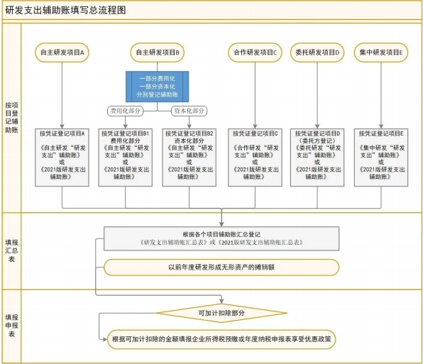
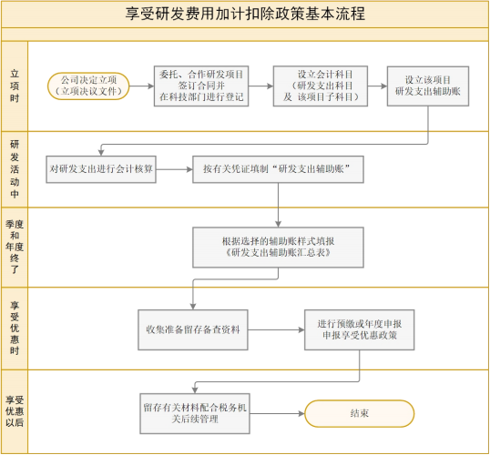

> **标题**：研发费用加计扣除政策执行指引（2.0版）
> **发文机关**：国家税务总局所得税司、科技部政策法规与创新体系建设司
> **成文年月**：2023年7月
> **发布日期**：2023年7月12日（上海市税务局政策解读页）／2023年7月7日（广东省税务局规范性文件页发文日期）
> **文号**：无（政策执行指引，正式件不带文号）
> **效力状态**：现行有效（广东省税务局规范性文件页标注“有效”）
> **官方原文**：https://shanghai.chinatax.gov.cn/zcfw/zcjd/202307/t467906.html
> **全文载体**：上述页面正文只有目录性导语，37 页全文在该页的 PDF 附件 https://shanghai.chinatax.gov.cn/zcfw/zcjd/202307/P020230712556736943266.pdf
> **镜像件**：国家税务总局广东省税务局 https://guangdong.chinatax.gov.cn/gdsw/zjfg/2023-07/12/content_d765c7dcf5834eb1a655b85ba507c6b0.shtml （附件与上海版 PDF 字节一致，md5 94cb326bc7e2087b2a76c4e1f0a0403d）；科学技术部 https://www.most.gov.cn/xxgk/xinxifenlei/fdzdgknr/fgzc/zcjd/202601/P020250926369462261750.pdf （内容相同，文件 md5 38b8460473e6341a9d07a73e0e1d2965）
> **核验**：2026-10-22 从该 PDF 逐页抽取文字转录。比对方法：把两侧空白删净后，按 PDF 每行的空格切块，官方件 1 291 块，本件命中 1 287 块；未命中的 4 块是同一处嵌套书名号在 PDF 里跨行断开所致，本件按原句写全，逐字仍在。本件另外做了四处编排：段与段之间补空行；两处 PDF 用半角尖括号排印的嵌套书名号（《国家税务总局关于印发<企业研究开发费用税前扣除管理办法（试行）>的通知》《国家税务总局关于发布修订后的<企业所得税优惠政策事项办理办法>的公告》）改回〈〉，因为尖括号在 markdown 里会被当作标签而不显示；“政策沿革”表1 原先被 PDF 分页切成三段、重复了两次表头，已按原行合并为一张 16 行的表；两处插图存为 images/rd-guide-2-0-fig1.png、images/rd-guide-2-0-fig2.png。

---

# 研发费用加计扣除政策执行指引（2.0版）

国家税务总局所得税司　科技部政策法规与创新体系建设司

2023年7月

## 修 订 说 明

2018年，税务总局所得税司在科技部政策法规与创新体系建设司的大力支持下，首次发布《研发费用加计扣除政策执行指引（1.0版）》，从政策概述、主要内容、核算要求、备案和申报管理等方面对研发费用加计扣除政策进行了全面解读，在指导基层税务人员理解把握政策，帮助企业及时、 充分、 准确享受政策红利方面发挥了积极作用。

为全面贯彻习近平新时代中国特色社会主义思想主题教育要求，更好地落实税收优惠政策，税务总局所得税司联合科技部政策法规与创新体系建设司对现行研发费用加计扣除相关政策进行梳理、提炼、整合，编写了《研发费用加计扣除政策执行指引（2.0 版）》，力求全方位、 多维度、深层次、更精炼地展示政策要义。

需要说明的是， 《研发费用加计扣除政策执行指引（2.0版）》仅旨在方便读者查找和充分理解现行研发费用加计扣除政策，不是税收执法或申请享受政策的依据。政策执行请以正式文件为准。

目 录一、 研发费用加计扣除政策概述................................................................................................................. 1

（一）政策要点....................................................................................................................................1

（二）政策沿革....................................................................................................................................2

（三）研发费用加计扣除与据实扣除的概念....................................................................................4二、 研发活动界定......................................................................................................................................... 5

（一）研发活动的概念与类型............................................................................................................5

（二）研发活动判断的基本要点........................................................................................................6

（三）不适用加计扣除政策的活动....................................................................................................7

（四）研发活动判断的边界与说明....................................................................................................8三、 研发项目管理....................................................................................................................................... 11

（一）研发项目的组织形式..............................................................................................................11

（二）研发项目的流程管理..............................................................................................................12四、 研发费用加计扣除政策的主要内容................................................................................................... 14

（一）政策适用范围..........................................................................................................................14

（二）研发费用加计扣除归集口径..................................................................................................15

（三）冲减研发费用的特殊情况......................................................................................................22

（四）其他事项..................................................................................................................................23五、 加计扣除研发费用核算要求............................................................................................................... 25

（一）享受研发费用加计扣除政策的会计核算要求......................................................................25

（二）研发支出辅助账的样式..........................................................................................................25

（三）研发支出辅助账核算流程......................................................................................................26

（四）研发费用的费用化或资本化处理方面的规定......................................................................27

（五）共用的人员及仪器、设备、无形资产核算要求..................................................................29

（六）研发费用的核算须做好部门间协调配合..............................................................................29

（七）企业集团集中开发的研发费用分摊需要关注关联申报......................................................29

（八）合作研发项目核算要求.......................................................................................................... 30六、 研发费用加计扣除申报和后续管理................................................................................................... 30

（一）享受研发费用加计扣除政策的办理方式.............................................................................. 30

（二）享受研发费用加计扣除政策的时点...................................................................................... 31

（三）享受研发费用加计扣除政策的留存备查资料...................................................................... 32

（四）税务机关后续管理.................................................................................................................. 33

（五）其他注意事项.......................................................................................................................... 34

## 一、 研发费用加计扣除政策概述

### （一）政策要点

1.企业开展研发活动中实际发生的研发费用，未形成无形资产计入当期损益的，在按规定据实扣除的基础上，再按照实际发生额的 100%在税前加计扣除；形成无形资产的，按照无形资产成本的200%在税前摊销。无形资产摊销年限不得低于 10年。作为投资或者受让的无形资产，有关法律规定或者合同约定了使用年限的，可以按照法律规定或者合同约定的使用年限分期摊销。

2.委托、合作、集中研发费用的加计扣除：

（1）企业委托境内的外部机构或个人进行研发活动发生的费用，按照费用实际发生额的80%计入委托方研发费用并按规定计算加计扣除；委托境外(不包括境外个人)进行研发活动所发生的费用，按照费用实际发生额的 80%计入委托方的委托境外研发费用。委托境外研发费用不超过境内符合条件的研发费用三分之二的部分，可按规定在企业所得税前加计扣除。

（2）企业共同合作开发的项目， 由合作各方就自身实际承担的研发费用分别计算加计扣除。

（3）企业集团根据生产经营和科技开发的实际情况，对技术要求高、投资数额大，需要集中研发的项目，其实际发生的研发费用，可以按照权利和义务相一致、 费用支出和收益分享相配比的原则，合理确定研发费用的分摊方法，在受益成员企业间进行分摊， 由相关成员企业分别计算加计扣除。

3.企业为获得创新性、创意性、 突破性的产品进行创意设计活动而发生的相关费用，可以按照规定进行加计扣除。

4.企业可在当年7月份预缴、10月份预缴以及企业所得税年度汇算清缴时申报享受研发费用加计扣除政策。

### （二）政策沿革

现行企业所得税法和实施条例明确研发费用可享受加计扣除。近年来，国家多次优化完善研发费用加计扣除政策，加大政策优惠力度，具体政策沿革见表1。

#### 表1：研发费用加计扣除政策沿革

| 时间 | 政策 | 主要内容 |
| --- | --- | --- |
| 2008年开始实施 | 《中华人民共和国企业所得税法》及其实施条例 | 以法律形式确认研发费用加计扣除政策。 |
| 2008年12月 | 《国家税务总局关于印发〈企业研究开发费用税前扣除管理办法（试行）〉的通知》（国税发〔2008〕 116号） | 对研发费用加计扣除政策作出系统、详细规定。 |
| 2015年11月 | 《财政部 国家税务总局 科技部关于完善研究开发费用税前加计扣除政策的通知》 （财税〔2015〕 119号） | 放宽了享受优惠的企业研发活动及研发费用的范围，大幅减少了研发费用加计扣除口径与高新技术企业认定研发费用归集口径的差异。 |
|  | 《国家税务总局关于企业研究开发费用税前加计扣除政策有关问题的公告》 （2015年第97号） | 细化研发费用加计扣除政策口径及管理要求，提高政策可操作性。 |
| 2017年5月 | 《财政部 税务总局 科技部关于提高科技型中小企业研究开发费用税前加计扣除比例的通知》（财税〔2017〕34号） | 将科技型中小企业享受研发费用加计扣除比例由50%提高到75%。 |
|  | 《国家税务总局关于提高科技型中小企业研究开发费用税前加计扣除比例有关问题的公告》（2017 年第 18号） | 进一步明确科技型中小企业研发费用加计扣除政策执行口径，保证优惠政策的贯彻实施。 |
| 2017年11月 | 《国家税务总局关于研发费用税前加计扣除归集范围有关问题的公告》（2017年第40号） | 进一步完善和明确了部分研发费用范围和归集口径。 |
| 2018年6月 | 《财政部 税务总局 科技部关于企业委托境外研究开发费用税前加计扣除有关政策问题的通知》（财税〔2018〕64号） | 允许委托境外研发费用加计扣除。 |
| 2018年9月 | 《财政部 税务总局 科技部关于提高研究开发费用税前加计扣除比例的通知》 （财税〔2018〕99 号） | 将全部研发费用加计扣除比例由 50%提高到75%。 |
| 2021年3月 | 《财政部 税务总局关于进一步完善研发费用税前加计扣除政策的公告》 （2021年第 13号） | 将制造业企业的研发费用加计扣除比例由75%提高至 100%。 |
| 2021年9月 | 《国家税务总局关于进一步落实研发费用加计扣除政策有关问题的公告》 （2021年第28号） | 在2021年10月份预缴申报时，允许企业自主选择享受前三季度研发费用加计扣除，优化研发费用辅助账样式，调整 “其他相关费用”限额的计算方法。 |
| 2022年3月 | 《财政部 税务总局 科技部关于进一步提高科技型中小企业研发费用税前加计扣除比例的公告》（2022年第 16号） | 将科技型中小企业的研发费用加计扣除比例由75%提高至 100%。 |
| 2022年5月 | 《国家税务总局关于企业预缴申报享受研发费用加计扣除优惠政策有关事项的公告》 （2022年第 10号） | 将企业 10月份预缴申报享受研发费用加计扣除政策的举措予以长期化、制度化。 |
| 2022年9月 | 《财政部 税务总局 科技部关于加大支持科技创新税前扣除力度的公告》 （2022年第28号） | 现行适用研发费用税前加计扣除比例 75%的企业，在2022年 10 月1 日至2022年12月31 日期间，研发费用税前加计扣除比例提高至100%。 |
| 2023年3月 | 《财政部 税务总局关于进一步完善研发费用税前加计扣除政策的公告》 （2023年第7号） | 将符合条件行业企业研发费用税前加计扣除比例由 75%提高至 100%的政策，作为制度性安排长期实施。 |
| 2023年6月 | 《国家税务总局 财政部关于优化预缴申报享受研发费用加计扣除政策有关事项的公告》 （2023 年第 11号） | 再新增一个享受时点，7月份预缴申报时企业可就当年上半年发生的研发费用享受加计扣除政策。 |

### （三）研发费用加计扣除与据实扣除的概念

1.加计扣除是企业所得税的一种税基式优惠方式，一般是指按照税法规定在实际扣除额的基础上，再加成一定比例，作为计算应纳税所得额时的扣除额。对企业的研发费用实施加计扣除，则称之为研发费用加计扣除。

2.“研发费用加计扣除”与“研发费用据实扣除”既有相同点又有不同点。

其相同点主要体现在以下方面：

（1）研发活动特征相同。两者都是企业为获得科学与技术（不包括人文、社会科学）新知识，创造性运用科学技术新知识，或实质性改进技术、工艺、产品（服务）而持续进行的具有明确目标的研究开发活动。

（2）研发费用处理方式相同。企业实际发生的研发支出费用化与资本化处理的原则，按照财务会计制度规定执行。

（3）不允许税前扣除费用范围相同。法律、行政法规和国务院财税主管部门规定不允许企业所得税前扣除的费用和支出项目， 同样不允许加计扣除。

（4）核算要求基本相同。企业未设立专门的研发机构或企业研发机构同时承担生产经营任务的，应对研发费用和生产经营费用分开进行核算，准确、合理地计算研发费用。

其不同点主要体现在以下方面：

（1）适用对象不同。研发费用加计扣除仅适用于财务核算健全并能准确归集核算研发费用的居民企业，而研发费用据实扣除适用于能够准确核算研发费用的所有企业。

（2）行业限制不同。享受研发费用加计扣除的企业有负面清单行业的限制，而据实扣除则没有负面清单行业的限制。

（3）研发费用范围不同。加计扣除的研发费用范围限于财税〔2015〕 119号等文件列举的6项费用及明细项，而据实扣除的研发费用范围按照税收及财务会计制度的规定确定。

## 二、 研发活动界定

### （一）研发活动的概念与类型

企业申请享受研发费用加计扣除政策，首先需要明确其研发项目是否为研发活动。根据财税〔2015〕119号的规定，研发活动是指企业为获得科学与技术新知识，创造性运用科学技术新知识，或实质性改进技术、产品（服务）、工艺而持续进行的具有明确目标的系统性活动。

该定义主要参照《弗拉斯卡蒂（Frascati）手册》 《企业会计准则第6 号—无形资产》 《企业会计制度》对研发活动的界定。研发活动可分为基础研究、应用研究、试验发展 3种类型（见表2）。

表2 研发活动类型及形式

| 类 型 | 研发活动 |  | 非研发活动 |
| --- | --- | --- | --- |
|  | 主要目的 | 具体形式 |  |
| 基 础 研 究 | 基础研究不预设某一特定的应用或使用目的，主要是为获得关于现象和可观察事实的基本原理的新知识，可针对已知或具有前沿性的科学问题，或者针对人们普遍感兴趣的某些广泛领域， 以未来广泛应用为目标。 | 分为两种类型：一是自由探索性基础研究， 即为了增进知识，不追求经济或社会效益，也不积极谋求将其应用于实际问题或把成果转移到负责应用的部门；二是目标导向（定向）基础研究，旨在获取某方面知识、期望为探索解决当前已知或未来可能发现的问题奠定基础。 | 艺术或人文学方面的研究。 |
| 应 用 研 究 | 主要针对某一特定的实际应用目的或目标，为获取新知识或寻找已有知识的实际应用途径而开展的创造性研究。 | 包括辨别基础研究成果的可应用性，或者研究出一套使企业能够完成预先设定的发展目标的新方案等。 | 对某项科研成果的直接应用，对现存产品、服务、技术、 材料或工艺流程进行的重复或简单改变。 |
| 试 验 发 展 | 主要是利用从科学研究和实际经验中获得的现有知识，为生产新材料、 新产品、 新设备，建立新工艺、新系统，或对已产生和已建立的上述各项进行实质性改进，而进行的开发、 试制、 小试、 中试等试验性、系统性工作。 | 原型样机设计、制造、测试，设计新工艺所需要的专用设备和架构，对新产品和新工艺的构思、开发和样品制造等。 | 市场调查、 质量控制、测试分析、维修维护、 常规测试、 为生产工艺而进行的设计、试生产等。 |

### （二）研发活动判断的基本要点

根据研发活动的判断要点（见表3），企业可自行判断其项目是否为研发活动。

#### 表3 研发活动判断要点及内涵

| 要点 |  | 内涵 |
| --- | --- | --- |
| 1 | 有明确创新目标 | 研发活动一般具有明确的创新目标，如获得新知识、新技术、新工艺、新材料、新产品、新标准等。 可通过以下问题予以明确。例如，该活动是否要探索以前未发现的现象、结构或关系？是否在一定范围要突破现有的技术瓶颈？研发成果是否不可预期？如果回答为“是”，则说明该活动具有明确的创新目标。 |
| 2 | 有系统组织形式 | 研发活动以项目、课题等方式组织进行，围绕具体目标，有较为确定的人、财、物等支持，经过立项、实施、结题的组织过程，因此是有边界的和可度量的。 |
| 3 | 研发结果不确定 | 研发活动的结果是不能完全事先预期的，必须经过反复不断的试验、测试，具有较大的不确定性，存在失败的可能。 |

### （三）不适用加计扣除政策的活动

为提高政策的精准性、可操作性，财税〔2015〕119号文明确以下活动不适用加计扣除政策：

1.企业产品（服务）的常规性升级；

2.对某项科研成果的直接应用，如直接采用公开的新工艺、材料、装置、产品、服务或知识等；

3.企业在商品化后为顾客提供的技术支持活动；

4.对现存产品、服务、技术、材料或工艺流程进行的重复或简单改变；

5.市场调查研究、效率调查或管理研究；

6.作为工业（服务）流程环节或常规的质量控制、 测试分析、 维修维护；

7.社会科学、 艺术或人文学方面的研究。

其中， 1 至6类活动虽与研发活动有密切关系，但都不属于研发活动。

### （四）研发活动判断的边界与说明

在某些情况下，研发活动与生产活动、科技活动等较难区分，有时甚至同时进行。根据财税〔2015〕119号和《弗拉斯卡蒂（Frascati）手册》对研发活动的界定，下面进一步说明研发活动的边界。

#### 1.研发活动与其他产业活动之间的边界说明（见表4）

#### 表4 研发活动（R&D）与其他产业活动之间的边界说明

| 项目 | 处理方式 | 备注 |
| --- | --- | --- |
| 原型 | 计入R&D | 原型的设计、制造和测试都属于研发活动；但为了进行批量生产而试生产的首批产品不是原型，其制造不属于研发活动 |
| 小试 | 计入R&D | 为了验证新产品、新工艺等能否正常运行的研发活动 |
| 中试 | 计入R&D | 为了验证新产品、新工艺等在大规模投产前能否正常运行的研发活动 |
| 中试工厂（中试设施） | 区别对待 | 主要目的是研发活动，其建造与运行则属于研发活动，包括为了对假设进行评估、编写新产品方案、确定新成品规则、设计新工艺所需要的专用设备和建筑物、编制工艺操作说明书或手册等搜集数据，或者获得经验；否则，不属于研发活动 |
| 工业设计 | 区别对待 | 为研发活动开展的设计属于研发活动，如设计程序、制定技术规格、开发其他用途等；为生产进行的设计不属于研发活动 |
| 工业工程和工装准备 | 区别对待 | “反馈”研发及与创新过程中的工装准备和工程属于研发活动；为产品流程而进行的工作不属于研发活动 |
| 软件开发 | 区别对待 | 在不以软件为最终产品的情况下，如果软件开 |

| 项目 | 处理方式 | 备注 |
| --- | --- | --- |
|  |  | 发是研发项目整体组成的一部分，属于研发活动；否则，需要进一步判断 |
| 试生产 | 区别对待 | 为新产品、新工艺全面测试及随后进一步的设计和工程化进行的试生产属于研发活动；否则，不属于研发活动 |
| 售后服务和故障排除 | 不属于R&D | “反馈”研发除外 |
| 专利与许可证工作 | 不属于R&D | 与研发项目直接相关的专利工作除外 |
| 常规测试 | 不属于R&D | 即使由R&D人员进行的常规测试也不属于研发活动 |
| 数据收集 | 区别对待 | 作为研发项目必不可少组成部分的数据收集属于研发活动；否则，不属于研发活动 |
| 公共检验控制、 标准与规章的执行 | 不属于R&D |  |

##### 注： “反馈”研发是指一项新产品或者新工艺转到生产部门后，仍然存在需要解决的技术问题，其

中一些可能需要进一步开展的研发活动。

#### 2.研发活动与其他科技活动之间的边界说明

科技活动的范围更广，包括研究开发、科技服务、科技成果转化等与科学技术相关的各类活动总称。

很多科技活动单独看其本身并不是研发活动，但如果主要是为了实现研发需求，则可视为研发活动。例如，科技信息服务、 通用信息收集和编制、测试与规范化、质量控制、 可行性研究等；否则，不是研发活动。

以下科技服务活动不属于研发活动： ①以常规手段或者为生产经营目的进行一般加工、定作、修理、修缮、广告、 印刷、 测绘、标准化测试，建设工程的勘察、设计、安装、施工、监理等服务，但以非常规技术手段，解决复杂、特殊技术问题而提供的服务除外；②描晒复印图纸、摄影摄像等服务;③计量检定单位提供的强制性计量检定服务;④理化测试分析单位提供的仪器设备的购售、租赁及用户服务。

#### 3.软件相关研发活动与非研发活动说明

软件开发活动即使取得了软件著作权，也不一定是研发活动。 只有当软件开发活动符合研发活动的界定时，才属于研发活动。

##### （1）软件研发活动的典型

① 在计算机科学领域产生新的原理、语言、操作系统；

② 基于独创技术，对新搜索引擎的设计和执行；

③ 基于系统或者网络的流程再造，试图解决硬件或者软件的冲突；

④ 创建新的或者更有效的算法，开发计算专业领域中的软件工具，如图像处理、地理数据显示、 字符识别等；

⑤ 建立新的、 独创的加密技术或者安全技术；

⑥ 在操作系统、编程语言、 数据管理、 通讯软件和软件开发工具层面上的信息技术开发；

⑦ 开源软件的开发；

⑧ 互联网技术的发展；

⑨ 软件的设计、开发、 配置和维护等方面方法的研究；

⑩ 在捕捉、传输、存储、检索、 处理或显示信息等通用方法上产生进步的软件开发；

① 开发软件程序或系统所必需的， 旨在填补技术知识空白的试验发展；

⑩ 对现有程序或系统的升级、 扩充或改变体现了科学和（或）技术的进步，并带来了知识存量的增加，可将其归为研发活动，如软件适配不同的操作系统或硬件、产品运行性能得以显著提升；

⑬ 针对新应用场景的软件开发，如算法的优化迭代、产品基础架构和功能模块的重新设计等。

##### （2）软件相关非研发活动的典型

常规性的软件相关活动， 由于不涉及科学和（或）技术的进步或技术不确定性的解决，不属于研发。例如：

① 运用已知方法和现有软件工具进行商业应用软件和信息系统的开发；

② 使用标准的加密方法进行安全性验证和数据完整性测试；

③ 使用现有工具对网页或者软件的制作；

④ 定制具有特殊用途的产品，在这个过程中，增加的知识对原有项目有重大改进的除外；

⑤ 为应用程序添加用户功能（包括基础数据输入功能）；

⑥ 试验发展过程结束后，对现有系统或者程序的日常调试，如功能、界面、性能等方面的简单优化；

⑦ 转换和（或）编译计算机语言；

⑧ 用户使用说明书的编写。

## 三、 研发项目管理

适用研发费用加计扣除政策的两大核心是 “研发活动的判断”和 “研发费用的准确核算归集”，而两者都需要以研发项目为基础， 即判断研发项目是否为研发活动且按照研发项目进行研发费用准确核算归集。 因此，规范的研发项目管理是研发费用加计扣除政策适用的基础和前提。

### （一）研发项目的组织形式

#### 1.主要组织形式

根据企业研发活动组织方式的不同，企业研发项目一般分为自主研发、委托研发、合作研发与集中研发。

（1）自主研发是指企业依靠自身资源，独立进行研发，并对研发成果拥有完全独立的知识产权。

（2）委托研发是指企业委托外部机构或个人基于企业研发需求而开展的研发项目，企业以支付报酬的形式获得受托方的研发成果所有权。 如果研发成果所有权仅属于受托方，委托方不能享受研发费用加计扣除政策。

（3）合作研发是指立项企业通过契约形式与其他企业共同投入资金、技术、人力等资源的研发项目。 合作研发共同完成的知识产权，其归属由合同约定，如果合同没有约定的， 由合作各方共同所有。

（4）集中研发是指企业集团根据生产经营和科技开发的实际情况，对技术要求高、投资数额大、单个企业难以独立承担的项目进行集中开发。

#### 2.委托研发与合作研发的确认

《技术合同认定管理办法》 （国科发政字〔2000〕63号）第六条规定：未申请认定登记和未予登记的技术合同，不得享受国家对有关促进科技成果转化规定的税收、信贷和奖励等方面的优惠政策。 因此，委托研发与合作研发项目应签订合同，委托、合作研发的合同需经科技行政主管部门登记。其中，根据财税〔2018〕64号规定，委托境外进行研发活动由委托方到科技行政主管部门进行登记。

### （二）研发项目的流程管理

研发项目是以研发任务为中心， 以研发团队为基本活动单位，在相应研发条件的保障之下，开展研发活动。企业对研发项目从立项、 实施到结题，建议建立全流程的管理制度， 以便可以更好地适用研发费用加计扣除政策。

#### 1.研发项目的立项

企业研发项目立项需要有企业决议文件与项目计划书。 项目计划书需回答以下问题：为什么做、做什么、 怎样做、做的条件、做后取得的成果和达到的水平、有什么创新点。

因此，项目计划书建议包括以下基本要素：

（1）研发目标，包括研发意义、 国内外现状、预期研发成果、预期实现的技术指标、 预期应用价值等；

（2）研发内容，包括技术难点或拟解决的关键技术问题、创新点、技术路线等；

（3）研发条件，包括研发基础、项目人员编制、经费预算等；

（4）项目进度安排，包括研发准备、技术攻关、试验测试等进度安排；（5）成果形式与考核指标。

#### 2.研发项目的实施

为保证研发项目得以有效实施，并便利研发费用加计扣除政策享受，建议企业建立规范的研发项目实施管理制度。例如，企业可以根据实际情况，采取以下管理制度：

（1）研发项目归口管理制度。企业可设立研发项目的归口管理部门，对项目实施全程管理，包括项目计划书的编制、项目招标、合同签订与管理、科技成果鉴定、 资料归档等工作。

（2）项目责任人负责制度。为保证项目的顺利进行，可明确项目的管理权责，实行项目责任人负责制，并明确权利与责任。每一个项目一般确定一或两个项目责任人。

（3）研发费用全流程记录制度。为保证研发费用的准确归集，从每个研发项目开始实施，建议研发部门与财务部门协调配合，对该项目的资源投入情况进行全流程记录。例如，通过工时系统对研发活动人员参与某一研发项目的工时进行记录、 通过材料领料单对某一研发项目的研发领用材料进行记录等。

（4）研发进度记录制度。例如，可对研发新材料关键技术攻关节点进行记录，包括技术路线、使用的关键设备和材料等；可对新材料是否达到某一关键技术指标的测试过程进行记录，包括测试的方法、结果、结论等。

（5）项目调整制度。在项目的执行过程中，如果出现技术路线或主要研究内容调整、 主要研究人员变动以及其他可能影响项目顺利完成的重大事项，项目责任人可及时向归口的科研管理部门报告，并按规定的程序进行项目变更、 暂停、终止等。

#### 3.研发项目的结题

研发项目结束后，建议项目组形成结题报告，包括项目进展情况、 知识产权成果、研发成果先进性、 关键技术突破点、 失败原因分析、技术测试报告等内容；建议财务部门形成财务决算报告。

#### 4.研发项目的资料管理

建议企业建立研发项目资料全程规范化管理制度， 明确企业内部相关部门的资料管理职能。每个研发项目从立项、实施到结题形成的各类文件、资料等， 由相关部门归档管理，从而为享受研发费用加计扣除政策提供资料支撑。

## 四、 研发费用加计扣除政策的主要内容

### （一）政策适用范围

研发费用加计扣除政策适用于会计核算健全、 实行查账征收并能够准确归集研发费用的居民企业。 此外，为获得创新性、创意性、 突破性的产品进行创意设计活动的企业发生的相关费用，也可按照规定进行加计扣除。

#### 1.负面清单行业企业不能享受研发费用加计扣除政策

财税〔2015〕119号第四条列举了不适用研发费用加计扣除政策的行业，包括烟草制造业、 住宿和餐饮业、 批发和零售业、 房地产业、 租赁和商务服务业、娱乐业、财政部和国家税务总局规定的其他行业。上述行业以《国民经济行业分类与代码（GB/T4754-2011）》 为准，并随之更新（目前最新版本为《国民经济行业分类与代码（GB/T4754-2017）》）。

2015年第97号公告将负面清单行业企业的判断口径具体细化为：以列举的不适用税前加计扣除政策行业为主营业务，其研发费用发生当年的主营业务收入占企业按税法第六条规定计算的收入总额减除不征税收入和投资收益的余额50%(不含)以上的企业。从收入总额中减除的投资收益包括税法规定的股息、红利等权益性投资收益以及股权转让所得。

在计算收入总额时，应注意收入总额的完整性和准确性，税收上确认的收入总额不能简单等同于会计收入，应重点关注税会收入确认差异及调整情况。 在判定主营业务时，应将企业当年取得的各项不适用加计扣除行业业务收入汇总确定。

#### 2.核定征收企业不能享受加计扣除政策

根据财税〔2015〕119号文件规定，研发费用加计扣除政策适用于会计核算健全、 实行查账征收并能够准确归集研发费用的居民企业。按核定征收方式缴纳企业所得税的企业不能享受此项优惠政策。

#### 3.创意设计活动发生的相关费用可以享受加计扣除政策

为落实《国务院关于推进文化创意和设计服务与相关产业融合发展的若干意见》 （国发〔2014〕10号）文件精神，财税〔2015〕119号特别规定了企业为获得创新性、创意性、 突破性的产品进行创意设计活动而发生的相关费用，可按照规定进行加计扣除。

创意设计活动是指多媒体软件、 动漫游戏软件开发，数字动漫、 游戏设计制作；房屋建筑工程设计（绿色建筑评价标准为三星）、风景园林工程专项设计；工业设计、多媒体设计、动漫及衍生产品设计、模型设计等。

值得一提的是，财税〔2015〕119号文件虽允许“创意设计活动”适用加计扣除政策，但其属于一项单独的优惠政策，并不代表此类 “创意设计活动”属于研发活动。

### （二）研发费用加计扣除归集口径

#### 1.可加计扣除的研发费用范围

（1）人员人工费用。指直接从事研发活动人员的工资薪金、基本养老保险费、基本医疗保险费、 失业保险费、 工伤保险费、 生育保险费和住房公积金， 以及外聘研发人员的劳务费用。

直接从事研发活动人员分为研究人员、技术人员和辅助人员三类。 直接从事研发活动人员既可以是本企业的员工，也可以是外聘研发人员。 外聘研发人员是指与本企业或劳务派遣企业签订劳务用工协议（合同）和临时聘用的研究人员、技术人员、 辅助人员。接受劳务派遣的企业按照协议（合同）约定支付给劳务派遣企业，且由劳务派遣企业实际支付给外聘研发人员的工资薪金等费用，属于外聘研发人员的劳务费用。 工资薪金包括按规定可以在税前扣除的对研发人员股权激励的支出。

（2）直接投入费用。指研发活动直接消耗的材料、燃料和动力费用；用于中间试验和产品试制的模具、 工艺装备开发及制造费，不构成固定资产的样品、样机及一般测试手段购置费，试制产品的检验费；用于研发活动的仪器、设备的运行维护、调整、检验、 维修等费用， 以及通过经营租赁方式租入的用于研发活动的仪器、设备租赁费。

（3）折旧费用。指用于研发活动的仪器、设备的折旧费。

（4）无形资产摊销。指用于研发活动的软件、专利权、非专利技术（包括许可证、专有技术、设计和计算方法等）的摊销费用。

（5）新产品设计费、新工艺规程制定费、新药研制的临床试验费、勘探开发技术的现场试验费。指企业在新产品设计、新工艺规程制定、 新药研制的临床试验、勘探开发技术的现场试验过程中发生的与开展该项活动有关的各类费用。

（6）其他相关费用。指与研发活动直接相关的其他费用，如技术图书资料费、 资料翻译费、 专家咨询费、 高新科技研发保险费，研发成果的检索、分析、评议、论证、 鉴定、评审、评估、验收费用，知识产权的申请费、 注册费、代理费，差旅费、会议费，职工福利费、 补充养老保险费、补充医疗保险费。 此类费用总额不得超过可加计扣除研发费用总额的 10%。

#### 2.研发费用的会计核算、 高新技术企业认定和加计扣除口径对比

目前研发费用主要有三个口径，一是会计核算口径，主要由《财政部关于企业加强研发费用财务管理的若干意见》（财企〔2007〕194号）规范；二是高新技术企业认定口径， 由《科技部 财政部 国家税务总局关于修订印发〈高新技术企业认定管理工作指引〉的通知》 （国科发火〔2016〕195 号）规范；三是加计扣除口径， 由财税〔2015〕119号和2015年第97号公告、 2017年第40号公告等文件规范。

三个研发费用归集口径相比较，存在一定差异（见表5）。 形成差异的主要原因如下：

一是会计口径的研发费用，其主要目的是为了准确核算研发活动支出，而企业研发活动是企业根据自身生产经营情况自行判断的，除该项活动应属于研发活动外，并无过多限制条件，企业在产品、技术、材料、 工艺、标准的研发过程中发生的各项费用均可计入研发费用。

二是高新技术企业认定口径的研发费用，其主要目的是为了判断企业研发投入强度、科技实力是否达到高新技术企业标准。为了保证口径统一，高新技术企业认定口径对研发费用有明确的范围，且对其他相关费用等部分费用有一定的限制。

三是研发费用加计扣除政策口径的研发费用，其主要目的是为了细化研发费用可以加计扣除的范围， 引导企业加大核心研发投入。 可加计扣除范围针对企业直接的、核心的研发投入，对其他相关费用有一定的比例限制。 应关注的是，允许加计扣除的研发费用范围采取的是正列举方式， 即政策规定中没有列举的研发费用，不可以加计扣除。

#### 表5 研发费用归集口径比较

| 项 目 | 研发费用加计扣除 | 高新技术企业认定 | 会计规定 | 备注 |
| --- | --- | --- | --- | --- |
| 人 员 人 工 费 用 | 直接从事研发活动人员的工资薪金、基本养老保险费、基本医疗保险费、失业保险费、工伤保险费、生育保险费和住房公积金，以及外聘研发人员的劳务费用。 | 企业科技人员的工资薪金、基本养老保险费、基本医疗保险费、失业保险费、工伤保险费、生育保险费和住房公积金，以及外聘科技人员的劳务费用。 | 企业在职研发人员的工资、奖金、津贴、补贴、社会保险费、住房公积金等人工费用以及外聘研发人员的劳务费用。 | 会计核算范围大于税收范围。高新技术企业人员人工费用归集对象是科技人员。 |
| 直 接 投 入 费 用 | （1）研发活动直接消耗的材料、燃料和动力费用。 | （1）直接消耗的材料、燃料和动力费用。 | （1）研发活动直接消耗的材料、燃料和动力费用。 |  |
|  | （2）用于中间试验和产品试制的模具、工艺装备开发及制造费，不构成固定资产的样品、样机及一般测试手段购置费，试制产品的检验费。 | （2）用于中间试验和产品试制的模具、工艺装备开发及制造费，不构成固定资产的样品、样机及一般测试手段购置费，试制产品的检验费。 | （2）用于中间试验和产品试制的模具、工艺装备开发及制造费，样品、样机及一般测试手段购置费，试制产品的检验费等。 |  |
|  | （3）用于研发活动的仪器、设备的运行维护、调整、检验、维修等费用，以及通过经营租赁方式租入的用于研发活动的仪器、设备租赁费。 | （3）用于研究开发活动的仪器、设备的运行维护、调整、检验、检测、维修等费用，以及通过经营租赁方式租入的用于研发活动的固定资产租赁费。 | （3）用于研发活动的仪器、设备、房屋等固定资产的租赁费，设备调整及检验 费，以及相关固定资产的运行维护、维修等费用。 | 房屋租赁费不属于加计扣除范围。 |
| 折 旧 费 用 | 用于研发活动的仪器、设备的折旧费。 | 用于研究开发活动的仪器、设备和在用建筑物的折旧费。 研发设施的改建、 改 | 用于研发活动的仪器、设备、房屋等固定资产的折旧费。 | 房屋折旧费、研发设施的改建、 改装、装修和修理过程 |

| 项 目 | 研发费用加计扣除 | 高新技术企业认定 | 会计规定 | 备注 |
| --- | --- | --- | --- | --- |
| 与 长 期 待 摊 费 用 |  | 装、装修和修理过程中发生的长期待摊费用。 |  | 中发生的长期待摊费用不计入加计扣除范围。 |
| 无 形 资 产 摊 销 | 用于研发活动的软件、专利权、非专利技术（包括许可证、专有技术、设计和计算方法等）的摊销费用。 | 用于研究开发活动的软件、知识产权、非专利技术（专有技术、许可证、设计和计算方法等）的摊销费用。 | 用于研发活动的软件、专利权、非专利技术等无形资产的摊销费用。 | 高新技术企业认定口径的研发费用包含“知识产权”摊销，而加计扣除口径的研发费用包含“专利权”摊销,二者存在一定差异。 |
| 设 计 试 验 等 费 用 | 新产品设计费、新工艺规程制定费、新药研制的临床试验费、勘探开发技术的现场试验费。 | 符合条件的设计费用、装备调试费用、试验费用（包括新药研制的临床试验费、勘探开发技术的现场试验费、田间试验费等）。 |  | 高新技术企业认定口径将装备调试费用、田间试验费用纳入范围；会计虽未对设计试验等费用进行列举，但规定研究、开发过程中发生的相关费用均可计入研发费 |

| 项 目 | 研发费用加计扣除 | 高新技术企业认定 | 会计规定 | 备注 |
| --- | --- | --- | --- | --- |
|  |  |  |  | 用。 |
| 其 他 相 关 费 用 | 与研发活动直接相关的其他费用，如技术图书资料费、 资料翻译费、专家咨询费、高新科技研发保险费，研发成果的检索、分析、评议、论证、鉴定、评审、评估、验收费用，知识产权的申请费、注册费、代理费，差旅费、会议费，职工福利费、补充养老保险费、补充医疗保险费。此项费用总额不得超过可加计扣除研发费用总额的 10%。 | 与研究开发活动直接相关的其他费用，包括技术图书资料费、资料翻译费、专家咨询费、高新科技研发保险费，研发成果的检索、论证、评审、鉴定、验收费用，知识产权的申请费、注册费、代理费，会议费、差旅费、通讯费等。此项费用一般不得超过研究开发总费用的20%，另有规定的除外。 | 与研发活动直接相关的其他费用，包括技术图书资料费、资料翻译费、会议费、差旅费、办公费、外事费、研发人员培训费、培养费、专家咨询费、高新科技研发保险费用等。研发成果的论证、评审、验收、评估以及知识产权的申请费、注册费、代理费等费用。 | 加计扣除政策及高新技术企业认定研发费用范围中对其他相关费用总额有比例限制。 |

#### 3.研发费用加计扣除“其他相关费用”限额计算方法

财税〔2015〕119号明确与研发活动直接相关的其它相关费用，不得超过可加计扣除研发费用总额的 10%。根据2021年第 28 号公告的规定，从 2021年起，企业在一个纳税年度内同时开展多项研发活动的， 由原来按照每一研发项目分别计算 “其他相关费用”限额， 改为统一计算全部研发项目“其他相关费用”限额。

例如：甲企业2023年开展了A、B 两个研发项目，A项目人员人工等五项费用之和为88万元，与研发活动直接相关的其他相关费用12万元；B项目人员人工等五项费用之和为84万元，与研发活动直接相关的其他相关费用8万元，假设两项研发活动均符合加计扣除相关规定。

2023年度该企业A、B 两个项目的其他相关费用限额为19.11万元[(88 +84) × 10% ÷ (1－ 10%)]，小于实际发生数20万元(12＋ 8)。则该企业当年允许加计扣除的其他相关费用为 19.11 万元，允许加计扣除的研发费用为 191.11万元(88＋ 84＋ 19.11)。

2023年该企业的研发费用加计扣除额为191.11万元(191.11 × 100%)。

#### 4.资本化项目中“其他相关费用”处理

按照现行政策规定， 2021年及以后年度，对于资本化项目 “其他相关费用”的处理分以下四步：第一步按当年全部费用化项目和当年已结束的资本化项目统一计算出当年全部项目 “其他相关费用”限额；第二步比较“其他相关费用”限额及其实际发生数的大小，确定可以加计扣除的 “其他相关费用”金额；第三步用可加计扣除的“其他相关费用”金额除以全部项目实际发生的 “其他相关费用”，得出可加计扣除比例；第四步用可加计扣除比例乘以每个资本化项目实际发生的“其他相关费用”，得出单个资本化项目可加计扣除的“其他相关费用”，与该项目其他可加计扣除的研发费用一并在以后年度摊销。

#### 5.企业委托研发费用的有关规定

企业委托境内的外部机构或个人开展研发活动发生的费用，可按规定税前扣除；加计扣除时按照研发活动发生费用的 80%作为加计扣除基数。委托个人研发的，应凭个人出具的发票等合法有效凭证在税前加计扣除（个人可通过电子税务局等渠道申请发票或到税务机关申请代开发票）。其中“研发活动发生的费用”是指委托方实际支付给受托方的费用。 无论委托方是否享受研发费用税前加计扣除政策，受托方均不得加计扣除。 委托外部研究开发费用实际发生额应按照独立交易原则确定。

根据财税〔2018〕64号相关规定，企业委托境外进行研发活动所发生的费用，按照费用实际发生额的80%计入委托方的委托境外研发费用。委托境外研发费用不超过境内符合条件的研发费用三分之二的部分，可以按规定在企业所得税前加计扣除。 要注意，委托境外个人进行研发活动所发生的费用不可加计扣除。

#### 6.企业委托关联方和非关联方管理要求的区别

委托方委托关联方开展研发活动的，受托方需向委托方提供研发过程中实际发生的研发项目费用支出明细情况。 比如，A企业2023年委托B关联企业研发，假设该研发项目符合研发费用加计扣除的相关条件。A企业支付给B企业 100万元。B企业实际发生研发费用90 万元（其中按可加计扣除口径归集的费用为85 万元），利润 10 万元。 2023年，A企业可加计扣除的金额为 100 × 80% × 100%=80 万元，但B企业应向A企业提供实际发生费用90万元的明细情况。

委托方委托非关联方开展研发的，考虑到涉及商业秘密等原因，受托方无需向委托方提供研发过程中实际发生的研发项目费用支出明细情况。

### （三）冲减研发费用的特殊情况

#### 1.特殊收入应扣减可加计扣除的研发费用

企业开展研发活动中实际发生的研发费用可按规定享受加计扣除政策。 实务中常有已归集计入研发费用、但在当期取得的研发过程中形成的下脚料、 残次品、 中间试制品等特殊收入，此类收入均为与研发活动直接相关的收入，应冲减对应的可加计扣除的研发费用。 为简便操作，企业取得研发过程中形成的下脚料、 残次品、 中间试制品等特殊收入，在计算确认收入当年的加计扣除研发费用时，应从已归集研发费用中扣减该特殊收入，不足扣减的，加计扣除研发费用按零计算。

#### 2.研发活动直接形成产品或作为组成部分形成的产品对外销售的特殊处理

生产单机、 单品的企业，研发活动直接形成产品或作为组成部分形成的产品对外销售，产品所耗用的料、 工、 费全部计入研发费用加计扣除不符合政策鼓励本意。考虑到材料费用占比较大且易于计量，企业研发活动直接形成产品或作为组成部分形成的产品对外销售的，研发费用中对应的材料费用不得加计扣除。产品销售与对应的材料费用发生在不同纳税年度且材料费用已计入研发费用的，可在销售当年以对应的材料费用发生额直接冲减当年的研发费用，不足冲减的，结转以后年度继续冲减。

#### 3.政府补助用于研发应区别处理

根据2017年第40号公告规定，企业取得的政府补助，会计处理时采用直接冲减研发费用方法且税务处理时未将其确认为应税收入的，应按冲减后的余额计算加计扣除金额。

根据《企业会计准则第 16号—政府补助》规定，政府补助有总额法和净额法两种会计处理方法。 净额法是将政府补助确认为对相关资产账面价值或者所补偿成本费用等的扣减。按照企业所得税法的规定，企业取得的政府补助应确认为收入，计入收入总额。 净额法产生了税会差异。企业在税收上将政府补助确认为应税收入， 同时增加研发费用，加计扣除应以税前扣除的研发费用为基数。但企业未进行相应调整的，税前扣除的研发费用与会计的扣除金额相同，应以会计上冲减后的余额计算加计扣除金额。例如：2023年，某企业发生研发费用200万元，取得政府补助50万元，当年会计上的研发费用为 150 万元，未进行相应的纳税调整，其税前加计扣除金额为150万元(150 × 100%)。

### （四）其他事项

#### 1.研发费用加计扣除可以与其他企业所得税优惠事项叠加享受

根据《国家税务总局关于发布修订后的〈企业所得税优惠政策事项办理办法〉的公告》 (2018年第23号)的规定，税收优惠，是指企业所得税法规定的优惠事项， 以及国务院和民族自治地方根据企业所得税法授权制定的企业所得税优惠事项。包括免税收入、减计收入、加计扣除、加速折旧、所得减免、抵扣应纳税所得额、减低税率、税额抵免等。

按照《财政部 国家税务总局关于执行企业所得税优惠政策若干问题的通知》 （财税〔2009〕69号）的规定，企业所得税法及其实施条例中规定的各项税收优惠，凡企业符合规定条件的，可以同时享受。 因此，企业既符合享受研发费用加计扣除政策条件，又符合享受其他优惠政策条件的，可以同时享受有关优惠政策。

例如，研发费用加计扣除政策可以叠加享受加速折旧政策。 2017年第 40号公告将加速折旧的加计扣除口径调整为就税前扣除的折旧部分计算加计扣除。某企业2022年12月购入并投入使用一专门用于研发活动的设备，单位价值1200万元，会计处理时按8年折旧，税法上规定的最低折旧年限为10年，不考虑残值。企业对该项设备选择缩短折旧年限的加速折旧方式，折旧年限缩短为6年（10 × 60%=6）。 2023年企业会计处理计提折旧额150 万元（1200/8=150），税收上因享受加速折旧优惠可以扣除的折旧额是200 万元（1200/6=200），若该设备6年内用途未发生变化，每年均符合加计扣除政策规定，则企业在6年内每年直接就其税前扣除的 “仪器、设备折旧费”200万元进行加计扣除200 万元（200 × 100%=200）。

#### 2.失败的研发活动所发生的研发费用也可加计扣除

失败的研发活动所发生的研发费用也可享受加计扣除。 一是企业的研发活动具有一定的风险和不可预测性， 既可能成功也可能失败，政策是对研发活动予以鼓励，并非单纯强调结果；二是失败的研发活动也并不是毫无价值的，在一般情况下的“失败”是指没有取得预期的结果，但可以取得其他有价值的成果；三是许多研发项目的执行是跨年度的，在研发项目执行当年，其发生的研发费用就可以享受加计扣除，而不是在项目执行完成并取得最终结果以后才可以申请加计扣除。在享受加计扣除时实际无法预知研发成果，如强调研发成功才能加计扣除，将极大的增加企业享受优惠的成本，降低政策激励的有效性。

#### 3.盈利企业和亏损企业都可以享受加计扣除政策

现行企业所得税法第五条明确企业每一纳税年度的收入总额，减除不征税收入、 免税收入、各项扣除以及允许弥补的以前年度亏损后的余额，为应纳税所得额， 因此，企业发生的研发费用，不论企业当年是盈利还是亏损，其发生符合条件的研发费用均可以加计扣除。 亏损企业享受研发费用加计扣除后，将加大亏损额，在结转以后年度弥补亏损时，将减少以后年度的应纳税所得额，从而享受到政策红利。

## 五、 加计扣除研发费用核算要求

### （一）享受研发费用加计扣除政策的会计核算要求

企业需要关注的是，财税〔2015〕119号文件对研发费用会计核算提出了若干要求：

1.遵照国家统一会计制度：企业应按照国家财务会计制度要求，对研发支出进行会计处理。

2.设置研发支出辅助账：对享受加计扣除的研发费用，按研发项目设置辅助账，准确归集核算当年可加计扣除的各项研发费用实际发生额。 企业在一个纳税年度内进行多项研发活动的，应按照不同研发项目分别归集可加计扣除的研发费用。企业研发费用各项目的实际发生额归集不准确的，税务机关有权对其税前扣除额或加计扣除额进行合理调整。

3.研发费用与生产费用分别核算：企业应对研发费用和生产经营费用分别核算，准确、合理归集各项费用支出，对划分不清的，不得实行加计扣除。

### （二）研发支出辅助账的样式

研发项目立项时应设置研发支出辅助账， 由企业留存备查。 2015年第 97号公告和2021年第28号公告为指导企业设置研发支出辅助账，明确了研发支出辅助账样式，供企业参照使用， 以帮助企业防范相关风险。研发支出辅助账样式包括以下几种：

1.2015版研发支出辅助账样式及汇总表：根据2015年第97号公告，研发支出辅助账样式包括4种形式，分别为自主研发 “研发支出”辅助账样式、 委托研发“研发支出”辅助账样式、合作研发 “研发支出”辅助账样式、集中研发“研发支出”辅助账样式。企业继续使用2015版研发支出辅助账样式的，可以参考2021版研发支出辅助账样式对委托境外研发费用、其他相关费用限额的计算公式等进行相应调整。

2.2021版研发支出辅助账样式及汇总表：与2015版研发支出辅助账样式相比， 2021版研发支出辅助账样式将辅助账体系由“4 张辅助账+1 张汇总表”精简为 “1 张辅助账+1 张汇总表”，并精简了辅助账填报项目，减少了企业填写工作量。

3.自行设计的研发支出辅助账样式：企业按照研发项目设置辅助账时，可以自主选择使用2015版研发支出辅助账样式，或者2021版研发支出辅助账样式，也可以参照上述样式自行设计研发支出辅助账样式。企业自行设计的研发支出辅助账样式，应当包括2021版研发支出辅助账样式所列数据项，且逻辑关系一致，能准确归集允许加计扣除的研发费用。

### （三）研发支出辅助账核算流程

企业应根据研发项目的形式，在立项后按要求设置辅助账。其中，选择2015版研发支出辅助账样式的，应根据研发项目的形式选择相应的辅助账样式，如自主研发的项目，选择自主研发“研发支出”辅助账样式，委托研发的项目，选择委托研发“研发支出”辅助账样式等；选择2021版研发支出辅助账样式的，按研发项目设置辅助账即可。 同一项目既涉及费用化，又涉及资本化的应分别设置辅助账。

企业应根据研发支出辅助账，汇总填报辅助账汇总表。 需注意的是，研发支出辅助账汇总表应填报所属期间的费用化及已结束的资本化项目的研发支出金额。 具体核算流程可见下图：

注： “填报申报表”中的 “预缴”是指7 月份预缴申报第2季度（按季预缴）或6 月份（按月预缴）企业所得税及10 月份预缴申报第 3季度（按季预缴）或9月份（按月预缴）企业所得税。

### （四）研发费用的费用化或资本化处理方面的规定

企业开展研发活动中实际发生的研发费用形成无形资产的，其税收上资本化的时点应与会计处理保持一致。 《企业会计准则第6号-无形资产》规定，企业内部研究开发项目的支出，应当区分研究阶段支出与开发阶段支出。

#### 1.研究阶段支出

研究，是指为获取新的科学或技术知识并理解它们而进行的独创性的有计划调查。 比如，意在获取知识而进行的活动，研究成果或其他知识的应用研究、评价和最终选择，材料、设备、产品、 工序、 系统或服务替代品的研究，新的或经改进的材料、设备、产品、 工序、 系统或服务的可能替代品的配制、设计、评价和最终选择等，均属于研究活动。

研究阶段是探索性的， 已进行的研究活动将来是否会转入开发、 开发后是否会形成无形资产等均具有较大的不确定性。 因此，对于企业内部研究开发项目，研究阶段的有关支出，应当在发生时全部费用化，计入当期损益（管理费用）。

#### 2.开发阶段支出

开发，是指在进行商业性生产或使用前，将研究成果或其他知识应用于某项计划或设计， 以生产出新的或具有实质性改进的材料、装置、产品等。 比如，生产前或使用前的原型和模型的设计、建造和测试，不具有商业性生产经济规模的试生产设施的设计、建造和运营等，均属于开发活动。

考虑到进入开发阶段的研发项目形成成果的可能性较大，如果企业能够证明开发支出符合无形资产的定义及相关确认条件，则可将其确认为无形资产。 具体来讲，对于企业内部研究开发项目，开发阶段的支出同时满足了下列条件的才能资本化，确认为无形资产，否则应当计入当期损益（管理费用）。

（1）完成该无形资产以使其能够使用或出售在技术上具有可行性。

（2）具有完成该无形资产并使用或出售的意图。

（3）无形资产产生经济利益的方式，包括能够证明运用该无形资产生产的产品存在市场或无形资产自身存在市场，无形资产将在内部使用的，应当证明其有用性。

（4）有足够的技术、财务资源和其他资源支持， 以完成该无形资产的开发，并有能力使用或出售该无形资产。

（5）归属于该无形资产开发阶段的支出能够可靠地计量。

#### 3.无法区分研究阶段和开发阶段的支出

无法区分研究阶段和开发阶段的支出，应当在发生时费用化，计入当期损益（管理费用）。

### （五）共用的人员及仪器、设备、无形资产核算要求

部分企业特别是中小企业，从事研发活动的人员同时也会承担生产经营管理等职能，用于研发活动的仪器、设备、 无形资产同时也会用于非研发活动。财税〔2015〕119号对允许加计扣除的研发费用不再强调“专门用于”，为准确核算研发费用，企业应对此类人员参与研发活动情况及仪器、设备、 无形资产的使用情况做必要记录，并将其实际发生的相关费用按实际工时占比等合理方法在研发费用和生产经营费用间分配，未分配的不得加计扣除。

### （六）研发费用的核算须做好部门间协调配合

研发费用的核算需要做大量的准备工作，如研发费用加计扣除政策要求的留存备查资料涉及公司决议、研发合同、会计账簿、相关科技成果资料等， 因此需要企业研发、财务等各职能部门密切配合。 如果各部门不能有效配合，导致相关资料不全，会计核算不准确、 不完整，会影响到准确归集研发费用以及享受优惠政策。

### （七）企业集团集中开发的研发费用分摊需要关注关联申报

企业集团根据生产经营和科技开发的实际情况，对集中研发项目按照财税〔2015〕119号规定归集的可加计扣除的研发费用，按照权利和义务相一致、费用支出和收益分享相配比的原则，合理确定研发费用的分摊方法，在受益成员企业间进行分摊， 由相关成员企业分别计算加计扣除。

企业集团应将集中研发项目的协议或合同、 集中研发项目研发费决算表，集中研发项目费用分摊明细情况表和实际分享收益比例等资料提供给相关成员企业。协议或合同应明确参与各方在该研发项目中的权利和义务、费用分摊方法等内容。

根据《国家税务总局关于完善关联申报和同期资料管理有关事项的公告》 （2016年第42号）的规定，企业集团开发、应用无形资产及确定无形资产所有权归属的整体战略，包括主要研发机构所在地和研发管理活动发生地及其主要功能、风险、 资产和人员情况等应在主体文档中披露。

### （八）合作研发项目核算要求

财税〔2015〕119号规定，企业共同合作开发的项目，由合作各方就自身实际承担的研发费用分别计算加计扣除。 企业共同合作研发的项目， 由合作各方就自身实际承担的研发费用，按照项目计划书、 经登记的技术开发（合作）合同等进行分项目会计核算、设置研发支出辅助账，并按照研发费用归集范围分别计算加计扣除。

## 六、 研发费用加计扣除申报和后续管理

### （一）享受研发费用加计扣除政策的办理方式

企业享受研发费用加计扣除优惠政策采取 “真实发生、 自行判别、 申报享受、相关资料留存备查”的办理方式。具体流程可见下图：

注： “季度和年度终了”中的“季度”是指“申报享受研发费用加计扣除政策的二季度和三季度”； “享受优惠时”中的“预缴”是指7月份预缴申报第2季度（按季预缴）或6月份（按月预缴）企业所得税及10月份预缴申报第 3季度（按季预缴）或9 月份（按月预缴）企业所得税。

### （二）享受研发费用加计扣除政策的时点

#### 1.预缴申报享受

（1）企业7月份预缴申报第2季度（按季预缴）或6月份（按月预缴）企业所得税时，能准确归集核算研发费用的，可以结合自身生产经营实际情况， 自主选择就当年上半年研发费用享受加计扣除政策。

对7月份预缴申报期未选择享受优惠的企业，在10月份预缴申报或年度汇算清缴时能够准确归集核算研发费用的，可结合自身生产经营实际情况， 自主选择在10月份预缴申报或年度汇算清缴时统一享受。

（2）企业 10月份预缴申报第 3季度（按季预缴）或9 月份（按月预缴）企业所得税时，能准确归集核算研发费用的，企业可结合自身生产经营实际情况， 自主选择就当年前三季度研发费用享受加计扣除政策。

对10月份预缴申报期未选择享受优惠的企业，在年度汇算清缴时能够准确归集核算研发费用的，可结合自身生产经营实际情况， 自主选择在年度汇算清缴时统一享受。

#### 2.汇缴申报享受

企业年度汇算清缴时能够准确归集核算研发费用的，可以就当年发生的研发费用享受加计扣除政策。

### （三）享受研发费用加计扣除政策的留存备查资料

#### 1.企业自主、 委托境内、 合作、 集中研发费用享受加计扣除政策的，应留存备查以下资料：

（1）自主、委托、合作研究开发项目计划书和企业有权部门关于自主、委托、合作研究开发项目立项的决议文件；

（2）自主、委托、合作研究开发专门机构或项目组的编制情况和研发人员名单；

（3）经科技行政主管部门登记的委托、合作研究开发项目的合同，科技行政主管部门一般是指技术合同登记机构；

（4）从事研发活动的人员（包括外聘人员）和用于研发活动的仪器、设备、 无形资产的费用分配说明（包括工作使用情况记录及费用分配计算证据材料）；

（5）集中研发项目研发费决算表、集中研发项目费用分摊明细情况表和实际分享收益比例等资料；

（6） “研发支出”辅助账及汇总表；

（7）企业如果已取得地市级（含）以上科技行政主管部门出具的鉴定意见，应作为资料留存备查。

#### 2.企业委托境外研发费用享受加计扣除政策的，应留存备查以下资料：

（1）企业委托研发项目计划书和企业有权部门立项的决议文件；（2）委托研究开发专门机构或项目组的编制情况和研发人员名单；

（3）经科技行政主管部门登记的委托境外研发合同，科技行政主管部门一般是指技术合同登记机构；

（4） “研发支出”辅助账及汇总表；

（5）委托境外研发银行支付凭证和受托方开具的收款凭据；（6）当年委托研发项目的进展情况等资料。

（7）企业如果已取得地市级（含）以上科技行政主管部门出具的鉴定意见，应作为资料留存备查。

企业预缴申报享受优惠时，应将《研发费用加计扣除优惠明细表》（A107012）与规定的其他资料一并留存备查。

企业对留存备查资料的真实性、合法性承担法律责任。按照2018年第 23号公告，企业留存备查资料应从企业享受优惠事项当年的企业所得税汇算清缴期结束次日起保留 10年。

### （四）税务机关后续管理

企业享受优惠事项后，税务机关应适时开展后续管理。在后续管理时，企业应当根据税务机关管理服务的需要，按照规定的期限和方式提供留存备查资料， 以证实享受优惠事项符合条件。 企业未能按照税务机关要求提供留存备查资料，或者提供的留存备查资料与实际生产经营情况、财务核算情况等不符，无法证实符合优惠事项规定条件的，或者存在弄虚作假情况的，税务机关将依法追缴其已享受的企业所得税优惠，并按照税收征管法等相关规定处理。

### （五）其他注意事项

#### 1.享受研发费用加计扣除的研发项目无需事先通过相关部门鉴定或立项

企业申报享受研发费用加计扣除优惠，无需事前通过科技部门鉴定。

企业研发项目立项，只需企业内部有决策权的部门，如董事会等作出决议即可，无需经过科技部门和税务部门进行立项备案。 政府及相关部门支持的重点项目，根据政府部门立项管理的相关要求办理。 委托研发和合作研发的合同，需经科技行政主管部门登记。

#### 2.税企双方对研发项目有异议的由税务机关转请科技部门鉴定

财税〔2015〕119号规定，税务机关对企业享受加计扣除优惠的研发项目有异议的，可以转请地市级（含）以上科技行政主管部门出具鉴定意见，科技部门应及时回复意见。 企业承担省部级（含）以上科研项目的， 以及以前年度已鉴定的跨年度研发项目，不再需要鉴定。

《科技部 财政部 国家税务总局关于进一步做好企业研发费用加计扣除政策落实工作的通知》（国科发政〔2017〕211号）规定，税务部门事中、事后对企业享受加计扣除优惠的研发项目有异议的，应及时通过县（区）级科技部门将项目资料送地市级（含）以上科技部门进行鉴定； 由省直接管理的县、 市，可直接由县级科技部门进行鉴定。 鉴定部门在收到税务部门的鉴定需求后，应及时组织专家进行鉴定，并在规定时间内通过原渠道将鉴定意见反馈税务部门。鉴定时，应由 3名以上相关领域的产业、技术、管理等专家参加。

#### 3.当年符合条件未享受加计扣除优惠的可以追溯享受

企业符合财税〔2015〕119号规定的研发费用加计扣除条件而在2016 年1 月 1 日以后未及时享受该项税收优惠的，可以追溯享受，追溯期限最长为 3年。

