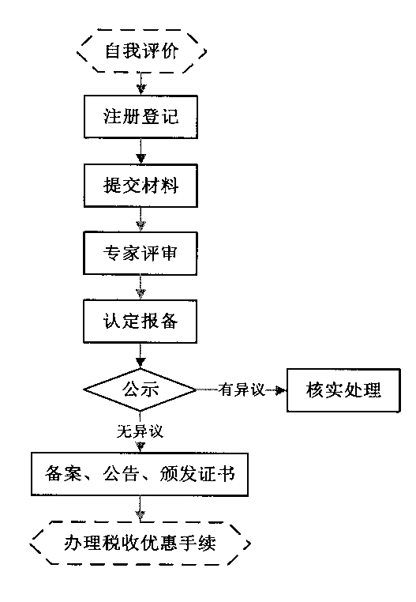

> **标题**：科技部 财政部 国家税务总局关于修订印发《高新技术企业认定管理工作指引》的通知
> **文号**：国科发火〔2016〕195号
> **成文日期**：2016年06月22日
> **发布日期**：2016年06月29日
> **发文机关**：科技部、财政部、国家税务总局
> **效力状态**：现行有效（官方页面标注：有效）
> **索引号**：306-18-2016-169
> **官方原文**：https://www.most.gov.cn/xxgk/xinxifenlei/fdzdgknr/fgzc/gfxwj/gfxwj2016/201606/t20160629_126169.html
> **核验**：2026-10-22 从上述官方页面抓取原始 HTML 后逐字转录，未作删改；正文每段之间空一行。官方 .doc 附件里靠空格对齐的表格与表单，本件用 ``` 围栏原样保留其版面，围栏标记是本件添加的唯一非原文字符。官方页面上的插图以本地文件形式保留，位置与官方页面一致。

# 高新技术企业认定管理工作指引

国科发火〔2016〕195号

各省、自治区、直辖市及计划单列市科技厅（委、局）、财政厅（局）、国家税务局、地方税务局：

根据《高新技术企业认定管理办法》（国科发火〔2016〕32号，以下称《认定办法》）第二十一条的规定，现将《高新技术企业认定管理工作指引》（以下称《工作指引》）印发给你们，并就有关事项通知如下：

一、2016年1月1日前已按《高新技术企业认定管理办法》（国科发火〔2008〕172号，以下称2008版《认定办法》）认定的仍在有效期内的高新技术企业，其资格依然有效，可依照《企业所得税法》及其实施条例等有关规定享受企业所得税优惠政策。

二、按2008版《认定办法》认定的高新技术企业，在2015年12月31日前发生2008版《认定办法》第十五条规定情况，且有关部门在2015年12月31日前已经做出处罚决定的，仍按2008版《认定办法》相关规定进行处理，认定机构5年内不再受理企业认定申请的处罚执行至2015年12月31日止。

三、本指引自2016年1月1日起实施。原《高新技术企业认定管理工作指引》（国科发火〔2008〕362号）、《关于高新技术企业更名和复审等有关事项的通知》（国科火字〔2011〕123号）同时废止。

科 技 部 财 政 部 国家税务总局

2016年6月22日

<!-- 《高新技术企业认定管理工作指引》全文（含附件1-8 表格）—— 官方 .doc 附件正文 -->

高新技术企业认定管理工作指引

```
              一、组织与实施
```

二、认定程序

三、认定条件

四、享受税收优惠

五、监督管理

```
              六、高新技术企业认定管理工作网
                  功能及操作提要
```

七、附件

根据《高新技术企业认定管理办法》（国科发火〔2016〕32号，以下称《认定办法》）的规定，制定本工作指引。

一、组织与实施

（一）领导小组办公室

全国高新技术企业认定管理工作领导小组办公室设在科技部火炬高技术产业开发中心，由科技部、财政部、税务总局相关人员组成，负责处理日常工作。

（二）认定机构

各省、自治区、直辖市、计划单列市科技行政管理部门同本级财政、税务部门组成本地区高新技术企业认定管理机构（以下称“认定机构”）。认定机构下设办公室，办公室设在省级、计划单列市科技行政主管部门，由省级、计划单列市科技、财政、税务部门相关人员组成。

认定机构组成部门应协同配合、认真负责地开展高新技术企业认定管理工作。

（三）中介机构

专项审计报告或鉴证报告（以下统称“专项报告”）应由符合以下条件的中介机构出具。企业可自行选择符合以下条件的中介机构。

1. 中介机构条件

（1）具备独立执业资格，成立三年以上，近三年内无不良记录。

（2）承担认定工作当年的注册会计师或税务师人数占职工全年月平均人数的比例不低于30%，全年月平均在职职工人数在20人以上。

（3）相关人员应具有良好的职业道德，了解国家科技、经济及产业政策，熟悉高新技术企业认定工作有关要求。

2. 中介机构职责

接受企业委托，委派具备资格的相关人员，依据《认定办法》和《工作指引》客观公正地对企业的研究开发费用和高新技术产品（服务）收入进行专项审计或鉴证，出具专项报告。

3. 中介机构纪律

中介机构及相关人员应坚持原则，办事公正，据实出具专项报告，对工作中出现严重失误或弄虚作假等行为的，由认定机构在“高新技术企业认定管理工作网”上公告，自公告之日起3年内不得参与高新技术企业认定相关工作。

（四）专家

1. 专家条件

（1）具有中华人民共和国公民资格，并在中国大陆境内居住和工作。

```
    （2）技术专家应具有高级技术职称，并具有《技术领域》内相关专业背景和实践经验，对该技术领域的发展及市场状况有较全面的了解。财务专家应具有相关高级技术职称，或具有注册会计师或税务师资格且从事财税工作10年以上。
    （3）具有良好的职业道德，坚持原则，办事公正。
```

（4）了解国家科技、经济及产业政策，熟悉高新技术企业认定工作有关要求。

```
    2. 专家库及专家选取办法
```

（1）认定机构应建立专家库（包括技术专家和财务专家），实行专家聘任制和动态管理，备选专家应不少于评审专家的3倍。

（2）认定机构根据企业主营产品（服务）的核心技术所属技术领域随机抽取专家，组成专家组，并指定1名技术专家担任专家组组长，开展认定评审工作。

```
    3. 专家职责
```

（1）审查企业的研究开发活动（项目）、年度财务会计报告和专项报告等是否符合《认定办法》及《工作指引》的要求。

（2）按照《认定办法》及《工作指引》的规定，评审专家对企业申报信息进行独立评价。技术专家应主要侧重对企业知识产权、研究开发活动、主营业务、成果转化及高新技术产品（服务）等情况进行评价打分；财务专家应参照中介机构提交的专项报告、企业的财务会计报告和纳税申报表等进行评价打分。

（3）在各评审专家独立评价的基础上，由专家组进行综合评价。

4. 专家纪律

（1）应按照《认定办法》、《工作指引》的要求，独立、客观、公正地对企业进行评价，并签订承诺书。

```
    （2）评审与其有利益关系的企业时，应主动申明并回避。
    （3）不得披露、使用申请企业的技术经济信息和商业秘密，不得复制保留或向他人扩散评审材料，不得泄露评审结果。
    （4）不得利用其特殊身份和影响，采取非正常手段为申请企业认定提供便利。
```

（5）认定评审期间，未经认定机构许可不得擅自与企业联系或进入企业调查。

```
    （6）不得收受申请企业给予的好处和利益。
```

一经发现违反上述规定，由认定机构取消其参与高新技术企业认定工作资格。

二、认定程序

（一）自我评价

企业应对照《认定办法》和本《工作指引》进行自我评价。

（二）注册登记

企业登录“高新技术企业认定管理工作网”（网址：www.innocom.gov.cn），按要求填写《企业注册登记表》（附件1），并通过网络系统提交至认定机构。认定机构核对企业注册信息，在网络系统上确认激活后，企业可以开展后续申报工作。

（三）提交材料

企业登录“高新技术企业认定管理工作网”，按要求填写《高新技术企业认定申请书》（附件2），通过网络系统提交至认定机构，并向认定机构提交下列书面材料：

1. 《高新技术企业认定申请书》（在线打印并签名、加盖企业公章）；

2. 证明企业依法成立的《营业执照》等相关注册登记证件的复印件；

3. 知识产权相关材料（知识产权证书及反映技术水平的证明材料、参与制定标准情况等）、科研项目立项证明（已验收或结题项目需附验收或结题报告）、科技成果转化（总体情况与转化形式、应用成效的逐项说明）、研究开发组织管理（总体情况与四项指标符合情况的具体说明）等相关材料；

4. 企业高新技术产品（服务）的关键技术和技术指标的具体说明，相关的生产批文、认证认可和资质证书、产品质量检验报告等材料；

5. 企业职工和科技人员情况说明材料，包括在职、兼职和临时聘用人员人数、人员学历结构、科技人员名单及其工作岗位等；

6. 经具有资质并符合本《工作指引》相关条件的中介机构出具的企业近三个会计年度（实际年限不足三年的按实际经营年限，下同）研究开发费用、近一个会计年度高新技术产品（服务）收入专项审计或鉴证报告，并附研究开发活动说明材料；

7. 经具有资质的中介机构鉴证的企业近三个会计年度的财务会计报告（包括会计报表、会计报表附注和财务情况说明书）；

8. 近三个会计年度企业所得税年度纳税申报表（包括主表及附表）。

对涉密企业，须将申请认定高新技术企业的申报材料做脱密处理，确保涉密信息安全。

（四）专家评审

认定机构收到企业申请材料后，根据企业主营产品（服务）的核心技术所属技术领域在符合评审要求的专家中，随机抽取专家组成专家组，对每个企业的评审专家不少于5人（其中技术专家不少于60%，并至少有1名财务专家）。每名技术专家单独填写《高新技术企业认定技术专家评价表》（附件3），每名财务专家单独填写《高新技术企业认定财务专家评价表》（附件4），专家组长汇总各位专家分数，按分数平均值填写《高新技术企业认定专家组综合评价表》（附件5）。具备条件的地区可进行网络评审。

（五）认定报备

认定机构结合专家组评审意见，对申请企业申报材料进行综合审查（可视情况对部分企业进行实地核查），提出认定意见，确定认定高新技术企业名单，报领导小组办公室备案，报送时间不得晚于每年11月底。

（六）公示公告

经认定报备的企业名单，由领导小组办公室在“高新技术企业认定管理工作网”公示10个工作日。无异议的，予以备案，认定时间以公示时间为准，核发证书编号，并在“高新技术企业认定管理工作网”上公告企业名单，由认定机构向企业颁发统一印制的“高新技术企业证书”（加盖认定机构科技、财政、税务部门公章）；有异议的，须以书面形式实名向领导小组办公室提出，由认定机构核实处理。

领导小组办公室对报备企业可进行随机抽查，对存在问题的企业交由认定机构核实情况并提出处理建议。

认定流程如下图所示：





三、认定条件

（一）年限

《认定办法》第十一条“须注册成立一年以上”是指企业须注册成立365个日历天数以上；“当年”、“最近一年”和“近一年”都是指企业申报前1个会计年度；“近三个会计年度”是指企业申报前的连续3个会计年度（不含申报年）；“申请认定前一年内”是指申请前的365天之内（含申报年）。

（二）知识产权

1. 高新技术企业认定所指的知识产权须在中国境内授权或审批审定，并在中国法律的有效保护期内。知识产权权属人应为申请企业。

2. 不具备知识产权的企业不能认定为高新技术企业。

3. 高新技术企业认定中，对企业知识产权情况采用分类评价方式，其中：发明专利（含国防专利）、植物新品种、国家级农作物品种、国家新药、国家一级中药保护品种、集成电路布图设计专有权等按Ⅰ类评价；实用新型专利、外观设计专利、软件著作权等（不含商标）按Ⅱ类评价。

4. 按Ⅱ类评价的知识产权在申请高新技术企业时，仅限使用一次。

5. 在申请高新技术企业及高新技术企业资格存续期内，知识产权有多个权属人时，只能由一个权属人在申请时使用。

6. 申请认定时专利的有效性以企业申请认定前获得授权证书或授权通知书并能提供缴费收据为准。

7. 发明、实用新型、外观设计、集成电路布图设计专有权可在国家知识产权局网站（http://www.sipo.gov.cn）查询专利标记和专利号；国防专利须提供国家知识产权局授予的国防专利证书；植物新品种可在农业部植物新品种保护办公室网站和国家林业局植物新品种保护办公室网站（http://www.cnpvp.net）查询；国家级农作物品种是指农业部国家农作物品种审定委员会审定公告的农作物品种；国家新药须提供国家食品药品监督管理局签发的新药证书；国家一级中药保护品种须提供国家食品药品监督管理局签发的中药保护品种证书；软件著作权可在国家版权局中国版权保护中心网站(http://www.ccopyright.com.cn)查询软件著作权标记（亦称版权标记）。

（三）高新技术产品（服务）与主要产品（服务）

高新技术产品（服务）是指对其发挥核心支持作用的技术属于《国家重点支持的高新技术领域》规定范围的产品（服务）。

主要产品（服务）是指高新技术产品（服务）中，拥有在技术上发挥核心支持作用的知识产权的所有权，且收入之和在企业同期高新技术产品（服务）收入中超过50%的产品（服务）。

（四）高新技术产品（服务）收入占比

高新技术产品（服务）收入占比是指高新技术产品（服务）收入与同期总收入的比值。

1. 高新技术产品（服务）收入

高新技术产品（服务）收入是指企业通过研发和相关技术创新活动，取得的产品（服务）收入与技术性收入的总和。对企业取得上述收入发挥核心支持作用的技术应属于《技术领域》规定的范围。其中，技术性收入包括：

```
    （1）技术转让收入：指企业技术创新成果通过技术贸易、技术转让所获得的收入；
```

（2）技术服务收入：指企业利用自己的人力、物力和数据系统等为社会和本企业外的用户提供技术资料、技术咨询与市场评估、工程技术项目设计、数据处理、测试分析及其他类型的服务所获得的收入；

（3）接受委托研究开发收入：指企业承担社会各方面委托研究开发、中间试验及新产品开发所获得的收入。

企业应正确计算高新技术产品（服务）收入，由具有资质并符合本《工作指引》相关条件的中介机构进行专项审计或鉴证。

2. 总收入

总收入是指收入总额减去不征税收入。

收入总额与不征税收入按照《中华人民共和国企业所得税法》（以下称《企业所得税法》）及《中华人民共和国企业所得税法实施条例》（以下称《实施条例》）的规定计算。

（五）企业科技人员占比

企业科技人员占比是企业科技人员数与职工总数的比值。

1. 科技人员

企业科技人员是指直接从事研发和相关技术创新活动，以及专门从事上述活动的管理和提供直接技术服务的，累计实际工作时间在183天以上的人员，包括在职、兼职和临时聘用人员。

2. 职工总数

企业职工总数包括企业在职、兼职和临时聘用人员。在职人员可以通过企业是否签订了劳动合同或缴纳社会保险费来鉴别；兼职、临时聘用人员全年须在企业累计工作183天以上。

3. 统计方法

企业当年职工总数、科技人员数均按照全年月平均数计算。

月平均数＝（月初数＋月末数）÷2

全年月平均数＝全年各月平均数之和÷12

年度中间开业或者终止经营活动的，以其实际经营期作为一个纳税年度确定上述相关指标。

（六）企业研究开发费用占比

企业研究开发费用占比是企业近三个会计年度的研究开发费用总额占同期销售收入总额的比值。

1. 企业研究开发活动确定

研究开发活动是指，为获得科学与技术（不包括社会科学、艺术或人文学）新知识，创造性运用科学技术新知识，或实质性改进技术、产品（服务）、工艺而持续进行的具有明确目标的活动。不包括企业对产品（服务）的常规性升级或对某项科研成果直接应用等活动（如直接采用新的材料、装置、产品、服务、工艺或知识等）。

企业应按照研究开发活动的定义填写附件2《高新技术企业认定申请书》中的“四、企业研究开发活动情况表”。

专家评价过程中可参考如下方法判断：

——行业标准判断法。若国家有关部门、全国（世界）性行业协会等具备相应资质的机构提供了测定科技“新知识”、“创造性运用科学技术新知识”或“具有实质性改进的技术、产品（服务）、工艺”等技术参数（标准），则优先按此参数（标准）来判断企业所进行项目是否为研究开发活动。

——专家判断法。如果企业所在行业中没有发布公认的研发活动测度标准，则通过本行业专家进行判断。获得新知识、创造性运用新知识以及技术的实质改进，应当是取得被同行业专家认可的、有价值的创新成果，对本地区相关行业的技术进步具有推动作用。

——目标或结果判定法。在采用行业标准判断法和专家判断法不易判断企业是否发生了研发活动时，以本方法作为辅助。重点了解研发活动的目的、创新性、投入资源（预算），以及是否取得了最终成果或中间成果（如专利等知识产权或其他形式的科技成果）。

2. 研究开发费用的归集范围

（1）人员人工费用

包括企业科技人员的工资薪金、基本养老保险费、基本医疗保险费、失业保险费、工伤保险费、生育保险费和住房公积金，以及外聘科技人员的劳务费用。

（2）直接投入费用

直接投入费用是指企业为实施研究开发活动而实际发生的相关支出。包括：

——直接消耗的材料、燃料和动力费用；

——用于中间试验和产品试制的模具、工艺装备开发及制造费，不构成固定资产的样品、样机及一般测试手段购置费，试制产品的检验费；

——用于研究开发活动的仪器、设备的运行维护、调整、检验、检测、维修等费用，以及通过经营租赁方式租入的用于研发活动的固定资产租赁费。

（3）折旧费用与长期待摊费用

折旧费用是指用于研究开发活动的仪器、设备和在用建筑物的折旧费。

长期待摊费用是指研发设施的改建、改装、装修和修理过程中发生的长期待摊费用。

（4）无形资产摊销费用

无形资产摊销费用是指用于研究开发活动的软件、知识产权、非专利技术（专有技术、许可证、设计和计算方法等）的摊销费用。

（5）设计费用

设计费用是指为新产品和新工艺进行构思、开发和制造，进行工序、技术规范、规程制定、操作特性方面的设计等发生的费用。包括为获得创新性、创意性、突破性产品进行的创意设计活动发生的相关费用。

（6）装备调试费用与试验费用

装备调试费用是指工装准备过程中研究开发活动所发生的费用，包括研制特殊、专用的生产机器，改变生产和质量控制程序，或制定新方法及标准等活动所发生的费用。

为大规模批量化和商业化生产所进行的常规性工装准备和工业工程发生的费用不能计入归集范围。

试验费用包括新药研制的临床试验费、勘探开发技术的现场试验费、田间试验费等。

（7）委托外部研究开发费用

委托外部研究开发费用是指企业委托境内外其他机构或个人进行研究开发活动所发生的费用（研究开发活动成果为委托方企业拥有，且与该企业的主要经营业务紧密相关）。委托外部研究开发费用的实际发生额应按照独立交易原则确定，按照实际发生额的80%计入委托方研发费用总额。

（8）其他费用

其他费用是指上述费用之外与研究开发活动直接相关的其他费用，包括技术图书资料费、资料翻译费、专家咨询费、高新科技研发保险费，研发成果的检索、论证、评审、鉴定、验收费用，知识产权的申请费、注册费、代理费，会议费、差旅费、通讯费等。此项费用一般不得超过研究开发总费用的20%，另有规定的除外。

3. 企业在中国境内发生的研究开发费用

企业在中国境内发生的研究开发费用，是指企业内部研究开发活动实际支出的全部费用与委托境内其他机构或个人进行的研究开发活动所支出的费用之和，不包括委托境外机构或个人完成的研究开发活动所发生的费用。受托研发的境外机构是指依照外国和地区（含港澳台）法律成立的企业和其他取得收入的组织；受托研发的境外个人是指外籍（含港澳台）个人。

4. 企业研究开发费用归集办法

企业应正确归集研发费用，由具有资质并符合本《工作指引》相关条件的中介机构进行专项审计或鉴证。

企业的研究开发费用是以单个研发活动为基本单位分别进行测度并加总计算的。企业应对包括直接研究开发活动和可以计入的间接研究开发活动所发生的费用进行归集，并填写附件2《高新技术企业认定申请书》中的“企业年度研究开发费用结构明细表”。

企业应按照“企业年度研究开发费用结构明细表”设置高新技术企业认定专用研究开发费用辅助核算账目，提供相关凭证及明细表，并按本《工作指引》要求进行核算。

5. 销售收入

销售收入为主营业务收入与其他业务收入之和。

主营业务收入与其他业务收入按照企业所得税年度纳税申报表的口径计算。

（七）企业创新能力评价

企业创新能力主要从知识产权、科技成果转化能力、研究开发组织管理水平、企业成长性等四项指标进行评价。各级指标均按整数打分，满分为100分，综合得分达到70分以上（不含70分）为符合认定要求。四项指标分值结构详见下表：

序号

指   标

分值

1

知识产权

≤30

2

科技成果转化能力

≤30

3

研究开发组织管理水平

≤20

4

企业成长性

≤20

```
    1. 知识产权（≤30分）
```

由技术专家对企业申报的知识产权是否符合《认定办法》和《工作指引》要求，进行定性与定量结合的评价。

序号

知识产权相关评价指标

分值

1

技术的先进程度

≤8

2

对主要产品（服务）在技术上发挥核心支持作用

≤8

3

知识产权数量

≤8

4

知识产权获得方式

≤6

5

（作为参考条件，最多加2分）

企业参与编制国家标准、行业标准、检测方法、技术规范的情况

≤2

（1）技术的先进程度

```
      A. 高  （7-8分）     B. 较高（5-6分）
      C. 一般（3-4分）     D. 较低（1-2分）
      E. 无  （0分）
```

（2）对主要产品（服务）在技术上发挥核心支持作用

```
      A. 强  （7-8分）     B. 较强（5-6分）
      C. 一般（3-4分）     D. 较弱（1-2分）
      E. 无  （0分）
```

（3）知识产权数量

```
      A. 1项及以上 （Ⅰ类）（7-8分）
      B. 5项及以上 （Ⅱ类）（5-6分）
      C. 3～4项    （Ⅱ类）（3-4分）
      D. 1～2项    （Ⅱ类）（1-2分）
      E. 0项              （0分）
```

（4）知识产权获得方式

```
      A. 有自主研发            （1-6分）
          B. 仅有受让、受赠和并购等（1-3分）
```

（5）企业参与编制国家标准、行业标准、检测方法、技术规范的情况（此项为加分项，加分后“知识产权”总分不超过30分。相关标准、方法和规范须经国家有关部门认证认可。)

```
      A. 是 （1-2分）
          B. 否 （0分）
```

2. 科技成果转化能力（≤30分）

依照《促进科技成果转化法》，科技成果是指通过科学研究与技术开发所产生的具有实用价值的成果（专利、版权、集成电路布图设计等）。科技成果转化是指为提高生产力水平而对科技成果进行的后续试验、开发、应用、推广直至形成新产品、新工艺、新材料，发展新产业等活动。

科技成果转化形式包括：自行投资实施转化；向他人转让该技术成果；许可他人使用该科技成果；以该科技成果作为合作条件，与他人共同实施转化；以该科技成果作价投资、折算股份或者出资比例；以及其他协商确定的方式。

由技术专家根据企业科技成果转化总体情况和近3年内科技成果转化的年平均数进行综合评价。同一科技成果分别在国内外转化的，或转化为多个产品、服务、工艺、样品、样机等的，只计为一项。

```
    A. 转化能力强，  ≥5项 （25-30分）
    B. 转化能力较强，≥4项 （19-24分）
    C. 转化能力一般，≥3项 （13-18分）
        D. 转化能力较弱，≥2项 （7-12分）
        E. 转化能力弱，  ≥1项 （1-6分）
        F. 转化能力无，    0项 （0分）
```

3. 研究开发组织管理水平（≤20分）

由技术专家根据企业研究开发与技术创新组织管理的总体情况，结合以下几项评价，进行综合打分。

（1）制定了企业研究开发的组织管理制度，建立了研发投入核算体系，编制了研发费用辅助账；（≤6分）

（2）设立了内部科学技术研究开发机构并具备相应的科研条件，与国内外研究开发机构开展多种形式产学研合作；（≤6分）

（3）建立了科技成果转化的组织实施与激励奖励制度，建立开放式的创新创业平台；（≤4分）

（4）建立了科技人员的培养进修、职工技能培训、优秀人才引进，以及人才绩效评价奖励制度。（≤4分）

4. 企业成长性（≤20分）

由财务专家选取企业净资产增长率、销售收入增长率等指标对企业成长性进行评价。企业实际经营期不满三年的按实际经营时间计算。计算方法如下：

（1）净资产增长率

净资产增长率＝1/2（第二年末净资产÷第一年末净资产＋第三年末净资产÷第二年末净资产）－1

净资产 = 资产总额 － 负债总额

资产总额、负债总额应以具有资质的中介机构鉴证的企业会计报表期末数为准。

（2）销售收入增长率

销售收入增长率＝1/2（第二年销售收入÷第一年销售收入＋第三年销售收入÷第二年销售收入）－1

企业净资产增长率或销售收入增长率为负的，按0分计算。第一年末净资产或销售收入为0的，按后两年计算；第二年末净资产或销售收入为0的，按0分计算。

以上两个指标分别对照下表评价档次（ABCDEF）得出分值，两项得分相加计算出企业成长性指标综合得分。

成长性得分

指标

赋值

分  数

≥35%

≥25%

≥15%

≥5%

﹥0

≤0

≤20分

净资产增长率赋值

≤10分

A

9-10分

B

7-8分

C

5-6分

D

3-4分

E

1-2分

F

0分

销售收入增长率赋值

≤10分

四、享受税收优惠

1. 自认定当年起，企业可持“高新技术企业”证书及其复印件，按照《企业所得税法》及《实施条例》、《中华人民共和国税收征收管理法》（以下称《税收征管法》）、《中华人民共和国税收征收管理法实施细则》（以下称《实施细则》）、《认定办法》和本《工作指引》等有关规定，到主管税务机关办理相关手续，享受税收优惠。

2. 未取得高新技术企业资格或不符合《企业所得税法》及其《实施条例》、《税收征管法》及其《实施细则》，以及《认定办法》等有关规定条件的企业，不得享受高新技术企业税收优惠。

3. 高新技术企业资格期满当年内，在通过重新认定前，其企业所得税暂按15%的税率预缴，在年度汇算清缴前未取得高新技术企业资格的，应按规定补缴税款。

五、监督管理

（一）重点检查

根据认定管理工作需要，科技部、财政部、税务总局按照《认定办法》的要求，可组织专家对各地高新技术企业认定管理工作进行重点检查，对存在问题的视情况给予相应处理。

（二）企业年报

企业获得高新技术企业资格后，在其资格有效期内应每年5月底前通过“高新技术企业认定管理工作网”，报送上一年度知识产权、科技人员、研发费用、经营收入等年度发展情况报表（附件6）；在同一高新技术企业资格有效期内，企业累计两年未按规定时限报送年度发展情况报表的，由认定机构取消其高新技术企业资格，在“高新技术企业认定管理工作网”上公告。

认定机构应提醒、督促企业及时填报年度发展情况报表，并协助企业处理填报过程中的相关问题。

（三）复核

对已认定的高新技术企业，有关部门在日常管理过程中发现其不符合认定条件的，应以书面形式提请认定机构复核。复核后确认不符合认定条件的，由认定机构取消其高新技术企业资格，并通知税务机关追缴其不符合认定条件年度起已享受的税收优惠。

属于对是否符合《认定办法》第十一条（除（五）款外）、第十七条、第十八条和第十九条情况的企业，按《认定办法》规定办理；属于对是否符合《认定办法》第十一条（五）款产生异议的，应以问题所属年度和前两个会计年度（实际经营不满三年的按实际经营时间计算）的研究开发费用总额与同期销售收入总额之比是否符合《认定办法》第十一条（五）款规定进行复核。

（四）更名及重大变化事项

高新技术企业发生名称变更或与认定条件有关的重大变化（如分立、合并、重组以及经营业务发生变化等），应在发生之日起三个月内向认定机构报告，在“高新技术企业认定管理工作网”上提交《高新技术企业名称变更申请表》（附件7），并将打印出的《高新技术企业名称变更申请表》与相关证明材料报认定机构，由认定机构负责审核企业是否仍符合高新技术企业条件。

企业仅发生名称变更，不涉及重大变化，符合高新技术企业认定条件的，由认定机构在本地区公示10个工作日，无异议的，由认定机构重新核发认定证书，编号与有效期不变，并在“高新技术企业认定管理工作网”上公告；有异议的或有重大变化的（无论名称变更与否），由认定机构按《认定办法》第十一条进行核实处理，不符合认定条件的，自更名或条件变化年度起取消其高新技术企业资格，并在“高新技术企业认定管理工作网”上公告。

（五）异地搬迁

1. 《认定办法》第十八条中整体迁移是指符合《中华人民共和国公司登记管理条例》第二十九条所述情况。

2. 跨认定机构管理区域整体迁移的高新技术企业须向迁入地认定机构提交有效期内的《高新技术企业证书》及迁入地工商等登记管理机关核发的完成迁入的相关证明材料。

3. 完成整体迁移的，其高新技术企业资格和《高新技术企业证书》继续有效，编号与有效期不变。由迁入地认定机构给企业出具证明材料，并在“高新技术企业认定管理工作网”上公告。

（六）其他

1. 有《认定办法》第十九条所列三种行为之一的企业，自行为发生之日所属年度起取消其高新技术企业资格，并在“高新技术企业认定管理工作网”上公告。

2. 认定机构应依据有关部门根据相关法律法规出具的意见对“重大安全、重大质量事故或有严重环境违法行为”进行判定处理。

3. 已认定的高新技术企业，无论何种原因被取消高新技术企业资格的，当年不得再次申请高新技术企业认定。

六、高新技术企业认定管理工作网功能及操作提要

“高新技术企业认定管理工作网”是根据《认定办法》建设的高新技术企业认定管理工作的信息化平台，由高新技术企业认定管理工作门户网站（以下简称“门户网站”）和高新技术企业认定管理系统（以下简称“管理系统”）构成。

（一）门户网站主要功能

门户网站（www.innocom.gov.cn）的主要功能包括：发布高新技术企业政策、工作动态、公示文件，公告备案、更名、异地搬迁、撤销资格、问题中介机构名单等信息，以及提供管理系统的登录入口。

（二）管理系统主要功能

管理系统由企业申报系统、认定机构管理系统和领导小组办公室管理系统三个子系统组成。

1. 企业申报系统主要功能

（1）企业注册

（2）企业信息变更

（3）企业名称变更

（4）认定申报

（5）年度发展情况报表

（6）查询

（7）密码找回

2. 认定机构管理系统主要功能

（1）企业注册管理

（2）认定申报管理

（3）撤销企业高企证书管理

（4）异地搬迁企业管理

（5）查询与统计

3. 领导小组办公室管理系统主要功能

（1）高企备案管理

（2）撤销企业高企证书管理

（3）异地搬迁企业管理

（4）查询与统计

附件1

企业注册登记表

企业名称

注册时间

注册类型

外资来源地

注册资金

所属行业

企业规模

行政区域

组织机构代码/统一社会信用代码

税务登记号/统一社会信用代码

企业所得税主管税务机关

□国税   □地税

企业所得税

征收方式

□查账征收  □核定征收

通信地址

邮政编码

企业法定

代表人

姓名

手机

身份证号/护照号

电话

传真

E-mail

联系人

姓名

手机

电话

传真

E-mail

企业是否上市

□是   □否

上市时间

股票代码

上市类型

是否属于国家级高新区内企业

□是  □否

高新区名称

附件2

```
                          系统填报号：
```

高新技术企业认定申请书

企业名称：

企业所在地区：      省     市(区、自治州)

认定机构：

```
  申请日期：            年      月      日
```

声明：本申请书上填写的有关内容和提交的资料均准确、真实、合法、有效、无涉密信息，本企业愿为此承担有关法律责任。

```
  法定代表人（签名）:           （企业公章）
```

科技部、财政部、国家税务总局编制

二O一六年六月

填  报  说  明

企业应参照《高新技术企业认定管理办法》、《国家重点支持的高新技术领域》（国科发火〔2016〕32号）和《高新技术企业认定管理工作指引》（国科发火〔2016〕195号）的要求填报。

本表内的所有财务数据须出自专项报告、财务会计报告或纳税申报表。

1. 企业应如实填报所附各表。要求文字简洁，数据准确、详实。

2. 各栏目不得空缺，无内容填写“0”；数据有小数时，保留小数点后2位。

3. 对企业知识产权情况采用分类评价方式，其中：发明专利（含国防专利）、植物新品种、国家级农作物品种、国家新药、国家一级中药保护品种、集成电路布图设计专有权等按Ⅰ类评价；实用新型专利、外观设计专利、软件著作权等（不含商标）按Ⅱ类评价。

4. “基础研究投入费用总额”是指：企业研究开发费用总额中，为获得科学与技术（不包括社会科学、艺术或人文学）新知识等基础研究活动支出的费用总额。

5. 销售收入 = 主营业务收入 + 其他业务收入

```
 企业总收入 = 收入总额 - 不征税收入
 净资产 = 资产总额 - 负债总额
```

6. “近三年”、“近一年”和“申请认定前一年内”：详见《工作指引》三（一）“年限”中的说明，“近三年”即“年限”中的“近三个会计年度”。

7. “研发活动”：详见《工作指引》三（六）1中“研究开发活动确定”。

8. “高新技术产品（服务）收入”：详见《工作指引》三（四）1中“高新技术产品（服务）收入”的定义。

9. IP代表知识产权编号；RD代表研究开发活动编号；PS代表高新技术产品（服务）编号。IP、RD、PS后取两位数（01、02、……）。

一、主要情况

技术领域

获得知识产权

数量(件)

Ⅰ类

Ⅱ类

人力资源

情况（人）

职工总数

科技人员数

近三年

经营情况

（万元）

年度

种类

净资产

销售收入

利润总额

第一年

第二年

第三年

近三年研究开发费用总额

（万元）

其

中

在中国境内

研发费用

总额（万元）

基础研究投入费用总额

（万元）

近一年企业总收入（万元）

近一年高新技术产品（服务）收入（万元）

申请认定前一年内是否发生过重大安全、

重大质量事故或严重环境违法行为

□是     □否

二、知识产权汇总表

获得

知识产权

数量(件)

发明专利

其中：国防专利

植物新品种

国家级农作物品种

国家新药

国家一级中药保护品种

集成电路布图

设计专有权

实用新型

外观设计

软件著作权

知识产权编号

知识产权名称

类别

授权日期

授权号

获得方式

IP…

三、人力资源情况表

（一）总体情况

企业职工

科技人员

总   数（人）

其中：在职人员

兼职人员

```
    临时聘用人员
```

外籍人员

```
    留学归国人员
    千人计划人员
```

（二）全体人员结构

学  历

博  士

硕  士

本  科

大专及以下

人  数

职  称

高级职称

中级职称

初级职称

高级技工

人  数

年  龄

30及以下

31-40

41-50

51及以上

人  数

四、企业研究开发活动情况表（近三年执行的活动，按单一活动填报）

研发活动编号：RD…

研发活动名称

起止时间

技术领域

技术来源

知识产权编号

研发经费

总预算

（万元）

研发经费

近三年总支出

（万元）

其中

第一年

第二年

第三年

目的及组织实施方式

（限400字）

核心技术及

创新点

（限400字）

取得的

阶段性成果

（限400字）

五、企业年度研究开发费用结构明细表(按近三年每年分别填报)

```
         年度                                      单位：万元
```

科目

累计发生额

研发项目编号

RD01

RD02

RD03

…

RD…

合计

内部研究开发费用

```
 其中：人员人工费用
       直接投入费用
       折旧费用与长期待摊费用
        无形资产摊销费用
       设计费用
       装备调试费用与试验费用
       其他费用
```

委托外部研究开发费用

```
 其中：境内的外部研发费用
```

研究开发费用（内、外部）小计

```
   企业填报人签字：                         日  期：
```

六、上年度高新技术产品（服务）情况表（按单一产品（服务）填报）

编号：PS…

产品（服务）名称

技术领域

技术来源

上年度销售收入

（万元）

是否主要产品

（服务）

□是     □否

知识产权编号

关键技术

及主要

技术指标

（限400字）

与同类产品

（服务）的

竞争优势

（限400字）

知识产权获得情况及其对产品（服务）在技术上发挥的支持作用

（限400字）

七、企业创新能力

知识产权对企业

竞争力的作用

（限400字）

科技成果转化情况

（限400字）

研究开发与技术创新组织管理情况

（限400字）

管理与科技人员

情况

（限400字）

八、（加分项）企业参与国家标准或行业标准制定情况汇总表

序号

标准名称

标准级别

标准编号

参与方式

□国家  □行业

□主持  □参与

□国家  □行业

□主持  □参与

□国家  □行业

□主持  □参与

附件3

高新技术企业认定技术专家评价表

企业名称

企业提交的资料是否符合要求

□是     □否

企业是否注册成立

一年以上

□是     □否

企业是否获得符合条件的

知识产权

□是     □否

核心技术是否属于《技术领域》规定的范围

□是     □否

```
      （若“是”，请填写3级技术领域标题或编号）
```

科技人员占比是否符合要求

□是     □否

近三年

研发费用

研发活动核定数

核除研发活动编号

核定总额

（万元）

其中：境内核定总额

（万元）

近一年高新技术产品（服务）

收入

产品（服务）

核定数

核除产品（服务）编号

收入核定总额

（万元）

1. 知识产权（≤30分）

得分：

技术的先进程度（≤8分）

```
      □A. 高  （7-8分）        □B. 较高（5-6分）
      □C. 一般（3-4分）        □D. 较低（1-2分）
      □E. 无  （0分）
```

得分：

对主要产品（服务）在技术上发挥核心支持作用（≤8分）

```
      □A. 强  （7-8分）        □B. 较强（5-6分）
      □C. 一般（3-4分）        □D. 较弱（1-2分）
      □E. 无  （0分）
```

得分：

知识产权数量（≤8分）

```
      □A.  1项及以上（Ⅰ类）（7-8分）
      □B.  5项及以上（Ⅱ类）（5-6分）
      □C.  3～4项   （Ⅱ类）（3-4分）
      □D.  1～2项   （Ⅱ类）（1-2分）
      □E.  0项             （0分）
```

得分：

知识产权获得方式（≤6分）

```
      □A. 有自主研发            （1-6分）
      □B. 仅有受让、受赠和并购等（1-3分）
```

得分：

（加分项，≤2分）企业是否参与编制国家标准、行业标准、检测方法、技术规范的情况

```
      □A. 是（1-2分）         □B. 否（0分）
```

得分：

2. 科技成果转化能力（≤30分）

得分：

```
 □A. 转化能力强，  ≥5项（25-30分）  □B. 转化能力较强，≥4项（19-24分）
 □C. 转化能力一般，≥3项（13-18分）  □D. 转化能力较弱，≥2项（7-12分）
 □E. 转化能力弱，  ≥1项（1-6分）    □F. 转化能力无，    0项（0分）
```

3. 研究开发组织管理水平（≤20分）

得分：

制定了企业研究开发的组织管理制度，建立了研发投入核算体系，编制了研发费用辅助账（≤6分）

得分：

设立了内部科学技术研究开发机构并具备相应的科研条件，与国内外研究开发机构开展多种形式的产学研合作（≤6分）

得分：

建立了科技成果转化的组织实施与激励奖励制度，建立开放式的创新创业平台（≤4分）

得分：

建立了科技人员的培养进修、职工技能培训、优秀人才引进，以及人才绩效评价奖励制度（≤4分）

得分：

对企业技术创新能力的综合评价

合计得分

专家签名：                年   月   日

注：各项均按整数打分。

附件4

高新技术企业认定财务专家评价表

企业名称

企业提交的财务资料是否符合要求

□是     □否

中介机构资质

是否符合要求

□是   □否

中介机构出具的审计（鉴证）报告是否符合要求

□是    □否

近三年研究开发费用归集是否符合要求

□是   □否

近一年高新技术产品（服务）收入归集是否符合要求

□是    □否

近三年

销售收入

（万元）

第一年

近三年

净资产

（万元）

第一年

第二年

第二年

第三年

第三年

净资产增长率

销售收入增长率

近三年销售收入合计（万元）

近一年企业总收入

（万元）

企业成长性（≤20分）

合计：

净资产增长率（≤10分）

```
    □A. ≥35% （9-10分）        □B. ≥25% （7-8分）
    □C. ≥15% （5-6分）         □D. ＞5%  （3-4分）
    □E. ＞0    （1-2分）         □F. ≤0    （0分）
```

得分：

销售收入增长率（≤10分）

```
    □A. ≥35% （9-10分）        □B. ≥25% （7-8分）
    □C. ≥15% （5-6分）         □D. ＞5%  （3-4分）
    □E. ＞0    （1-2分）         □F. ≤0    （0分）
```

得分：

对企业财务状况的

综合评价

专家签名：                                                年     月     日

附件5

高新技术企业认定专家组综合评价表

企业名称

企业是否注册成立一年以上

□是     □否

企业是否获得符合条件的

知识产权

□是     □否

核心技术是否属于《技术领域》规定的范围

□是     □否

```
        （若“是”，请填写3级技术领域标题或编号）
```

科技人员占企业职工总数的比例（%）

是否

符合

条件

□是  □否

近三年研究开发费用总额占同期销售收入总额比例（%）

□是  □否

近三年在中国境内研发费用总额占全部研发费用总额比例（%）

□是  □否

近一年高新技术产品（服务）收入占同期总收入比例（%）

□是  □否

创新能力评价

总分

1. 知识产权得分

3. 研究开发组织管理水平得分

```
    技术先进程度
     组织管理制度
    核心支持作用
     研发机构
    知识产权数量
     成果转化奖励制度
    知识产权获得方式
     人才绩效制度
   （加分）参与标准制定
```

4. 成长指标得分

2. 科技成果转化能力得分

```
      净资产增长率
     销售收入增长率
```

综合评价是否符合认定条件：        □是            □否

否（简述理由）

专家组长签字：                                             年     月     日

附件6

```
         年度高新技术企业发展情况报表
```

企业名称

组织机构代码/

统一社会信用代码

所属地区

高新技术企业

认定证书编号

高新技术企业认定时间

企业联系人

联系电话

本年度

获得的

知识产权数

（件）

发明专利

其中：国防专利

植物新品种

国家级农作物品种

国家新药

国家一级中药保护品种

集成电路布图

设计专有权

实用新型

外观设计

软件著作权

本年度

人员情况

（人）

职工总数

科技人员数

新增就业人数

其中：吸纳高校应届毕业生人数

企业本年度

财务状况

（万元）

总收入

销售收入

净资产

高新技术产品（服务）收入

纳税总额

企业所得税减免额

利润总额

出口创汇总额

（万美元）

研究开发费用额

其中

在中国境内

研发费用额

基础研究投入

费用总额

企业是否上市

□是        □否

上市时间

股票代码

上市类型

注：以上信息应按《高新技术企业认定管理办法》和《高新技术企业认定管理工作指引》

的规定填报。

附件7

高新技术企业名称变更申请表

```
 企业名称
```

变更前

变更后

高新技术企业证书编号

发证日期

联系人

联系电话

企业名称历史变更情况（认定高新技术企业后）

序号

变更时间

变更内容

企业更名原因（限100字内）

承 诺：

```
    以上填报内容及附件信息属实。
                                            法人签字：
                                            申请企业（盖章）：
                                                年    月    日
```

附件8

专家承诺书

我承诺，按照《高新技术企业认定管理办法》和《高新技术企业认定管理工作指引》的要求，履行评审专家职责，遵守评审专家纪律，做到：

1. 独立、客观、公正地对申请企业材料进行评价。

2. 评审与自身有利益关系的企业时，主动申明并回避。

3. 不披露、使用申请企业的技术经济信息和商业秘密，不复制保留或向他人扩散评审材料，不泄露评审结果。

4. 不利用特殊身份和影响，采取非正常手段为申请企业认定提供便利。

5. 认定评审期间，未经认定机构许可不擅自与企业联系或进入企业调查。

6. 不收受申请企业给予的任何好处和利益。

```
                          承诺专家：
                              日期：
```

科学技术部办公厅                       2016年6月27日印发
